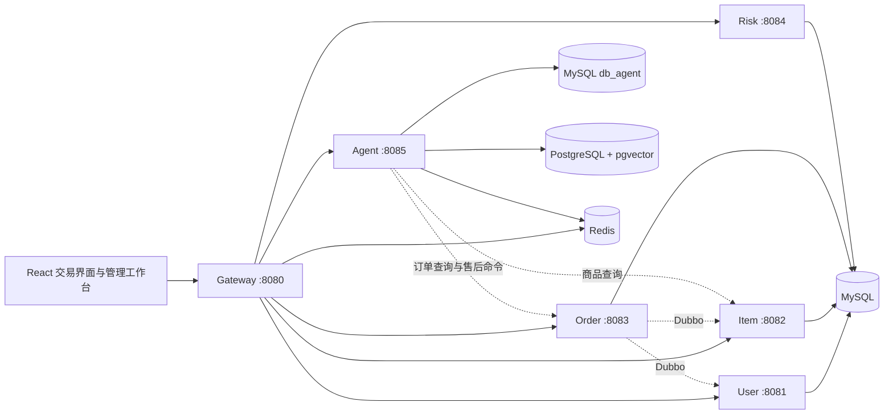

# 虚拟资产 C2C 交易平台

基于 Java 微服务与 React 的虚拟资产交易项目，覆盖商品发布、担保交易、卡密交付、支付与对账、售后仲裁、风控处置，以及智能客服与人工协同。

后端通过 Spring Cloud Gateway 提供统一 HTTP/WebSocket 入口，服务间使用 Dubbo；客服服务结合 Spring AI Alibaba Graph、RAG 和结构化用户记忆完成对话与业务查询。

> 更新日期：2026-10-19。本文按当前源码整理，包括最新的实时人工接管、主动触达、SOP 和卡片组件。新增客服协同能力仍处于开发联调阶段，部分功能有模板或本地兜底实现；具体边界见“当前实现边界”。支付渠道均为 Mock，仓库不包含一键部署的基础设施编排。

## 1. 功能与当前状态

| 领域 | 当前源码包含的能力 | 说明 |
| --- | --- | --- |
| 用户与商家 | 注册登录、商家申请与审核、账户、保证金、提现 | 用户、商家、资金服务位于 `mall-user-service` |
| 商品与库存 | 商品发布审核、商品查询、卡密导入、库存预留、秒杀 | 支持虚拟商品与数字交付场景 |
| 担保交易 | 订单创建、支付确认、交付、收货确认、超时处理、结算、评价 | 配有交易编排、重试与对账相关代码 |
| 支付与对账 | 银联/银行卡、微信、支付宝、数字人民币四种 Mock 支付策略；支付尝试、通知、退款、账单核对、差异处理 | 已有后端代码、支付弹窗和对账控制台；不连接真实支付渠道 |
| 风控 | 风险规则、事件、决策、案件、跨服务处置命令及重试 | 管理入口为 `/api/admin/risk/**` |
| 智能客服 | 多层意图识别、多意图处理、订单/售后/商品查询、规则问答、SSE、反馈与运行追踪 | 业务事实查询使用受限 Dubbo 接口 |
| RAG 知识库 | 文档管理、切分、索引任务、向量/关键词/混合检索、引用及评估 | MySQL 保存元数据，PostgreSQL + pgvector 保存向量 |
| 用户长期记忆 | 结构化偏好提取、异步写入、跨会话召回、修改与删除 | Java + MySQL 实现；用户级读写默认关闭 |
| 实时人工协同 | WS 票据、消息与事件存储、同步接口、排队/认领/转派/结束、客服工作台 | 已有初版实现，新旧转接链路仍需统一 |
| 坐席辅助 | 回复建议、会话总结接口及工作台面板 | 当前返回模板内容，尚未接入真实模型生成和事实核验 |
| 主动触达 | 签名 Webhook、事件 Inbox、业务通知、会话绑定 | 初版支持物流延误、退款成功和售后状态变更通知 |
| SOP 与富媒体 | 售后表单流程、任务提交、售后命令接口；商品、时间线、表单、评分、转接状态、流程进度卡 | 当前 SOP 为固定售后流程，尚非完整通用工作流引擎 |

## 2. 技术栈

版本来自当前 `pom.xml`、前端 `package.json` 和评估依赖文件。

| 部分 | 技术 |
| --- | --- |
| Java 与应用框架 | Java 21、Spring Boot 3.5.6 |
| 微服务 | Spring Cloud 2025.0.0、Spring Cloud Alibaba 2025.0.0.0、Nacos、Dubbo 3.3.0 |
| 网关与实时通信 | Spring Cloud Gateway WebFlux、Spring MVC WebSocket、SSE |
| 数据访问 | MySQL 8、MyBatis-Plus 3.5.12、JdbcTemplate、Redis |
| 消息与事务 | RocketMQ Spring Boot Starter 2.3.1、RocketMQ 客户端版本管理 5.3.0、Seata |
| 定时任务 | XXL-Job 2.4.0、Spring 定时任务及模块内 Worker |
| AI / RAG | Spring AI Alibaba 1.1.0.0、Spring AI 1.1.0、DashScope、PostgreSQL + pgvector |
| 前端 | React 19、Vite 8、JavaScript / JSX、Oxlint |
| 离线评估 | Python、RAGAS 0.2.x |

前端当前以 `.js` / `.jsx` 为主，没有独立的 TypeScript 应用配置。客服记忆没有引入 Mem0 SDK 或独立 Python 微服务；Python 用于离线 RAG 评估。

## 3. 仓库结构与服务端口

```text
mall-parent/
├── mall-api/                  # 共享 RPC 契约、DTO、上下文与公共能力
├── mall-gateway-service/      # 统一入口、路由、认证、限流
├── mall-user-service/         # 用户、商家、账户、资金、提现
├── mall-item-service/         # 商品、库存、卡密、秒杀
├── mall-order-service/        # 订单、支付、交付、售后、结算、对账
├── mall-risk-service/         # 风险评估、案件和处置命令
├── mall-agent-service/        # 智能客服、RAG、记忆、人工协同、SOP
├── mall-frontend/             # 交易界面与管理工作台
├── doc/
│   ├── init/                 # 初始业务与架构设计
│   ├── agent/                # Agent / RAG / 记忆 / 协同设计
│   ├── reconciliation/       # 多渠道支付与对账设计
│   ├── sql/                  # 分阶段建表和增量迁移
│   └── data/                 # MySQL 演示数据与 RAG 知识文档
├── scripts/                  # RAG 导入、工程规范扫描
├── evaluation/               # 离线评估脚本与数据
├── db.sql                    # 用户、商品、订单的基础 schema
└── pom.xml                   # Maven 多模块父工程
```

| 模块 | HTTP 端口 | Dubbo 端口 | 数据库/职责 |
| --- | ---: | ---: | --- |
| Gateway | 8080 | — | 前端与外部 API 入口 |
| User | 8081 | 20881 | `db_user` |
| Item | 8082 | 20882 | `db_item` |
| Order | 8083 | 20880 | `db_order` |
| Risk | 8084 | 20884 | `db_risk` |
| Agent | 8085 | 消费方，配置为 `-1` | `db_agent` 与 pgvector |
| Frontend | 3000 | — | Vite 开发服务器 |

Order 与 Risk 的 XXL-Job 执行器默认端口分别为 9999、9998。上述值是仓库开发配置，实际以各模块配置及环境覆盖为准。

## 4. 架构与主要调用关系



- **交易链路**：前端 → Gateway → 订单服务，订单服务通过 Dubbo 协调商品、资金等业务；RocketMQ 和编排任务参与异步处理。
- **AI 对话**：用户输入 → 规则/意图库/模型识别 → 领域查询与知识检索 → 输出校验 → SSE 回复及运行记录。
- **人工协同**：票据签发 → WebSocket 握手 → 会话订阅/消息发送 → 消息、公开事件和 Outbox；REST 提供快照与增量同步入口。
- **主动触达**：业务 Webhook → 验签及事件 Inbox → 接收人解析 → 业务通知及会话绑定。
- **SOP**：售后流程实例 → 动态表单 → 任务提交 → 订单服务售后命令 → 等待人工审核。

Nacos 用于注册发现；Seata、RocketMQ 和 XXL-Job 需要按启用的业务场景单独部署。图示展示主要依赖，不代表新增协同模块已完成多实例可靠性验收。

## 5. CustomerAgent 与人工协同

### 智能问答和知识检索

客服 Graph 已包含意图识别、上下文处理、多意图分阶段执行、知识检索、业务查询、回答合成与输出护栏。典型场景包括订单状态、订单时间线、售后进度、平台规则和售前商品咨询。

用户消息保留普通 HTTP 与 SSE 两种入口。意图库通过发布版本管理；管理端可查看 Run、工具调用、反馈和评估证据。订单时间线来自订单状态日志，不能直接视为真实快递轨迹。

### 人工接管和坐席工作台

新增的协同代码位于 `customer/conversation`、`realtime`、`handoff`、`copilot`、`delivery` 等包。会话引入 `BOT / QUEUED / HUMAN / NONE` 服务模式及 `control_epoch` 字段。

- 用户端增加全局 `CustomerRealtimeProvider`、WebSocket 客户端和富消息渲染。
- 管理端“客服接待工作台”包含队列、认领、聊天、转派、结束服务和 Copilot 面板。
- 技能路由代码包含 `SENIOR_SUPPORT`、`AFTER_SALE`、`SALES`、`GENERAL_SUPPORT`；HIGH/URGENT 和特定风险词优先匹配资深组。
- 当前路由判断主要是 Java 固定规则，不能把数据库规则表理解为已完成动态规则发布引擎。

### 主动事件、SOP 和卡片

主动事件入口为 `/api/agent/integrations/{source}/events`，当前读取 `X-Event-Timestamp`、`X-Event-Nonce`、`X-Event-Signature`，使用 HMAC-SHA256 校验。通知处理已使用 Inbox、业务去重记录和业务会话绑定表。

SOP 当前提供创建实例、列出本人实例和提交任务接口，主要演示“收集售后原因 → 调用售后申请接口 → 等待人工审核”。前端已有商品橱窗、订单时间线、动态表单、评分、人工状态及流程进度组件，消息支持 `cards` 结构。

### 跨会话记忆

记忆采用 MySQL 结构化偏好、Outbox/Worker 异步捕获和受控召回。全局配置默认允许该模块运行，但每个用户的 `read_enabled`、`write_enabled` 默认均为 `0`，需要通过设置接口开启。

主要接口：

| 方法 | 路径 |
| --- | --- |
| GET / PUT | `/api/agent/memory/settings` |
| GET | `/api/agent/memories` |
| PATCH / DELETE | `/api/agent/memories/{memoryNo}` |
| DELETE | `/api/agent/memories` |
| GET | `/api/agent/memory/operations/{operationNo}` |

设计依据见 [长期记忆设计](doc/agent/customerServiceAgent/mem0_long_term_memory_design.md)。文档名称中的 Mem0 不表示运行时使用了 Mem0。

### 当前实现边界

以下是当前源码中可直接确认的状态，也是继续完善协同功能时需要关注的部分：

| 能力 | 当前边界 |
| --- | --- |
| 新旧转接衔接 | 新的 `CustomerHandoffService` 与旧 `CustomerStore.handoff/process` 并存；AI 触发转接、旧管理接口与新工作台尚未全部走同一套状态管理 |
| Copilot | 建议和总结为固定模板，没有调用模型完成真实总结，也没有为模板中的“已核实”提供事实核验；仅用于界面联调 |
| 主动触达 | 接收人查询失败仍有固定用户兜底，Webhook 使用代码内开发密钥；处理使用临时虚拟线程，未完成持久化失败任务恢复、乱序控制和用户频控闭环 |
| SOP | 节点推进主要由代码固定；下游失败存在本地服务单号兜底，不能据此认定真实售后单已创建；售后命令幂等目前使用进程内缓存 |
| 富媒体动作 | 已有组件和部分动作处理，但服务端卡片绑定校验、完整 Schema 校验和全部动作闭环仍需完善 |
| 实时可靠性 | 已有事件存储、同步接口和 Outbox 发布代码；跨实例 Redis 订阅、周期补漏及运行时调度仍需完善和验证。Agent 当前入口未显式启用 Spring 调度，不能仅因方法带 `@Scheduled` 就认为 Dispatcher 已运行 |
| 权限与接入 | 新增快照/同步、Copilot、工作流和卡片接口的资源归属校验尚不完整；WS Origin 当前放开，部分路径仍有开发身份兜底，不能当作已完成生产权限隔离 |
| 功能开关 | 协同设计里的 `customer-service.collaboration.*` 开关尚未接入当前 `CustomerProperties`，不能通过照抄设计配置来关闭相关 Bean |

完整目标、状态机和验收方案见 [实时人工协同、主动触达、SOP 与富媒体设计](doc/agent/customerServiceAgent/live_handoff_outbound_sop_rich_ui_design.md)。该文档保留设计时的基线说明，不能作为当前功能全部完成或测试通过的证明。

## 6. 多渠道 Mock 支付与对账

当前支付策略包含：

| 枚举 | 显示方式 |
| --- | --- |
| `UNIONPAY_BANK` | 银行卡 / 银联 |
| `WECHAT_PAY` | 微信支付 |
| `ALIPAY` | 支付宝 |
| `ECNY` | 数字人民币 |

订单服务中已增加支付策略注册、支付尝试、Mock 渠道记录、通知 Outbox/Inbox、支付确认、账单生成与解析、对账运行和差异处理等代码。前端对应 `PaymentModal` 和 `ReconciliationConsole`。

常用入口包括 `/api/payment/{paymentNo}/methods`、`/api/payment/{paymentNo}/attempts`、`/api/payment/attempts/{attemptNo}/mock-confirm`，以及 `/api/trade/admin/reconciliation/**`、`/api/trade/admin/channel-settlements`。

`PAYMENT_MOCK_ENABLED` 当前用于旧 `/mock-pay` 路径；新增 `/attempts/{attemptNo}/mock-confirm` 尚未接入同一开关，不能将该配置视为所有 Mock 支付入口的总开关。

设计中的 T+1、D+1、D+0 和账单时间属于本项目模拟协议，不表示真实支付产品的统一服务承诺。详见 [多渠道支付与对账设计](doc/reconciliation/multi_channel_mock_payment_reconciliation_design.md)；其中“待开发”说明是历史设计状态，当前是否接通以源码、迁移和实际联调为准。

## 7. 环境和配置

### 开发环境

- JDK 21、Maven。
- Node.js `20.19+`（20.x）或 `22.12+`，满足当前 Vite/Oxlint 的 engines；以下以前端 pnpm 命令为例。
- MySQL 8；启动 Agent 还需要 PostgreSQL + pgvector。
- Nacos、Redis；完整业务联调按需准备 RocketMQ、Seata、XXL-Job Admin。
- 邮件验证码需要 SMTP 配置；真实模型/Embedding 需要对应服务凭据。

各服务读取自身 `src/main/resources/application.yml`。业务模块与 Agent/Gateway 的默认基础设施地址并不完全一致，启动前需要统一到自己的环境。仓库未提供 Docker Compose，也没有自动数据库迁移启动流程。

### 常用配置项

| 模块 | 配置项 | 用途 |
| --- | --- | --- |
| 业务服务 | `SPRING_DATASOURCE_URL/USERNAME/PASSWORD` | 覆盖相应服务数据库 |
| 服务发现 | `SPRING_CLOUD_NACOS_DISCOVERY_SERVER_ADDR`、`DUBBO_REGISTRY_ADDRESS` | Nacos 发现与 Dubbo 注册；Gateway/Agent 另支持 `NACOS_SERVER_ADDR` |
| Redis | `SPRING_DATA_REDIS_HOST/PORT/PASSWORD` | Spring 通用覆盖；部分模块另支持 `REDIS_HOST/PORT/PASSWORD` |
| Gateway | `JWT_SECRET`、`FRONTEND_ORIGIN` | JWT 校验和浏览器跨域来源，需与登录签发配置一致 |
| Agent MySQL | `AGENT_MYSQL_URL/USERNAME/PASSWORD` | `db_agent` 数据源 |
| Agent 向量库 | `AGENT_PGVECTOR_HOST/PORT/DATABASE/USERNAME`、`PGVECTOR_PASSWORD` | PostgreSQL / pgvector 连接 |
| 客服模型 | `CUSTOMER_SERVICE_PROVIDER`、`CUSTOMER_SERVICE_API_KEY`、`CUSTOMER_SERVICE_BASE_URL` | `MOCK` 或 `DASHSCOPE` |
| 客服模型名称 | `CUSTOMER_SERVICE_MASTER_MODEL`、`CUSTOMER_SERVICE_RESPONSE_MODEL` | 意图识别与回复模型 |
| Embedding | `RAG_EMBEDDING_PROVIDER/API_KEY/BASE_URL/MODEL/DIM` | `MOCK` 或 `OPENAI_COMPATIBLE`，维度需匹配向量表 |
| Agent 业务查询 | `DUBBO_ORDER_SERVICE_URL`、`DUBBO_ITEM_QUERY_SERVICE_URL` | 当前查询消费者的直连 URL 覆盖 |
| 订单支付 | `PAYMENT_CALLBACK_SECRET`、`PAYMENT_MOCK_ENABLED` | 支付回调密钥与旧 `mock-pay` 开关，该开关默认关闭 |
| XXL-Job | `XXL_JOB_ADMIN_ADDRESSES`、`XXL_JOB_EXECUTOR_PORT` | 执行器调度地址和端口，按服务分别配置 |
| 前端 | `VITE_GATEWAY_URL`、`VITE_API_BASE_URL` | 开发代理目标、浏览器 API 基地址 |

表中的 `A/B/C` 表示多个独立环境变量，例如 `AGENT_MYSQL_URL`、`AGENT_MYSQL_USERNAME`、`AGENT_MYSQL_PASSWORD`，不是单个带斜杠的变量名。

注意：Agent 当前商品查询直连默认值也指向 `20880`，而 Item 默认 Dubbo 端口为 `20882`。按默认本地端口启动时，应显式设置：

```bash
export DUBBO_ORDER_SERVICE_URL=dubbo://127.0.0.1:20880
export DUBBO_ITEM_QUERY_SERVICE_URL=dubbo://127.0.0.1:20882
```

本地只验证模型流程时，分别关闭真实聊天模型和真实 Embedding：

```bash
export CUSTOMER_SERVICE_PROVIDER=MOCK
export RAG_EMBEDDING_PROVIDER=MOCK
```

客服模型默认是 MOCK，Embedding 默认是 OPENAI_COMPATIBLE，二者互不联动。MOCK 模式仍需要数据库、Redis 等依赖，并不代表离线内存演示；真实商品/订单查询仍需要对应 Dubbo 提供方。`customer-eval` profile 会将客服 provider 设为 DASHSCOPE，使用前配置模型凭据。

## 8. 数据库准备

DDL 和演示数据需要手工按依赖执行。以下是脚本导航，不是可无条件重复执行的安装命令；已部署环境应核对已有字段、索引和数据，只补未执行的迁移。

### 业务基础与支付对账

| 顺序 | 脚本位置 | 内容 |
| --- | --- | --- |
| 1 | [db.sql](db.sql) | 创建 `db_item`、`db_order`、`db_user` 基础表 |
| 2 | [doc/sql/init](doc/sql/init) 中的 `stage1_schema.sql` | 商家、担保交易、资金与售后等扩展 |
| 3 | 同目录 `stage1_trade_consistency_migration.sql`、`stage1_payment_callback_security_migration.sql` | 交易一致性、回调安全增量 |
| 4 | 同目录 `stage2_schema.sql`、`stage2_batch2_query_performance_migration.sql`、`stage2_batch3_operation_closure_migration.sql` | `db_risk`、风险标记、查询与运营闭环扩展 |
| 5 | 同目录 `seata_undo_log_migration.sql` | Seata 所需表，按脚本适用库执行 |
| 6 | [doc/sql/reconciliation](doc/sql/reconciliation) 的 `v1` → `v2` → `v3` | 支付尝试与渠道、退款与待处理资金、结算与对账 |
| 7 | `v4_mock_demo_fixtures.sql`；[doc/data/MySQL](doc/data/MySQL) 的演示数据 | 按需要导入演示配置/数据，先核对是否与已有数据冲突 |

部分阶段脚本包含重叠字段/索引，执行前逐项核对，不能把所有 SQL 拼接后反复执行。`v2` 对账迁移同时涉及 `db_order` 和 `db_user`。

[MySQL 演示说明](doc/data/MySQL/README.md) 包含账号和数据口径，但其中部分路径尚为旧目录写法：实际业务迁移在 `doc/sql/init/`，演示数据在 `doc/data/MySQL/`，以当前文件树为准。

### Agent / RAG

| 顺序 | 脚本/目录 | 说明 |
| --- | --- | --- |
| 1 | [doc/sql/rag](doc/sql/rag) 的 `stage3_rag_schema.sql`、`stage3_rag_pgvector_schema.sql` | MySQL 知识元数据与 PostgreSQL 向量表，分别在对应数据库执行 |
| 2 | [客服 SQL 目录](doc/sql/agent/customerServiceAgent) 的 `stage3_customer_service_agent_schema.sql`、`stage3_customer_service_agent_pgvector_migration.sql` | 会话/消息/Run/转接基础表与知识可见性 |
| 3 | `stage3_customer_service_intent_*`、`stage3_customer_service_intent_release_*` | 先意图编辑数据，再发布快照，MySQL/PG 分别迁移 |
| 4 | `stage3_customer_service_runtime_mysql_migration.sql`、`customer_agent_v2_mysql_migration.sql`、`customer_agent_v2_pgvector_migration.sql` | 运行租约、关键词索引与后续优化 |
| 5 | `stage3_customer_service_memory_mysql_migration.sql` | 用户偏好、设置、Outbox 和运行证据字段 |
| 6 | [stage3_customer_service_live_handoff_outbound_sop_migration.sql](doc/sql/agent/customerServiceAgent/stage3_customer_service_live_handoff_outbound_sop_migration.sql) | 实时消息、坐席、事件、工作流和卡片表；依赖已有客服和记忆 schema |

同名协同迁移还存在于 `doc/sql/agent/` 下，两份当前 SQL 主体等价，**只能选一份执行**。本文统一链接 `customerServiceAgent` 目录中的版本；脚本含非幂等 `ALTER TABLE`，再次执行会产生重复列/索引问题。

协同迁移初始化了技能组和路由样例，但不等于已经配置好真实坐席、业务事件源或全部 SOP 定义。迁移也不等于完成历史消息序号回填和上线验收。最新代码已引用新增字段和表，不能仅执行旧客服 schema 后直接运行新版本。

向量库连接与导入说明见 [RAG 数据库配置](doc/sql/rag/stage3_rag_database_setup.md)、[RAG 知识数据](doc/data/RAG/README.md)。切换 Embedding 模型或维度后需要核对索引并重新生成向量。

## 9. 构建和启动

### 后端

先完成基础设施、数据库和环境配置，再在仓库根目录安装模块依赖：

```bash
mvn -DskipTests install
```

该命令跳过测试，适合首次准备本地依赖，不代表测试通过。业务服务按 User / Item → Order → Risk → Agent 的依赖关系启动，再启动 Gateway；以下命令分别在独立终端执行：

```bash
mvn -pl mall-user-service org.springframework.boot:spring-boot-maven-plugin:3.5.6:run
mvn -pl mall-item-service org.springframework.boot:spring-boot-maven-plugin:3.5.6:run
mvn -pl mall-order-service org.springframework.boot:spring-boot-maven-plugin:3.5.6:run
mvn -pl mall-risk-service org.springframework.boot:spring-boot-maven-plugin:3.5.6:run
mvn -pl mall-agent-service org.springframework.boot:spring-boot-maven-plugin:3.5.6:run
mvn -pl mall-gateway-service org.springframework.boot:spring-boot-maven-plugin:3.5.6:run
```

运行单个服务时不加 `-am`，避免把父 POM/公共 API 模块一同作为应用启动。也可以在 IDE 中运行各模块的 `*Application` 类。只验证部分功能时，仍须启动其数据库、注册中心与实际使用的 RPC/消息依赖。

### 前端

```bash
cd mall-frontend
pnpm install
pnpm dev
```

仓库同时保留 pnpm 与 npm 锁文件，以上以 pnpm 为例；同一次开发使用一种包管理器即可。也可通过已安装的 Corepack 调用 `corepack pnpm`。

默认打开 [本地前端](http://localhost:3000)。Vite 将 `/api` 转发到 `VITE_GATEWAY_URL`，默认 [本地网关](http://localhost:8080)，并为 `/api/agent/realtime/ws` 配置 WebSocket 代理。浏览器 API 基地址由 `VITE_API_BASE_URL` 控制，通常保持同源代理即可。

```bash
pnpm lint
pnpm build
```

本 README 的启动步骤未包含自动创建坐席、知识入库或模型密钥配置；这些需要按相关模块说明准备。

## 10. 主要 API 入口

以下列出当前代码中的入口，用于定位模块；完整请求字段以 Controller 和前端 API 适配代码为准。

| 场景 | 入口 |
| --- | --- |
| 交易与订单 | `/api/trade/**`、`/api/order/**` |
| 支付与支付尝试 | `/api/payment/**` |
| 对账与差异处理 | `/api/trade/admin/reconciliation/**` |
| 风险管理 | `/api/admin/risk/**` |
| 客服会话 | `POST/GET /api/agent/sessions`、`GET /api/agent/sessions/{session}` |
| AI 消息 | `POST /api/agent/sessions/{session}/messages`、`POST .../messages/stream` |
| 实时票据/连接 | `POST /api/agent/realtime/tickets`、`GET /api/agent/realtime/ws?ticket=...` |
| 快照/同步 | `GET /api/agent/sessions/{session}/snapshot`、`GET .../sync` |
| 新人工转接 | `POST /api/agent/sessions/{session}/handoffs` |
| 坐席档案/队列 | `/api/staff/agent/me`、`/api/staff/agent/handoffs` |
| 坐席认领/转派/结束 | `/api/staff/agent/handoffs/{no}/claim`、`.../{no}/transfer`、`.../{no}/resolve` |
| 坐席发言与辅助 | `/api/staff/agent/sessions/{session}/messages`、`.../copilot/reply-suggestions`、`.../copilot/summaries` |
| 主动事件 | `POST /api/agent/integrations/{source}/events` |
| 工作流 | `POST/GET /api/agent/workflows`、`POST /api/agent/workflows/{workflowNo}/tasks/{taskNo}/submit` |
| 卡片动作 | `POST /api/agent/sessions/{session}/card-actions` |
| 知识管理 | `/api/admin/agent/knowledge/**` |
| Agent 运行/意图库管理 | `/api/admin/agent/runs/**`、`/api/admin/agent/intent-releases/**` |

用户和管理员 HTTP 请求使用登录身份；实时握手使用服务端签发的短期票据；外部事件使用专门签名头。新增接口的完整资源权限隔离仍需按第 5 节补齐。

## 11. 测试、评估与开发验证

在仓库根目录执行后端测试：

```bash
mvn test

# 只测试 Agent 及构建依赖模块
mvn -pl mall-agent-service -am test

# 支付与对账所在模块
mvn -pl mall-order-service -am test
```

已有测试覆盖订单/资金/风控、客服识别与安全、工具使用、记忆模块和多渠道支付对账等。新协同能力仍需补充 WS 经网关联调、跨账号权限、并发认领、断线补发、事件重放和 SOP 重启恢复验证，设计文档中的验收用例不等于已经执行通过。

RAG 离线评估位于 [evaluation/rag-evaluation](evaluation/rag-evaluation/README.md)，需要运行中的 Agent、已导入/索引的知识和管理员令牌。支持确定性检索指标与 RAGAS 质量指标；裁判模型配置不完整时跳过对应 RAGAS 指标。

工程规范扫描：

```bash
bash scripts/ci/engineering-standards-scan.sh
```

文档、配置检查与应用测试分开执行。运行真实业务联调前，确认所选数据库包含当前版本迁移，并使用对应环境的配置。

## 12. 文档导航

| 主题 | 文档 |
| --- | --- |
| 项目路线 | [三阶段路线图](doc/init/virtual_asset_market_three_phase_roadmap.md) |
| 交易设计 | [第一阶段交易系统](doc/init/stage1_virtual_asset_trading_design.md) |
| 风控设计 | [第二阶段风控系统](doc/init/stage2_risk_control_design.md) |
| 认证与网关 | [身份与上下文](doc/init/enterprise_auth_and_user_context_design.md)、[Gateway 设计](doc/init/spring_cloud_gateway_design.md) |
| 支付与对账 | [多渠道 Mock 支付与对账](doc/reconciliation/multi_channel_mock_payment_reconciliation_design.md) |
| Agent 总体 | [阶段三 Agent 设计](doc/agent/stage3_agent_development_design.md) |
| 客服基础 | [实现说明](doc/agent/customerServiceAgent/implementation.md)、[原始实现设计](doc/agent/customerServiceAgent/implementation_design.md) |
| 客服协同 | [人工接管、主动触达、SOP 与富媒体](doc/agent/customerServiceAgent/live_handoff_outbound_sop_rich_ui_design.md) |
| 用户记忆 | [跨会话记忆设计](doc/agent/customerServiceAgent/mem0_long_term_memory_design.md) |
| RAG | [开发设计](doc/agent/RAG/rag_development_design.md)、[数据库配置](doc/sql/rag/stage3_rag_database_setup.md)、[知识数据](doc/data/RAG/README.md) |
| 演示数据 | [MySQL 数据说明](doc/data/MySQL/README.md) |
| 前端 | [前端 README](mall-frontend/README.md) |
| 工程改进 | [工程规范清单](doc/stage1_and_stage2_improve/engineering_standards_checklist.md) |

设计文档记录架构目标和当时的实现基线，源码与迁移文件记录当前开发内容；新增能力是否可用，需要结合配置、数据准备和实际验证结果判断。
