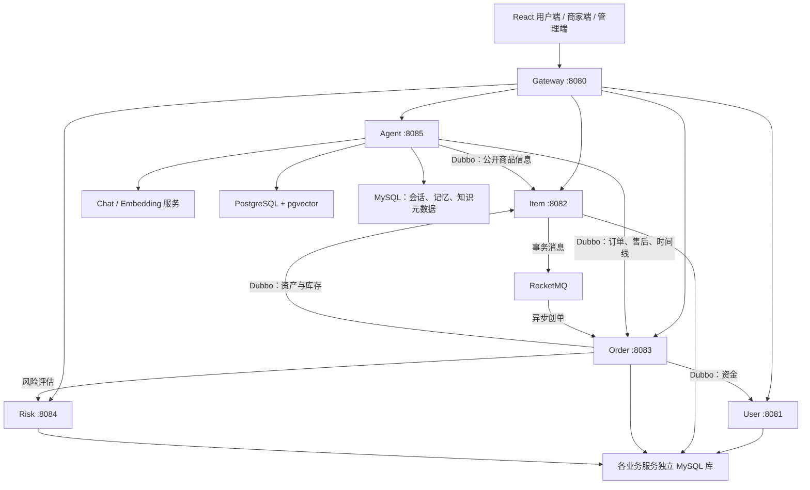

# 虚拟资产 C2C 交易平台与客服 Agent

面向卡密、虚拟道具等商品的微服务交易平台，将商品管理、秒杀下单、担保交易、支付对账、售后风控与客服 Agent 连接起来。用户可以在交易页面购买和查询订单，也可以通过客服会话查询业务进度、了解平台规则、补充问题信息或申请人工服务。

后端采用 Java 21、Spring Boot、Spring Cloud Alibaba 与 Dubbo；客服基于 Spring AI Alibaba Graph 编排，通过受限业务工具和 RAG 获取回答依据；前端采用 React 与 Vite。

本文按 **2026-10-24 当前源码**整理，介绍已实现功能、运行方式和仓库内已有评测记录。

## 已实现功能

| 模块 | 功能 |
| --- | --- |
| 用户与商家 | 注册登录、JWT 身份认证、商家申请与审核、账户资金、提现、积分 |
| 商品与资产 | 商品浏览、筛选、上下架与审核，卡密批量导入、加密存储、资产预留与交付 |
| 下单与交易 | Redis 秒杀预扣与异步创单、Seata TCC 下单、担保订单、支付、交付、确认、结算、退款与评价 |
| 支付与对账 | 银行卡／银联、微信、支付宝、数字人民币四类 Mock 渠道，支付尝试、退款、渠道账单、到账核对、差异处理 |
| 售后与风控 | 售后申请、协商记录、交付证据、平台仲裁；风险规则、案件、证据、处置命令与执行回执 |
| 客服 Agent | 三层意图识别、槽位校验与澄清、多意图分阶段执行、分层记忆、业务事实查询、知识问答、SSE 输出 |
| 人工客服 | 转接申请、排队、坐席认领、转派、结束服务、会话历史与坐席消息 |
| 知识与意图库管理 | 文档编辑、切片预览、异步索引、检索测试；意图库快照构建、校验、启用与撤销 |
| 观测与评测 | 请求追踪、审计日志、业务状态日志、Agent Run／工具调用记录、意图评测与 RAG 离线评估 |

## 系统架构



Nacos 提供服务注册与发现，Dubbo 承载服务间 RPC；Redis 用于缓存、秒杀库存、请求防重与运行控制；Seata 协调 TCC 下单；XXL-JOB 承载订单维护、对账和风控相关任务。

### 服务与目录

| 模块 | HTTP 端口 | Dubbo 端口 | 职责 / 数据库 |
| --- | --- | --- | --- |
| `mall-api` | — | — | 公共 DTO、RPC 接口、业务枚举与通用组件 |
| `mall-gateway-service` | 8080 | — | 路由、JWT 校验、身份传递、限流、请求追踪 |
| `mall-user-service` | 8081 | 20881 | 用户、商家、账户资金、提现、积分；`db_user` |
| `mall-item-service` | 8082 | 20882 | 商品、卡密、库存、秒杀；`db_item` |
| `mall-order-service` | 8083 | 20880 | 订单、支付、交付、售后、结算与对账；`db_order` |
| `mall-risk-service` | 8084 | 20884 | 风险规则、案件与处置；`db_risk` |
| `mall-agent-service` | 8085 | 消费端 | 客服、记忆、知识检索与意图库；`db_agent`、pgvector |
| `mall-frontend` | 3000 | — | 用户交易界面、商家与管理工作台 |
| `evaluation` | — | — | 意图识别与 RAG 评测数据、脚本、报告 |
| `doc/sql`、`doc/data` | — | — | 数据库初始化、增量迁移与演示数据 |

Order、Risk 的 XXL-JOB 执行器默认端口分别为 `9999`、`9998`。

### 技术栈

| 层次 | 当前依赖 |
| --- | --- |
| Java 与应用框架 | Java 21、Spring Boot 3.5.6 |
| 微服务 | Spring Cloud 2025.0.0、Spring Cloud Alibaba 2025.0.0.0、Dubbo 3.3.0、Nacos |
| 数据访问 | MySQL、MyBatis-Plus 3.5.12、Redis、PostgreSQL / pgvector |
| 消息、事务与调度 | RocketMQ Spring Boot Starter 2.3.1、Seata、XXL-JOB 2.4.0 |
| Agent | Spring AI Alibaba Graph / DashScope 1.1.0.0、Spring AI 1.1.0 |
| 前端 | React 19、Vite 8、JavaScript / JSX、Oxlint |
| 评测 | Python 3、RAGAS 0.2.x |

具体版本以根目录及各模块的 `pom.xml`、前端 `package.json` 为准。

## 交易后端实现

### 秒杀异步下单

秒杀链路位于 Item 和 Order 服务：

1. 使用用户与商品维度的 Redis 防重标记限制重复提交，Lua 脚本原子检查并预扣秒杀库存。
2. 发送 RocketMQ 事务消息，在商品服务的本地事务中扣减 MySQL 库存并写入 `t_mq_transaction_log`。
3. Broker 回查时读取事务日志，决定提交、回滚或继续等待。
4. 订单消费者异步创建订单，通过订单号唯一约束处理重复消息；普通消费异常交由 MQ 重试。
5. 发送事务消息抛出异常时，回补本次 Redis 预扣并清理防重标记。

请求受理后返回订单号，前端可继续查询结果。相关实现见 [秒杀服务](mall-item-service/src/main/java/com/example/item/provider/SeckillServiceImpl.java)、[事务监听器](mall-item-service/src/main/java/com/example/item/listener/SeckillTransactionListener.java) 与 [订单消费者](mall-order-service/src/main/java/com/example/item/listener/SeckillOrderConsumer.java)。

### TCC 下单

`/api/order/createTcc` 提供 Seata 全局事务下单入口：Order 调用 Item 的 Try 预留库存并创建本地订单，由全局事务结果驱动 Confirm 确认或 Cancel 释放库存。

库存分支通过 `t_tcc_action_log` 记录事务状态，执行重复调用检查、空回滚处理与防悬挂判断。接口支持 `mockException` 参数，用于触发回滚路径。

相关实现见 [下单编排](mall-order-service/src/main/java/com/example/item/service/OrderServiceImpl.java) 与 [库存 TCC 分支](mall-item-service/src/main/java/com/example/item/provider/ItemDubboServiceImpl.java)。

### 担保交易与六维状态

担保交易使用 `TradeOrder` 及独立的业务编排，分别维护六个状态维度：

| 状态维度 | 表达的业务含义 |
| --- | --- |
| 订单 | 待支付、已支付、已交付、确认、结算、退款、取消等订单阶段 |
| 支付 | 初始化、支付中、成功、失败、超时、迟到成功 |
| 交付 | 待交付、已交付、已查看、已确认 |
| 资金托管 | 未托管、冻结、待结算、待退款、已结算、已退款 |
| 售后 | 无售后、申请、协商、仲裁、申诉、已解决 |
| 风控 | 正常、人工复核、冻结、受限、拒绝 |

业务操作执行身份、状态与跨维度前置校验，例如资金冻结后交付、存在售后争议时阻断结算，并记录状态流转日志。卡密自动交付与人工交付使用不同的业务处理分支。

担保交易还实现了取消、支付超时关闭、自动确认、结算、交付超时处理、售后举证、平台仲裁与评价。Agent 通过查询接口读取这些状态和时间线，形成可追溯的客服回答依据。

### Mock 支付、对账与风控

- **支付**：采用渠道策略与注册工厂，统一管理支付尝试、回调确认、退款及 Mock 渠道账。四种支付方式均使用项目内的 Mock 渠道实现。
- **回调校验**：校验签名、金额、时间戳及 nonce，结合业务状态处理重复回调。
- **对账**：记录对账任务、账单、差异与修复操作，提供管理端查询和差异处置入口。
- **风控**：结合规则与业务指标生成风险结果、案件和证据，通过处置命令、消息和回执联动用户、商品及订单服务。
- **审计与观测**：记录关键操作、请求 Trace、慢 SQL 与服务指标，供管理端及运行排查使用。

## 客服 Agent 实现

### Graph 执行流程


Graph 由 [CustomerRunner](mall-agent-service/src/main/java/com/example/agent/customer/CustomerRunner.java) 编译执行。每次请求记录 Run、节点路径、识别来源、工具调用、检索证据、耗时及模型用量；前端通过 SSE 展示处理阶段和回答内容。

### 三层意图识别与业务路由

意图目录包含 **21 类客服意图**，识别结果路由到订单、售后、规则、投诉与人工升级、售前、记忆 **6 类业务处理节点**，另有模板回复和兜底分支。

| 层级 | 实现方式 | 处理范围 |
| --- | --- | --- |
| L1 规则 | 正则与确定性规则 | 问候、身份询问、偏好查询与删除等明确表达 |
| L2 向量意图库 | 对启用版本的示例向量检索，结合相似度阈值与候选分差判断 | 满足接收条件的单意图问题 |
| L3 LLM | 结构化输出、问题拆分、槽位提取与执行阶段规划 | L2 回退、复杂多意图及上下文依赖问题 |

识别流程还包含人工升级规则和待补槽任务恢复，评测中分别记录为 `ESCALATION_RULE`、`CONTEXT_RESUME`。识别后校验业务编号的来源、格式、问题片段与槽位关系；缺少必要信息时返回澄清，补充信息后继续原任务。

L2 使用独立发布快照。构建时保存意图、示例和向量，校验时执行 **L2 → L3 最终意图匹配**，分别统计 L2 接收比例、接收准确率、L3 回退数及最终结果；启用操作切换在线活动版本。

### 多意图分阶段执行

Master 为拆分后的任务生成 `executionStage`。调度器按阶段顺序执行，同阶段任务通过 `CompletableFuture` 并行处理；上一阶段返回的业务事实写入后续任务上下文，参与实体定位与槽位补全。

例如，“先查最近订单，再看这笔订单的售后进度”可以先取得订单信息，再将确认的订单实体传给下一阶段。最终按任务顺序收集结果，由 Response 汇总，并受到整次请求预算和工具超时控制。

### 分层记忆与上下文管理

| 层级 | 当前实现 |
| --- | --- |
| 近期消息 | 最多保留最近 8 条消息，结合单条长度与总字符预算裁剪上下文 |
| 滚动摘要 | 异步维护规则化会话摘要，将此前对话中的关键信息压缩后传入模型 |
| 结构化会话状态 | 保存订单、售后单、商品实体、当前焦点、实体关系与待处理意图，支持指代解析和补槽 |
| 跨会话偏好 | 自研 MySQL 记忆存储，以 Outbox 和异步 Worker 提取、合并用户品类及交付偏好，按当前意图筛选召回 |

长期记忆提供用户级读写开关、版本与 epoch 校验、有效期及删除操作。异步提取在数据库事务外执行，合并时检查版本与任务租约；回答阶段再次校验记忆状态。订单当前状态等业务事实通过工具实时获取。

用户级记忆读写默认关闭，可通过 `GET / PUT /api/agent/memory/settings` 查看或修改；`/api/agent/memories` 提供记忆查询、修改和删除入口。

### 业务工具与回答约束

- **订单与售后工具**：通过 Dubbo 查询本人订单、订单详情、状态时间线、售后进度和交付证据摘要；服务端校验订单买卖双方归属。
- **商品工具**：读取对外可见的商品信息，为售前问题提供业务事实。
- **工具白名单**：按处理节点约束可调用工具与知识文档类型，执行工具调用次数和超时限制。
- **输出校验**：对结构化输出、业务编号、敏感内容和回答依据执行检查，记录错误或降级原因。
- **人工服务**：支持转接申请、队列、认领、转派和结束；会话服务模式区分 BOT、QUEUED、HUMAN，并维护控制版本。AI 结果入库时检查当前服务模式，人工接管中的结果转为内部草稿。

### RAG 知识问答

知识管理以 MySQL 保存文档、切片、版本和索引任务，以 PostgreSQL / pgvector 保存向量：

1. 按 Markdown 结构生成父子切片，支持切片预览、文档编辑和重新索引。
2. 异步生成子块向量，按文档版本与索引状态管理可检索内容。
3. 客服检索支持向量、关键词及混合模式；混合模式通过 RRF 融合候选，再回溯父块构造回答上下文。
4. 按 PUBLIC 可见性、文档类型和启用版本过滤结果，记录文档、切片与检索日志。
5. 管理端提供索引任务查询、切片树和检索测试界面。

商品知识语料位于 [doc/data/RAG](doc/data/RAG/README.md)，包含 18 份演示 Markdown 文档。

## 本地运行

### 环境准备

| 依赖 | 用途 |
| --- | --- |
| JDK 21、Maven | 后端编译与运行 |
| Node.js、pnpm 或 npm | React / Vite 前端 |
| MySQL、Redis、Nacos | 业务存储、缓存与服务发现 |
| RocketMQ、Seata | 消息链路与 TCC 事务 |
| PostgreSQL + pgvector | Agent 知识与意图向量检索，当前向量维度为 1536 |
| XXL-JOB Admin | 订单、对账与风控任务调度 |
| Python 3 | 离线评测脚本 |

### 数据库初始化

在目标数据库执行对应脚本。下表按基础表、增量迁移、演示数据的依赖顺序列出；已有数据库按实际 schema 补齐迁移。部分脚本含非幂等 `ALTER TABLE`，执行前核对已存在的列与索引。

**交易与风控：**

| 顺序 | 位置 / 文件 |
| --- | --- |
| 1 | 根目录 [db.sql](db.sql)：用户、商品、订单基础表 |
| 2 | [doc/sql/init](doc/sql/init)：`stage1_schema.sql` → `stage1_trade_consistency_migration.sql` → `stage1_payment_callback_security_migration.sql` |
| 3 | 同目录：`stage2_schema.sql` → `stage2_batch2_query_performance_migration.sql` → `stage2_batch3_operation_closure_migration.sql` |
| 4 | 同目录：`seata_undo_log_migration.sql`，按脚本指定的业务库执行 |
| 5 | [doc/sql/reconciliation](doc/sql/reconciliation)：`v1_payment_attempt_and_mock_channel.sql` → `v2_payment_refund_and_fund_suspense.sql` → `v3_channel_settlement_and_reconciliation.sql` |
| 6 | 按需导入 [MySQL 演示数据](doc/data/MySQL) 与 `doc/sql/reconciliation/v4_mock_demo_fixtures.sql` |

**Agent 与 RAG：**

以下客服脚本统一位于 [doc/sql/agent/customerServiceAgent](doc/sql/agent/customerServiceAgent)，MySQL 与 PostgreSQL 脚本分别执行。

| 顺序 | 脚本 |
| --- | --- |
| 1 | [RAG 基础表](doc/sql/rag)：`stage3_rag_schema.sql`、`stage3_rag_pgvector_schema.sql` |
| 2 | `stage3_customer_service_agent_schema.sql`、`stage3_customer_service_agent_pgvector_migration.sql` |
| 3 | `stage3_customer_service_intent_mysql_migration.sql`、`stage3_customer_service_intent_pgvector_migration.sql` |
| 4 | `stage3_customer_service_intent_release_mysql_migration.sql`、`stage3_customer_service_intent_release_pgvector_migration.sql` |
| 5 | `stage3_customer_service_runtime_mysql_migration.sql`、`customer_agent_v2_mysql_migration.sql`、`customer_agent_v2_pgvector_migration.sql` |
| 6 | `stage3_customer_service_memory_mysql_migration.sql` |
| 7 | `stage3_customer_service_live_handoff_outbound_sop_migration.sql`：当前会话与客服协同相关表及字段 |
| 8 | `stage3_customer_service_intent_examples_expand_20261020.sql`：13 类默认 L2 业务意图的补充训练示例 |

客服协同迁移在上一级 `doc/sql/agent` 也有同名文件，选用表中目录的版本执行一次即可。完成 MySQL 意图示例导入后，通过发布功能生成版本向量。

PostgreSQL 配置见 [RAG 数据库说明](doc/sql/rag/stage3_rag_database_setup.md)。

### 服务配置

各服务读取自身 `src/main/resources/application.yml`。将数据库、Nacos、Redis、RocketMQ、Seata 和 XXL-JOB 地址配置为实际环境；使用环境变量或 IDE 运行配置覆盖连接信息。

| 配置范围 | 常用环境变量 |
| --- | --- |
| 业务 MySQL | `SPRING_DATASOURCE_URL`、`SPRING_DATASOURCE_USERNAME`、`SPRING_DATASOURCE_PASSWORD`，按服务指定数据库 |
| Nacos / Dubbo | `SPRING_CLOUD_NACOS_DISCOVERY_SERVER_ADDR`、`SPRING_CLOUD_NACOS_CONFIG_SERVER_ADDR`、`DUBBO_REGISTRY_ADDRESS` |
| Redis | `SPRING_DATA_REDIS_HOST`、`SPRING_DATA_REDIS_PORT`、`SPRING_DATA_REDIS_PASSWORD`；Agent / Gateway 等也提供 `REDIS_*` 占位变量 |
| RocketMQ | `ROCKETMQ_NAME_SERVER` |
| 网关 | `JWT_SECRET`、`FRONTEND_ORIGIN` |
| Agent MySQL | `AGENT_MYSQL_URL`、`AGENT_MYSQL_USERNAME`、`AGENT_MYSQL_PASSWORD` |
| Agent PostgreSQL | `AGENT_PGVECTOR_HOST`、`AGENT_PGVECTOR_PORT`、`AGENT_PGVECTOR_DATABASE`、`AGENT_PGVECTOR_USERNAME`、`PGVECTOR_PASSWORD` |
| Chat 模型 | `CUSTOMER_SERVICE_PROVIDER`、`CUSTOMER_SERVICE_API_KEY`、`CUSTOMER_SERVICE_BASE_URL`、`CUSTOMER_SERVICE_MASTER_MODEL`、`CUSTOMER_SERVICE_RESPONSE_MODEL` |
| Embedding | `RAG_EMBEDDING_PROVIDER`、`RAG_EMBEDDING_API_KEY`、`RAG_EMBEDDING_BASE_URL`、`RAG_EMBEDDING_MODEL`、`RAG_EMBEDDING_DIM`、`RAG_EMBEDDING_BATCH_SIZE` |
| 调度 | `XXL_JOB_ADMIN_ADDRESSES`、`XXL_JOB_EXECUTOR_PORT` |
| 前端 | `VITE_GATEWAY_URL`、`VITE_API_BASE_URL` |

Chat 与 Embedding 独立配置。真实客服使用 `CUSTOMER_SERVICE_PROVIDER=DASHSCOPE`，向量服务使用 `RAG_EMBEDDING_PROVIDER=OPENAI_COMPATIBLE`，并分别提供密钥与模型名称。当前向量表和发布校验使用 1536 维，Embedding 输出需与其一致。

本地 Mock 模式配置：

```bash
export CUSTOMER_SERVICE_PROVIDER=MOCK
export RAG_EMBEDDING_PROVIDER=MOCK
```

Mock 模式用于流程演示，仍需准备数据库、Redis 等依赖。Agent 默认通过注册中心发现业务服务，也支持 `DUBBO_ORDER_SERVICE_URL` 和 `DUBBO_ITEM_QUERY_SERVICE_URL` 指定直连地址。

### 构建与启动

在仓库根目录安装后端模块依赖：

```bash
mvn -DskipTests install
```

分别在独立终端启动服务，或在 IDE 中运行对应的 `*Application` 类：

```bash
mvn -pl mall-user-service org.springframework.boot:spring-boot-maven-plugin:3.5.6:run
mvn -pl mall-item-service org.springframework.boot:spring-boot-maven-plugin:3.5.6:run
mvn -pl mall-order-service org.springframework.boot:spring-boot-maven-plugin:3.5.6:run
mvn -pl mall-risk-service org.springframework.boot:spring-boot-maven-plugin:3.5.6:run
mvn -pl mall-agent-service org.springframework.boot:spring-boot-maven-plugin:3.5.6:run
mvn -pl mall-gateway-service org.springframework.boot:spring-boot-maven-plugin:3.5.6:run
```

启动前端：

```bash
cd mall-frontend
pnpm install
pnpm dev
```

访问 [http://localhost:3000](http://localhost:3000)。Vite 默认将 `/api` 转发到 `http://localhost:8080`，并为客服 WebSocket 路径配置代理。

登录后，用户端提供商品、订单和客服入口；管理端提供运营审核、对账差异、风控案件、知识库以及客服管理工作台。

## 启用 L2 意图库

1. 配置真实 Chat 和 Embedding 服务，保持 `customer-service.rag-enabled=true`。
2. 在管理后台进入 **智能客服 → 意图库发布 → 构建完整意图库版本**。
3. 提交独立评估问句，构建意图快照与向量。仓库提供 [基础发布校验集](evaluation/intention-evaluation/l2_release_evaluations.json)。
4. 刷新查看 `BUILDING → VALIDATING → READY` 状态；构建或校验失败时，详情报告显示失败阶段和原因。
5. 对 READY 版本点击 **启用此版本**，切换在线 L2。

`READY` 表示校验通过、可以启用；实际在线版本由活动指针决定。也可以使用管理员 JWT 调用启用接口：

```bash
export INTENT_EVAL_ADMIN_TOKEN='<管理员登录返回的 JWT>'
RELEASE_NO='<状态为 READY 的版本编号>'

curl -X POST "http://localhost:8080/api/admin/agent/intent-releases/${RELEASE_NO}/activate" \
  -H "Authorization: Bearer ${INTENT_EVAL_ADMIN_TOKEN}" \
  -H "Content-Type: application/json" \
  -d '{}'
```

在 `db_agent` 查询当前活动版本：

```sql
SELECT scene, active_release_no
FROM t_customer_service_intent_active_release
WHERE scene = 'CUSTOMER_SERVICE';
```

发布校验集应覆盖本次启用的业务意图与 OTHER 负例。200 条正式评测集用于评估识别效果，与训练示例分开使用。完整操作说明见 [L2 构建与启用](evaluation/intention-evaluation/L2_PUBLISH.md)。

## 评测与验证

### 意图识别评测

[evaluate_intents.py](evaluation/intention-evaluation/evaluate_intents.py) 调用管理员识别接口 `/api/admin/agent/intent-evaluation/recognize`，获得意图与槽位后结束。模型由后端配置，脚本使用管理员 JWT；上下文由显式测试夹具提供。

[200 条测试用例](evaluation/intention-evaluation/intent_cases.json) 覆盖 21 类意图，包含简单表达、近邻意图、否定、引用、多意图、上下文指代、缺槽与异常输入；难度分布为 easy 40、medium 80、hard 80。

```bash
# 离线校验数据集与判分逻辑
python3 evaluation/intention-evaluation/evaluate_intents.py --validate-only
python3 evaluation/intention-evaluation/evaluate_intents.py --self-test

# 全量在线识别评测
export INTENT_EVAL_ADMIN_TOKEN='<管理员登录返回的 JWT>'
python3 evaluation/intention-evaluation/evaluate_intents.py

# 按案例复测
python3 evaluation/intention-evaluation/evaluate_intents.py --case-id INT-029
```

脚本输出逐条结果、汇总指标、错误分组与失败案例，报告保存到 `evaluation/intention-evaluation/outputs/<运行编号>/`。

**仓库已有记录：**[20261020T161310Z-d7a0fe93](evaluation/intention-evaluation/outputs/20261020T161310Z-d7a0fe93/summary.json)，使用 DASHSCOPE、非 Mock 模型及启用的 L2 版本。

| 指标 | 结果 |
| --- | --- |
| 选定样本 | 200 条 |
| 有效分类 / 覆盖率 | 193 / 200，96.50% |
| 有效样本意图完全匹配率 | 185 / 193，95.85% |
| 匹配数 / 全部选定样本 | 185 / 200，92.50% |
| Micro-F1 / Macro-F1 | 0.964286 / 0.969356 |
| 有槽位判分的样本匹配率 | 68 / 78，87.18% |
| 异常样本 | 7 条 |

| 识别来源 | 意图完全匹配 / 有效样本 | 匹配率 |
| --- | --- | --- |
| 上下文恢复 | 4 / 4 | 100.00% |
| 人工升级规则 | 9 / 15 | 60.00% |
| L1 规则 | 14 / 14 | 100.00% |
| L2 向量意图库 | 12 / 13 | 92.31% |
| L3 LLM | 146 / 147 | 99.32% |

上述数据对应这一次历史运行，范围是**意图识别与槽位解析**，未执行业务工具和完整客服链路。有效样本指标排除了 7 条异常；各来源准确率仅以该来源有效样本为分母。完整记录保留了模型配置、意图库版本、数据集哈希及错误明细。

### RAG 评估

[evaluation/rag-evaluation](evaluation/rag-evaluation/README.md) 提供检索指标和 RAGAS 评估，统计 Hit@K、MRR、上下文覆盖率、延迟及错误率；配置裁判模型后计算回答忠实度、相关性等指标。数据准备、依赖安装和运行参数见目录说明。

### 工程检查

```bash
# 后端测试
mvn test

# Agent 模块及其依赖
mvn -pl mall-agent-service -am test

# 工程规范扫描
bash scripts/ci/engineering-standards-scan.sh

# 前端检查与构建（在 mall-frontend 目录执行）
pnpm lint
pnpm build
```

仓库包含交易、支付回调、对账、风控、网关鉴权、Agent 路由、工具约束、记忆、意图库发布及 Embedding 相关测试。

## 代码与文档入口

| 主题 | 入口 |
| --- | --- |
| 客服识别与路由 | [CustomerMaster](mall-agent-service/src/main/java/com/example/agent/customer/CustomerMaster.java)、[IntentCatalog](mall-agent-service/src/main/java/com/example/agent/customer/IntentCatalog.java) |
| Graph 与阶段调度 | [CustomerRunner](mall-agent-service/src/main/java/com/example/agent/customer/CustomerRunner.java) |
| 上下文与长期记忆 | [上下文窗口](mall-agent-service/src/main/java/com/example/agent/customer/CustomerContextWindowBuilder.java)、[记忆模块](mall-agent-service/src/main/java/com/example/agent/customer/memory) |
| 业务工具权限 | [CustomerToolPolicy](mall-agent-service/src/main/java/com/example/agent/customer/CustomerToolPolicy.java)、[订单事实查询](mall-order-service/src/main/java/com/example/item/service/AgentOrderQueryService.java) |
| 知识检索 | [CustomerKnowledgeService](mall-agent-service/src/main/java/com/example/agent/customer/CustomerKnowledgeService.java)、[RAG 模块](mall-agent-service/src/main/java/com/example/agent/rag) |
| 意图库版本管理 | [IntentReleaseService](mall-agent-service/src/main/java/com/example/agent/customer/IntentReleaseService.java)、[发布操作说明](evaluation/intention-evaluation/L2_PUBLISH.md) |
| 担保交易 | [TradeOrderService](mall-order-service/src/main/java/com/example/item/service/TradeOrderService.java)、[业务状态枚举](mall-api/src/main/java/api/enums) |
| 支付与对账 | [支付模块](mall-order-service/src/main/java/com/example/item/payment)、[对账模块](mall-order-service/src/main/java/com/example/item/reconciliation) |
| 初始化与语料 | [SQL 脚本](doc/sql)、[业务演示数据](doc/data/MySQL)、[知识语料](doc/data/RAG) |
