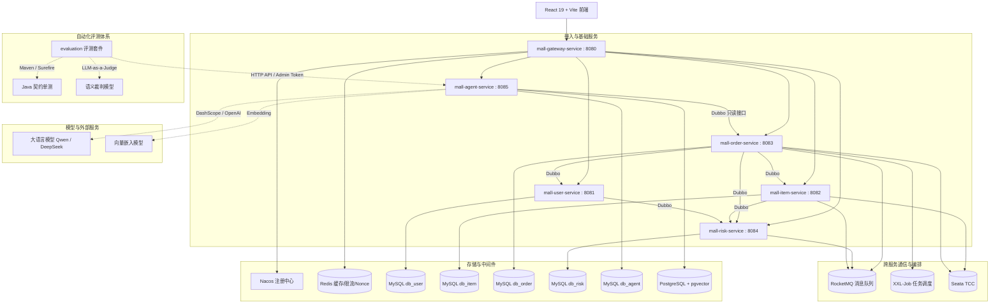

# 悦购商城 · 虚拟资产担保交易平台

> 一个 C2C 虚拟资产交易平台，重点不是“能买买买”，而是把担保交易、资金账本、交付证据、售后仲裁、规则风控、异步补偿，以及受控 Agent 智能体工程与量化评测体系这些平台级问题做扎实。

项目当前已落地统一网关、用户中心、虚拟商品、担保订单、Mock 支付、资金账户、交付确认、结算提现、售后仲裁，以及覆盖风险事件、规则决策、案件处置与命令补偿的风控运营闭环；同时沉淀了统一枚举、异常契约、traceId 贯通、内部接口防护与工程规范扫描等微服务治理能力。

在此基础上，项目推进了 **Agent 智能体与 RAG 知识体系**：基于 Spring AI Alibaba Graph Core 落地了三层意图过滤（L1规则/L2向量快照/L3模型）、只读业务工具隔离、公开知识受控检索、多轮槽位澄清与人机协同的智能客服；并提供 RAGAS 检索生成评测、CustomerAgent 确定性回放、预发评测及发布证据汇总工具。企业发布仍需实际环境验证和业务批准。

## 项目边界

这是一个学习与实战项目，外部通道全部使用 Mock、开源基础设施或本地可运行方案：

| 真实平台能力 | 本项目实现 |
|---|---|
| 微信 / 支付宝支付 | Mock 支付单、支付页、回调验签、退款 |
| 银行卡提现 | 提现申请、审核流、模拟打款流水 |
| 短信验证码 | 邮箱验证码 + Redis 令牌限流 |
| 资金托管 | 平台内部资金账本 + 冻结 / 待结算 / 可用余额原子划转 |
| KYC 实名认证 | 资料提交 + 后台审核状态流转 |
| 风控模型 | 规则引擎、实时风险指标、案件处置、证据聚合、命令追踪与人工兜底 |
| 智能客服 Agent | Spring AI Alibaba Graph 编排，分层意图路由、只读业务工具、受控知识检索、多轮槽位隔离与转人工；默认 Mock，支持 DashScope / OpenAI 兼容协议 |
| RAG 知识库 | 父子分片（Parent-Child）、MySQL 元数据权威源 + PostgreSQL pgvector 派生向量、HNSW 索引与多路召回 |
| AI 评测体系 | RAGAS 检索生成评测 + CustomerAgent 契约测试、确定性回放、在线多轮评测与发布证据门禁；客服语义验收需人工评审 |

外部服务可以是假的，但状态机、幂等、一致性、权限边界、审计追踪和模型幻觉防护必须按真实生产标准实现。

## 核心业务与技术闭环

### 1. 担保交易主链路
```text
商家入驻审核 -> 缴纳保证金 -> 发布虚拟资产 -> 商品审核 -> 买家创建订单
  -> Mock 支付 -> 资金托管冻结 -> 卖家交付卡密 -> 买家确认 / 超时自动确认
  -> 平台抽成计算 -> 结算冷却期 -> 卖家申请提现 -> 评价信用沉淀
  (异常链路: 售后证据提交 -> 买卖双方举证 -> 管理员介入仲裁 -> 原路退款/打款)
```

### 2. 规则风控与运营闭环
```text
交易/用户行为事件采集 -> 实时指标窗口计算 -> 规则引擎命中 -> 风险决策拦截
  -> 自动生成风控案件 -> 运营工作台认领 -> 证据聚合与人工处置 -> 命令可靠下发 -> 失败重发与死信补偿
```

### 3. 受控智能客服 Agent 闭环
```text
用户输入
  -> 输入安全检查 (Input Guard)
  -> 会话上下文加载与租约获取
  -> 三层意图识别 (L1 正则规则 -> L2 向量发布快照检索 -> L3 大模型结构化分类)
  -> 槽位提取与多轮澄清 (Slot Resolve / Clarify，支持同意图双实例隔离)
  -> 受控路由执行:
       ├─ 订单/售后查询: 通过 Dubbo 调用只读业务接口 (严格买卖双方所有权鉴权与脱敏)
       ├─ 平台规则解释: 受控 searchKnowledge 工具 (仅允许公开已发布文档、父子分片回溯)
       └─ 投诉与人工转接: 自动创建人工支持工单，跳过模型直连人工
  -> 响应组装 (代码级整合经校验事实与引用，不开放自由改写，杜绝幻觉)
  -> 输出合规检查 (Output Guard) 与 Trace 全链路持久化
```

### 关键工程能力
- **担保订单多维状态机**：交易、支付、交付、托管、售后、风控状态解耦独立演进。
- **高可靠资金账本**：每笔冻结、解冻、结算、退款、提现均具备唯一幂等业务键与资金对账流水。
- **交付证据追溯**：卡密加密存储、卖家交付流水、买家查看流水、确认记录全流程留痕。
- **支付回调安全**：HMAC-SHA256 签名、时间窗口校验、Redis nonce 防重放与来源 IP 准入。
- **分布式事务与跨服务一致性**：Seata TCC 保证核心资产扣减；RocketMQ 事务消息编排；异步补偿对账任务。
- **审计与对账体系**：订单/支付/资金流水 T+1 内存对账；审计日志支持同步落库与 RocketMQ 异步解耦（实测耗时降低 79.94%，TPS 提升近 4 倍）。
- **统一接入与工程治理**：Spring Cloud Gateway 负责路由鉴权、Redis 令牌桶限流；全链路 traceId 贯通；规范脚本门禁。
- **受控 Agent 架构**：大模型不得直接发起业务写操作；业务数据查询与工具调用严格执行服务端权限校验；意图库支持版本化构建、独立验证集评估与原子切换。
- **双重 AI 评测体系**：RAG 检索质量量化评估 + Agent 任务级多轮交互测评，告别盲目调试大模型。

## 架构总览



## 技术栈

| 层级 | 技术选型 | 说明 |
|---|---|---|
| 后端语言与核心框架 | Java 21、Spring Boot 3.2.5 | 现代化 LTS 运行时 |
| 微服务体系 | Spring Cloud 2023.0.1、Spring Cloud Alibaba 2023.0.1.0 | 微服务治理套件 |
| RPC 与服务发现 | Apache Dubbo 3.2.11、Nacos 2.x | 高性能 RPC 与配置注册中心 |
| 接入网关 | Spring Cloud Gateway、LoadBalancer | 统一认证路由与限流 |
| 分布式事务 | Seata TCC | 两阶段提交保证交易一致性 |
| 消息队列 | Apache RocketMQ 5.3.0 | 削峰填谷、异步解耦与可靠投递 |
| 数据持久化 | MyBatis Plus 3.5.6、MySQL 8 | 业务数据与权威元数据存储 |
| 向量数据库 | PostgreSQL 16 + pgvector | 存储派生向量，HNSW 索引加速向量检索 |
| 缓存与会话 | Redis 7、Caffeine 本地缓存 | 分布式锁、Token 缓存与两级缓存 |
| 定时任务 | XXL-Job 2.4.0 | 超时关闭、对账与指标定时刷新 |
| AI / Agent 编排 | Spring AI Alibaba 1.1.0.0、Spring AI 1.1.0 | 基于 Graph Core 状态图进行智能客服编排 |
| 模型与 Embedding | DashScope (qwen3.8-flash / qwen3.7-text-embedding) | 客服分类与知识检索统一使用 qwen3.8-flash；Embedding 独立配置 |
| 前端工程 | React 19、Vite 8 | 包含商城前台与运营管理后台 |
| AI 评测套件 | Python 3.9+、RAGAS 0.2.x、LLM-as-a-Judge | 自动化 RAG 与 Agent 业务闭环评测 Harness |
| 代码质量与测试 | Maven Test、Surefire、Oxlint、Shell CI 脚本 | 契约测试与工程规范门禁 |

## 模块说明

| 模块 | 职责定位 |
|---|---|
| [mall-api](mall-api) | 跨服务 Dubbo 接口契约、公共 DTO、共享状态枚举、统一异常与响应体、用户上下文、风控公共模型及 Agent 只读查询契约 |
| [mall-gateway-service](mall-gateway-service) | 统一 HTTP 流量入口、动态路由、JWT 校验、RBAC 粗粒度鉴权、Redis 令牌桶限流、CORS、访问日志与 traceId 透传 |
| [mall-user-service](mall-user-service) | 用户注册登录、邮箱验证码、商家入驻与保证金、虚拟资产账户、资金流水、提现审批与积分管理 |
| [mall-item-service](mall-item-service) | 虚拟资产发布与审核、秒杀活动、卡密库存管理、敏感信息脱敏与资产预留 |
| [mall-order-service](mall-order-service) | 担保交易订单、Mock 支付中心、回调安全校验、卡密交付、确认结算、售后维权、仲裁管理、资金流水对账与事务补偿恢复 |
| [mall-risk-service](mall-risk-service) | 实时风险事件采集、指标计算、规则引擎、风险决策、关联图谱分析、案件管理工作台与补偿命令下发 |
| [mall-agent-service](mall-agent-service) | 智能客服 Agent 与企业级 RAG 知识库服务。实现三层意图过滤、受控工具调用、父子分片检索、多轮澄清、会话租约与运行 Trace 追踪 |
| [evaluation](evaluation) | 企业级 AI 评测套件。包含 RAG 向量检索生成评测（RAGAS）与 CustomerAgent 多轮业务能力评测套件（场景用例、L2 校准、契约测试、LLM 裁判与质量门禁） |
| [mall-frontend](mall-frontend) | 响应式前端：包含买家商城（商品浏览、担保下单、卡密提取、资金提现、右侧客服抽屉）与管理后台（资质审核、仲裁处理、风控案件、RAG 知识库与客服运行监控） |
| [doc](doc) | 系统架构设计、阶段演进文档、数据库脚本、技术方案设计及压测对账数据记录 |

## 服务与端口规划

| 服务 | HTTP 端口 | Dubbo 端口 | 核心说明 |
|---|---:|---:|---|
| mall-gateway-service | 8080 | - | 统一接入网关 |
| mall-user-service | 8081 | 20881 | 用户与资金服务 |
| mall-item-service | 8082 | 20882 | 商品与资产服务 |
| mall-order-service | 8083 | 20883 | 交易与仲裁服务（兼提供 Agent 只读查询接口） |
| mall-risk-service | 8084 | 20884 | 规则风控服务 |
| mall-agent-service | 8085 | - | 智能客服与 RAG 知识服务（Dubbo 仅作为 Consumer） |
| mall-frontend | 3000 | - | React 前端开发服务器 |

## 代表性业务接口

完整接口设计参见 [阶段一设计](doc/init/stage1_virtual_asset_trading_design.md)、[阶段二设计](doc/init/stage2_risk_control_design.md) 与 [客服实现说明](doc/agent/customerServiceAgent/implementation.md)。

| 业务域 | 接口 | 说明 |
|---|---|---|
| **用户与资产** | `GET /api/user/info` | 获取当前用户基础资料与账户余额 |
| | `POST /api/asset/item` | 卖家发布虚拟资产卡密商品 |
| **交易与支付** | `POST /api/trade/orders` | 买家创建担保交易订单 |
| | `POST /api/payment/{paymentNo}/start` | 发起订单支付（生成带签名 Mock 支付单） |
| | `POST /api/payment/{paymentNo}/mock-pay` | 模拟渠道支付成功并触发安全回调 |
| | `POST /api/trade/orders/{orderNo}/deliver` | 卖家交付虚拟资产（解密写入凭据） |
| | `POST /api/trade/orders/{orderNo}/confirm` | 买家验收并确认交付（触发结算倒计时） |
| | `GET /api/trade/orders/{orderNo}/secrets` | 买家查看脱敏后的卡密交付凭据 |
| **售后与仲裁** | `POST /api/trade/disputes` | 买家发起售后维权申请 |
| | `POST /api/trade/admin/disputes/{disputeNo}/arbitrate` | 运营管理员介入并仲裁售后 |
| | `POST /api/withdraw/apply` | 卖家发起可用资金提现申请 |
| **规则风控** | `GET /api/admin/risk/cases` | 运营后台查询待处置风控案件列表 |
| | `POST /api/admin/risk/cases/{caseNo}/resolve` | 运营审核并执行处置决策（加黑/拦截/放行） |
| **智能客服 Agent** | `POST /api/customer/conversations` | 用户创建新客服会话 |
| | `POST /api/customer/conversations/{convId}/messages` | 向客服发送消息（触发三层意图过滤与 Graph 执行） |
| | `GET /api/customer/conversations/{convId}/messages` | 查询会话历史消息流 |
| | `POST /api/customer/knowledge/search` | 用户态检索公开启用平台规则知识 |
| **知识与客服管理** | `POST /api/admin/agent/knowledge/reindex` | 管理端重新触发知识库切分与向量索引 |
| | `POST /api/admin/agent/intent-releases` | 提交意图库版本快照并触发独立测试集构建校验 |
| | `POST /api/admin/agent/intent-releases/{releaseNo}/activate` | 原子激活或回滚意图库指定版本 |
| | `GET /api/admin/agent/customer/runs/{runId}` | 管理端排查客服单次运行的 Trace 轨迹与工具调用详情 |

## 三阶段路线规划

| 阶段 | 状态 | 目标 | 主要交付物 |
|---|---|---|---|
| **阶段一：业务闭环** | 已完成 | 跑通可信担保交易主链路 | 商家准入、资产发布、担保订单多维状态机、Mock 支付安全回调、资金账本、卡密交付证据链、自动确认、结算冷却期、提现与售后仲裁 |
| **阶段二：风控与运营** | 已完成 | 具备平台级反黑产与一致性保障 | 支付回调防重放、跨服务一致性恢复与对账任务、风险事件实时计算、规则引擎、关联图谱、风控案件工作台、命令可靠补偿与统一工程规范门禁 |
| **阶段三：受控 Agent 与 RAG** | **核心链路落地** | 让 Agent 成为受控业务能力并建立量化质量基准 | Spring AI Alibaba Graph 客服编排、三层意图路由（L1规则/L2向量/L3模型）、只读 Dubbo 工具鉴权隔离、父子分片 RAG 知识检索、运行时并发租约、双重自动化评测套件（RAGAS + customerAgent 三层场景多轮评测与门禁） |

> **阶段三核心原则**：Agent 严禁直接发起资金划转、订单改单、放款提现等写操作；所有业务查询严格执行鉴权隔离；业务回答严禁无依据自由改写；一切版本发布均需通过自动化评测门禁验证。

## 本地运行指南

### 环境依赖要求

- **JDK 21** & **Maven 3.8+**
- **Node.js 20+**
- **Python 3.9+**（运行 evaluation 评测套件需备）
- **MySQL 8**（业务与元数据存储）
- **PostgreSQL 16 + pgvector 扩展**（Agent 向量知识存储）
- **Redis 7**（分布式锁、缓存与限流）
- **Nacos 2.x**（服务注册与发现）
- **RocketMQ 5.x**（异步解耦与消息总线）
- **Seata Server**（分布式事务协调器）
- **XXL-Job Admin 2.4.0**（分布式任务调度）

### 1. 数据库初始化

#### (1) MySQL 基础与增量脚本
按顺序导入基础库与各阶段增量脚本：

```bash
# 基础结构
mysql -u <username> -p < db.sql
mysql -u <username> -p < doc/sql/init/seata_undo_log_migration.sql

# 阶段一：担保交易与一致性
mysql -u <username> -p < doc/sql/init/stage1_schema.sql
mysql -u <username> -p < doc/sql/init/stage1_payment_callback_security_migration.sql
mysql -u <username> -p < doc/sql/init/stage1_trade_consistency_migration.sql

# 阶段二：风控体系与运营闭环
mysql -u <username> -p < doc/sql/init/stage2_schema.sql
mysql -u <username> -p < doc/sql/init/stage2_batch2_query_performance_migration.sql
mysql -u <username> -p < doc/sql/init/stage2_batch3_operation_closure_migration.sql

# 阶段三：RAG 与 Agent MySQL 结构
mysql -u <username> -p < doc/sql/rag/stage3_rag_schema.sql
mysql -u <username> -p < doc/sql/agent/customerServiceAgent/stage3_customer_service_agent_schema.sql
mysql -u <username> -p < doc/sql/agent/customerServiceAgent/stage3_customer_service_intent_mysql_migration.sql
mysql -u <username> -p < doc/sql/agent/customerServiceAgent/stage3_customer_service_intent_release_mysql_migration.sql
mysql -u <username> -p < doc/sql/agent/customerServiceAgent/stage3_customer_service_runtime_mysql_migration.sql
```

#### (2) PostgreSQL (pgvector) 向量表初始化
在 PostgreSQL 数据库中执行：

```bash
psql -h <pg_host> -U <pg_user> -d postgres -f doc/sql/rag/stage3_rag_pgvector_schema.sql
psql -h <pg_host> -U <pg_user> -d postgres -f doc/sql/agent/customerServiceAgent/stage3_customer_service_agent_pgvector_migration.sql
psql -h <pg_host> -U <pg_user> -d postgres -f doc/sql/agent/customerServiceAgent/stage3_customer_service_intent_pgvector_migration.sql
psql -h <pg_host> -U <pg_user> -d postgres -f doc/sql/agent/customerServiceAgent/stage3_customer_service_intent_release_pgvector_migration.sql
```

### 2. 基础设施配置

检查各服务 `src/main/resources/application.yml` 中的数据库与中间件连接地址。

#### 关键环境变量配置
网关与各业务服务支持通过环境变量覆盖核心参数：

| 环境变量 | 作用服务 | 说明 |
|---|---|---|
| `NACOS_SERVER_ADDR` | 全服务 | Nacos 地址，默认 `127.0.0.1:8848` |
| `REDIS_HOST` / `REDIS_PORT` | 全服务 | Redis 访问地址 |
| `JWT_SECRET` | 网关 / 用户 | JWT 签名密钥（生产环境严禁默认值） |
| `PAYMENT_CALLBACK_SECRET` | 订单服务 | 支付回调 HMAC 签名密钥 |
| `PAYMENT_MOCK_ENABLED` | 订单服务 | 是否开启 Mock 支付端点（本地设为 `true`） |
| `PGVECTOR_PASSWORD` | Agent 服务 | PostgreSQL 向量库访问密码 |
| `CUSTOMER_SERVICE_PROVIDER` | Agent 服务 | 客服模型提供商：`MOCK`（默认，本地无需 API Key）或 `DASHSCOPE` |
| `CUSTOMER_SERVICE_API_KEY` | Agent 服务 | 选用真实模型时的 DashScope API Key |
| `CUSTOMER_SERVICE_BASE_URL` | Agent 服务 | DashScope Chat API 地址，默认 `https://dashscope.aliyuncs.com`；provider 仍填写 `DASHSCOPE` |
| `CUSTOMER_SERVICE_MASTER_MODEL` / `CUSTOMER_SERVICE_RESPONSE_MODEL` | Agent 服务 | 客服分类与规则检索模型，默认均为 `qwen3.8-flash` |
| `RAG_EMBEDDING_PROVIDER` | Agent 服务 | `MOCK` 或 `OPENAI_COMPATIBLE` |
| `RAG_EMBEDDING_API_KEY` | Agent 服务 | 向量嵌入模型的 API Key |

### 3. 配置 XXL-Job 调度任务

在 XXL-Job Admin 中注册执行器 `mall-order-executor` 与 `mall-risk-executor`，配置如下核心调度任务：

| JobHandler | 触发周期 | 说明 |
|---|---|---|
| `tradeCloseExpiredPaymentJob` | 每 10 秒 | 自动关闭并解冻支付超时的订单 |
| `tradeDeliveryTimeoutJob` | 每 1 分钟 | 扫描卖家交付超时的订单并执行退款 |
| `tradeAutoConfirmJob` | 每 5 分钟 | 买家超出验收时限未确认的订单自动确认 |
| `tradeSettlementJob` | 每 10 分钟 | 冷却期结束的已确认订单资金打入卖家可用余额 |
| `tradeFundReconciliationJob` | 每日凌晨 | 订单表与资金账户流水差异对账 |
| `tradeOrchestrationRecoverJob` | 每 30 秒 | 恢复因网络故障中断的跨服务编排任务 |
| `paymentCallbackNonceCleanupJob`| 每小时 | 清理 Redis / 表中过期的防重放 Nonce |
| `riskIndicatorRefreshJob` | 每 5 分钟 | 刷新滑动窗口物化风险指标 |

### 4. 构建与启动后端服务

先在根目录完成公共模块构建：
```bash
mvn clean package -DskipTests
```

启动网关：
```bash
java -jar mall-gateway-service/target/mall-gateway-service-0.0.1-SNAPSHOT.jar
```

依次在不同终端启动各微服务：
```bash
# 启动用户服务
mvn -pl mall-user-service org.springframework.boot:spring-boot-maven-plugin:3.2.5:run

# 启动商品服务
mvn -pl mall-item-service org.springframework.boot:spring-boot-maven-plugin:3.2.5:run

# 启动交易订单服务
mvn -pl mall-order-service org.springframework.boot:spring-boot-maven-plugin:3.2.5:run

# 启动风控服务
mvn -pl mall-risk-service org.springframework.boot:spring-boot-maven-plugin:3.2.5:run

# 启动 Agent 智能客服与 RAG 服务
mvn -pl mall-agent-service org.springframework.boot:spring-boot-maven-plugin:3.2.5:run
```

### 5. 启动前端应用

```bash
cd mall-frontend
npm install
npm run dev
```
访问 `http://localhost:3000`。Vite 开发服务器默认将 `/api/**` 请求代理至 `http://localhost:8080` 网关端口。

---

## 验证与自动化评测体系

项目配备了自底层单元测试、工程规范门禁至上层 Agent 复杂交互的立体化验证能力。

### 1. 基础工程验证
```bash
# 后端单元测试
mvn test

# 前端代码扫描与构建验证
cd mall-frontend && npm run lint && npm run build

# 架构与工程规范扫描（包括循环依赖、异常规范等）
bash scripts/ci/engineering-standards-scan.sh
```

### 2. CustomerAgent 智能客服评测体系
位于 [evaluation/agent-evaluation/customerAgent](evaluation/agent-evaluation/customerAgent)。

当前维护 v2.1 数据集，共 200 条公开用例，覆盖 19 个目录意图。137 条通过 Java 实际编排/API/存储代码与固定外部依赖回放；141 条具备在线执行条件，包括多轮和 P0 场景，两类结果独立统计。

评分器校验实际答案、业务证据、工具边界、引用、隐私及逐轮状态；PR 工作流执行回归。发布证据汇总另需重复预发运行、独立隐藏集、基线、容量成本和负责人审批。当前存在待修复的服务验收失败，不能把工具已交付理解为已达到企业上线标准；没有自动 LLM 语义裁判。

```bash
cd evaluation/agent-evaluation/customerAgent
make validate
make test
make test-java
make replay

# 预发令牌、合成夹具和知识发布准备好后运行在线评测
python3 run_customer_agent_eval.py
# 发布汇总参数及外部证据格式见本目录 README
python3 assess_release.py --help
```

### 3. RAG 知识检索与生成评测体系
位于 [evaluation/rag-evaluation](evaluation/rag-evaluation)。

基于 RAGAS `0.2.x` 构建的知识库评测 Harness：
- **检索阶段确定性指标**：`hit@1` (≥0.70)、`hit@3` (≥0.85)、`mrr` (≥0.75)、`context_coverage` (≥0.80)、`latency_p95_ms` (≤3000ms)。
- **生成阶段 RAGAS 指标**：`faithfulness` (≥0.90)、`answer_relevancy` (≥0.80)、`context_precision` (≥0.75)、`context_recall` (≥0.80)。

```bash
cd evaluation/rag-evaluation
python3 -m venv .venv && source .venv/bin/activate
pip install -r requirements.txt

# 生成权威黄金问题集
python3 scripts/build_golden_dataset.py

# 执行全量质量门禁评估
python3 scripts/run_evaluation.py --fail-on-quality
```

---

## 核心文档索引

### 阶段设计与架构演进
- [三阶段演进规划](doc/init/virtual_asset_market_three_phase_roadmap.md)
- [Spring Cloud Gateway 接入层设计](doc/init/spring_cloud_gateway_design.md)
- [阶段一：虚拟资产担保交易设计](doc/init/stage1_virtual_asset_trading_design.md)
- [阶段二：风控与反黑产体系设计](doc/init/stage2_risk_control_design.md)
- [阶段三：Agent 智能体体系设计](doc/agent/stage3_agent_development_design.md)
- [企业级认证与上下文设计](doc/init/enterprise_auth_and_user_context_design.md)
- [React 响应式前端工程设计](doc/init/react_frontend_architecture_design.md)
- [秒杀与积分系统设计](doc/init/seckill_mall_points_system_design.md)

### Agent 与 RAG 专题
- [智能客服实现与运行说明](doc/agent/customerServiceAgent/implementation.md)
- [智能客服落地开发设计](doc/agent/customerServiceAgent/implementation_design.md)
- [RAG 向量检索与知识库开发设计](doc/agent/RAG/rag_development_design.md)
- [RAG 数据库初始化与环境说明](doc/sql/rag/stage3_rag_database_setup.md)

### AI 评测专题 (Evaluation)
- [CustomerAgent 评测体系设计方案](evaluation/agent-evaluation/customerAgent/customer_agent_evaluation_plan.md)
- [CustomerAgent 评测工具使用说明](evaluation/agent-evaluation/customerAgent/README.md)
- [RAGAS 知识检索与生成评测说明](evaluation/rag-evaluation/README.md)

### 质量、治理与实战压测
- [阶段一与阶段二优化总评审](doc/stage1_and_stage2_improve/stage1_stage2_optimization_review.md)
- [安全与一致性落地设计](doc/stage1_and_stage2_improve/stage1_stage2_batch1_security_consistency_dev_design.md)
- [查询性能与索引优化设计](doc/stage1_and_stage2_improve/stage1_stage2_batch2_query_performance_dev_design.md)
- [运营闭环落地设计](doc/stage1_and_stage2_improve/stage1_stage2_batch3_operation_closure_dev_design.md)
- [工程规范检查清单](doc/stage1_and_stage2_improve/engineering_standards_checklist.md)
- [压测与量化指标记录](数据量化.md)

## 免责声明

本项目用于个人学习与演示现代后端微服务架构、虚拟资产交易系统、平台级风控体系，以及受控业务 Agent 智能体工程与量化评测体系。系统内未接入真实第三方商业支付渠道、真实银行打款流水或真实公安 KYC 实名通道，严禁直接作为真实商业生产交易平台使用。
