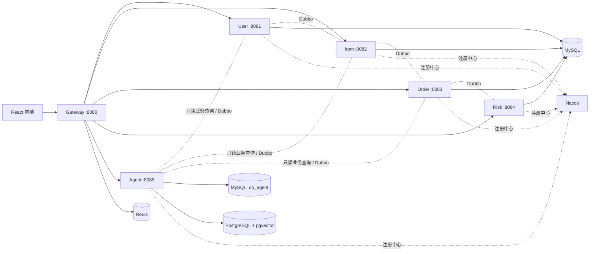

# 虚拟资产 C2C 交易平台

这是一个面向虚拟商品交易的微服务项目，覆盖商品发布与审核、担保交易、支付回调、卡密交付、售后仲裁、风险处置和客服 Agent。后端以 Java / Spring Boot 为主，服务间通过 Dubbo 协作；前端是 React 管理与交易界面。

> 本仓库面向本地开发和演示。各服务依赖的基础设施、数据库和外部模型需要单独准备；仓库未提供一键部署的 Docker Compose 配置。启动前请检查并覆盖各模块配置中的环境相关默认值，尤其不要在生产环境复用示例凭据或密钥。

## 功能概览

- **用户与商家**：注册、登录、账户资料、商家申请和资质审核。
- **商品与库存**：虚拟商品发布、审核、卡密库存管理、商品查询及秒杀相关能力。
- **担保交易**：创建订单、支付回调、卡密交付、买家确认收货、超时自动确认、商家结算和提现。
- **售后与风控**：退款/争议处理、证据提交、仲裁、风险事件与规则处置、风险案件和操作重试。
- **客服 Agent**：基于 Spring AI Alibaba Graph 的客服流程，结合规则、已发布的风险/意图数据和大模型；支持流式回复、知识检索、业务只读查询、人工转接和反馈追踪。
- **跨会话用户记忆**：客服服务内已实现基于 MySQL 的结构化偏好记忆，包括记忆提取、异步写入、查询、修改和删除。该能力目前是 Java 实现；项目中没有独立 Python 服务或 Mem0 SDK。每位用户的记忆读写默认关闭，需要通过设置接口主动开启。

## 技术栈

| 部分 | 主要技术 |
| --- | --- |
| 后端 | Java 21、Spring Boot 3.5.6、Spring Cloud 2025.0.0、Spring Cloud Alibaba 2025.0.0.0 |
| 服务治理与 RPC | Nacos、Apache Dubbo 3.3.0、Spring Cloud Gateway |
| 数据与消息 | MySQL、MyBatis-Plus 3.5.12、Redis、RocketMQ 5.3 客户端、Seata |
| 定时任务 | XXL-Job 2.4.0 |
| Agent / RAG | Spring AI Alibaba 1.1.0.0、Spring AI、PostgreSQL + pgvector |
| 前端 | React 19、Vite 8、TypeScript、pnpm |
| RAG 评估 | Python、RAGAS 0.2.x |

## 仓库结构

```text
mall-parent/
├── mall-api/                 # 服务间共享 API、DTO 和接口
├── mall-gateway-service/     # API 网关、路由与认证入口
├── mall-user-service/        # 用户、商家和账户相关业务
├── mall-item-service/        # 商品、库存和卡密业务
├── mall-order-service/       # 订单、支付、交付、售后与结算
├── mall-risk-service/        # 风控事件、规则与案件处置
├── mall-agent-service/       # 客服 Agent、RAG 和用户记忆
├── mall-frontend/            # React 前端
├── doc/                      # 设计、运行和数据库文档
├── db.sql                    # 基础数据库初始化脚本
├── scripts/                  # 数据导入与工程检查脚本
└── evaluation/               # RAG 评估资料与脚本
```

### 服务与本地端口

| 服务 | HTTP 端口 | Dubbo 端口 | 说明 |
| --- | ---: | ---: | --- |
| Gateway | 8080 | — | 前端和外部 API 入口 |
| User | 8081 | 20881 | 用户与商家 |
| Item | 8082 | 20882 | 商品与库存 |
| Order | 8083 | 20880 | 订单、支付和交易履约 |
| Risk | 8084 | 20884 | 风险处理 |
| Agent | 8085 | 消费方 | 客服对话与知识管理 |
| Frontend | 3000 | — | Vite 开发服务器 |

Order 和 Risk 的 XXL-Job 执行器默认分别使用 9999 和 9998。实际端口以对应模块的 `application.yml` 和启动环境覆盖值为准。

## 架构概览



业务异步消息、分布式事务和定时任务分别使用 RocketMQ、Seata 和 XXL-Job；相关功能需要相应基础设施正常运行。客服 Agent 的 RAG 知识向量存储依赖 PostgreSQL 的 pgvector 扩展，结构化会话、运行记录和用户记忆存储在 `db_agent`。

## 环境准备

### 必需工具

- JDK 21
- Maven（仓库根目录包含 `pom.xml`）
- Node.js 22 或兼容 Vite 8 的较新版本，以及 Corepack / pnpm
- MySQL

### 按功能准备的基础设施

- Nacos：服务发现和注册。
- Redis：网关及业务服务缓存/会话相关能力。
- RocketMQ：异步业务消息。
- Seata：涉及分布式事务的业务流程。
- XXL-Job Admin：订单、风控执行器注册和调度。
- PostgreSQL + pgvector：Agent RAG 向量检索。
- SMTP 邮件服务：需要邮件通知时配置。

当前仓库没有统一的基础设施编排文件。基础设施地址、账号、密码、模型服务和密钥都应在本地配置或通过环境变量注入；不要将真实密钥提交到 Git。

### 配置约定

各服务读取自身的 `application.yml` / `application-*.yml`，并支持 Spring Boot 外部化配置。除 Agent 和 Gateway 暴露的专用环境变量外，也可使用标准 Spring 环境变量覆盖，例如 `SPRING_DATASOURCE_URL`、`SPRING_DATASOURCE_USERNAME`、`SPRING_DATASOURCE_PASSWORD`、`SPRING_CLOUD_NACOS_DISCOVERY_SERVER_ADDR` 和 `SPRING_DATA_REDIS_HOST`。请按所启动模块逐项检查配置，不同模块可能连接不同数据库。

Gateway 常用环境变量：

| 变量 | 用途 |
| --- | --- |
| `NACOS_SERVER_ADDR` | Nacos 地址 |
| `REDIS_HOST`、`REDIS_PORT`、`REDIS_PASSWORD` | Redis 连接 |
| `JWT_SECRET` | JWT 签名密钥，部署时必须提供安全值 |
| `FRONTEND_ORIGIN` | 浏览器跨域允许的前端来源 |

Agent 常用环境变量：

| 变量 | 用途 |
| --- | --- |
| `AGENT_MYSQL_URL`、`AGENT_MYSQL_USERNAME`、`AGENT_MYSQL_PASSWORD` | Agent 的 MySQL 连接 |
| `AGENT_PGVECTOR_HOST`、`AGENT_PGVECTOR_PORT`、`AGENT_PGVECTOR_DATABASE`、`AGENT_PGVECTOR_USERNAME`、`PGVECTOR_PASSWORD` | Agent 的 pgvector 连接 |
| `NACOS_SERVER_ADDR`、`DUBBO_REGISTRY_ADDRESS` | 服务发现与 Dubbo 注册 |
| `REDIS_HOST`、`REDIS_PORT`、`REDIS_PASSWORD` | Redis 连接 |
| `CUSTOMER_SERVICE_PROVIDER` | 客服模型提供方；支持 `MOCK` / `DASHSCOPE` |
| `CUSTOMER_SERVICE_API_KEY`、`CUSTOMER_SERVICE_BASE_URL` | 客服模型凭据与服务地址 |
| `CUSTOMER_SERVICE_MASTER_MODEL`、`CUSTOMER_SERVICE_RESPONSE_MODEL` | Agent 使用的模型名称 |
| `RAG_EMBEDDING_PROVIDER` | RAG Embedding 提供方；开发时可设为 `MOCK` |
| `RAG_EMBEDDING_API_KEY`、`RAG_EMBEDDING_BASE_URL` | Embedding 服务连接 |

首次在本机验证 Agent 的 MOCK 路径时，显式设置 `CUSTOMER_SERVICE_PROVIDER=MOCK` 和 `RAG_EMBEDDING_PROVIDER=MOCK`，并按启动配置准备其余依赖。MOCK 模式适合流程联调，不代表真实模型或真实向量检索已可用。

Order 服务还需要支付回调密钥 `PAYMENT_CALLBACK_SECRET`。模拟支付由 `PAYMENT_MOCK_ENABLED` 控制，默认关闭；仅在本地联调时按需开启。支付回调的签名与幂等校验仍应在测试环境中验证。

## 数据库初始化

数据库 DDL 由仓库 SQL 文件维护，目前不依赖 Flyway 或 Liquibase 自动迁移。请先创建各模块配置所需的数据库，再按项目文档执行 SQL；不要假设启动应用会自动创建完整 schema。

1. 阅读 [MySQL 初始化说明](doc/data/MySQL/README.md)，按其顺序初始化用户、商品和订单等基础库。根目录 `db.sql` 只覆盖基础初始化的一部分，并不创建所有业务阶段所需数据库。
2. 如果启动 Agent，先按 [RAG 数据库配置说明](doc/sql/rag/stage3_rag_database_setup.md) 准备 `db_agent`、PostgreSQL 和 pgvector。
3. 对 `db_agent` 按依赖顺序应用客服 Agent schema、意图/发布、运行时迁移，以及用户记忆迁移。记忆迁移依赖既有 Agent 会话和运行表，不能单独作为首次初始化脚本执行。
4. 如果需要 RAG 知识检索，继续应用相应的 PostgreSQL schema 和迁移，并按 [RAG 数据文档](doc/data/RAG/README.md) 导入知识库内容。

Agent 相关脚本位于 `doc/sql/agent/customerServiceAgent/` 和 `doc/sql/rag/`。其中记忆迁移文件为 `stage3_customer_service_memory_mysql_migration.sql`。生产环境执行前请备份数据库，并核对目标 schema 和迁移顺序。

## 构建与启动

### 后端

先在仓库根目录构建 Maven reactor：

```bash
mvn clean install
```

然后按依赖关系先启动 Nacos、MySQL、Redis，以及当前业务流程所需的 RocketMQ、Seata 和 XXL-Job Admin，再分别运行服务。例如：

```bash
mvn -pl mall-gateway-service -am org.springframework.boot:spring-boot-maven-plugin:3.5.6:run
mvn -pl mall-user-service -am org.springframework.boot:spring-boot-maven-plugin:3.5.6:run
mvn -pl mall-item-service -am org.springframework.boot:spring-boot-maven-plugin:3.5.6:run
mvn -pl mall-order-service -am org.springframework.boot:spring-boot-maven-plugin:3.5.6:run
mvn -pl mall-risk-service -am org.springframework.boot:spring-boot-maven-plugin:3.5.6:run
mvn -pl mall-agent-service -am org.springframework.boot:spring-boot-maven-plugin:3.5.6:run
```

首次只验证单个服务时，可以只启动它及其实际依赖；未启动 Nacos、Dubbo 提供方、数据库或消息中间件时，相应功能可能无法就绪。以上命令会使用各模块的默认 Spring profile；需要其他 profile 时，通过 `SPRING_PROFILES_ACTIVE` 或 Maven 参数指定。请在启动前设置数据库、注册中心、支付密钥及模型相关配置。

### 前端

```bash
cd mall-frontend
corepack pnpm install
corepack pnpm dev
```

前端开发服务器默认监听 `http://localhost:3000`，`/api` 请求代理到 `VITE_GATEWAY_URL`，未设置时目标为 `http://localhost:8080`。浏览器 API 基地址可由 `VITE_API_BASE_URL` 配置。生产静态构建和本地检查命令：

```bash
corepack pnpm build
corepack pnpm lint
```

## 客服 Agent 与长期记忆

Agent 服务通过 `/api/agent` 提供用户会话能力，通过 `/api/admin/agent` 提供管理能力。主要能力包括会话消息及 SSE 流式回复、用户反馈、知识库管理、运行记录和人工转接。具体请求字段和行为请以 [客服 Agent 实现说明](doc/agent/customerServiceAgent/implementation.md) 为准。

已实现的记忆管理 API：

| 方法 | 路径 | 作用 |
| --- | --- | --- |
| `GET` | `/api/agent/memory/settings` | 查询当前用户记忆读写设置 |
| `PUT` | `/api/agent/memory/settings` | 更新记忆读写设置 |
| `GET` | `/api/agent/memories?limit=20` | 查询当前用户记忆，服务端限制返回数量 |
| `PATCH` | `/api/agent/memories/{memoryNo}` | 修改一条记忆 |
| `DELETE` | `/api/agent/memories/{memoryNo}` | 删除一条记忆 |
| `DELETE` | `/api/agent/memories` | 清空当前用户记忆 |
| `GET` | `/api/agent/memory/operations/{operationNo}` | 查询异步记忆操作状态 |

这些接口受当前用户身份约束；客户端不能通过传入其他用户 ID 访问他人记忆。用户级读写开关在 SQL 中默认关闭，应用配置中的全局开关不能替代用户授权。记忆内容属于个人数据，应在前端提供清晰的启用、查看、修改和删除入口，并遵守项目的隐私与数据保留策略。

该实现使用 MySQL 结构化偏好记录及异步 outbox/worker 流程，并调用现有客服模型进行提取。它不是 Mem0 集成；目前没有 Mem0 服务、SDK 或 Python 微服务依赖。相关方案与实现边界见 [长期记忆设计文档](doc/agent/customerServiceAgent/mem0_long_term_memory_design.md)。

## 测试与评估

```bash
# 后端单元和集成测试
mvn test

# 前端静态检查与构建
cd mall-frontend
corepack pnpm lint
corepack pnpm build
```

RAG 离线评估位于 `evaluation/rag-evaluation/`，说明见 [RAG Evaluation README](evaluation/rag-evaluation/README.md)。该评估需要 Agent 服务、已导入/索引的知识文档以及相应管理权限；RAGAS 裁判模型未配置时，依赖该模型的指标会跳过，确定性指标仍可执行。仓库还提供工程规范扫描：

```bash
bash scripts/ci/engineering-standards-scan.sh
```

## 项目文档

- [项目三阶段路线图](doc/init/virtual_asset_market_three_phase_roadmap.md)
- [第一阶段交易系统设计](doc/init/stage1_virtual_asset_trading_design.md)
- [第二阶段风控系统设计](doc/init/stage2_risk_control_design.md)
- [Agent 总体开发设计](doc/agent/stage3_agent_development_design.md)
- [客服 Agent 实现说明](doc/agent/customerServiceAgent/implementation.md)
- [客服 Agent 实现设计](doc/agent/customerServiceAgent/implementation_design.md)
- [客服 Agent 跨会话记忆设计](doc/agent/customerServiceAgent/mem0_long_term_memory_design.md)
- [RAG 开发设计](doc/agent/RAG/rag_development_design.md)
- [MySQL 初始化说明](doc/data/MySQL/README.md)
- [RAG 数据库配置](doc/sql/rag/stage3_rag_database_setup.md)
- [RAG 数据目录说明](doc/data/RAG/README.md)
- [前端说明](mall-frontend/README.md)

## 安全与运行提示

- 不要将真实数据库密码、JWT 密钥、支付回调密钥、模型 API Key 或 SMTP 凭据提交到仓库。
- 在公网或共享测试环境中禁用 MOCK 支付，并使用独立的测试密钥和回调地址。
- 对外开放客服记忆管理前，应确认认证、用户隔离、授权默认值和审计策略符合产品要求。
- 端口、profile、基础设施地址和配置项以各模块当前配置为准；本 README 给出的端口是仓库默认开发配置。
