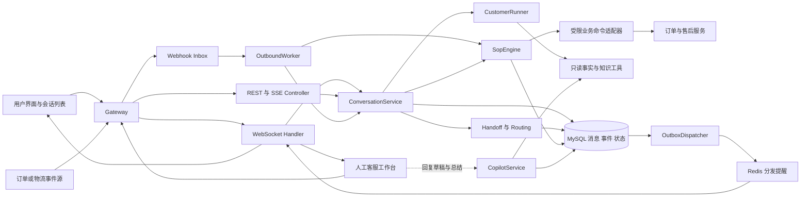
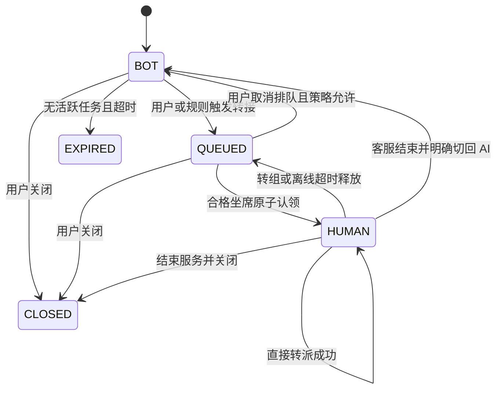
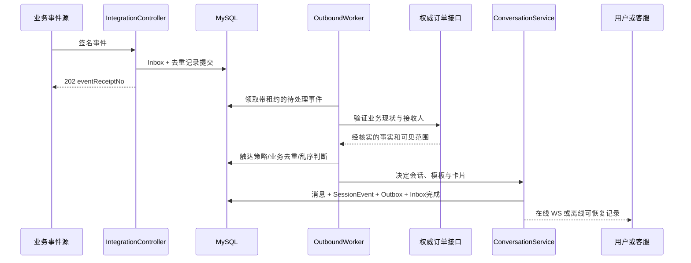
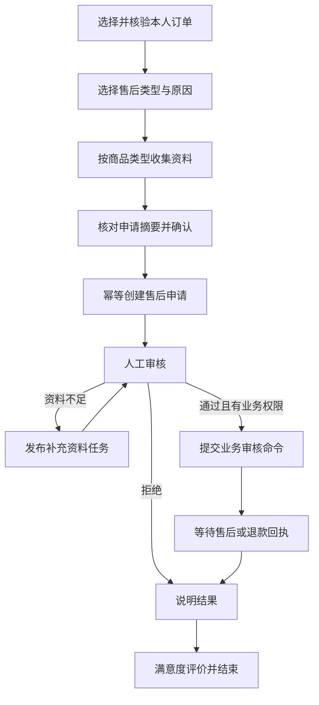

# CustomerAgent 实时人工协同、主动触达、SOP 与富媒体卡片开发设计

> 文档状态：开发设计，尚未实施。
>
> 设计日期：2026-10-19。代码基线：当前工作区，Git HEAD `4668e21`。
>
> 范围：Live Chat Handoff、技能组路由、Agent Copilot、事件驱动主动触达、持久化 SOP、结构化卡片。
>
> 本次交付仅新增本文档；不修改 Java/前端/配置，不生成或执行数据库迁移，不部署服务。文中的类、表、接口、配置均需在后续开发中实现，明确标注为“已有”的除外。

## 1. 目标、边界与关键决策

### 1.1 用户可感知的目标

1. 用户转人工后继续在同一个会话发送消息；客服认领后能够实时回复，支持排队、转派、断线恢复、结束服务和明确切回 AI。
2. `HIGH` / `URGENT` 风险优先进入资深客服组；普通售前请求进入销售组；路由结果可解释、可审计。
3. 人工服务期间，AI 为客服生成回复草稿、会话摘要和下一步建议；草稿由客服审阅发送。
4. 经认证的订单/物流/退款事件能够创建站内服务通知及会话，在线实时收到，离线登录后可补看。
5. 退换货/售后资料收集可以跨多轮、跨登录、跨服务重启继续；表单、审核、外部业务回执都有明确状态。
6. 商品、订单时间线、动态表单和评分使用统一版本化卡片协议，历史消息与实时消息使用同一渲染方式。

### 1.2 范围约束

- 保留现有 Java 21、Spring Boot 3.5.6、Spring Cloud 2025.0.0、Spring AI Alibaba Graph、MySQL、Redis、pgvector 和 React 技术基础。新增 MVC WebSocket 支持，不为本次需求整体迁移 WebFlux。
- 第一轮完整交付覆盖站内聊天与通知；短信、微信、邮件、浏览器系统推送仅预留渠道接口，不计入本次验收。
- AI 仍只具备受控的事实查询与建议能力。创建售后申请等业务写入由显式 SOP 命令执行，必须经过用户确认、业务授权和下游幂等接口；退款审批仍遵守交易系统权限。
- SOP 首期是版本化定义驱动的有限状态机，提供发布/回滚接口和维护页面；不引入通用 BPMN 引擎或拖拽设计器。Graph 负责单次 AI 推理，SOP 数据库负责长时间等待与恢复。
- 项目当前按单个平台设计，无现成租户隔离模型。若未来引入多租户，必须将 `tenant_id` 加入所有授权、唯一约束、游标和 Redis 命名空间，不能只加在请求参数上。
- 所有容量、超时、SLA 和保留期是建议初始值，需要压测和业务评审；不是现有系统能力或已验证性能。

### 1.3 关键决策表

| 决策 | 选定方案 | 原因与代价 |
|---|---|---|
| 实时协议 | 原生 WebSocket + 版本化 JSON，REST 作命令/同步备用通道 | 便于和当前 React/MVC 集成；应用需自行实现鉴权、ACK、补拉及背压 |
| AI 流式回答 | 保留 POST SSE；新增客户端也可接收 WS 流式预览 | 兼容当前体验，最终消息统一落库、统一去重 |
| 数据权威源 | MySQL 消息日志、会话事件、Inbox/Outbox | Redis 重启、网络中断不能丢已确认消息 |
| 多实例分发 | Outbox 发布 Redis Pub/Sub 提醒，实例按 MySQL 序号追赶 | 复用基础设施；Pub/Sub 不承担可靠存储，必须配周期性补漏 |
| 人工服务状态 | 生命周期 `status` 与服务模式 `service_mode` 分离 | 兼容旧 `HANDOFF` 字段，又允许人工期间继续收消息 |
| 发言控制 | `control_epoch` + 数据库事务校验 | 防止 AI 在接管后回复、旧客服转派后继续发送 |
| 技能路由 | 风险/业务规则 → 组资格 → 容量分配 | 规则可审计，模型不能直接指定客服或权限 |
| 主动触达 | 验签 Webhook → Inbox → 决策 → 消息/Outbox | 支持幂等、重试、乱序和用户离线 |
| 富媒体 | 服务端事实映射 + JSON Schema + 前端组件白名单 | 模型不生成可执行 UI 或任意 URL |
| 交付次序 | 消息基础 → 人工/卡片 → Copilot/事件 → SOP 闭环 | 避免每项能力各造一套发送、审计和恢复链路 |

## 2. 现有实现核对与差距

以下均以实际代码为准。旧设计文档中已过时的“未实现 SSE”等描述，不作为本次现状判断。

| 位置（仓库相对路径） | 当前实现 | 本次设计中的改造 |
|---|---|---|
| `mall-agent-service/.../customer/CustomerController.java` | REST 创建/读取/关闭会话，普通消息和 POST SSE；管理员认领、resolve 工单 | 增加统一消息入口、实时票据、同步/列表接口；旧接口通过兼容适配器进入新服务 |
| `CustomerStore.start()` | 只允许 `ACTIVE`；用户消息和 Run 绑定；用户级运行租约；每分钟最多 5 次 AI 请求 | 将“保存消息”和“启动 AI”分开；人工消息不能受 AI Run 锁阻塞 |
| `CustomerStore.session()` | 最近 100 条；仅 `role=AGENT` 时关联 Run 获得结构结果 | 新增序号分页、消息自身 `payload_json`，人工/事件/SOP 无 Run 也可完整恢复 |
| `CustomerStore.handoff()` | 写 `t_agent_handoff`、改 `HANDOFF`；只将 `HIGH` 映射为高优先级 | 原子创建实时排队状态、保留完整风险、分配路由规则版本 |
| `CustomerStore.process()` | `OPEN→PROCESSING→RESOLVED`，记录 handler/resolution | 认领同时变更会话控制权、容量；结束必须明确 CLOSE 或 RETURN_TO_BOT |
| `CustomerStore.updateHandoffContext()` | 保存识别、执行结果、旧摘要和最近消息 | 保留初始快照，增加上下文游标和更新版本；Copilot 从事实及实时消息重建上下文 |
| `CustomerMaster.recognize()` | 模型支持四级风险，但最终通常合并为 `human ? HIGH : LOW` | 保留 `LOW/NORMAL/HIGH/URGENT`；不能因为折叠等级导致紧急客诉被降级 |
| `CustomerRunner` | 单次 Graph、进程内 Run 注册表，`respond()` 合成文本；`finish()` 保存 AI 消息 | 仍用于单次 AI；增加模式仲裁及提交时 fencing；持久化待执行任务，不用注册表保存长流程 |
| `CustomerToolPolicy` | 按 Agent 白名单限制只读工具及转人工 | 新增独立 Copilot 只读策略；SOP 业务命令不用模型工具授权 |
| `customer/memory/*` | 已有记忆捕获 Outbox、租约及异步 Worker | 借鉴设计，不复用记忆队列表；普通事件不能混进偏好抽取 |
| `mall-frontend/src/api/customerServiceApi.js` | 真正的客服 API 和 SSE 解析器 | 新增 WS 客户端、命令幂等/补拉、卡片动作 API；`agentApi.js` 当前主要是知识库 API |
| `CustomerServiceDialog.jsx` | `handoff` 时禁用输入；已有 choices、timeline 的局部渲染 | 改为模式/连接/输入状态分别控制，加入通用 `RichMessageRenderer` |
| `CustomerServiceLauncher.jsx` | 只有打开 Dialog 才挂载聊天组件，依赖 sessionStorage 恢复单会话 | 登录态顶层挂载连接和会话列表，Dialog 关闭后仍能接主动通知 |
| `CustomerServiceAdmin.jsx` | 工单表格、JSON 详情、文本 resolve | 增加客服工作台、排队与在线状态、实时聊天和 Copilot 面板 |
| 网关 `AuthenticationGlobalFilter` / `application.yml` | Authorization JWT；`/api/admin/agent/**` 只放 ADMIN；agent 路由为 HTTP | 增加 WS 精确路由与票据鉴权、独立客服路径、Webhook 服务鉴权 |
| `AgentActorResolver` / `AdminAuthInterceptor` | 校验网关头与 JWT 的一致性，管理接口 ADMIN 权限 | 新入口不接收客户端自报 actor；增加客服范围授权、WS Principal 与服务事件身份 |

### 2.1 必须补足的业务接口

- `AgentOrderQueryDubboService` 已提供订单、售后、状态时间线、交付凭证类型摘要；订单归属在 `AgentOrderQueryService` 按买家/卖家校验，ADMIN 也不会自动越权。
- 现有 `TimelineFact` 是订单状态变化，不能当作真实物流扫描轨迹。现有交付体系包含数字商品交付；实体物流事件必须接专门适配器，卡片必须区分 `ORDER_STATUS` 与 `LOGISTICS`。
- `AgentItemQueryDubboService.queryPublicItem` 当前返回商品名、价格、库存、交付方式和副标题，没有商品列表检索、图片、详情跳转路由。首期单商品卡可用已有字段；橱窗候选列表、封面需扩展公开 DTO/查询接口，未提供的字段隐藏。
- 交易 HTTP 已有申请售后、证据、留言、管理员仲裁接口，但不是为客服服务调用设计的幂等委托接口。本方案新增受限的售后命令适配层；不假定旧 HTTP 接口已有 `operationId` 幂等保障。
- 外部事件处理需要可信的“事件业务对象→接收用户/角色”映射；当前 `OrderFact` 不返回买卖家 ID，需新增仅服务间可调用的接收人解析契约，不能信任 Webhook 的 `userId`。

## 3. 总体架构与统一消息主干



### 3.1 领域服务划分

| 拟新增服务 | 职责与事务边界 |
|---|---|
| `CustomerConversationService` | 授权、幂等收消息、服务模式仲裁、消息和事件原子持久化 |
| `ConversationMessageStore` / `SessionEventStore` | 分页、序号、投递回放；从逐渐膨胀的 `CustomerStore` 拆出 |
| `CustomerRealtimeService` | 连接、订阅、ACK、同步、背压；无业务写入捷径 |
| `CustomerHandoffService` | 排队、认领、转派、结束、控制权及坐席容量 |
| `SkillRoutingService` | 确定性规则、候选组、优先级和超时升级 |
| `CustomerCopilotService` | 受限事实查询、建议与摘要任务；只写内部成果 |
| `CustomerOutboundService` | 事件规范化、接收人验证、触达规则和频控 |
| `CustomerSopEngine` | 工作流版本、实例推进、表单、人工任务、外部回执 |
| `RichMessageAssembler` / `CardActionService` | 事实到卡片、Schema 校验、动作鉴权及过期校验 |
| `CustomerEventDispatcher` | Outbox 领取、分发、租约重试和死信 |

### 3.2 消息、运行与事件分离

- **Message**：用户可见、可恢复的聊天内容；来源为 `USER / AI / STAFF / OUTBOUND / SOP / SYSTEM`。不要求存在 `runNo`。
- **Run**：一次 AI 计算。`trigger_type` 扩展 `COPILOT_REPLY / COPILOT_SUMMARY / OUTBOUND_REWRITE / SOP_EXTRACT`；纯模板通知和人工发送不创建伪 Run。
- **SessionEvent**：用户可见会话的有序变化，如消息、模式、卡片版本。每个会话独立连续 `eventSeq`，事务内从会话行分配。
- **Internal artifact**：Copilot 草稿、内部备注、路由理由、审核证据；独立表和 staff API，永不写用户会话事件流。
- **Transient event**：typing、在线状态、AI delta、队列刷新提示；不保证补发，连接恢复后从权威快照更新。

新消息的 `session_seq` 等于其 `message.created` 的 `eventSeq`；由于中间有状态事件，消息序号允许不连续。客户端按会话事件游标补拉，不能按消息行 ID 推断是否丢事件。

### 3.3 一条消息的提交

1. 解析可信主体，校验归属/客服分配、正文长度和 `clientMessageId`。
2. 开短事务，锁会话行；查询幂等键，重复同内容返回原 receipt，不同内容返回 409。
3. 校验模式、控制权与预期版本；写消息、分配 `eventSeq`、写公开事件、Outbox、幂等 receipt。
4. BOT 模式需要回复时，同事务创建持久化 AI 待执行记录；QUEUED/HUMAN 模式仅收消息并通知工作台。
5. 提交后返回 `message.accepted`；该 ACK 只表示持久化成功，不表示对方已收到或已读。
6. Dispatcher 推送事件；AI Worker 在事务外调用模型，提交最终回复时再次校验 `control_epoch`。

所有外部调用（LLM、Dubbo、Redis 网络发布）均不放入持有会话行锁的事务。现有 `CustomerDatabase.tx` 为 3 秒短事务，应继续保持该边界。

### 3.4 AI 入站调度兼容

消息入口从 `CustomerStore.start()` 中拆出；保留用户级 AI 运行租约，但不再把它当作人工聊天锁。新增 Run `QUEUED` 状态及执行租约字段；默认每用户最多一个运行中 AI Run、最多两个待处理输入，超过返回可重试限流，不丢弃已 ACK 消息。

对已接受消息，Worker 重启后扫描 `QUEUED`/过期运行租约恢复。一个 Run 只能提交一次最终消息，唯一约束为 `run_no + output_kind=FINAL`。运行中的只读推理可在租约失效后重新计算，不能重复提交可见回复或执行写工具。

旧 `POST /messages`、`/messages/stream` 复用相同接收事务与任务；SSE 订阅该 Run 的临时 delta 和最终结果，不另写用户消息。SSE 断开不等于撤销已提交的消息。同步 REST 超时可返回处理中 receipt，由新同步接口查询结果；旧客户端的错误/重试仍命中原幂等结果。

## 4. WebSocket 与消息同步协议

### 4.1 端点与连接建立

- 用户票据：`POST /api/agent/realtime/tickets`，原 JWT 鉴权。
- 坐席票据：`POST /api/staff/agent/realtime/tickets`，JWT + 启用的坐席身份。
- 握手：`GET /api/agent/realtime/ws?ticket=<短期一次性票据>`。
- 应用子协议：`customer-chat.v1`；仅接受文本 JSON，不在 WS 上传二进制附件。

浏览器 WebSocket 构造器只提供 URL 和子协议参数，不能照搬 fetch 的自定义 Authorization 头，因此采用单独票据。[WebSockets 标准](https://websockets.spec.whatwg.org/#the-websocket-interface)

票据包含 `jti、subjectId、realm=USER|STAFF、issuedAt、expiresAt、credentialExpiresAt、allowedOrigin、authVersion`，采用独立密钥签名，60 秒内使用一次。服务端将 `jti` 保存 Redis，握手原子消费；只保存票据摘要，不保存 JWT。票据不携带可任意订阅的会话权限，订阅时仍查库。

具体鉴权顺序：

1. 网关仅对精确的 WS 路径、GET + Upgrade 请求启用票据过滤器；验证签名、用途、Origin、时效，且不消费 jti。
2. 此分支替代该路径的普通 Authorization 要求，不把 `/api/agent/**` 加入公开白名单。无票据或票据无效直接拒绝。
3. agent 服务 `HandshakeInterceptor` 再验证并原子消费 jti，创建 `RealtimePrincipal`；不调用只认 JWT/网关头的旧 resolver 来猜身份。
4. JWT 的过期时间限制连接凭据寿命；连接最多 30 分钟重连换票据，最晚不得超过原凭据有效期。坐席禁用/撤权事件立即关闭连接，另每 30 秒重查有效性补漏。
5. 全链路访问日志、Tracing、异常日志必须过滤 ticket 查询参数；不把票据存入 localStorage，不在监控标签中记录。
6. Redis 不可用时票据签发和握手失败关闭；REST 消息与同步仍可用，不能退化成允许重复使用票据。

用户本地退出时关闭连接并清除该账号缓存；若接入账号级服务端吊销机制，连接定期检查该机制。不得将“前端关连接”描述成全设备即时撤销 JWT。

所有新入口必须在网关清除外部传入的 `X-User-Id/X-User-Role/X-Staff-Id` 等身份头后重新注入；agent 直连入口只能接受经验证 JWT、票据或服务签名，不因有同名 Header 就信任身份。尤其要收紧现有 `AgentActorResolver` 的 header-only 回退：保留它的前提是服务网络明确只允许受信网关访问，新增公网/直连部署必须显式验证凭据。WS 的身份不能由某个消息帧重新覆盖。

### 4.2 网关、服务端与本地开发改造

新增比现有 `/api/agent/**` 更优先的 WS route，URI 为 `lb:ws://mall-agent-service`；现有 REST/SSE route 保留。Spring Cloud Gateway 支持该负载均衡 WS 路由形式。[Gateway 4.3 文档](https://docs.spring.io/spring-cloud-gateway/reference/4.3/spring-cloud-gateway-server-webflux/global-filters.html#the-websocket-routing-filter)

- agent 增加 `spring-boot-starter-websocket`，版本交给现有 Boot BOM；使用 `TextWebSocketHandler`、`HandshakeInterceptor`。
- 每连接使用串行发送队列或 `ConcurrentWebSocketSessionDecorator`，避免多线程并发写同一个底层 Session。[Spring Framework 6.2 文档](https://docs.spring.io/spring-framework/reference/6.2/web/websocket/server.html)
- `/api/staff/agent/**` 新增普通 HTTP 路由和 staff 授权过滤；`/api/admin/agent/**` 继续管理权限，不直接放宽现有知识库/意图库管理。
- `vite.config.js` 为 `/api/agent/realtime/ws` 配专用 `ws: true` 代理，再匹配通用 `/api`。
- Ingress/反向代理允许 Upgrade/Connection，空闲超时建议 120 秒；不得用当前 95 秒 AI 请求超时作为整个 WS 生命周期。
- 握手限流与帧内限流分开：网关 HTTP 限流不会自动限制升级后的消息帧。

### 4.3 公共信封和命令

```json
{
  "protocolVersion": 1,
  "type": "message.send",
  "requestId": "REQ_001",
  "sessionNo": "AS_001",
  "payload": {
    "clientMessageId": "c-20261019-001",
    "content": "请帮我看一下退款进度",
    "expectedControlEpoch": 8
  }
}
```

`requestId` 用于一次传输关联，可每次重试变化；`clientMessageId` 是业务幂等 ID，重试保持不变。身份、role、handlerId、发送人名称均由服务端填充，拒绝客户端指定。

```json
{
  "protocolVersion": 1,
  "type": "message.created",
  "eventId": "EV_001",
  "sessionNo": "AS_001",
  "eventSeq": 41,
  "serverTime": "2026-10-19T10:00:00+08:00",
  "payload": {
    "messageNo": "AM_001",
    "clientMessageId": "c-20261019-001",
    "sender": { "type": "USER", "displayName": "我" },
    "content": "请帮我看一下退款进度",
    "schemaVersion": 3,
    "cards": []
  }
}
```

| 类型 | 方向 | 持久化/语义 |
|---|---|---|
| `session.subscribe` / `session.unsubscribe` | 客户端→服务端 | 携带 `afterEventSeq`；授权后订阅，不持久化 |
| `message.send` | 双方客户端→服务端 | 与 REST 共用保存服务；人工发送额外校验 assignment/epoch |
| `message.accepted` | 服务端→发送方 | receipt 含 messageNo、eventSeq、runNo 可空、replayed |
| `message.created` | 服务端→有权订阅者 | 持久化，公开内容唯一事实 |
| `session.mode.changed` / `handoff.changed` | 服务端→订阅者 | 持久化，仅包含用户可见的状态与客服展示名 |
| `card.updated` / `workflow.public.changed` | 服务端→订阅者 | 持久化，卡片实例版本与脱敏流程进度 |
| `session.sync.completed` | 服务端→连接 | 当前追赶高水位，不持久化 |
| `delivery.ack` / `read.mark` | 客户端→服务端 | 分别确认已接收事件与已读消息；游标取 max |
| `run.started` / `answer.delta` / `run.preview.cancelled` | 服务端→发起连接 | 临时预览；携带 runNo、controlEpoch、chunkIndex |
| `typing` / `heartbeat` / `heartbeat.ack` | 双向 | 临时，有限流，不写会话消息 |
| `inbox.changed` | 服务端→用户本人连接 | 无正文刷新提示；通过会话列表可靠恢复 |
| `queue.changed` / `copilot.ready` | 服务端→有权 staff 连接 | 内部提示，丢失后用 staff API 重建；不能走公开流 |
| `command.rejected` | 服务端→发起方 | code、requestId、retryable、最新模式/版本（仅授权范围） |

### 4.4 去重、顺序与断线恢复

- MySQL 在锁会话行的事务内分配连续 `eventSeq`；所有公开状态事件和消息使用同一序列。数据库事务回滚同时回滚序号。
- 客户端按 `(sessionNo,eventSeq)` 去重，最终消息再按 `messageNo` 合并；本人乐观消息按 `clientMessageId` 替换。SSE 最终结果必须增加 messageNo/eventSeq，避免 WS 和 SSE 显示两遍。
- 收到 `n+2` 但缺 `n+1` 时缓冲并补拉；不能直接将游标推进到最大已见序号。
- 重连发送最后连续收到的 `afterEventSeq`。服务端先挂接缓冲订阅，再读取数据库高水位 H，按升序回放 `(cursor,H]`，然后合并缓冲中 `>H` 的事件；缓冲溢出则重新同步。
- `GET /api/agent/sessions/{session}/sync?afterEventSeq=40&limit=100` 返回 events、nextCursor、hasMore、highWatermark。每页 `limit≤200`，范围合法性由服务端校验。
- 游标已超出事件保留窗口返回 `SYNC_RESET_REQUIRED`；客户端获取一致性快照（状态、最新消息、活跃卡片/SOP、snapshotSeq）后再增量追赶。快照及水位必须来自同一数据库一致性视图。
- 历史消息另用 `beforeMessageSeq` 向前分页，不依赖事件永久保存。新建主动会话通过会话列表恢复，不依赖用户已经知道 sessionNo。
- 断线重试指数退避 1/2/4/8/最多 30 秒并加入抖动；重发必须使用原幂等 ID。用户切换账号后不允许沿用上个账号的游标、票据或待发送队列。

### 4.5 多实例可靠性与背压

每个 agent 实例维护本地连接注册表；Redis 仅广播 `{sessionNo,latestEventSeq}` 或指向内部资源的提醒。收到提醒的实例按本地订阅者权限从事件表追赶；不直接将总线任意 payload 广播给浏览器。

Redis Pub/Sub 可能丢消息，尤其丢掉会话最后一条通知时，不能等“下一条”来发现缺口。[Redis 官方投递语义](https://redis.io/docs/latest/develop/pubsub/#delivery-semantics) 因此每实例每 2 秒批量校验活跃订阅会话的数据库高水位；每 15 秒校验在线用户收件箱版本。Outbox 重试解决发布前故障，水位校验解决发布后订阅者漏收。

初始限制：输入正文 2,000 Unicode 字符；WS 入站命令 32 KiB；单条富消息 64 KiB（含文本、最多 10 张卡）；单连接待发送不超过 256 KiB/100 条。持续超过 5 秒未排空则断开慢连接并提示重连补拉，不阻塞其他连接、不无限堆积。补拉按字节预算分页，大对象改走已授权 HTTP 快照。

网关和客户端的出站帧上限需额外容纳信封开销，建议 80 KiB；服务端入站业务命令仍按 32 KiB 检查。批量 sync 不能把 200 条消息一次塞进单帧，WS 逐事件发送，REST 分页同时限制条数和总字节。

应用心跳 25 秒，75 秒无有效响应判为断线。typing 最多每 2 秒一次、3 秒过期。建议每用户最多 3 条连接、每坐席 2 条连接；多标签页共享同一个坐席容量，不能重复计数。

内部提示也需补漏：工作台每 5 秒重新同步有权查看的队列摘要，未完成的 Copilot 任务每 2 秒查一次直至完成/超时。主动草稿列表随会话详情刷新；不能因唯一一条 `copilot.ready` 或 `queue.changed` 丢失而永远显示处理中。转派后立即解除旧客服订阅，推送每批消息时再次比对会话当前负责人/监督权限及 epoch，不永久缓存握手时权限。

## 5. 人工接管、技能组路由与客服工作台

### 5.1 会话和转接状态

| `status`（兼容字段） | `service_mode`（新权威服务模式） | 允许用户发消息 | AI 面向用户回复 |
|---|---|---|---|
| ACTIVE | BOT | 是 | 是，经控制权校验 |
| HANDOFF | QUEUED | 是，追加诉求 | 否；系统可发排队提示 |
| HANDOFF | HUMAN | 是 | 否；仅 Copilot |
| CLOSED | NONE | 否 | 否 |
| EXPIRED | NONE | 否 | 否 |

服务模式是业务判断依据；`status` 同事务维护供旧客户端显示。24 小时不活跃只对普通 BOT 自动过期；人工排队、人工服务和等待中的 SOP 使用各自的到期策略，不被当前 `own()` 的超时推导静默终结。

转接单保留旧状态 `OPEN / PROCESSING / RESOLVED / CLOSED`：OPEN=排队，PROCESSING=有人负责，RESOLVED=服务完成，CLOSED=取消。排队、转派和无席状态以新增字段及审计动作表达，避免旧代码无法识别大量新枚举。



### 5.2 接管和 AI 竞争的处理

会话增加 `control_epoch`，转人工、认领、转派、退回 AI、关闭时均递增。Run 记录启动时 epoch；AI 的每个预览和最终提交都关联它。

- 转接事务立即将模式设为 QUEUED、递增 epoch、写系统排队消息和状态事件。这条确定性消息取代模型的“已转人工”拼接。
- 包括触发转接的当前 Run 在内，旧 epoch 的 AI Run 不得再提交面向用户的答案、卡片或覆盖会话槽位。可保留运行审计及已获得的事实作为转接上下文。
- `CustomerStore.finish()` 增加会话锁和条件校验；旧 epoch 只终结 Run 为 `CANCELED` 并释放自身租约，不调用偏好捕获、不追加用户可见消息。
- 已经发到浏览器的 delta 不能物理撤回。客户端收到更高 epoch 的状态事件时清除尚未提交的旧预览，迟到 delta 忽略；服务端收到切换通知后停止生成/发送，提交端的数据库 fencing 是最终保障。
- 正常完成后才发生接管的 AI 消息保留，其序号先于接管事件；不能倒改已经完成的历史。
- 多实例不能仅靠 `RUN_REGISTRY` 取消推理；通知用于尽早停止资源消耗，数据库提交校验决定可见结果。

### 5.3 路由规则与优先级

风险来源保存为 `riskLevel、riskSources、ruleVersion`。等级取可信风控信号、确定性规则、经校验的模型识别中的最高等级，`URGENT > HIGH > NORMAL > LOW`；LLM 输出只可提升排队关注度，不能授予业务权限或覆盖已确认高风险。

| 顺序 | 条件 | 必须进入的技能组 | 优先级 |
|---|---|---|---|
| 1 | URGENT | `SENIOR_SUPPORT`，要求 urgent 能力 | P0 |
| 2 | HIGH、赔偿/仲裁/资金损失类风险 | `SENIOR_SUPPORT` | P1 |
| 3 | NORMAL/LOW + AFTER_SALE_* | `AFTER_SALE` | P2 |
| 4 | NORMAL/LOW + PRE_SALE_* | `SALES` | P2 |
| 5 | HUMAN_HELP 或无法匹配 | `GENERAL_SUPPORT` | P2 |

多个意图取最高风险、最严格技能要求；售前与高风险同时出现必须优先资深组。路由记录命中规则、意图、风险、候选组与排除原因。`CustomerMaster` 必须保留风险枚举，`CustomerStore.handoff()` 不再只比较字符串 HIGH。

组内分配：先过滤启用/上班/可接单/技能合格的坐席，再按负载率 `activeCount/maxConcurrent`、最近分配时间、staffId 稳定排序。初始每席并发 3，资深高风险会话可按权重占 2 个容量单位。排队按风险等级、等待时间、handoffNo 排序；等待老化只提升同安全资格队列内的公平性，不把高危客诉降到销售组。

规则版本化发布；生效版本仅影响新转接，重路由显式记录。人工覆盖路由需要主管权限和原因，也必须满足目标组风险资格。

### 5.4 原子认领与转派

认领请求：`POST /api/staff/agent/handoffs/{no}/claim`，body 包含 `operationId、expectedVersion`。候选查询只是建议，最终认领必须在事务内：

1. 锁坐席容量行，校验可接单、成员关系/技能和剩余容量。
2. 锁会话与转接行，校验 OPEN、当前 activeHandoffNo、预期版本。
3. 更新 handler、PROCESSING、HUMAN、epoch、版本和容量；写分配审计、系统提示、公开状态事件、Outbox。
4. 两个客服同时认领只允许一个成功，另一个返回 `HANDOFF_ALREADY_CLAIMED`，不得覆盖 handler。

转给指定客服时，同时锁新旧坐席容量行（staffId 升序）；目标满额则整个事务回滚，原客服继续负责。转组则释放原容量并进入 QUEUED，原客服立即失去发送权，`control_epoch` 递增。后台只允许一个当前负责人；主管加入查看不等于获得发送权，必须显式接管。

所有需要多种锁的事务采用一致顺序：坐席行（升序）→ AI user_gate（需要时）→ 会话行（升序）→ 转接/工作流行 → 子记录。先读到的 handler 可能变化，获取锁后重查并在不一致时重试整个事务。现有 close/finish/handoff 的锁顺序需要一起审查，不能只在新方法里约定。

### 5.5 在线状态、超时与结束

- 坐席可设置 `AVAILABLE / BUSY / AWAY / OFFLINE`；连接在线不等于可接单。AVAILABLE 且容量足够才参加分配。
- 心跳落 Redis presence，认领事务检查新鲜度；Redis 异常时停止自动派单，已认领会话继续通过 REST 服务。
- 断线 60 秒内保留归属方便重连；超时转 QUEUED 并递增 epoch、释放容量。恢复扫描器以数据库记录确认结果，不能因 Redis key 丢失直接覆盖其他客服。
- 建议首次响应目标：URGENT 30 秒、HIGH 60 秒、普通 180 秒；到点通知主管/重新寻找合格组。无席时展示“正在排队/当前离线”，允许留言；不伪造已有人接入。
- 结束接口必须带 `resolutionCode、resolutionSummary、disposition=CLOSE|RETURN_TO_BOT、expectedVersion、operationId`。结束和容量释放必须同事务。
- CLOSE 同时处理未完成 SOP：明确暂停、取消或继续以独立任务等待；不得静默遗失。RETURN_TO_BOT 保留事实摘要、递增 epoch，等待用户下一条输入，不自动让 AI重复回答旧诉求。
- 用户关闭排队/人工会话同样释放当前转接与容量；主管可查历史，不能继续给已关闭会话发言。

### 5.6 客服工作台和权限

工作台分为“队列/我的会话、消息区、上下文与 Copilot”三个区域。显示服务模式、连接状态、风险标签、已核验业务对象、未读数、SOP 进度；发送按钮始终依据当前负责人和 epoch，网络异常保留草稿。

采用坐席档案权限，不要求普通客服拥有整个商城 ADMIN：JWT 确定登录用户，`t_agent_staff` 确定 `AGENT / SUPERVISOR` 权限，技能组决定可接范围。ADMIN 可以维护坐席与规则；如需进入客户会话，仍需登记有效坐席或使用有审计的主管权限。

| 能力 | 用户 | 当前客服 | 同组未认领客服 | 主管/管理员 |
|---|---|---|---|---|
| 读公开消息 | 本人会话 | 已分配会话 | 只看脱敏排队摘要 | 授权范围内并审计 |
| 发人工消息 | 否 | 是 | 否 | 显式接管后 |
| 获取 Copilot | 否 | 是 | 否 | 授权查看/协助 |
| 看内部备注 | 否 | 是 | 否 | 授权范围内 |
| 转派/结束 | 关闭自己的会话 | 当前负责会话 | 否 | 有管理权限 |
| 审核退款/仲裁 | 发起申请 | 还需交易侧业务权限 | 否 | 仍须交易侧权限 |

## 6. Agent Copilot 设计

### 6.1 接口与数据边界

- `POST /api/staff/agent/sessions/{session}/copilot/reply-suggestions`
- `POST /api/staff/agent/sessions/{session}/copilot/summaries`
- `GET /api/staff/agent/copilot/tasks/{taskNo}`

POST 接受 `operationId、basedOnEventSeq、expectedControlEpoch、instruction`；instruction 最长 500 字，仅允许“更简短/解释规则/总结”等建议任务，不能改变工具权限。返回 202 + taskNo；任务持久化后执行，WS `copilot.ready` 仅作为刷新提示。

输入：授权范围内的公开会话历史、人工公开消息、转接快照、当前 SOP、已确认订单/售后对象、最新只读事实及公开知识引用。内部知识如后续启用必须有独立 ACL；默认继续使用当前公开知识边界，不能为方便复用管理端无过滤检索。

人工调用工具时不得将 staffId 当订单 owner，也不得直接由前端提交任意 userId。`CopilotAccessService` 先校验“当前坐席→会话→业务对象”，由服务端构造受限查询主体；查询目标仍受买家/卖家归属约束，并单独记录 operatorStaffId、subjectUserId、sessionNo、purpose。新增专用查询授权契约时同时在 provider 验证，不仅依赖调用方。

### 6.2 回复建议与总结输出

```json
{
  "taskNo": "CP_001",
  "status": "SUCCEEDED",
  "basedOnEventSeq": 41,
  "controlEpoch": 8,
  "validUntil": "2026-10-19T10:05:00+08:00",
  "suggestions": [{
    "suggestionId": "S1",
    "text": "已核实该订单的售后申请正在处理中，我会继续为您确认进度。",
    "citations": [{ "sourceType": "ORDER_TOOL", "referenceId": "AT_001" }],
    "requiresVerification": false
  }],
  "warnings": [],
  "recommendedActions": [{ "type": "OPEN_WORKFLOW", "workflowCode": "AFTER_SALE_REVIEW" }]
}
```

总结字段为 `customerGoal、verifiedFacts、staffCommitments、unresolvedQuestions、nextActions、coveredThroughEventSeq、sourceMessageNos`。事实和用户声称分栏；任何金额、日期、审批结论必须引用可信工具结果，资料不足输出待核实，不编造承诺。

### 6.3 辅助流程

1. 校验权限和版本，记录请求、模型/提示词版本、输入范围与哈希。
2. 在独立资源池异步检索/生成，单任务建议总预算 15 秒、最多 3 次只读工具调用、最多 3 条建议。
3. 对结构、敏感字段、引用与承诺措辞做输出校验，保存内部 artifact。
4. 发布 staff-only 提醒。结果生成后有新公开内容或 controlEpoch 变化即标记 stale；旧任务不得悄悄覆盖新草稿。
5. “采用建议”仅填入编辑器；点击“发送”走人工消息服务，带 `copilotTaskNo、suggestionId、basedOnEventSeq` 供审计。已过时建议必须刷新或显式确认已复核最新消息，转派后原客服不能发送。
6. 记录采用/编辑/忽略与发送消息关联，用于评估；不将未发送草稿、内部摘要、客服推测写入用户长期偏好。

Copilot 失败只影响辅助面板，人工聊天仍可发送；总结使用独立版本记录，不直接无条件覆盖现有异步 rolling summary。切回 BOT 时，在会话锁下选取已校验且覆盖游标最新的摘要，再带最近公开消息恢复上下文。

摘要指针附带 `summary_version、summary_covered_message_seq`，任何异步摘要写入必须按覆盖范围/版本 CAS，落后结果只保留为历史 artifact。现有 `SUMMARY_EXECUTOR` 的直接 UPDATE 必须纳入该规则，避免人工总结完成后被旧 Run 的延迟摘要覆盖。

## 7. 事件驱动主动触达

### 7.1 事件契约

入口：`POST /api/agent/integrations/{source}/events`，`source` 必须预先登记。与支付回调路径、用户聊天路径使用不同身份体系。首批类型：`LOGISTICS_DELAYED / LOGISTICS_RECOVERED / REFUND_SUCCEEDED / AFTER_SALE_STATUS_CHANGED`。

```json
{
  "schemaVersion": 1,
  "eventId": "order-system-refund-RF1001-v3",
  "eventType": "REFUND_SUCCEEDED",
  "aggregateType": "REFUND",
  "aggregateId": "RF1001",
  "aggregateVersion": 3,
  "occurredAt": "2026-10-19T09:58:00+08:00",
  "correlationId": "biz-refund-RF1001",
  "data": {
    "orderNo": "TR123456",
    "refundNo": "RF1001",
    "amount": "99.00",
    "currency": "CNY"
  }
}
```

`source` 以认证主体为准，不从 body 信任；`eventId` 在 source 内稳定唯一；`aggregateVersion` 在该业务聚合内递增。金额为十进制字符串，编号为字符串。没有可靠聚合版本的来源必须每次查权威现状，不能按收到时间“最后写入覆盖”。

### 7.2 服务鉴权、防重放与接收 ACK

建议第一阶段使用每来源独立 HMAC-SHA256 密钥、HTTPS、可选来源 IP/mTLS。Header：`X-Event-Key-Id、X-Event-Timestamp、X-Event-Nonce、X-Event-Signature`。签名输入明确为：

```text
HTTP_METHOD + "\n" + CANONICAL_PATH + "\n" + TIMESTAMP + "\n"
+ NONCE + "\n" + HEX(SHA256(RAW_REQUEST_BODY))
```

- 先限制 body 为 64 KiB，再对原始字节验签，常量时间比较；时间偏差容忍 5 分钟，nonce 窗口 10 分钟。重试用同 eventId/业务正文、新 timestamp/nonce/signature。
- 网关匹配该精确 integration 路径，先做来源、限流和服务认证；agent 在解析前再次验签。不能为接 Webhook 放开整个 agent 路径，也不能复用用户 JWT 或支付回调密钥。
- `source + eventId` 唯一；同事件哈希返回原 eventReceiptNo；相同 ID 不同规范化业务正文返回 `EVENT_PAYLOAD_CONFLICT` 并告警。
- 只有 Inbox 和处理任务提交成功后返回 202；正常重复返回 200 + duplicate=true。数据库失败返回 503，来源应重试。签名/类型/结构错误返回 401/400，不持久化不可信大包。
- nonce 存储故障时不跳过检查，可切 MySQL 唯一 nonce 记录；两种存储均不可用返回 503。密钥轮换按 keyId 支持短暂双钥验证。

### 7.3 处理流水线



Inbox 状态：`RECEIVED → PROCESSING → SUCCEEDED | SKIPPED | RETRY_WAIT | DEAD`。领取使用短事务租约与 `lease_generation`；Worker 在事务外验证事实，最终提交时必须再次匹配 generation 和当前 PROCESSING 状态，旧 Worker 不能提交迟到结果。

处理分支的结果（发送、合并、跳过、待客服处理、推进 SOP）均落库且可查询；不能因没有发送文字就永远保持 PROCESSING。

### 7.4 接收人、乱序与业务幂等

1. 验证 source 允许上报该事件类型和 aggregate；用受限服务接口解析业务归属。退款成功一般通知付款方，不能因为当前查询接口允许买卖家双方就把付款明细发给双方。
2. 查询最新状态及版本，校验事件确实发生；事件本身是触发线索，文本、金额、订单状态使用权威事实。
3. 以 `(source,aggregateType,aggregateId)` 保存已处理版本；已通知较新终态后收到旧延误事件则 SKIPPED。不同事件类别使用明确的业务转换规则，不能只比较不同来源的时间戳。
4. 采用第二层业务去重键，例如 `REFUND_SUCCEEDED:refundNo:recipient`、`LOGISTICS_DELAYED:orderNo:incidentId:recipient`。不同 eventId 描述同一个业务事实也只能通知一次；同一订单第二次独立物流异常可再次通知。
5. 事实已恢复但尚未处理的延误任务取消；退款成功已通知后不发送“仍在退款中”。若缺少支持校验的 provider，进入 RETRY_WAIT/DEAD，不虚构成功通知。
6. 同事务完成去重 reservation→发送/跳过状态，避免先标已通知再因写消息失败漏发。重试重新校验资格、版本和冷却窗口。

### 7.5 会话选择与人工模式

新增 `(userId,bizType,bizNo)` 业务会话绑定表。在绑定行锁下：优先复用同业务、同用户且仍活跃的会话；没有则创建 `origin=OUTBOUND` 的新会话并建立绑定。两条并发事件不能各自创建重复会话。已关闭会话不重新打开，新建会话保留 predecessorSessionNo；普通用户可继续拥有其他主题会话。

- BOT：写确定性服务通知，可附动作卡。对话后续按普通 AI 流程进行。
- QUEUED：只允许交易事实类型的 SYSTEM 通知并更新排队上下文；不恢复自由问答。
- HUMAN：`REFUND_SUCCEEDED` 等已批准的服务事实可作为 SYSTEM 通知发送，工作台同时可见；“是否需要催单”等需要对话决策的主动草稿进入 staff-only 待办，由当前客服决定发送。
- 业务用户离线：消息和未读数落库；下次登录会话列表显示，不将浏览器离线视为发送失败，不反复生成同一条消息。
- 外部事件不得伪装成 USER 消息调用 `runner.send()`，不得改变人机控制权；事件需要推进 SOP 时先使用准确 correlationKey，不模糊匹配最近一个工作流。

STAFF_REVIEW 草稿按 session 归属而非固定 staffId 保存；转派后新负责人可见，旧负责人失去操作权。客服可发送或忽略，发送时重验当前事实、触达设置、业务去重键和 controlEpoch，以人工身份通过统一消息事务提交并完成 delivery 记录。切回 BOT 后仍未处理的草稿重新评估策略，过期内容丢弃；不得无条件补发。

### 7.6 触达策略和用户设置

用户配置独立于长期记忆设置：`serviceNoticeEnabled、proactiveAssistanceEnabled、quietHours、timezone`。首期不做营销推送。

- 默认交易服务通知启用，主动协助启用；用户可在会话列表设置中分别关闭。关闭后，已存在消息不删除；新通知跳过并记录原因，工作流状态仍正常更新。
- 默认安静时段 22:00–08:00（以用户 timezone，缺省 Asia/Shanghai）；在该时段可静默入箱但不弹窗/音效，主动询问延后并在发送前重查状态。
- 主动协助建议每用户每天最多 3 次、同业务每 30 分钟最多 1 次；退款成功这种一次性业务回执按业务键去重，不被其他订单占满额度而遗漏。所有类别仍有防滥用总量上限与合并策略。
- HIGH/URGENT 客诉关联会话停止销售/推荐触达；必要业务通知保持事实性，并推给当前客服。
- 频控计数在 MySQL 决策事务内原子预占（按用户/规则/时间窗唯一），Redis 仅加速。客户端设置、聚合版本和发送状态最终提交前再次确认，防止关闭设置与在途任务竞争。
- 模板版本可审计。物流例：“检测到订单 TR123456 配送异常，是否需要协助查询？”；只有可用催单服务存在时才出现“发起催单”动作，否则展示“联系人工”。

### 7.7 通知渠道与事件源改造

`OutboundChannel` 首期仅实现 `IN_APP`。WebSocket 只是在线传输，最终触达记录表示 `STORED / DELIVERED / READ`，不能把 publish 成功算已读。

订单服务当前已使用 RocketMQ，但 agent 模块尚无对应消费实现。首期提供 Webhook，订单侧应在业务变更事务中写自己的 Outbox，由独立投递器重试，不能只在 HTTP 请求结束时临时发通知。后续 RocketMQ Consumer 复用同一 Inbox 接收与幂等逻辑，不维护第二套触达状态。

## 8. 可恢复的 SOP 任务流

### 8.1 运行模型

工作流由不可变的 `definitionCode + definitionVersion` 定义驱动。实例绑定用户、业务对象和初始会话，但不依赖某条 WS 连接、某次 Run 或 slot_json。等待可以持续数小时/数天，进程重启后从数据库恢复。

首期节点白名单：

| 节点类型 | 行为 | 等待状态 |
|---|---|---|
| `FORM` | 发布受控表单，收集并验证字段 | WAITING_USER |
| `DECISION` | 根据已验证变量执行声明式条件 | RUNNING |
| `SERVICE_QUERY` | 只读查询业务事实 | RUNNING / RETRY_WAIT |
| `USER_CONFIRM` | 展示最终申请摘要，用户确认 | WAITING_USER |
| `SERVICE_COMMAND` | 执行经过授权的幂等业务命令 | WAITING_EXTERNAL |
| `HUMAN_TASK` | 进入指定技能/权限的人工审核队列 | WAITING_HUMAN |
| `WAIT_EVENT` | 按精确业务关联等外部回执 | WAITING_EXTERNAL |
| `NOTIFY` | 通过统一消息服务发送结果 | RUNNING |
| `END` | 记录终态及结果 | COMPLETED |

实例另有 `PAUSED / CANCELED / EXPIRED / FAILED`。节点执行记录有 `nodeExecutionNo、attempt、state、inputHash、output、version`。条件只允许受控比较操作与字段路径；不执行任意 SpEL、脚本、SQL、URL 或模型返回的代码。

### 8.2 售后审核示例流程



示例变量：`orderNo、itemType、requestType、reasonCode、description、evidenceRefs、requestedAmount、currency、disputeNo、reviewResult`。地址/电话只有实体退货确需时才收集到受限字段存储，不能无条件写聊天正文或模型上下文。

项目当前已有数字交付与争议处理，首期可闭环“售后申请/补充资料/人工审核/结果回执”。实体退换货的退件地址、运单、仓库收货节点使用独立定义版本和物流适配器；上游能力完成后启用该定义，不对数字商品显示无意义的退件地址。

### 8.3 定义契约示例（片段）

```json
{
  "code": "AFTER_SALE_REVIEW",
  "version": 1,
  "startNode": "collect_reason",
  "instanceTtlDays": 30,
  "nodes": [{
    "id": "collect_reason",
    "type": "FORM",
    "formCode": "after_sale_reason",
    "formVersion": 1,
    "outputSchema": {
      "type": "object",
      "required": ["requestType", "reasonCode"],
      "additionalProperties": false,
      "properties": {
        "requestType": { "enum": ["REFUND", "RETURN", "EXCHANGE"] },
        "reasonCode": { "enum": ["NOT_RECEIVED", "NOT_AS_DESCRIBED", "OTHER"] },
        "description": { "type": "string", "maxLength": 1000 }
      }
    },
    "next": "confirm_request"
  }, {
    "id": "confirm_request",
    "type": "USER_CONFIRM",
    "next": "create_dispute"
  }, {
    "id": "create_dispute",
    "type": "SERVICE_COMMAND",
    "handler": "CREATE_AFTER_SALE_REQUEST",
    "next": "manual_review",
    "onUnknown": "wait_command_result"
  }]
}
```

这是协议片段，发布时必须提供所有引用节点，包括 manual_review 和 wait_command_result；发布校验不允许悬空边、无终态路径、无界循环、未知 handler、表单引用缺失和不受支持的业务能力。定义状态 `DRAFT / PUBLISHED / DISABLED`；活动版本指针可切回旧版，已运行实例固定原版本。规则/表单版本也随定义固定。

### 8.4 表单持久化与非连续多轮

每个 FORM 创建 `taskNo、formInstanceId、schemaVersion、taskVersion`，表单卡绑定此任务；草稿与提交分离。

```json
{
  "operationId": "op-form-001",
  "expectedTaskVersion": 4,
  "values": {
    "requestType": "REFUND",
    "reasonCode": "NOT_RECEIVED",
    "description": "截至今天仍未收到"
  }
}
```

- `PATCH .../tasks/{taskNo}/draft` 保存部分字段，支持分次填写；`POST .../submit` 才校验必填并推进节点。
- 每次提交验证当前用户、流程归属、任务状态和版本；旧表单返回 409 `WORKFLOW_TASK_STALE` 及刷新引用，不能覆盖已补充的新资料。
- 草稿和最终提交都进行类型/枚举/长度/条件必填校验；草稿允许缺必填字段，不允许保存未知字段或错误类型。
- 用户自然语言回答可经 `SOP_EXTRACT` Run 产生候选字段及 sourceMessageNo；只存候选，展示待确认值。金额、地址、申请类型、业务编号以及最终业务提交必须用户确认，不能凭“好的”跨任务推断同意。
- 用户插问订单进度时正常回答查询，SOP 保留 WAITING_USER；不能让 `missingSlots` 抢占当前表单。多个活跃流程由任务 ID 明确绑定，界面提供“继续某申请”。
- 同用户/同订单/同流程默认仅允许一个非终态实例，使用 active binding 唯一约束；不同订单可并行，建议每用户最多 5 个活跃流程。
- session 关闭不等于流程结束：创建工作流时默认独立保留，关闭时提示仍有待办；下次登录通过 `/workflows` 找回。恢复到新会话需要同用户授权并记录绑定迁移，不能把旧会话偷偷打开。

### 8.5 外部业务命令与一致性

拟新增 `CustomerAfterSaleCommandService`（mall-api 契约 + order provider 实现）：

```text
createAfterSaleRequest(operationId, authorizationContext, validatedRequest)
submitAdditionalEvidence(operationId, authorizationContext, disputeNo, evidenceRefs)
submitReviewDecision(operationId, authorizationContext, disputeNo, expectedBizVersion, decision)
queryCommandResult(operationId, authorizationContext)
```

`authorizationContext` 由可信服务构建，包含 subjectUserId、operatorType/Id、sessionNo、workflowNo、授权动作、有效期和必要的用户确认记录摘要；使用服务间身份与签名验证，不能接收浏览器任意指定的同名字段。provider 验证主体归属、操作者业务权限、状态及金额规则。角色来自服务端权限系统，不把客服自动提升为交易管理员，也不长期保存用户 JWT 用于后台重放。

节点推进事务只写 `t_agent_sop_command`，携带稳定 operationId=`workflowNo:nodeExecutionNo:commandType`；Worker 在事务外调用 provider。下游必须在**同一业务事务**保存 operationId→结果并执行业务变更，且重复同 ID 不同正文冲突。返回 unknown/超时后先查询 operationId 结果，不能直接创建第二笔申请或退款。

对于尚无幂等查询的旧接口，该节点进入 WAITING_HUMAN，由人工在交易工作台完成并关联真实业务单号；不能把“调用一次 + 捕获异常”当作 exactly-once。这是过渡模式，最终 SOP 自动命令闭环验收依赖新增 provider 契约完成。

业务命令发出后允许出现“用户撤销但下游已成功”的竞争：取消仅阻止尚未派发的命令；已发送未知结果必须查询/对账并呈现真实状态，后续撤销执行独立补偿命令。不能回滚聊天数据库就声称业务退款已撤销。

### 8.6 人工审核与聊天接管的关系

`HUMAN_TASK` 是售后审核任务，`Handoff` 是当前聊天发言权，两者不是同一状态。审核员可在独立队列完成审核而不占用聊天席位；只有需要即时沟通才创建或关联 Handoff。

- 审核任务按技能组及 `AFTER_SALE_REVIEW` 权限分配，当前聊天客服无业务权限时只能协助收集资料。
- 补充资料会创建新 taskVersion/formInstance；旧卡禁用。审核决定引用所审资料版本，资料被更新时旧审核提交冲突。
- HUMAN 服务期间，新的 SOP 表单由当前客服触发或预先批准的流程节点触发；AI 不额外重复追问。
- 所有审核意见和内部备注先存内部记录，公开结果由模板白名单映射，不能原样将内部风控说明透传给用户。

### 8.7 等待、超时和恢复

| 场景 | 处理 |
|---|---|
| 服务重启 | Worker 扫描到期任务和未完成命令，租约失效后重新领取 |
| 24 小时未填表 | 最多一条可配置提醒，遵守触达设置；任务继续等待 |
| 7 天未补充资料 | 标 EXPIRED，记录原因；已发生业务申请按业务规则继续，不擅自撤销 |
| 外部回执未到 | 定时按业务单号/operationId 查询；超出阈值进人工排查 |
| 回执先于 WAIT_EVENT 创建 | Inbox 保留可关联结果；注册 wait 时在同事务/补偿扫描中检查已有事实，不能只等未来事件 |
| 重复/乱序回执 | workflowNo/业务键/节点版本匹配，已完成节点不再次执行 |
| 定义已下线 | 禁止新实例，已有实例继续原版或显式迁移；迁移需要变量映射与审计 |
| 无限自动循环 | 单次驱动最多 10 个同步节点，超限转异步任务；每实例限制重试及节点执行总数 |

到期时间存数据库 UTC 时间，展示按用户时区；不使用 JVM 内存定时器作为唯一提醒来源。提醒、超时和回执推进同样使用 expectedVersion CAS。

## 9. 结构化富媒体卡片协议

### 9.1 协议层次与事实来源

分别管理三个版本：`protocolVersion=1`（传输）、`schemaVersion=3`（消息）、`cardVersion=1`（单卡）。不能因为更新一个卡片就要求所有客户端改变 WS 协议。

```json
{
  "schemaVersion": 3,
  "messageNo": "AM_100",
  "sessionNo": "AS_001",
  "sender": { "type": "AI", "displayName": "智能客服" },
  "content": "订单当前已完成交付，以下是状态记录。",
  "answer": "订单当前已完成交付，以下是状态记录。",
  "runNo": "AR_001",
  "cards": [{
    "cardId": "CARD_100",
    "type": "order_timeline",
    "cardVersion": 1,
    "revision": 1,
    "fallbackText": "订单 TR123456：已交付。",
    "data": {
      "orderNo": "TR123456",
      "timelineKind": "ORDER_STATUS",
      "asOf": "2026-10-19T10:00:00+08:00",
      "items": [{
        "eventKey": "order-status-18",
        "occurredAt": "2026-10-19T09:00:00+08:00",
        "label": "已交付",
        "state": "COMPLETED"
      }]
    },
    "actions": [{
      "actionId": "ACT_100",
      "type": "OPEN_BUSINESS_PAGE",
      "label": "查看订单",
      "target": { "routeName": "TRADE_ORDER_DETAIL", "bizNo": "TR123456" }
    }]
  }],
  "citations": [],
  "suggestedActions": [],
  "handoffRequired": false
}
```

`content` 是新消息标准纯文本，`answer` 为旧 Run 兼容投影，内容应一致。结构数据由 `RichMessageAssembler` 从已授权 DTO/工作流任务映射；LLM 只可生成受控说明文字或建议卡类型，不能直接决定 actionId、价格、库存、审批结果或卡片 JSON。

### 9.2 首批组件

| type | 必需字段 | 可选字段/边界 | 交互 |
|---|---|---|---|
| `product_showcase` | items[].itemId/name、fallbackText | price 使用 amount/currency；imageUrl 来自可信 CDN；库存仅经核实才显示 | 查看商品、选中候选；不直接购买 |
| `order_summary` | orderNo、状态标签、asOf | 金额/预计日期仅在授权 DTO 提供时展示 | 查看业务详情、继续售后 |
| `order_timeline` | orderNo、timelineKind、items | 现有 DTO 生成 ORDER_STATUS；物流轨迹需要独立 provider | 展开时间线、刷新事实 |
| `dynamic_form` | workflowNo、taskNo、formInstanceId、taskVersion、fields | 仅白名单字段控件，字段权限和条件来自已发布表单 | 保存草稿、提交、取消 |
| `rating` | feedbackScope、targetNo、min=1、max=5 | reasonCodes/comment，重复提交策略固定 | 点击星级并提交 |
| `handoff_status` | handoffNo、mode、queueState | 客服展示名、可选估计等待区间；不能无依据显示精确排位 | 取消排队、继续留言 |
| `workflow_progress` | workflowNo、公开节点、currentState | 内部审核理由与权限字段隐藏 | 继续当前任务 |

商品列表首期最多 6 项；时间线最多 30 节点；表单最多 20 字段。若卡片不能完整满足必需字段，回退纯文本而不是展示空值/错误金额。快照保留生成时 `asOf`；刷新发布新的 revision，不修改旧消息的历史事实。

### 9.3 动态表单与评价例子

```json
{
  "cardId": "CARD_FORM_01",
  "type": "dynamic_form",
  "cardVersion": 1,
  "revision": 2,
  "fallbackText": "请在售后任务中补充申请原因。",
  "data": {
    "workflowNo": "WF_001",
    "taskNo": "WT_002",
    "formInstanceId": "FORM_002",
    "taskVersion": 4,
    "fields": [{
      "name": "reasonCode",
      "label": "申请原因",
      "widget": "select",
      "required": true,
      "options": [{ "value": "NOT_RECEIVED", "label": "未收到商品" }]
    }, {
      "name": "description",
      "label": "补充说明",
      "widget": "textarea",
      "maxLength": 1000
    }]
  },
  "actions": [{
    "actionId": "ACT_FORM_SUBMIT_01",
    "type": "SUBMIT_FORM",
    "label": "提交资料"
  }]
}
```

控件白名单为 `text / textarea / select / radio / checkbox / date / rating / attachment`；attachment 首期仅在已存在授权文件上传/扫描能力接通时开放。上传通过独立 HTTP/对象存储流程返回 fileRef；限制归属、类型、大小、扫描状态和有效期，聊天中不携带 Base64 或任意远程 URL。

评价统一使用 `feedbackScope=RUN|HANDOFF|WORKFLOW`；`targetNo` 由服务端绑定。保留原 `POST /runs/{run}/feedback`，作为 RUN 评价适配器；人工结束和 SOP 结束不能伪造 runNo。建议唯一约束 `(userId,scope,targetNo)`，支持显式更新评分并审计，重试不重复计数。

### 9.4 卡片动作必须回到服务端

`POST /api/agent/sessions/{session}/card-actions` 示例：

```json
{
  "operationId": "op-card-001",
  "messageNo": "AM_100",
  "cardId": "CARD_FORM_01",
  "revision": 2,
  "actionId": "ACT_FORM_SUBMIT_01",
  "input": { "reasonCode": "NOT_RECEIVED", "description": "截至今天仍未收到" }
}
```

服务端根据已落库的 cardId/actionId 查实际命令，不信任客户端提交的 type、target、价格、用户 ID 或 schema。依次校验：消息归属→卡片存在→action 允许→有效期/revision→目标实体当前状态→输入 Schema→operationId 幂等→调用领域服务。

支持动作：`SELECT_ENTITY、OPEN_BUSINESS_PAGE、START_WORKFLOW、SAVE_FORM_DRAFT、SUBMIT_FORM、SUBMIT_RATING、REQUEST_HANDOFF、CANCEL_HANDOFF`。敏感业务写入只通过已确认的 SOP 节点，不提供通用 EXECUTE_TOOL 动作。

导航动作使用 `routeName + bizNo`，前端映射预定义路由，业务页面再次授权。当前单页交易工作台可以映射为 `tradeSection` 并设置明确业务上下文；不能让所有卡片按钮都无条件滚到同一个锚点，也不能把模型生成的 URL 当导航目标。

### 9.5 Schema、渲染与安全

采用 JSON Schema Draft 2020-12 存储消息/卡片/表单契约，Java 与前端使用兼容验证器，并以同一组 fixture 做契约测试；具体依赖版本在实现阶段按现有 BOM/前端依赖兼容性锁定。[JSON Schema 2020-12 规范](https://json-schema.org/draft/2020-12)

- 入口 `oneOf` 按 type 分支；限制 additionalProperties、数组数量、字符串长度、枚举和 URI 协议，服务端校验不能只依赖前端。
- React 使用明确组件映射，文本按普通文本渲染；禁用任意 HTML、JS、远程 React 组件和动态执行表达式。
- 未知 cardVersion/type 展示 fallbackText 及允许的帮助入口，不崩溃、不盲执行未知动作。
- 卡片 revision 过期时先刷新；提交成功后广播 `card.updated`，多标签页禁用旧按钮。按钮禁用仅是体验，最终依靠服务端状态及幂等保证。
- 表单标签、错误提示、键盘焦点、评分 aria-label、图片 alt 必须完整；避免 token delta 频繁触发屏幕阅读器。
- 私密表单值不复制到公开消息内容；卡片恢复接口按字段可见性返回，客服/用户各看授权部分。

### 9.6 老客户端兼容

旧响应继续保留 `answer / citations / intentResults / choices / timeline / suggestedActions / handoffRequired / handoffNo`。服务端生成新消息 DTO 后由 v2 adapter 生成兼容字段；数据库仅保存统一消息事实，避免维护两套不一致内容。

客户端请求可声明 `messageSchemaVersions=[2,3]、cardTypes`；无声明按 v2。新前端有 cards 时优先通用渲染，不再重复渲染同一 intentResult 的 choices/timeline；没有 cards 时走旧渲染。

v2 前端目前禁用人工输入，服务端不能仅靠新增字段修复这一行为。人工能力启用前必须发布新前端或给旧客户端清晰升级/备用入口提示；对旧客户端仍返回兼容 HANDOFF 状态，不声称已获得完整实时能力。

## 10. 数据模型、索引与一致性约束

本节为逻辑表结构，不是可直接执行的迁移脚本。统一使用 MySQL 8/InnoDB、UTC `datetime(3)`、业务编号 `varchar(64)`、版本/游标 `bigint`。事件 ID/幂等键使用大小写敏感二进制排序规则，避免 `idA` 与 `ida` 意外碰撞。JSON 入库前做白名单、脱敏和大小限制；无跨业务库外键。

### 10.1 现有表扩展

| 表 | 拟新增/调整字段 | 索引/约束与迁移重点 |
|---|---|---|
| `t_agent_session` | service_mode、origin、control_epoch、version、last_event_seq、last_public_message_seq、active_handoff_no、assigned_staff_id、business_type/no、predecessor_session_no、last_user_active_time、summary_version、summary_covered_message_seq | `(user_id,updated_time,id)`；`(assigned_staff_id,service_mode)`；status/mode 映射同事务；新 last_user_active_time 避免主动通知无限续期 |
| `t_agent_message` | session_seq、sender_type、sender_id、payload_json、schema_version、origin_event_id、workflow_no、copilot_task_no、output_kind、request_hash | 唯一 `(session_no,session_seq)`；唯一 `(run_no,output_kind)` 约束 AI FINAL；保留 message_no；不要求 run_no 非空 |
| `t_agent_handoff` | risk_level、risk_sources_json、skill_group_id、routing_rule_version、routing_snapshot_json、priority_rank、version、queued_time、sla_due_time、end_disposition、last_staff_seen_time | run_no 改可空，支持用户直接/事件触发转接；索引 `(status,skill_group_id,priority_rank,queued_time,id)`；同 session 仅一个 OPEN/PROCESSING |
| `t_agent_run` | source_message_no、control_epoch、operator_id、response_visibility、lease_owner/until/generation、attempt_count、next_retry_time、context_event_seq | trigger_type 扩展；状态增加 QUEUED；索引 `(status,next_retry_time,id)`；唯一 source_message_no 的公开 CHAT Run（内部 Run 不受此约束） |
| `t_agent_feedback` | feedback_scope、target_no、version；run_no 可空 | 唯一 `(user_id,feedback_scope,target_no)`；历史数据回填 RUN/run_no 后替换旧唯一约束 |

旧 `role` 可继续保存 USER/AGENT/STAFF/SYSTEM 的兼容表示，真正展示及授权依据 sender_type；内部数据不通过加一个 role 后混入公共消息表。旧消息的 `result_json` 映射到 payload_json，历史无结构内容包装为纯文本 v3。

原唯一键 `(session_no,client_message_id)` 仅适用于用户消息。新写入先使用 `t_agent_command_operation` 的 actor 范围幂等，完成回填与所有实例切换后替换旧唯一约束；不能直接允许用户和客服同 ID 在旧索引上冲突。旧接口保持“同用户同会话同 ID 同正文只提交一次”的行为。

### 10.2 统一消息可靠性表

| 拟新增表 | 主要字段 | 必须有的索引/约束 |
|---|---|---|
| `t_agent_session_event` | event_id、session_no、event_seq、event_type、public_payload_json、created_time | 唯一 event_id；唯一 `(session_no,event_seq)`；`(created_time,id)` 供清理；只存公开事件 |
| `t_agent_event_outbox` | event_id、state、attempt_count、next_retry_time、lease_owner、lease_until、lease_generation、last_error_code、finished_time | 唯一 event_id；`(state,next_retry_time,id)`；`(state,lease_until)` |
| `t_agent_command_operation` | operation_no、actor_type/id、scope_key、client_operation_id、request_hash、state、receipt_json、result_ref、created/expiry_time | 唯一 `(actor_type,actor_id,scope_key,client_operation_id)`；scope_key 非空如 SESSION:AS001 / TASK:WT001 |
| `t_agent_read_cursor` | session_no、actor_type/id、last_delivered_event_seq、last_read_message_seq、updated_time | 唯一 `(session_no,actor_type,actor_id)`；游标仅增不减，read 必须引用已存在且可读的消息 |
| `t_agent_inbox_head` | user_id、revision、updated_time | 主键 user_id；新增会话、未读或通知变更时递增，给在线未打开会话的用户补漏 |
| `t_agent_business_session_binding` | user_id、biz_type/no、session_no、version | 唯一 `(user_id,biz_type,biz_no)`；创建/替换会话时加行锁；无业务编号的普通聊天不写此表 |

REST/WS 同一 command handler 共用 operation 表。request_hash 基于规范化业务正文，排除 requestId、traceId、传输时间等；包含内容、目标、预期业务版本等语义字段。重复已完成操作先授权，再按哈希返回原结果。重放不能因工作已完成而误报状态冲突，也不能绕过当前读取权限。

公开消息/状态、SessionEvent、Outbox、receipt 必须同事务提交。不得在事务内捕获 Outbox INSERT 失败后仍返回发送成功；记忆模块可选捕获的容错方式不适用于聊天可靠发送。

### 10.3 客服、路由及内部审计表

| 拟新增表 | 主要字段 | 索引/约束 |
|---|---|---|
| `t_agent_staff` | staff_id、user_id、display_name、staff_role、enabled、availability、max_capacity、used_capacity、version、auth_version | 唯一 user_id；used_capacity≥0 且≤max_capacity；禁用触发重新分配 |
| `t_agent_skill_group` | group_id、code、name、enabled、risk_ceiling、hours_json、timezone | 唯一 code；资深组使用技能要求共同约束 |
| `t_agent_staff_skill` | staff_id、group_id、capabilities_json、enabled | 唯一 `(staff_id,group_id)`；资格在认领和人工业务操作时验证 |
| `t_agent_routing_rule` | rule_code、version、priority、condition_json、target_group、fallback_groups_json、state、published_by/time | 唯一 `(rule_code,version)`；独立活动版本指针；fallback 不得降低风险资格 |
| `t_agent_handoff_audit` | action_no、handoff_no、from/to_staff/group、old/new_epoch、action、reason、operator_id、operation_id、created_time | 唯一 action_no；`(handoff_no,id)`；内部可见，追加写 |
| `t_agent_staff_note` | note_no、session_no、author_staff_id、redacted_content、created_time | `(session_no,id)`；仅 staff API，不投影至用户历史 |
| `t_agent_copilot_task` | task_no、session_no、requester_staff_id、task_type、based_on_event_seq、control_epoch、state、run_no、input_hash、artifact_json、expires_time、lease/attempt 字段 | 唯一 task_no；`(state,next_retry_time,id)`；`(session_no,created_time)`；artifact 有版本和保留期限 |

同会话活跃转接唯一性由 session.active_handoff_no + 事务锁维护，并以 handoff 生成列 `active_session_no = IF(status IN ('OPEN','PROCESSING'),session_no,NULL)` 的唯一索引兜底。迁移前先处理历史重复记录，再加约束；MySQL 唯一索引允许多行 NULL 表示历史终态。

### 10.4 主动事件与触达表

| 拟新增表 | 主要字段 | 索引/约束 |
|---|---|---|
| `t_agent_event_source` | source_code、allowed_event_types、key_ids、secret_ref、enabled、rate_limit、version | 唯一 source_code；仅存密钥引用，不存明文密钥 |
| `t_agent_event_nonce` | source_code、nonce_hash、expires_time | 唯一 `(source_code,nonce_hash)`；MySQL 防重放备用，按 expiry 清理 |
| `t_agent_event_inbox` | receipt_no、source、event_id、event_type、aggregate_type/id/version、payload_hash、verified_payload_json、state、decision_code、lease/attempt 字段、trace_id | 唯一 `(source,event_id)`；`(state,next_retry_time,id)`；`(aggregate_type,aggregate_id,created_time)` |
| `t_agent_event_cursor` | source、aggregate_type/id、last_applied_version、fact_state_json、version | 唯一 `(source,aggregate_type,aggregate_id)`；更新需 CAS/锁；跨来源按领域映射判断 |
| `t_agent_outbound_rule` | rule_code/version、event_type、conditions、template_code/version、delivery_policy、frequency_policy、state | 唯一 `(rule_code,version)`；活动版本与审计 |
| `t_agent_outbound_delivery` | delivery_no、inbox_id、recipient_user_id、business_dedupe_key、session_no、message_no、decision、delivery_state、rule/template_version、defer_until、lease/attempt 字段 | 唯一 `(recipient_user_id,business_dedupe_key)`；`(decision,defer_until,id)`；记录 SUPPRESSED/DEFERRED/STAFF_REVIEW 等决策 |
| `t_agent_outbound_setting` | user_id、service_notice_enabled、proactive_assistance_enabled、quiet_hours_json、timezone、version | 主键 user_id；变更检查与发送事务的并发顺序 |
| `t_agent_outbound_quota` | user_id、rule_scope、window_start、reserved_count、sent_count、version | 唯一 `(user_id,rule_scope,window_start)`；失败释放 reservation，发送成功转 sent |

DEFERRED 记录保留原 business_dedupe_key，但不能当作已经发送；稍后仍可由同一 delivery_no 推进。用户设置改变后用新策略重评未发送记录，已发送的业务键不能复活发送第二次。

### 10.5 SOP 与卡片表

| 拟新增表 | 主要字段 | 索引/约束 |
|---|---|---|
| `t_agent_sop_definition` | code、version、definition_json、checksum、state、published_by/time | 唯一 `(code,version)`；PUBLISHED 内容不可变 |
| `t_agent_form_definition` | code、version、json_schema、ui_schema、sensitive_fields、state | 唯一 `(code,version)`；固定绑定到定义版本 |
| `t_agent_sop_instance` | workflow_no、definition_code/version、user_id、biz_type/no、origin/current_session_no、state、current_node、variables_json、version、due_time、result_ref | 唯一 workflow_no；`(user_id,state,updated_time)`；`(state,due_time)` |
| `t_agent_sop_binding` | user_id、biz_type/no、workflow_code、active_workflow_no、version | 唯一 `(user_id,biz_type,biz_no,workflow_code)`；终态在同事务释放绑定 |
| `t_agent_sop_task` | task_no、workflow_no、node_execution_no、node_id、kind、state、version、assigned_group/staff、form_instance_id、draft_json、submitted_json、due_time、reminder_count、lease/attempt 字段 | 唯一 task_no；唯一 node_execution_no；`(state,due_time,id)`；`(assigned_group,state,id)` |
| `t_agent_sop_transition` | transition_no、workflow_no、operation_id、from/to_node/state、variables_hash、operator、reason、created_time | 唯一 `(workflow_no,operation_id)`；`(workflow_no,id)`，用于审计与恢复诊断 |
| `t_agent_sop_command` | command_no、workflow_no、node_execution_no、operation_id、command_type、request_hash、authorized_input、state、result_json、business_ref、lease/attempt 字段 | 唯一 operation_id；`(state,next_retry_time,id)`；未知结果状态 UNKNOWN 不等于失败 |
| `t_agent_sop_event_wait` | wait_no、workflow_no、node_execution_no、source/event_type、correlation_key、expected_biz_version、state、matched_event_id、due_time | 唯一 `(workflow_no,node_execution_no)`；`(correlation_key,event_type,state)`；关联回执后只推进一次 |
| `t_agent_card_instance` | card_id、message_no、session_no、card_type/version、revision、state、expires_time、public_data_json、action_binding_json、workflow/task_ref | 唯一 card_id；`(message_no,id)`；action_binding 只存服务端受控命令；历史 revision 在事件/消息快照留存 |

SOP 敏感字段采用受限存储/字段级加密和掩码投影；密钥由配置的密钥管理系统提供。若初期没有可靠上传、加密和访问审计能力，不开放收集身份证/支付凭证/敏感附件的字段类型。

### 10.6 通用 Worker、失败重试和清理

Outbox/Inbox/Copilot/SOP 命令共用执行组件，分表与独立资源配额。任务字段统一为 `state、attempt_count、next_retry_time、lease_owner、lease_until、lease_generation、last_error_code`。

领取使用 `SELECT ... FOR UPDATE SKIP LOCKED`、更新 generation 后提交；该能力适用于队列领取，不用于业务一致性读取。[MySQL 8 锁定读文档](https://dev.mysql.com/doc/refman/8.0/en/innodb-locking-reads.html) 完成、失败和续租均要求 `id + state=PROCESSING + generation` 匹配；最终业务提交需在同事务先锁/校验领取记录，防止旧 Worker 写出内容后才发现租约失效。

建议退避 1s/5s/30s/2m/10m/30m，最多 8 次，加入抖动；不可重试的鉴权、Schema、归属错误直接 DEAD/SKIPPED。运维重放用原业务幂等键、新 attempt，不能生成新业务通知/退款单以规避重复校验。

建议保留：公开事件 30 天、消息/业务审计 180 天、Copilot 草稿 7 天、原始已验证事件载荷 30 天。重要限制：event/business 去重键至少保留至来源最大重试/重放窗口结束；消息幂等键应与消息同寿命；业务命令 operationId 的下游去重记录不得早于业务生命周期清理。窗口外事件进入人工确认/校验，不直接视作新事件再次触达。具体期限须与业务数据保留策略统一。

删除会话内容时需处理消息、卡片、公开事件及其 Outbox payload，保留必要脱敏墓碑/去重键以防重放恢复内容；只删消息表会从事件回放中重新泄露内容。

## 11. REST 接口清单与错误约定

### 11.1 用户侧

统一返回现有 `ApiResponse` 外壳；以下表中的 202/409 等指 HTTP 状态，业务 code/errorCode 同步表达，不能一律 HTTP 200 后让 WS/重试层猜测失败。

| 方法与路径 | 请求关键字段 | 返回/用途 |
|---|---|---|
| POST `/api/agent/sessions` | 可选 businessRef、客户端能力 | sessionNo、serviceMode、controlEpoch、capabilities |
| GET `/api/agent/sessions` | cursor、limit、unreadOnly | 本人会话列表、预览、未读、inboxRevision |
| GET `/api/agent/sessions/{s}` | 可选 beforeMessageSeq、limit | 兼容历史 + 新消息/模式字段 |
| GET `/api/agent/sessions/{s}/snapshot` | 无 | 一致性状态/最新消息/活跃卡片/工作流摘要/snapshotSeq |
| GET `/api/agent/sessions/{s}/sync` | afterEventSeq、limit | 公开事件分页/水位 |
| POST `/api/agent/sessions/{s}/messages` | content、clientMessageId、可选 capabilities | 旧模式结果；声明 v3 时可返回 accepted receipt |
| POST `/api/agent/sessions/{s}/messages/stream` | 同上 | 保留现有 SSE；新模式可返回人工收件结果后结束 |
| POST `/api/agent/sessions/{s}/handoffs` | operationId、reason、expectedVersion | handoffNo、路由展示、排队状态 |
| POST `/api/agent/sessions/{s}/handoffs/{h}/cancel` | operationId、expectedVersion | 仅本人当前排队单可取消；HUMAN 需关闭/请求结束 |
| POST `/api/agent/sessions/{s}/read` | lastReadMessageSeq | 更新本人已读并返回未读数 |
| POST `/api/agent/sessions/{s}/close` | operationId（新协议）、expectedVersion | 按接管/SOP 策略结束会话 |
| POST `/api/agent/realtime/tickets` | 客户端能力 | ticket、expiresAt、wsPath |
| POST `/api/agent/sessions/{s}/card-actions` | 见 9.4 | 领域 receipt、最新卡片/任务引用 |
| POST `/api/agent/workflows` | operationId、workflowCode、sessionNo、业务对象 | workflowNo、当前任务/卡片 |
| GET `/api/agent/workflows` | state、cursor | 本人未完成/历史流程 |
| GET `/api/agent/workflows/{w}` | 无 | 脱敏实例与当前任务 |
| POST `/api/agent/workflows/{w}/resume` | operationId、新 sessionNo、expectedVersion | 同用户授权迁移会话绑定 |
| PATCH `/api/agent/workflows/{w}/tasks/{t}/draft` | operationId、expectedTaskVersion、values | 草稿版本 |
| POST `/api/agent/workflows/{w}/tasks/{t}/submit` | 同上 | 校验后推进结果 |
| POST `/api/agent/workflows/{w}/cancel` | operationId、expectedVersion、reason | 已发业务命令需按实际状态处理 |
| GET/PUT `/api/agent/outbound-settings` | 开关/安静时段/时区/expectedVersion | 设置及版本 |
| POST `/api/agent/feedback` | operationId、scope、targetNo、rating、comment | 统一评价；旧 RUN API 保留 |

SOP 的直接 submit API 和 card-actions 必须调用同一任务提交服务，不能出现点击卡片有幂等、直接调用接口却重复推进的差异。

### 11.2 坐席与管理员

| 方法与路径 | 权限 | 主要行为 |
|---|---|---|
| GET `/api/staff/agent/me` | 启用坐席 | 档案、技能、容量、可用状态 |
| PUT `/api/staff/agent/me/availability` | 本人 | 设置可接单状态，带 expectedVersion |
| POST `/api/staff/agent/realtime/tickets` | 启用坐席 | 签发 STAFF 票据 |
| GET `/api/staff/agent/handoffs` | 队列权限 | 分页、分组、风险过滤，脱敏摘要 |
| GET `/api/staff/agent/sessions` | 当前坐席 | 我的会话/未读 |
| GET `/api/staff/agent/sessions/{s}` | 分配或监督权限 | 历史、业务对象、内部上下文 |
| GET `/api/staff/agent/sessions/{s}/snapshot` | 分配或监督权限 | 公开状态一致性快照；内部成果从独立资源获取 |
| GET `/api/staff/agent/sessions/{s}/sync` | 分配或监督权限 | 同一公开事件流，内部数据独立读取 |
| POST `/api/staff/agent/sessions/{s}/read` | 分配或监督权限 | 本人已读游标，不代用户标已读 |
| POST `/api/staff/agent/handoffs/{h}/claim` | 技能匹配且容量足够 | 原子认领 |
| POST `/api/staff/agent/handoffs/{h}/transfer` | 当前负责人/主管 | 指定目标客服或组，reason 必填 |
| POST `/api/staff/agent/handoffs/{h}/resolve` | 当前负责人/主管 | disposition 必填，释放容量 |
| POST `/api/staff/agent/sessions/{s}/messages` | 当前负责人 | content、clientMessageId、expectedControlEpoch |
| POST `/api/staff/agent/sessions/{s}/notes` | 当前负责人/主管 | 内部备注，操作幂等 |
| POST `/api/staff/agent/sessions/{s}/copilot/reply-suggestions` | 当前负责人/授权协助 | 202 + taskNo |
| POST `/api/staff/agent/sessions/{s}/copilot/summaries` | 同上 | 202 + taskNo |
| GET `/api/staff/agent/copilot/tasks/{t}` | 当前仍有会话访问权 | 内部任务状态/成果 |
| GET `/api/staff/agent/sessions/{s}/outbound-drafts` | 当前负责人/主管 | 待人工处理的主动协助草稿 |
| POST `/api/staff/agent/outbound-drafts/{d}/send` | 当前负责人 | operationId、expectedControlEpoch、编辑后正文；重验事实与通知策略 |
| POST `/api/staff/agent/outbound-drafts/{d}/dismiss` | 当前负责人/主管 | operationId、reason；记录跳过决策 |
| GET `/api/staff/agent/sop-tasks` | 对应审核权限 | 我的/可认领审核任务 |
| POST `/api/staff/agent/sop-tasks/{t}/claim` | 技能及业务资格 | 认领审核任务，不自动取得聊天权 |
| POST `/api/staff/agent/sop-tasks/{t}/complete` | 审核负责人及业务权限 | decision、资料版本、operationId |
| GET/POST/PUT `/api/admin/agent/staff` 及 `/{id}` | ADMIN | 坐席维护、停用及审计 |
| GET/POST/PUT `/api/admin/agent/skill-groups` 及 `/{id}` | ADMIN | 技能组和成员维护 |
| GET/POST `/api/admin/agent/routing-rules`、`/{id}/publish` | ADMIN | 版本化规则发布/活动指针切换 |
| GET/POST `/api/admin/agent/outbound-rules`、`/{id}/publish` | ADMIN | 模板、事件策略、试运行 |
| GET/POST `/api/admin/agent/sop-definitions`、`/{id}/publish` | ADMIN | 定义与表单校验、发布 |
| GET `/api/admin/agent/integration-events` | 运维管理权限 | 事件决策、失败与重试链路 |
| POST `/api/admin/agent/integration-events/{id}/retry` | 运维管理权限 | 原幂等键重放，reason 必填 |

旧 `/api/admin/agent/handoffs/{no}/process` 适配 claim；旧 resolve 没有 disposition 时使用预先约定 `CLOSE`，只用于旧客户端且返回该决定。若记录已经由新客服服务接管，旧接口同样执行 ownership/version 校验。禁止保留 `CustomerStore.process()` 的直接 SQL 路径绕过容量、消息及状态机。

### 11.3 失败码与客户端处理

| HTTP/WS code | 含义 | 客户端行为 |
|---|---|---|
| 401 `REALTIME_TICKET_INVALID/EXPIRED` | 票据无效/失效 | 换票据；登录失效则重新登录 |
| 403 `SESSION_ACCESS_DENIED` | 会话/订阅/卡片无权限 | 停止重试，不返回他人会话内容 |
| 409 `IDEMPOTENCY_PAYLOAD_CONFLICT` | 同操作 ID 不同正文 | 不自动换 ID 重发有副作用操作，提示核对 |
| 409 `CONTROL_EPOCH_STALE` | 接管/转派导致控制权变化 | 刷新会话，保留草稿；旧客服不得再发 |
| 409 `HANDOFF_ALREADY_CLAIMED` | 其他人已认领 | 刷新队列 |
| 409 `STAFF_CAPACITY_EXCEEDED` | 容量不足 | 保持队列或原负责人 |
| 409 `WORKFLOW_TASK_STALE/CARD_STALE` | 任务/卡片过期版本 | 重新拉当前卡片，保留可复用输入供确认 |
| 410 `SYNC_RESET_REQUIRED` | 事件游标过老 | 一致性快照重置，历史用分页接口 |
| 422 `FORM_VALIDATION_FAILED` | 字段校验失败 | 返回 fieldErrors，不推进节点 |
| 429 `CHAT_RATE_LIMITED/COPILOT_BUSY` | 限流或资源满 | 按 retryAfter 重试，人工通道与 AI 额度独立 |
| 503 `EVENT_DEPENDENCY_UNAVAILABLE` | 无法验证事件事实 | Inbox 重试/来源重试，不能谎报触达 |
| 503 `MESSAGE_STORAGE_UNAVAILABLE` | 未能持久化 | 不返回 accepted，前端保留原 ID 重试 |

WS `command.rejected` 具有相同 errorCode/status/retryable/traceId 字段；HTTP 中不泄露内部异常堆栈。消息被接受后 AI 计算失败，通过持久化的受控错误回复/Run 状态表达，不能撤回已确认的用户消息。

## 12. 代码接入与前端拆分计划

### 12.1 后端建议目录

以下目录位于 `mall-agent-service/src/main/java/com/example/agent/customer/`，均为拟新增或拟拆分：

```text
conversation/  CustomerConversationService, ConversationMessageStore, SessionEventStore
realtime/      CustomerWebSocketConfig, CustomerWebSocketHandler, RealtimePrincipal
               RealtimeTicketService, RealtimeSubscriptionService, RealtimeProtocol
handoff/       CustomerHandoffService, SkillRoutingService, StaffPresenceService
copilot/       CustomerCopilotService, CopilotContextBuilder, CopilotAccessService
outbound/      CustomerIntegrationController, EventVerifier, CustomerOutboundService
               OutboundPolicy, OutboundTemplateRegistry, RecipientResolver
sop/           CustomerSopEngine, SopDefinitionValidator, SopTaskService
               SopCommandWorker, SopEventCorrelator, SopRecoveryWorker
richui/        RichMessageAssembler, CardSchemaRegistry, CardActionService
delivery/      CustomerEventDispatcher, InboxWorker, LeaseTaskExecutor
```

先提取接口和事务边界，再按阶段迁移方法；不要在 `CustomerController`、`CustomerStore` 和 `CustomerRunner` 继续添加所有新业务分支。

### 12.2 现有文件逐项改造任务

| 文件/模块 | 后续开发内容 |
|---|---|
| `CustomerController.java` | 现有 API 走统一接收服务；补充 messageNo/游标；新增专门 controller，避免扩大一个类 |
| `CustomerStore.java` | start/finish/handoff/close/process 拆分；所有写路径纳入新不变量；history 过滤内部内容并正确区分人工角色 |
| `CustomerRunner.java` | 可执行已落库输入；公开输出提交 fencing；SSE/WS 临时预览 sink；结果经 RichMessageAssembler |
| `CustomerMaster.java` | 风险不折叠；SOP 输入先交任务路由；不要将表单数据当普通 missingSlots 无限追问 |
| `CustomerModels.java` / prompt registry | Copilot 建议、摘要、字段候选各自结构化 Prompt 和预算；不复用用户公开回答的自动发送逻辑 |
| `CustomerOutputGuard.java` | 扩展消息/卡片/金额/来源校验，未知卡片回退，内部信息隔离 |
| `CustomerContextWindowBuilder.java` | 支持 STAFF 公开消息及新摘要；排除内部备注、未发送草稿和系统技术事件 |
| `CustomerRedisGate.java` | AI 限流与真人聊天分离；不以 AI Run 租约阻止排队留言 |
| `customer/memory/*` | 明确仅捕获符合用户偏好规则的用户内容；排除事件通知、表单敏感数据、Copilot 和内部评论 |
| `mall-api` | 新的受限业务查询/事件接收人/售后命令契约，保留原接口兼容 |
| `mall-order-service` / `mall-item-service` | provider 授权及 operationId 幂等；订单事件 Outbox；公开商品图/候选列表扩展 |
| `mall-gateway-service` | WS route/票据身份、staff 路径、integration 服务身份、去敏日志、帧外握手限流 |
| 数据库脚本目录 | 后续新增独立增量迁移、回填与核查脚本，不改已发布脚本假装历史环境自动升级 |

### 12.3 前端结构与数据流

```text
customer/
  CustomerServiceProvider.jsx        登录后连接、会话缓存、未读、账号切换清理
  CustomerServiceLauncher.jsx        展示未读、通知入口
  CustomerConversationList.jsx       多会话/主动触达收件箱
  CustomerServiceDialog.jsx          消息与模式；转人工后继续输入
  realtime/customerRealtimeClient.js 握手、心跳、恢复、去重、慢连接处理
  rich/RichMessageRenderer.jsx       协议版本分发和 fallback
  rich/ProductShowcaseCard.jsx
  rich/OrderTimelineCard.jsx
  rich/DynamicFormCard.jsx
  rich/RatingCard.jsx
  staff/CustomerStaffWorkspace.jsx   队列/我的会话/发送
  staff/CopilotPanel.jsx             内部草稿、总结、来源、采用
  staff/SopTaskPanel.jsx             审核/补件/权限
```

`CustomerServiceProvider` 挂在已登录应用层，不随 Dialog 关闭销毁。关闭弹窗与关闭会话是不同操作。人工模式保留输入、明确客服身份；排队时允许继续留言；连接断开显示“消息尚未发送/等待重试”，不能显示已读。

状态至少拆为 `serviceMode、transportState、inputState、runState`，不再以一个 busy/handoff 布尔值同时控制全部交互。AI 正在生成时可保留短队列，人工聊天无需等 Run 完成。操作版本冲突刷新状态但保留用户编辑草稿。

## 13. 运行配置、容量与可观测性

### 13.1 配置草案

以下为拟新增属性，仅供实现参考，尚不存在于当前运行配置：

```yaml
customer-service:
  collaboration:
    enabled: false
    realtime:
      enabled: false
      ticket-ttl-seconds: 60
      heartbeat-seconds: 25
      connection-timeout-seconds: 75
      reconcile-interval-ms: 2000
      max-connections-per-user: 3
      max-send-buffer-bytes: 262144
    handoff:
      enabled: false
      default-capacity: 3
      reconnect-grace-seconds: 60
      senior-group: SENIOR_SUPPORT
    copilot:
      enabled: false
      total-timeout-ms: 15000
      max-concurrent-tasks-per-staff: 1
    outbound:
      enabled: false
      dry-run: true
      proactive-daily-limit: 3
      default-timezone: Asia/Shanghai
    sop:
      enabled: false
      max-active-instances-per-user: 5
      max-sync-transitions: 10
    rich-ui:
      enabled: false
      max-cards-per-message: 10
      max-message-bytes: 65536
```

开关仅控制新能力/新任务的准入；不允许简单关闭开关后把已有 HUMAN 会话变回 BOT 或停止已提交业务命令的结果追踪。运行中的接管、SOP 和消息读取服务必须保留兼容支持直至排空。

### 13.2 资源隔离与容量假设

设计基准建议：2 个 agent 实例，总计 2,000 在线连接、100 个坐席、20 条持久化消息/秒、Webhook 峰值 50 次/秒；具体实例规格在压测报告固定。此基准是验收测试负载，不能直接承诺生产容量。

- 实时线程只做解析、授权和调度，不同步等待模型。数据库消息事务使用独立有界队列，禁止因虚拟线程便无限接收任务。
- 公开 AI、Copilot、SOP 抽取使用不同并发额度；模型限流优先保留人工收发和业务事件处理，优先丢弃/拒绝过期 Copilot 请求。
- 以基准 20 msg/s 估算，每条至少 message+event+outbox 三份写入；保留期与 JSON 平均字节数一起计算容量。事件清理后仍保留消息历史，避免重复保存无限大模型上下文。
- 2 秒高水位校验必须按本实例去重 session 批量查询，按 `(session_no,last_event_seq)` 点查/批量查；不能每连接每次各扫整张消息表。
- Redis 故障时不接新 WS，但 REST 收发、同步、已持有连接的数据库补漏可继续，受专门容量限制；展示传输降级状态。

### 13.3 指标与告警

| 类别 | 指标与建议告警 |
|---|---|
| 消息 | accepted latency、commit→client ACK latency、同步延迟、去重命中、sequence gap、发送缓冲溢出 |
| 接管 | 队列等待 P50/P95、首次人工回复时间、按风险的 SLA 超时、认领冲突、席位利用率、容量漂移 |
| Copilot | 成功率、P95、过期比例、建议采用/修改比例、引用缺失、模型/工具成本 |
| 主动触达 | Inbox积压最老年龄、重复/冲突/乱序比例、业务去重、静默/限流/禁用抑制、DEAD 数量 |
| SOP | 各节点停留时间、超时任务、未知命令结果、重复提交、恢复成功率 |
| 卡片 | Schema失败、未知类型回退、动作冲突、渲染错误、表单完成率 |

所有日志关联 `traceId、sessionNo、messageNo、handoffNo、eventId、workflowNo、operationId`，但指标标签只用低基数 code/type/state，不把业务编号和用户 ID 作为 Prometheus 标签。日志不存 JWT、票据、HMAC 密钥、完整敏感表单值。

容量使用数定期以 PROCESSING 转接重新核对，差异生成审计并修复；修复也需坐席锁，不能与认领并发覆盖。审计记录保留操作者、请求原因、前后版本、关联事件和耗时，不记录未经脱敏的完整 Prompt。

## 14. 灰度、迁移与回滚

### 14.1 数据和应用切换顺序

1. 核对真实环境 schema 与历史迁移，当前项目未接入 Flyway/Liquibase；后续交付迁移脚本、预检查、回填、校验和回滚说明，由发布流程执行。
2. Expand：新增表与可空字段，暂不打开能力；部署能够双读、统一写新旧兼容字段的后端。
3. 完成所有实例升级后，短暂关闭会话写入并排空在途 Run，对每会话旧消息按 ID 排序回填 session_seq 和初始公开事件，更新 last_event_seq；老消息初始事件只供同步，不进入实时广播 Outbox。
4. 为历史消息回填 sender、schemaVersion、payload，给已有幂等键建 operation 记录；冲突记录出清单，不能静默丢消息。大规模环境可按 session 分区迁移并设迁移屏障，但未迁移会话不得开新能力。
5. 迁移旧 handoff：OPEN→QUEUED；PROCESSING 仅在 handler 能映射到启用坐席时→HUMAN，否则回队列并记录原 handler；RESOLVED/CLOSED 但 session 仍 HANDOFF 的历史记录标为 CLOSED，保留 resolution，不自动恢复 AI。
6. 加唯一约束和非空约束，验证 epoch、序号、唯一活跃转接、容量及 message/event 数量一致；再发布新前端。
7. 开内部测试账号、单技能组灰度；再按用户稳定哈希放量，灰度标志记录到 session，活跃会话不在新旧处理器间跳变。
8. Outbound 先 dry-run，只记录“拟触达”的内部决策；不创建公开消息、不扣正式额度、不占用正式通知去重键。切正式后仅允许符合时效的事件按原来源幂等关系评估。
9. SOP 先发布无业务写入的资料收集/人工节点；受限下游幂等接口验收后再启用 SERVICE_COMMAND 定义版本，完整目标验收必须包含自动创建与回执恢复。

写入屏障和回填是必要步骤：不能在旧实例持续写不带序号的消息时一边回填一边宣称序列完整。大表 DDL 的锁影响与执行时长需在预发布验证。

### 14.2 回滚策略

- 先关新转接、新 Outbound 决策和新 SOP 实例准入；继续收发已有 HUMAN 会话、处理已提交业务命令及回执。
- 富媒体可以随时回退为同一消息的纯文本兼容投影；WS 故障退 REST 收发 + 轮询同步，不能清空本地未确认消息。
- Copilot 可直接停新任务，不影响人工发送。路由发布回滚只切新转接的活动规则，不覆盖已认领归属。
- 不能直接回滚到完全不理解 service_mode/eventSeq 的旧二进制处理已有会话。必须保留兼容版本或排空 HUMAN/SOP 后切换；否则旧 `start()` 会再次拒绝人工消息。
- 不回滚/删除已生效业务命令。数据库采取向前修复，保留新增字段及审计；回滚只还原准入和展示，不做破坏性 DROP。

## 15. 分阶段开发任务与交付物

| 阶段 | 工作项 | 可验证交付 | 依赖 |
|---|---|---|---|
| P0 契约与权限 | 消息/卡片 Schema、actor/坐席范围、业务接收人、售后命令契约、状态机评审 | JSON fixtures、接口规格、迁移预案、端到端时序 | 当前代码核对 |
| P1 可靠消息基础 | Message/Run 解耦、事件序号、Outbox、AI 任务持久化、snapshot/sync、SSE 兼容 | 重启/断网不丢已 ACK 消息，最终消息不重复 | P0 |
| P2 实时人工闭环 | WS、票据/网关、聊天工作台、认领/转派/结束、风险路由和容量 | 两个浏览器真实双向聊天，控制权竞争测试通过 | P1 |
| P3 卡片与 Copilot | 通用 Renderer、订单/商品/评分卡、动作校验、建议/总结 | 历史与实时同构，草稿私有、人工确认发送 | P1、P2；表单卡随 P5 |
| P4 主动触达 | 订单 Outbox/Webhook、验签、Inbox、接收人解析、频控/乱序、站内收件箱 | 在线提示、离线补看、重复事件只通知一次 | P1、卡片基础、业务事件源 |
| P5 SOP 完整闭环 | 定义发布、任务/草稿、人工审核、命令幂等、回执/定时恢复、动态表单 | 跨登录/重启完成售后申请至回执及评价 | P2/P3/P4、下游授权与幂等 |
| P6 联调与放量 | 故障注入、权限/兼容/压力测试、迁移演练、监控与运维手册 | 基准报告、灰度记录、回滚演练 | P1–P5 |

不以“接口返回 200”作为阶段完成依据。P2 必须真正有用户与客服实时来回消息；P4 必须在用户未发起请求时自动生成通知；P5 必须验证等待和重启后的续办；P3/P5 必须实际点击卡片完成一次受控交互。

## 16. 测试与验收矩阵

### 16.1 功能和一致性用例

| 编号 | 场景 | 通过标准 |
|---|---|---|
| RT-01 | 用户转人工→排队继续留言→坐席认领→双方各发 3 条 | 同一 session，消息持久化、顺序正确，用户输入可用 |
| RT-02 | 两个坐席同时认领同一单 | 一个成功；另一个 409；容量只增加一次 |
| RT-03 | 人工接管与 AI 最终提交同时发生 | 事务顺序决定合法结果；接管之后无旧 epoch 新 AI 回复 |
| RT-04 | SSE 已有预览时转派/接管 | 旧预览清除，迟到 delta 被忽略；已完成旧消息保留 |
| RT-05 | WS 提交后 ACK 丢失，再经 REST 重试同 ID | 只一条用户消息/一项业务操作，返回相同 receipt |
| RT-06 | 数据库已提交，服务在 publish 前重启 | Outbox 恢复投递；已确认消息可同步 |
| RT-07 | Redis 丢失最后一条 Pub/Sub 提醒，之后无新消息 | 周期校验仍在约定补漏时间内送达，不能永久漏收 |
| RT-08 | 用户断网、刷新、多标签页、跨实例重连 | 补齐缺口，无重排/重复；已读游标不回退 |
| RT-09 | 很久后重连，cursor 早于保留窗口 | 提示 reset，快照与后续事件无缺口 |
| RT-10 | 转派后旧坐席仍发送或读取新草稿 | 拒绝发送，撤销订阅，内部 API 再次授权 |
| RT-11 | 目标坐席满额，直接转派 | 转派失败，原负责人和容量保持一致 |
| RT-12 | 用户关闭 HUMAN 会话 | 释放席位、终结/暂停关联任务，拒绝继续发言 |
| RT-13 | 没有可用坐席或资深组无人在线 | 正确排队/升级，不路由到不合格销售组 |
| RT-14 | HUMAN 下高频聊天和另一个 AI Run 正在执行 | 真人消息不被每分钟 5 次 AI 配额或 user_gate 锁长期阻塞 |
| RT-15 | 接受 AI 消息后 Worker 重启/租约交接 | 已接受输入最终有结果或明确失败，最多一个 FINAL |
| ROUTE-01 | PRE_SALE + URGENT 同时命中 | 保留 URGENT，进具备 urgent 能力的资深组 |
| CP-01 | 客服请求建议、采用、编辑后发送 | 只在点击发送后出现 STAFF 消息；审计关联建议和编辑结果 |
| CP-02 | 建议生成期间用户追加消息/转派 | 标记 stale，旧草稿不能绕过版本/owner 校验 |
| CP-03 | 普通用户/未认领客服猜 taskNo | 无法获取内部建议、摘要、工具证据 |
| CP-04 | 模型超时或输出无依据退款承诺 | 不展示不安全建议；客服仍可正常聊天 |
| EV-01 | 合法物流异常事件，用户未开 Dialog | 形成新/已有会话通知，悬浮入口未读更新 |
| EV-02 | 用户离线收到退款事件后登录 | 列表可发现会话，金额来自权威事实，阅读后未读清零 |
| EV-03 | 同 eventId 重试、同业务不同 eventId | 分别由接收去重和业务去重保障只触达一次 |
| EV-04 | 同 eventId 不同 payload | 明确冲突并告警，不覆盖原事件 |
| EV-05 | 错误签名/过期 timestamp/复用 nonce/伪造 userId | 拒绝或忽略不可信接收人，不向他人发消息 |
| EV-06 | 退款成功/物流恢复后才到旧延误事件 | 旧事件跳过，不发送矛盾通知 |
| EV-07 | HUMAN 下主动催单草稿 | 到内部待办，不能以 AI 身份自动抢答 |
| EV-08 | 设置关闭/安静时段/频控并发 | 行为符合策略且额度准确，延后发送前重查现状 |
| EV-09 | 并发事件创建同业务会话 | 同绑定只创建一个活跃会话，另一个复用 |
| SOP-01 | 填一半→离开→次日另一设备继续 | 草稿恢复，实例/定义版本一致 |
| SOP-02 | 填表中插问订单状态 | 正常查询，表单任务不丢失、不乱推进 |
| SOP-03 | 旧卡片提交、双标签页同时提交 | 一次推进，另一次幂等重放或版本冲突 |
| SOP-04 | 发布新定义版本时旧实例仍等待 | 旧实例按固定旧版继续，不自动混用新字段 |
| SOP-05 | 命令下游成功但响应丢失 | 查询原 operationId 找回结果，不重复售后单/财务变更 |
| SOP-06 | 回执先到、重复到、乱序到 | 能补关联正确实例/节点，最多推进一次 |
| SOP-07 | 审核员无仲裁权限 | 可收集资料，不可执行审核业务写入 |
| SOP-08 | 撤销与命令发送竞争 | 呈现真实已发生结果，必要补偿单独执行 |
| SOP-09 | 多实例抢同任务，旧 Worker 租约超时后返回 | 仅当前 generation 可以写实例/消息/结果 |
| UI-01 | 新/旧协议、未知卡类型和未知版本 | 新卡渲染，旧协议文本可读，未知卡不执行动作 |
| UI-02 | 历史消息恢复包含人工/主动通知/表单 | 不依赖 run_no 也能完整展示 |
| UI-03 | 篡改 actionId/目标订单/价格/表单枚举 | 服务端拒绝，不由前端校验兜底 |
| UI-04 | 订单状态时间线/真实物流轨迹 | 语义标签明确，未接物流 provider 不伪造轨迹 |
| UI-05 | 评价双击、刷新重试、修改评分 | 一个目标一份有效评价，版本/统计一致 |
| SAFE-01 | 模型输出 HTML/脚本、外链或越权工具指令 | 纯文本/Schema拒绝/动作白名单限制 |
| SAFE-02 | 账号切换、伪造网关头、猜 session/workflow/fileRef | 新旧入口均隔离，不能跨账号读写 |

### 16.2 测试分层与性能目标

- 领域单测：状态转换、技能路由、优先级、公开/内部投影、Schema、幂等哈希与表单规则。
- 集成测试：使用 MySQL 8 和 Redis 测试环境覆盖真实锁、JSON、唯一索引、SKIP LOCKED 和租约；H2 不能证明上述并发语义。
- 契约测试：Java/React 共享消息与卡片 fixtures；模拟 Dubbo 接收人/售后命令结果与 Webhook 验签；覆盖旧 v2 Run 响应。
- 端到端：用户浏览器 + 两个坐席浏览器，经过真实网关 WS/SSE/REST 路由；包括跨实例重连和 Vite 开发代理。
- 故障注入：kill Worker、暂停 Redis、数据库超时、丢 ACK、丢总线通知、慢客户端、模型不可用、业务命令未知结果。
- 压测建议在 13.2 基准下：真人消息持久化 ACK P95≤300ms、正常跨实例收到公开消息 P95≤1s、总线漏收补齐≤5s；Webhook 接收 P95≤500ms（不含异步事实校验）、正常触达处理 P95≤5s；SOP 表单提交 P95≤500ms（不含外部业务完成）。这些是待验证目标。
- 正确性门槛：已 ACK 消息在指定数据库持久化保障下不丢失；业务操作重复执行为 0；内部信息向普通用户泄露为 0；高风险路由降级至不合格组为 0。数据库灾难恢复的 RPO/RTO 由数据库 HA/备份方案另行定义，不能以应用幂等替代。

实施后的基本验证入口：`mvn -pl mall-agent-service -am test`，gateway/order/API 按实际改造补相应模块测试；前端执行已有 `npm run lint` 和 `npm run build`，另增加必要的交互/契约测试工具。本文档阶段不运行应用测试，不声称已经通过实现验证。

## 17. 实施前需确认的外部依赖与默认选择

| 事项 | 本设计默认 | 实施前需要落实的证据 |
|---|---|---|
| 客服权限 | 独立 staff 档案 + 技能组，普通席位不授商城 ADMIN | 现有账号系统的用户/坐席映射、主管范围 |
| 资深与销售组 | SENIOR_SUPPORT / SALES / AFTER_SALE / GENERAL_SUPPORT | 实际人员、排班、并发容量和风险资格 |
| WebSocket 部署 | 同一 agent 服务多实例、Gateway `lb:ws` | Ingress Upgrade/超时、浏览器 Origin、票据密钥管理 |
| 物流事件 | 专用来源和 provider；不假定当前订单时间线就是物流 | 物流源签名、incidentId、版本、轨迹查询契约 |
| 退款事实 | 订单/退款 provider 验证并解析付款方 | refundNo、金额币种、到账/退款成功状态的准确语义 |
| 业务写入 | 新增 scoped command + 下游 operationId 幂等 | provider 的授权、唯一约束及查询未知结果测试 |
| 表单附件 | 有授权文件服务才开放 | 上传、扫描、权限、删除、保留期 |
| 通知设置 | 站内服务通知/协助开关与 quiet hours | 产品确认默认、频次、模板与消除误导的措辞 |
| 工作流 | 首期售后申请与审核；实体退货按能力单独启用 | 可执行的业务节点、超时规则、补件/撤销策略 |
| 数据规模 | 本文基准仅用于测试 | 峰值用户/席位/消息量、存储预算和保留策略 |

上述依赖不影响消息、接管、卡片协议等基础模块先行开发；涉及真实物流、财务状态或敏感附件的场景，必须等相应 provider/权限能力验证后启用。

## 18. 参考依据与文档关系

本设计在现有 CustomerAgent 之上新增协同与工作流能力，当前代码是现状依据。建议后续实现完成后更新运行说明，但本次不修改这些历史文件：

- [现有实现方案](implementation_design.md)：原始客服架构、会话、权限和前端设计。
- [现有运行说明](implementation.md)：接口、迁移、模型模式与部署基础。
- [长期记忆设计](mem0_long_term_memory_design.md)：偏好边界、Outbox、租约与删除语义；本设计不把客服内部成果当用户偏好。
- [Spring Framework 6.2 WebSocket](https://docs.spring.io/spring-framework/reference/6.2/web/websocket/server.html)：Handler、握手、Origin 与并发发送要求。
- [Spring Cloud Gateway 4.3 Global Filters](https://docs.spring.io/spring-cloud-gateway/reference/4.3/spring-cloud-gateway-server-webflux/global-filters.html)：WebSocket 路由及 `lb:ws`。
- [WebSockets 标准](https://websockets.spec.whatwg.org/)：浏览器接口与连接行为。
- [Redis Pub/Sub](https://redis.io/docs/latest/develop/pubsub/)：非持久的 at-most-once 投递语义。
- [MySQL 8 锁定读](https://dev.mysql.com/doc/refman/8.0/en/innodb-locking-reads.html)：队列领取、行锁和 SKIP LOCKED。
- [JSON Schema Draft 2020-12](https://json-schema.org/draft/2020-12)：结构协议及验证规范。

外部文档用于核对技术机制，读取日期为 2026-10-19；没有据此要求升级项目的 Spring/Boot 版本。本文的队列策略、表结构、接口、SLA、业务状态机和权限划分是面向本仓库的设计决定，后续以契约测试、并发测试和联调结果验证。
