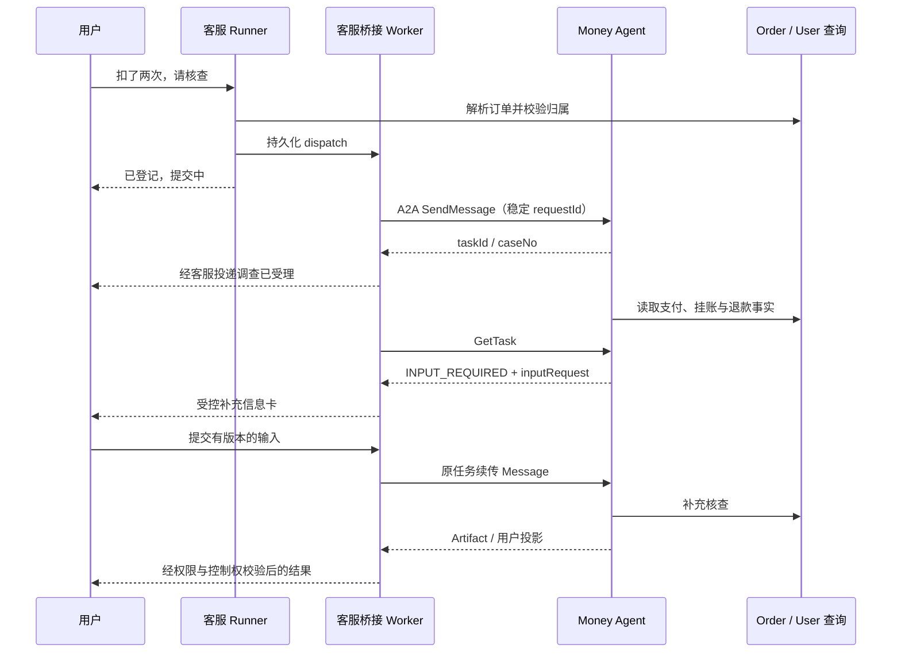

# 客服 Agent 与资金异常调查 Agent 对接开发设计

> 依赖：[主体设计](development_design.md)、[统一数据契约](data_contracts_and_schema.md)。本分册以当前 `CustomerRunner/CustomerMaster/CustomerStore` 及 React 实时客服实现为基线，新增内容均待开发。

## 1. 对接后的职责

客服负责确认“用户想调查哪笔钱”、获取必要输入、发起/关联调查、解释允许披露的事实、承接人工服务。Money 负责调查计划、资金事实、异常判断、财务处理建议和报告。

保留现有 `ORDER_AGENT`、`AFTER_SALE_AGENT`、`RULE_AGENT` 等节点。新增的是一个轻量的 **`MONEY_BRIDGE` 路由处理器**，不是另一个独立金融推理 Agent。它不持有退款/入账能力，也不重新判断 Money 报告中的资金事实。

三条链分别实现：

1. 客服 → Money：登记/查询/取消调查。
2. Money → 客服 → 用户 → Money：有版本地收集必要输入。
3. Money → 客服/坐席：投递可见进展、报告和业务结果，支持断线恢复与人工接管。

## 2. 现状核对与接入影响

| 当前实现 | 需要做的接入工作 |
| --- | --- |
| `IntentCatalog` 固定 21 类意图，售后以 disputeNo 查询 | 新增资金异常和调查进度意图，现有售后继续原职责 |
| `CustomerMaster` 只明确支持 orderNo/disputeNo/itemId；多处写死槽位列表和正则 | 增加统一槽位定义与资金引用解析，不能只改 prompt |
| Master 的“资金损失/被盗/仲裁”等提前走人工升级 | 保留优先级，已转人工时不偷偷自动开始调查；坐席可显式发起 |
| `CustomerRunner.tool` 每轮最多 6 次、单次 3 秒；Run 默认 90 秒 | 本轮仅做范围校验和本地登记/缓存查询，不等待长调查 |
| `respond` 只把 evidence/order/timeline/deliveryEvidenceSummary/choices 放入汇总 | 扩展为明确的 moneyProjection 与 lockedAnswerSection；不能让新字段被丢掉 |
| `pendingIntents` 表达本轮缺槽，`activeFocus/entityRegistry` 表达活跃实体 | 长任务放绑定表；只在上下文中保存最少 case/订单引用 |
| 输出校验以知识引用和订单/售后事实为主，流式校验是文本/引用过滤 | 新增资金事实与模板校验，不以关键词安全检查替代金额/状态一致性 |
| `CustomerStore.finish` 按 BOT/HUMAN 决定公开答复，但没有完整复核生成时的 controlEpoch | Money 结果在提交/投递时比对相同 epoch，防止 HUMAN→BOT 后旧结果重新覆盖 |
| 前端存在 `/realtime/sessions` 与后端 `/sessions` 等路径差异 | 本分册明确统一路径，先做契约测试 |
| 快照返回 recentMessages/payload，前端主要读取 messages/cards | 增加统一 DTO 转换与兼容读取，保证刷新后卡片不消失 |

## 3. 新意图与分流规则

### 3.1 只增加三类

| code | route | requiredSlots | optionalSlots | 用途 |
| --- | --- | --- | --- | --- |
| `PAYMENT_ANOMALY` | `MONEY_BRIDGE` | orderNo | attemptNo | 扣款与订单不一致、多次扣款、关闭订单后扣款 |
| `REFUND_ANOMALY` | `MONEY_BRIDGE` | orderNo | refundNo、moneyCaseNo | 已申请/记录退款但状态冲突或持续未确认 |
| `MONEY_CASE_PROGRESS` | `MONEY_BRIDGE` | moneyCaseNo | orderNo | 查询既有调查进展 |

requiredSlots 在本次范围内保持 AND 语义，不为了支持三类新意图改造所有意图为任意逻辑表达式。用户只给 attemptNo/refundNo 时，先由可信解析得到 orderNo，再进入 requiredSlots 校验。

### 3.2 与既有意图的区分

| 输入 | 预期路由 | 说明 |
| --- | --- | --- |
| “这笔订单付成功了吗” | ORDER_STATUS | 先普通状态查询；没有异常主张不自动建案 |
| “微信扣款了，订单还是待支付” | PAYMENT_ANOMALY | 对照渠道与平台事实 |
| “怎么申请退款” | AFTER_SALE_GUIDE | 仍为现有售后引导 |
| “售后单 DP…处理到哪了” | AFTER_SALE_PROGRESS | 仍为售后单查询 |
| “订单说退款了，钱没退回来” | REFUND_ANOMALY | 资金事实核查，与售后规则区分 |
| “那个资金调查有结果了吗” | MONEY_CASE_PROGRESS | 从授权活跃绑定消解 case，不猜编号 |
| “我的卖家结算什么时候可用” | SETTLEMENT | 现有结算查询，不扩展成买家支付调查 |
| “我账户被盗，要求赔偿并转人工” | HUMAN_HELP/既有升级规则 | 先人工，资金调查只由有权限坐席随后发起 |

`PAYMENT_ANOMALY/REFUND_ANOMALY` 只是候选。`CustomerMoneyTriageService` 读最小支付摘要、已有活动案后决定 `EXPLAIN_DIRECTLY / ATTACH_EXISTING / REGISTER_INVESTIGATION / ASK_SCOPE / HANDOFF`。普通处理中且无矛盾时可以解释已知状态，不无条件创建调查。

### 3.3 L1、L2、L3 同步改造

- L1：保留问候/偏好/人工升级优先级。只新增严格的本地卡片动作处理，不用一条含“钱”的正则抢走全部规则问题。
- L2：在 `t_customer_service_intent` 增加三类元数据、required_slots_json、route_node；训练示例和评测示例分离，给售后/结算/提现混淆项增加负例。
- L3：新增 `master-planner-v4.xml.st`，完整说明意图边界、新槽位和资金进度引用；`CustomerPromptRegistry` 注册新模板，`CustomerModels` 的 Master 调用点切换到 v4。
- Mock：更新 `CustomerMaster` 的 mock 分类分支，使本地流程能跑三类新意图；不能只在真实模型模式支持。
- 发布：走 `IntentReleaseService.create → 生成向量 → 校验 → activate`。该服务要求覆盖全部待发布意图及 OTHER，因此扩展现有评测集合，不只传三条资金样例。

不直接覆盖活动向量表，不将新增意图插入 MySQL 后就宣称在线生效。发布快照中的 route_node 必须与 `IntentCatalog.ROUTES` 一致。

## 4. 槽位、指代与跨会话恢复

### 4.1 统一槽位定义

新增 `CustomerSlotRegistry`，集中定义 slotName、格式校验、实体集合名、显示名和可信解析方式。逐一替换 `CustomerMaster` 中 modelIntents/validateModel/resolve/resume/contextHasEntity/registryCandidates 的写死字段集合，避免只在某一步识别新字段。

| slot | 来源 | 校验方式 |
| --- | --- | --- |
| orderNo | 原句、已确认订单、受限资金引用解析 | 现有订单格式 + 服务端归属 |
| attemptNo | 原句或服务端返回候选 | PA_ 前缀的完整不透明编号，最长 64；查表验证 |
| refundNo | 原句或服务端返回候选 | 当前有 RF_ 与 REF_SUSPENSE_ 等格式，最长 64；查表验证 |
| moneyCaseNo | 原句、绑定表、服务端卡片 | MC + 32 位 hex；绑定归属与远端受众权限 |

格式匹配只用于抽取。特别处理 `PA_T202610310001_01` 中嵌入的订单号：先识别完整资金编号并屏蔽该片段，再抽取独立订单编号，或统一词法边界包含下划线；不能把内嵌 T… 自动当作用户明确提供的已授权订单。

Money 卡片产生的 caseNo 等服务端引用不要求在用户自由文字中出现，但必须有 `SERVER_CARD_SELECTION` 或 `VERIFIED_REFERENCE` 来源；LLM 自造的新编号仍然拒绝。

### 4.2 LOAD_CONTEXT 阶段的改动

当前 LOAD_CONTEXT 节点主要记录阶段。新增 `CustomerMoneyContextLoader`：

1. 从已鉴权 userId 查询最近活动 binding（默认 5 条），而非扫描其他用户案件。
2. 根据当前会话业务绑定、明确订单和用户选择排序。
3. 对输入中明确的 attempt/refund/case 引用调用受限解析；结果附入 verifiedReferences，权限失败不返回候选对象。
4. 将简化的 `moneyCases` 写入临时运行上下文：caseNo、orderNo、taskState、caseState、projectionRevision、最后更新时间；不写内部报告和金融明细。
5. 修改 `CustomerContextWindowBuilder`，将该集合加入受预算约束的活跃实体描述。

这个过程应在 Master 识别前提供已验证引用。它不覆盖数据库中的历史 slot_json，后台 Worker 也不直接改用户会话焦点。

### 4.3 指代选择规则

“刚才那个调查”只在当前会话有唯一有效调查焦点时消解。多个活动问题时展示有限候选卡片，要求用户选择；不能以最近更新时间任意决定是哪笔钱。

用户切换到新订单后，旧 moneyCaseNo 不跟着套用；校验 case.orderNo 与 task.orderNo 关系，不一致返回 `MONEY_SUBJECT_CONFLICT`。并行多意图中的两笔订单分别绑定自己的 intentInstanceId，不共用一个全局可变 caseNo。

用户只问“资金调查进度”又没有编号：从当前账号活动案件给候选；无候选则询问订单号或说明尚无调查记录。不要让缺 caseNo 自动退化为新建调查。

### 4.4 slot_json 扩展与兼容

建议新写 schemaVersion=4，读端兼容现有版本 3：

```json
{
  "schemaVersion": 4,
  "activeFocus": {"orderNo": "T202610310001", "moneyCaseNo": "MC00000000000000000000000000000001"},
  "entityRegistry": {
    "orders": [],
    "disputes": [],
    "items": [],
    "moneyCases": [{"moneyCaseNo": "MC00000000000000000000000000000001", "orderNo": "T202610310001", "source": "VERIFIED_MONEY_BINDING", "confirmed": true, "lastMentionedTurn": 3}]
  },
  "pendingIntents": []
}
```

示例省略原有 turnNo 等未改变字段。Money 的 INPUT_REQUIRED 存在 binding/inputRequest 中，不塞进 `pendingIntents`；后者只存本轮缺槽任务，避免每次普通聊天都恢复旧调查追问。

## 5. CustomerRunner 的逐方法修改

### 5.1 新增依赖

注入 `CustomerMoneyApplicationService`、`CustomerMoneyContextLoader`、`CustomerMoneyAnswerAssembler`。不要在 Runner 里直接建立 A2A HTTP Client、访问财务数据库或持有长任务线程。

`Run` 新增 `expectedControlEpoch`（start 时读取）、`containsMoneyIntent`、`verifiedMoneyReferences`。以不可变/意图独立数据传递，兼容当前同阶段 CompletableFuture 并行执行。

### 5.2 分发顺序

`executeTask` 在现有订单/售后/policy 分支前增加 `MONEY_BRIDGE` 分支，防止未知新路由落到 policy 搜索：

```java
if ("MONEY_BRIDGE".equals(agent)) {
    // 只登记/获取当前可见投影，不同步等待调查完成。
    MoneyBridgeResult bridge = moneyApplication.handle(
        run.actor, run.session, run.no, intentInstanceId,
        run.expectedControlEpoch, validatedIntent);
    populateMoneyIntentResult(result, bridge);
} else {
    // 原有订单、售后、规则等分支。
}
```

`stageName` 增加“正在核对资金问题…”等用户可理解文本；不显示内部 Agent 拓扑。

### 5.3 工具白名单和计数

`CustomerToolPolicy` 新增：

```text
MONEY_BRIDGE -> resolveMoneySubject, queryMoneyPublicSummary,
               registerMoneyInvestigation, queryMoneyCaseProjection
```

`registerMoneyInvestigation` 仅写客服本地 dispatch，不发起资金操作。所有工具都由服务端把 actor、session、grant 填入，模型参数中不存在 userId/adminId/receiverURL。

保持现有每轮工具总数上限 6；复用 LOAD_CONTEXT 的已验证解析结果，单个资金意图目标不超过 3 次调用。两个独立资金意图同阶段执行也必须共享原有原子计数和总预算，达到上限时返回明确未受理状态，不悄悄丢任务。

### 5.4 本地登记与 remote acceptance 分开

客服正常一轮只等待本地登记，远程故障不会卡住 90 秒 Run。稳定 `requestId` 可由 `userId + 原始clientMessageId + intentInstanceId + action` 的 hash 派生并保存；跨轮重复问题再通过活动范围键合并。

本地登记成功响应：

```json
{
  "intentInstanceId": "RUN-DEMO-001:i1",
  "code": "PAYMENT_ANOMALY",
  "resolutionState": "COMPLETED",
  "bizType": "ORDER",
  "bizNo": "T202610310001",
  "answer": "已登记这笔订单的资金核查请求，正在提交调查。",
  "evidence": [{"orderNo": "T202610310001", "sourceKind": "VERIFIED_ORDER_SCOPE"}],
  "citations": [],
  "money": {
    "dispatchNo": "MD00000000000000000000000000000001",
    "dispatchState": "PENDING",
    "caseNo": null,
    "taskNo": null,
    "taskState": null,
    "caseState": null,
    "projectionRevision": 0
  }
}
```

`resolutionState=COMPLETED` 仅表示**本轮委托登记动作完成**，Money 的 taskState、caseState 独立表达。不能把它改成假售后号或“调查已完成”。接口响应无 caseNo 时前端使用 dispatchNo 查询本地进度。

### 5.5 异常降级

Money 专属失败由 bridge 生成合法的局部结果，不抛成整个 Run 的通用失败：

| 情况 | 客服行为 |
| --- | --- |
| 无归属/对象不存在 | “无法访问这笔业务记录”，不透露是否属于别人 |
| 范围不明确 | 展示有限候选或询问订单号 |
| 本地登记失败 | 明确未登记，提供重试/人工；不伪造 dispatch |
| 远端暂不可用但已登记 | 显示“提交待恢复”，保留稳定请求，后台重试 |
| 远端已受理 | 显示真实任务阶段，不再本地新建 |
| 查询投影失败 | 显示最后已核实时间并标记暂未获取最新结果，不将缓存当实时事实 |

普通订单/规则意图仍正常完成。例如“查扣款异常，另外提现最低多少”可以一项登记、一项正常答复。

## 6. 异步桥接 Worker

### 6.1 `CustomerMoneyDispatchWorker`

1. 按 next_attempt_at claim dispatch，保存 lease/fencing token。
2. 校验 grant 是否仍有效，获取短期服务/委托凭据。
3. 调用 MoneyAgentClient.start/provideInput/cancel。
4. 收到合法回执后，在本地事务内更新 dispatch、upsert binding；如果会话已关闭仍保存绑定，不强行公开发言。
5. 创建有唯一业务键的进度投递记录，由独立投递服务处理。

网络超时后保留 requestId/payloadHash，指数退避。权限失效、schema 不兼容是永久错误，进入人工处理，不无限重试。

### 6.2 `CustomerMoneyTaskSyncWorker`

对非终态任务调用 GetTask，检查 caller/context/taskId/caseNo/orderNo 对应。另对授权仍有效、case 仍活动的 binding 调用 `MoneyAgentClient.getCase`（A2A case-status 技能），包括 task 已 COMPLETED 但 case 为 NEED_REVIEW/WAITING_BIZ 的情况；通过 case 的 currentTaskNo 发现后续调查。只有更高 projectionRevision 才更新最新案件视图，GetTask 的历史投影不能覆盖更晚的案件投影。

多个 Worker 并发靠 binding.version CAS；同 revision 不同 hash 隔离并告警。旧 task 的迟到响应不覆盖 current task。报告完全一致的普通轮询不创建消息。

等待输入时低频检查，等待财务/业务回执时按配置降低频率；case-notices 只作提前唤醒信号，丢通知仍能由定时 case 查询恢复。MUTED 订阅不主动发消息，REVOKED 停止读取；不能将用户取消订阅解释为取消整个财务案件。

仅发生以下有意义变化才投递：远端首次受理、需要用户补充、进入人工复核、产生关键资金事实变化、调查终态。技术步骤、心跳、工具查询次数不逐条通知用户。

### 6.3 主动入口 `CustomerMoneyNoticeService`

接收 `/internal/agent/money/case-notices`：先服务鉴权与 schema/hash 校验，再 Inbox 持久化；后台根据 Order 范围解析确定买家，检查服务通知策略，建立 user-scoped binding，获取其可见投影。

请求中不接受自由 userId/senderType/消息正文；即使 Money 内部任务来自财务，也不能据此以系统管理员身份向任意会话发送。无法解析用户时留处理记录，不使用默认 userId=1。

## 7. 用户补充信息如何返回 Money

### 7.1 卡片优先

资金问题使用新增 `MoneyInputCard`，不是当前售后 SOP 的 DynamicForm 流程。字段来自受验证 schema，并由客服在允许字段目录内再次检查。首版不使用用户任意上传文件 URL。

提交链：用户点击 → 客服校验 card/session/user/inputRequest/version → 本地 dispatch(PROVIDE_INPUT) → Money 续传同一未终态 Task → 回执更新卡片。

卡片状态至少区分 `EDITABLE/SUBMITTING/SUBMITTED/STALE/FAILED`。本地登记后显示 SUBMITTING；远端接受后显示 SUBMITTED，避免网络失败却显示资料已收到。

### 7.2 自由文本补充

若该会话只有一个当前有效 inputRequest，且用户本轮明确回答其字段，可由 `MoneyInputCandidateExtractor` 提取候选。包含金额、支付方式等关键选择时展示确认卡，用户确认后再提交；不把每条新聊天自动当补证。

若用户同时提出新问题，先处理新意图，原输入请求保持待补充；若有多个案件，要求选择 case。用户明确转人工时优先转人工，未提交候选不自动发送。

如果 Money Task 已结束，用户补充新材料需创建关联的新任务，不向终态任务强塞输入。旧卡片对外返回 `MONEY_INPUT_STALE` 并展示最新入口。

## 8. 回复生成与资金事实校验

### 8.1 首版选择：资金段使用确定性模板

不要直接把 Money 内部报告加入 `verified_tool_facts` 然后让客服模型自由重写。首版由 `CustomerMoneyAnswerAssembler` 根据 publicProjection 生成资金段，其他子问题保持原有生成方式。

`respond` 改为：拆分 money/nonMoney 结果 → 对 nonMoney 走现有汇总 → 拼入不可改写资金段 → 整体校验 → 再发出。Money 金额、原始状态、是否完成、更新时间均由程序填充。

当本轮包含资金意图时，生成期间可发 stage.progress，但 answer.delta 先缓冲完整回复，待资金校验和控制权复核后再输出；其他普通轮次保留现有流式体验。当前 `CustomerStreamingAnswerGuard` 仍保留用于敏感词/引用校验，但不能证明资金事实正确。

### 8.2 需要改动的结果字段

- `respond` 保留 `money`、`cards`、`moneyProjectionRef`、`lockedAnswerSection`，但只把已脱敏的公开数据交给客户端。
- `CustomerOutputGuard.validate` 对 money 结果增加：订单归属证据、case/order 对应、projectionRevision、模板匹配、coverage、金额/币种与 factId 对应校验。
- 继续使用 `bizType=ORDER/bizNo=orderNo` 满足现有业务归属证据逻辑；caseNo 放独立 money 字段，不把 case 伪装成订单号。
- 对 `MONEY_CASE_PROGRESS`，由已验证 binding 补入对应 orderNo 及 slotSource，确保现有证据校验不会漏过。
- 业务事实引用使用 moneyFactRefs，不伪装成带 docNo/docVersion 的 `[S1]` 知识引用。平台规则仍按现有 citations 契约。

### 8.3 表述白名单

| 权威条件 | 允许文本概要 | 禁止升级成 |
| --- | --- | --- |
| dispatch 已保存，远端未知 | 已登记请求，提交中 | 已受理调查/已查明 |
| 仅退款申请或业务编排受理 | 退款流程已受理/处理中 | 已退款成功 |
| 平台资金步骤 SUCCESS，渠道未知 | 平台资金记录已更新，渠道结果待核实 | 资金已原路到账 |
| 渠道返回 PROCESSING | 渠道仍在处理中，最后查询时间… | 马上到账/保证某时到账 |
| 渠道 SUCCEEDED 且对象参数匹配 | 渠道返回退款成功，尚无收款账户到账证明 | 买家账户一定已到账 |
| 报告已产出、case NEED_REVIEW | 调查材料已整理，等待人工复核 | 问题已解决 |
| 数据源不可达/集合截断 | 当前无法完整核实 | 未扣款/不存在退款 |

保留原安全规则，不通过删除整个退款承诺正则解决文本被拦问题。资金段使用经过测试的固定措辞；如以后开放模型解释，增加独立结构化 claims 校验并在验收后灰度。

## 9. 消息投递、人工接管与会话关闭

### 9.1 新建内部消息写入口

新增 `CustomerSystemMessageService`，仅供可信业务组件调用，明确角色 `AGENT/SYSTEM`、senderType `MONEY_UPDATE`、schemaVersion 与完整 cards。它验证绑定和受众，不走 `new AgentActor(1L,"SYSTEM")` 或把系统消息伪装为用户。

当前 `CustomerConversationService.sendMessage` 的 senderType 可影响 isStaff 判断，且公开消息结构与新要求不同；资金结果不能通过任意传 senderType 绕开权限。公共发送入口应由后端推导 senderType，内部系统发送使用不同方法和权限路径。

### 9.2 投递事务

1. 根据 caseNo/projectionRevision/recipient/deliveryKind 取唯一 delivery。
2. 锁 binding 和 session，验证 userId、会话 ACTIVE、mode、最新 controlEpoch 与投影版本。
3. BOT 且允许公开：创建消息和卡片，使用 `SessionEventStore.appendPublicEventInTx` 同事务分配序号/落事件/Outbox，记录 messageNo。
4. QUEUED/HUMAN 或 epoch 已变化：写 `t_agent_money_staff_note`，delivery 标 `HELD_FOR_STAFF`；不写公开消息，也不向用户广播内部材料。
5. CLOSED/EXPIRED：binding 保留最新投影，delivery 标 `WAITING_SESSION`。用户下次打开有效会话时通过绑定展示；不复活已关闭会话。

人工返回 BOT 后，旧 HELD_FOR_STAFF 不自动群发；仅重新读取当前投影生成一次最新摘要，或由坐席选择公开。否则排队期间的旧状态会按时间顺序重复轰炸用户。

### 9.3 生成中控制权变化

`CustomerStore.start` 返回生成时 expectedControlEpoch；finish 时要求 mode=BOT 且 epoch 精确相等。仅检查当前 mode 不够：BOT→HUMAN→BOT 也应使旧答复失效。

Money 轮次答案全部缓冲后，在持有会话控制条件的提交路径落库再发送已提交结果；若条件不满足，用户流只收到模式变化/已转人工状态，完整内容保留给坐席。不得在最终 guard 失败之前已经把未校验资金段推给用户。

### 9.4 取消的含义

用户可取消自己发起、没有未决业务命令且没有其他有效调查需求的任务。其动作只取消调查/订阅，不取消支付或退款。后台财务案件仍有运营处理需要或其他主体仍在调查时，仅将该用户绑定 subscription_state 设为 MUTED，并返回 `SUBSCRIPTION_MUTED` 及说明，不调用 CancelTask，也不允许用户关闭整个财务案件。撤回取证授权是单独的 REVOKED 动作，执行任务若依赖该授权则进入 AUTH_REQUIRED；不把静音自动当作撤权。

取消与完成竞争使用 task/version CAS；远端已完成则返回真实完成结果，不伪造取消成功。关闭聊天窗口不等于取消调查。

## 10. 前后端 HTTP 契约

### 10.1 先统一现有实时接口

以当前 `CustomerRealtimeController` 的服务端路径为准修正调用端，并加入契约测试：

| 功能 | 前端当前调用 | 服务端当前路径/处理 | 目标 |
| --- | --- | --- | --- |
| 会话列表 | `/api/agent/realtime/sessions` | `/api/agent/sessions` | 使用后端路径 |
| 快照 | `/api/agent/realtime/sessions/{s}/snapshot` | `/api/agent/sessions/{s}/snapshot` | 使用后端路径 |
| 补拉事件 | `/api/agent/realtime/sessions/{s}/sync` | `/api/agent/sessions/{s}/sync` | 使用后端路径 |
| 已读 | `/api/agent/realtime/sessions/{s}/read` | `/api/agent/sessions/{s}/read` | 使用后端路径 |
| 转人工 | `/api/agent/realtime/sessions/{s}/handoff` | `/api/agent/sessions/{s}/handoffs` | 路径和复数统一 |
| 卡片动作 | `/api/agent/realtime/sessions/{s}/card-actions` | `/api/agent/sessions/{s}/card-actions` | 使用后端路径 |
| 实时 ticket / WS | `/api/agent/realtime/...` | 该部分确实有 realtime 前缀 | 保留，不全局字符串替换 |

售后 `sop.start/submitTask` 的前端路径也与当前 `CustomerWorkflowController` 不一致，但资金卡片不走这条链路；另列现有功能修复项，不让新对接依赖未修好的售后 SOP。

### 10.2 新增用户 API

| Method/path | 输入 | 返回 |
| --- | --- | --- |
| POST `/api/agent/money/investigations` | sessionNo、orderNo/受控selector、problemFamily、claim、clientOperationId | dispatchNo、dispatchState、可选 caseNo |
| GET `/api/agent/money/dispatches/{dispatchNo}` | 登录身份 | 当前用户的提交状态与回执 |
| GET `/api/agent/money/cases` | 可选 orderNo、游标 | 当前用户的绑定投影列表 |
| GET `/api/agent/money/cases/{caseNo}` | 登录身份 | 当前用户可见最新投影及更新时间 |
| POST `/api/agent/money/cases/{caseNo}/inputs/{inputNo}` | expectedInputVersion、answers、clientOperationId | 本地提交回执，远端未受理前状态为 SUBMITTING |
| POST `/api/agent/money/cases/{caseNo}/cancel` | expectedTaskVersion、reason、clientOperationId | 取消请求回执；不直接表示远端已取消 |

HTTP 返回沿用 ApiResponse。业务异常码固定并带 retryable：`MONEY_SUBJECT_REQUIRED/MONEY_SUBJECT_CONFLICT/MONEY_CASE_INACCESSIBLE/MONEY_DISPATCH_UNAVAILABLE/MONEY_INPUT_STALE/MONEY_INPUT_VERSION_CONFLICT/MONEY_AUTH_EXPIRED/MONEY_REMOTE_UNAVAILABLE/MONEY_SCHEMA_UNSUPPORTED`。

查询 API 不从 URL 的 caseNo 推断 userId；先校验当前用户绑定，再取远端对应受众投影。所有 Controller 使用统一鉴权与会话访问服务，不能仅接受未验证的 X-User-Id。

### 10.3 坐席与管理接口

客服侧新增 `/api/staff/agent/sessions/{sessionNo}/money-cases`，查看当前被分配会话的案件摘要；新增显式“发起调查/提交资料/公开摘要”动作。校验坐席在线身份、当前 assignment/skill group、controlEpoch，不能所有 ADMIN 默认读取所有用户消息。

Money 自身管理接口建议：

```text
GET  /api/admin/money-agent/cases
POST /api/admin/money-agent/cases
GET  /api/admin/money-agent/cases/{caseNo}
POST /api/admin/money-agent/cases/{caseNo}/assign
POST /api/admin/money-agent/cases/{caseNo}/reinvestigate
POST /api/admin/money-agent/cases/{caseNo}/close
POST /api/admin/money-agent/proposals/{proposalNo}/review
GET  /api/admin/money-agent/commands/{operationId}
```

review 接口只审批结构化建议；执行动作由后端受控流程生成。API 要求 expectedVersion 和 clientOperationId，不能传一个字符串“同意”就触发任意业务动作。

## 11. 卡片、快照与实时协议

### 11.1 新增组件

- `MoneyInvestigationCard.jsx`：关联订单、阶段、更新时间、coverage 提示、查询详情/转人工/允许时取消。
- `MoneyInputCard.jsx`：渲染有限字段目录，提交前显示具体要发送的资料；避免复用含售后 workflowNo 假设的动态表单。
- `MoneyReportPanel.jsx`：用户视图和坐席视图分别取对应 API，不能同一份内部 payload 在客户端隐藏字段。

`RichMessageRenderer` 增加 `money_investigation`、`money_input` 类型，未知卡仍用 fallbackText。UI 采用已有 cardId/type/cardVersion/revision/data/actions 契约。

### 11.2 进度卡示例

```json
{
  "cardId": "CARD-DEMO-001",
  "type": "money_investigation",
  "cardVersion": 1,
  "revision": 3,
  "fallbackText": "资金调查已受理，正在核查渠道状态。",
  "data": {
    "caseNo": "MC00000000000000000000000000000001",
    "orderNo": "T202610310001",
    "caseState": "OPEN",
    "taskState": "WORKING",
    "projectionRevision": 3,
    "updatedAt": "2026-10-31T10:01:00+08:00",
    "environment": "MOCK"
  },
  "actions": [{"actionId": "ACTION-DEMO-001", "type": "OPEN_MONEY_CASE", "label": "查看进度"}]
}
```

动作对象不携带可任意访问的外链或用户 ID。`MoneyCardActionHandler` 根据持久化 cardId/actionId 查真实目标及允许动作，忽略浏览器自报的 type/bizNo 是否看起来正确。现有 `CardActionService` 的 default 成功分支不能处理新动作，未知动作应返回不支持。

### 11.3 消息 schema 与恢复

建议新的消息 payload 采用 schemaVersion=4，统一：`messageNo/sessionNo/sessionSeq/role/senderType/content/cards/citations/suggestedActions/createdTime`。存储 payload_json 为对象；读取老版 payload 数组时按 cards 兼容转换，读取旧 richCard 时转换单元素 cards。

快照由 `CustomerMessageViewAssembler` 返回标准 `messages`；兼容期可同时返回旧 recentMessages，前端读取 `messages ?? recentMessages`，不合并两份导致重复。消息中的 payload 统一转换后再传前端。

`CustomerRealtimeContext` 用 messageNo、runNo、clientMessageId 进行消息关联；SSE 临时 AI 气泡与最终公开事件必须共享稳定标识，不能靠“最后一条消息”处理金融结果。旧消息仍允许降级展示。

### 11.4 事件去重与更新

保持 RealtimeProtocol 的 envelope 版本 1，新增 payload 类型 `money.case.changed`；`message.created/card.updated` 继续使用。Money 的 projectionRevision 与会话 eventSeq 不混用。

WebSocket client 向 Context 传递 envelope 的 sessionNo/eventSeq/eventId，不能只保留 payload 丢失序号。Context 仅应用更大 eventSeq，卡片仅接受更大 revision；中间序号缺失时调用 sync。

sync 读取当前会话授权，分页 until highWatermark；断线重连以 snapshotSeq 起点补拉。测试“回包与实时事件重复”“卡片 4 先于 3 到达”“刷新后历史卡片仍可见”。现有 Redis 广播不能替代数据库补拉。

## 12. 接入必须完成的访问控制修复

1. 新建 `CustomerSessionAccessService`，供 snapshot/sync/read/card-actions/绑定迁移共用。当前部分方法只接收 sessionNo 查询，没有在该层验证 actor，资金数据接入前必须补齐。
2. `AgentActorResolver` 当前可接受身份 header；对公网入口必须验证真实 JWT 或可验证网关身份，禁止绕过 Gateway 直连服务伪造 header。内部 Money 事件使用独立服务认证，不能伪装普通用户请求。
3. `CardActionService` 要校验 session 所有者、card 所有者、action 目录、revision、幂等键；禁止未知动作默认成功。
4. `CustomerConversationService` 外部调用的 senderType 由服务端确定，内部投递使用独立受控入口。
5. `CustomerStore.finish` 增加 expectedControlEpoch 精确比较；内部草稿/便笺按实际 schema 落库，不依赖吞掉异常的 fallback。
6. 不把 Money 事件送入现有有固定收件人兜底的通用 outbound 路径。资金 notice Inbox 和投递记录有独立真实关联。

这些是接入涉及数据与消息路径的必要修复，并不是要求先重构全部客服模块。

## 13. 两条完整时序

### 13.1 用户主动调查



图中 B 对用户的箭头表示调用客服消息投递服务，不是 Worker 绕过控制权直接写 WebSocket。

### 13.2 财务主动调查后用户追问

运营/对账事件 → Money 创建问题 → 必要时向客服发受控 notice → 客服解析合法买家并绑定 → 用户随后询问 → LOAD_CONTEXT 找到已有绑定 → 获取最新投影 → 复用问题。

若财务案件调查范围比该用户更大，用户只能附着到单订单受众视图，A2A history/artifacts 同样过滤；不能因为 caseNo 相同就获取完整财务 Task 历史。

## 14. 客服侧完成标准

新增意图在 L2/L3/Mock 三路径均可用；只给资金编号能可信定位；两笔订单不会串案；本轮回答不等待长任务；重复发送不重复受理；补充输入有版本和回执；结果不会泄露内部财务数据；SSE/WS/快照三入口呈现一致；转人工和关闭会话不会丢调查；所有“已受理/已完成”均有对应权威记录。

具体测试矩阵、文件改动和发布顺序见[实施与验收](implementation_and_acceptance.md)。
