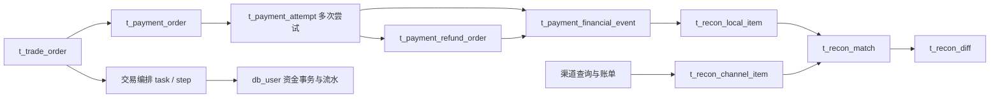
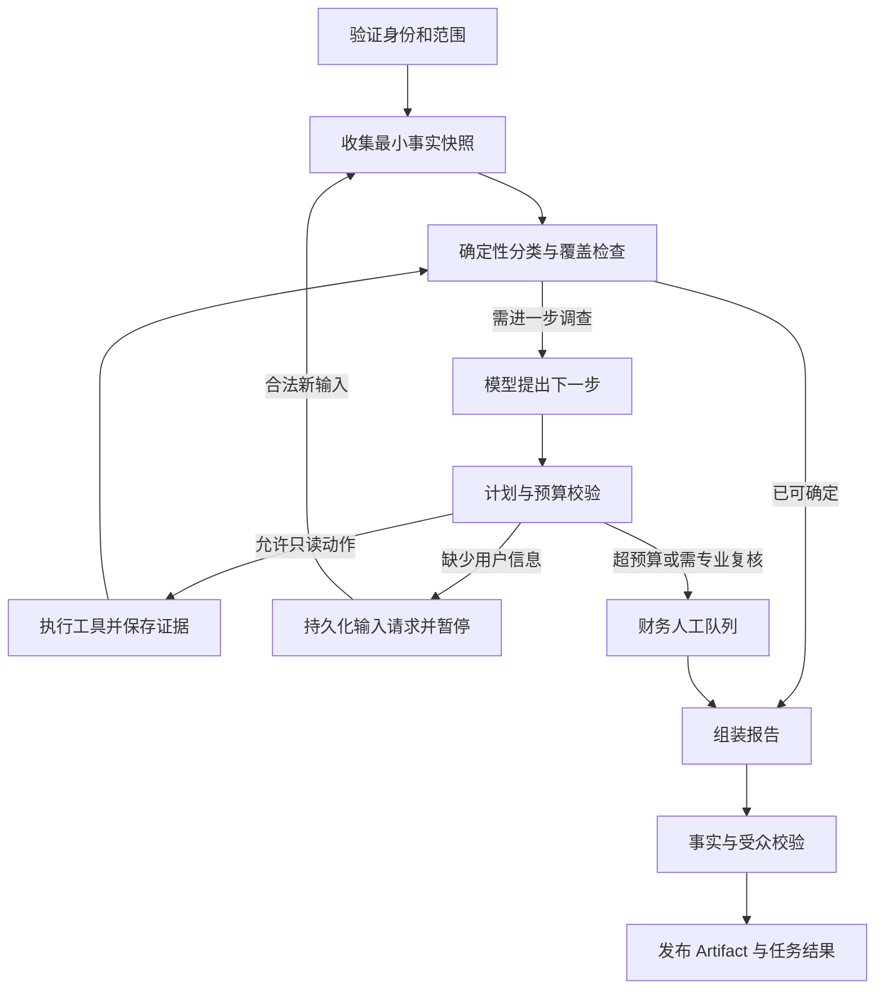

# 资金异常调查 Agent：主体开发设计

> 配套：[数据与数据库](data_contracts_and_schema.md)、[客服接入](customer_agent_integration.md)、[实施与验收](implementation_and_acceptance.md)。日期：2026-10-31。
>
> 标记约定：“现状”表示已核对的源码；“新增/改造”表示本设计要求；示例编号、端口、超时和阈值均为设计值。代码片段是接口/算法设计，不是已实现代码。

## 1. 业务定位与首版范围

### 1.1 独立承担什么结果

资金异常调查 Agent（下文 Money Agent）为支付与财务运营提供：

1. 对某笔交易、支付尝试或对账差异的可验证资金路径。
2. 异常分类、支持/反对证据、待核查项以及下一步工作。
3. 受众隔离的报告：财务内部调查包、客服可见摘要、用户可见进度。
4. 审核与业务执行后的复查，明确“已解决”“尚未解决”“证据不足”。

它可以由对账任务或运营主动发起，客服只是其中一个入口。因此它有自己的业务任务、状态、负责人和服务生命周期，不是客服内部又一个查询分支。

### 1.2 首版处理范围

| 范围 | 触发例子 | 首版结果 |
| --- | --- | --- |
| 支付已扣款但订单未推进 | 用户反馈、渠道单边差异 | 定位支付尝试；检查渠道事实与平台确认/编排；形成补确认建议 |
| 重复/迟到支付与挂账 | 多笔成功、订单关闭后付款 | 区分用于订单的款与挂账款；核查挂账入账及对应退款 |
| 退款状态冲突/长时间未确认 | 订单退款但渠道未知、失败、处理中 | 给出四层事实；待查原退款，不直接再次发起退款 |
| 对账金额/单边差异 | `t_recon_diff` 新增或重开 | 重新确认条目类型、对象关联、时间窗口，提供调查材料 |
| 调查进度与补充资料 | 客服追问或财务追问 | 查询已有问题，不重复建案；有版本地续传输入 |

暂不覆盖：提现审核、商家银行卡到账、全平台余额审计、任意金额转账、自动仲裁、补偿赔付、自动豁免差异。商家结算基础查询保留现有 `SETTLEMENT` 路由。渠道结算/到账可作为内部佐证，但不是买家退款到账证明。

### 1.3 Agent 与普通程序的分工

| 工作 | 实现方式 |
| --- | --- |
| 编号解析、归属、关联唯一性、金额和币种比较、状态合法性 | 确定性 Java 代码 |
| 识别对账候选、到期扫描、重试、去重、告警 | Job/Worker/SQL |
| 解析用户“被扣两次”“退款去哪了”等描述；形成待核查假设 | 有结构输出约束的模型 |
| 根据相互矛盾或不完整的材料选择下一项只读调查 | 有界规划器 + 工具白名单 |
| 事实报告与面向客服的说明 | 程序输出事实；模型补充解释；输出校验器验证引用 |
| 补确认、退款、资金入账、对账关单 | 业务服务与审批机制，模型无直接执行权 |

保留“纯规则 + 自动聚合 + 模板报告”基线。简单、证据完整的问题直接模板输出，无需调用模型；模型增量必须通过人工处理时间、有效补证和报告可用率证明。

## 2. 当前项目的真实链路

### 2.1 模块与技术边界

- `mall-order-service` 实际 Java 包名是 `com.example.item`。支付、退款、对账和交易编排都在该模块，不应按模块名虚构 `com.example.order` 包。
- `mall-user-service` 拥有平台/用户资金账户、`FundTransaction`、`FundFlow`。资金数据不能由 Agent 跨库直查。
- `mall-agent-service` 是客服与 RAG 所在服务，已有 Spring AI Alibaba Graph、MySQL、pgvector、Redis、SSE/WebSocket。
- 当前 Java 21、Spring Boot 3.5.6、Dubbo 3.3.0；Agent 模块使用 Spring AI Alibaba 1.1.0.0、Spring AI 1.1.0。新增服务先沿用项目 BOM，A2A 依赖单独兼容验证。
- 四种支付方式 `UNIONPAY_BANK / WECHAT_PAY / ALIPAY / ECNY` 都由项目内 Mock 策略实现。本文不能被解释成真实支付渠道已接通。

### 2.2 事实对象及关联



图中是业务关联，不代表所有边都有现成外键或完整关联字段。

| 现有对象 | 核实到的字段与语义 | 查询注意事项 |
| --- | --- | --- |
| `PaymentOrder` | `paymentNo/orderNo/activeAttemptNo/successfulAttemptNo/paymentMode/dataOrigin/version` | 聚合状态不能代替全部尝试；旧支付链路可能没有 attempt |
| `PaymentAttempt` | `attemptNo/paymentNo/orderNo/attemptSeq/outTradeNo/profileSnapshot/status/allocationStatus/version` | 当前尝试号为 `PA_ + orderNo + _序号`，`outTradeNo` 当前等于 attemptNo；业务关联仍应查表 |
| `PaymentRefundOrder` | `refundNo/originalAttemptNo/orderNo/status/channelRefundNo/fundTaskNo/requestKey/version` | 同订单可能多条退款；`fundTaskNo` 字段存在不代表所有路径已经填充 |
| `PaymentFinancialEvent` | `eventType/eventStage/bizType/bizNo/orderNo/profileId/channelBusinessDate/recordedAt` | 是平台事件记录，不是独立渠道到账证据；当前存在状态质量问题 |
| `ReconDiff` | `diffNo/diffType/bizKey/orderNo/attemptNo/refundNo/lastSeenRunNo/status` | `orderNo` 可能为空，编号类型可能填入不准确，需回溯原始条目 |
| `ReconRun/ReconFile/ReconMatch` | 截止时间、账单日期、版本/hash、条目关联 | 先确认账单完整和窗口闭合，不能把未出账当资金丢失 |
| `FundTransaction` | `transactionNo/businessType/orderNo/idempotencyKey/amount/status` | 没有持久化 `attemptNo/refundNo`；挂账交易 `orderNo` 为空 |
| `FundFlow` | `transactionNo/ownerType/ownerId/accountType/direction/amount/balanceAfter` | 外部账户方向是平台账本表达，不能证明外部账户实到；部分 `balanceAfter` 不适合作权威余额 |

### 2.3 已存在的确定性处理链

正常支付由 `PaymentApplicationService` 创建尝试，`PaymentConfirmationService.acceptVerifiedFact` 处理渠道事实并触发 `TradeOrchestrationService`。多付/迟到路径设置 `allocationStatus=LATE_PAYMENT`，调用 User 服务挂账并尝试自动退回。

订单退款编排中的 `TradeOrchestrationCommandService.fundRefund` 调用渠道退款与内部资金接口。渠道对账由 `ReconciliationExecutionService` 和 `MultiChannelReconciliationJobHandler` 承担。**Money Agent 不能重新实现这些状态机，也不能变成它们的调度器。**

## 3. 必须计入开发的现状缺口

这些是静态代码观察，尚未执行运行复现。影响只读调查的部分在第一阶段处理；涉及写操作的部分是启用修复能力的硬性门槛。

| 编号 | 现状 | 设计影响/改造要求 |
| --- | --- | --- |
| G01 | 现有 `FundDubboService` 主要是资金命令，缺少调查明细查询 | 新建独立只读接口，禁止给模型直接绑定原命令接口 |
| G02 | 挂账资金事务无 orderNo，attempt/refund 未持久化 | 通过受验证的精确幂等键关联历史数据；新增资金业务引用表；关联缺失返回未知 |
| G03 | `processChannelRefund` 每次生成随机后缀退款号，未由稳定业务操作去重 | 首版禁止 Agent 调用退款；后续先改为业务操作唯一退款记录与渠道查询恢复 |
| G04 | `processChannelRefund` 对 `PROCESSING` 也写 `successAt` 和 `eventStage=SUCCESS` | `successAt`/金融事件不能单独证明成功；修复写入条件，历史矛盾保留审计 |
| G05 | 退款编排捕获渠道异常后仍继续内部资金步骤；内部使用的 `RF_ + orderNo` 不一定等于真实渠道退款号 | 报告区分内部出账与渠道事实；必须建立准确操作/退款/资金事务关联 |
| G06 | `triggerSuspenseAutoRefund` 判断 `result.success()`，而查询退款的 success 也可能只表示找到了记录 | 统一“调用成功/记录存在/退款终态”的语义；终态以明确状态和匹配字段判断 |
| G07 | 挂账调用异常被记录后仍继续退款路径；attempt 成功后重复确认直接短路 | 不以 attempt 成功推定 User 资金步骤成功；需独立查询资金回执与恢复任务 |
| G08 | 对账代码将退款条目也可能归成 `*_PAYMENT`，部分 bizKey 被写入 attemptNo；比较以金额为主 | 调查重新解析 itemType、币种、状态与时间窗口；不能直接以 diffType 决定修复 |
| G09 | `ReconciliationRepairService` 的 `QUERY` 和 `REPAIR` 共用写分支；`RESOLVE/WAIVE` 可改变业务状态 | 查询必须独立；关单不等于钱已正确；第一版不将这些管理动作作为 LLM 工具 |
| G10 | `acceptVerifiedFact` 的入参前置校验及并发绑定仍需加强；当前方法未统一严格拒绝不匹配的状态/币种/身份 | 补确认前以订单/支付/attempt 锁和可信渠道事实做全量校验，不能直接照搬调用 |
| G11 | 多处查询/退款用 `ChannelProfileSnapshot.defaultFor`，忽略原尝试配置快照；金融事件的账户标识有固定值 | 查询优先解析原 snapshot；无法恢复则报 `PROFILE_UNRESOLVED`，禁止悄悄套当前默认账户 |
| G12 | Mapper 有待查退款方法，但已读 Job 未形成完整退款持续查单闭环；已有对账测试部分仅验证简单表达式 | 新增明确的查询恢复与真实服务测试，不能用“有方法/有测试文件”证明闭环 |
| C01 | 客服只支持订单/售后/商品槽位，没有资金问题引用 | 客服增加受限资金桥接与问题绑定，详见客服分册 |
| C02 | 前端实时路径、快照字段与服务端存在不一致 | 先修复恢复/补证/卡片契约，再接入后台调查结果 |
| C03 | 主动触达、卡片操作、消息 senderType 与归属校验存在原型边界 | 新资金链路走有身份、受众和幂等约束的专用桥接，不直接复用开发兜底 |

不能让 LLM 通过“合理猜测”弥补 G02/G04/G05。事实不完整本身就是调查结果，并应进入人工队列。

## 4. 服务与部署设计

### 4.1 明确选择独立服务

新增 Maven 模块 `mall-money-agent-service`，包 `com.example.moneyagent`，数据库 `db_money_agent`。建议本地 HTTP 端口 `8086`，启动时需检查冲突；Dubbo 仅作为消费者，不强制设置提供者端口。

| 服务 | 数据所有权 | 新增职责 |
| --- | --- | --- |
| Money Agent | 问题、调查任务、快照、报告、输入请求、操作建议 | 独立运行调查和运营工作台 API，提供 A2A 服务 |
| 客服 Agent | 会话、用户消息、客服任务绑定、用户投影、投递记录 | A2A Client、用户身份桥接、补证交互与结果送达 |
| Order | 支付/退款/对账及操作命令台账 | 只读快照、渠道只读观察、可信实体解析、受控补确认 |
| User | 内部资金事务/流水与新增业务引用 | 受限查询和资金证据关联 |
| Gateway | 用户/管理员访问入口 | 新增管理路由；A2A 内部入口不暴露为免登录公网 API |

### 4.2 最小依赖

沿用根 POM 版本管理、`mall-api`、Web、Validation、MyBatis-Plus、MySQL、Actuator、Dubbo/Nacos，以及现有 Graph/模型适配方式。Money 首版不需要独立 pgvector、知识向量库或 Redis 锁；数据库租约承担任务正确性，Redis 可用于限流。

A2A 采用 v1.0.0 协议基线，Java SDK 候选为已发布的 `1.4.0.Final`。只在依赖兼容与协议测试通过后锁定；不要求顺便升级现有客服的 AI 依赖。[协议规范](https://a2a-protocol.org/v1.0.0/specification/)、[Java SDK 发布页](https://github.com/a2aproject/a2a-java/releases/tag/v1.4.0.Final)

首版采用 HTTPS JSON-RPC + 后台轮询任务结果，不要求 push notification 或全程 SSE。轮询有持久化游标和退避；以后增设标准推送时仍保留查询恢复。

### 4.3 组件结构

```text
com.example.moneyagent
  api/              MoneyCaseAdminController, MoneyA2aEndpoint
  application/      MoneyCaseService, MoneyTaskService, MoneyInputService
  investigation/    MoneyInvestigationGraph, MoneyPlanValidator
                    MoneyRuleEvaluator, MoneyStatusNormalizer
                    MoneyReportAssembler, MoneyReportGuard
  tools/            OrderMoneyQueryClient, UserFundQueryClient, MoneyToolPolicy
  authorization/    MoneyAccessPolicy, DelegationVerifier, MoneyAdminPolicy
  runtime/          MoneyTaskWorker, MoneyLeaseRepository, MoneyTaskRecoveryJob
                    MoneySourceInboxWorker, MoneyEventOutboxWorker
  transport/a2a/    MoneyA2aAdapter, MoneyTaskStateMapper, MoneySkillCatalog
  persistence/      entity / mapper / repository
  model/            MoneyModelClient, MoneyPromptRegistry, MockMoneyModelClient
  operations/       MoneyProposalService, MoneyReviewService, MoneyCommandTracker
```

Graph 不持有跨数小时的内存会话。每次 Worker 执行一个有限步骤，checkpoint 落库后释放租约；补充信息或业务事件到达再恢复。不能复制客服 `RUN_REGISTRY` 的内存持久性假设。

## 5. 调查入口与关联规则

### 5.1 三类入口

1. **客服**：用户已选定订单并表达异常，创建/复用调查；查询正常支付只返回事实，不建案。
2. **运营**：管理端在对账差异详情点击“发起资金调查”，指定 diffNo，服务端解析对象；不可提交任意用户身份。
3. **系统**：对账差异新增/重开、退款持续未知、编排进入人工状态触发候选；确定性筛选后建案。

系统触发不能直接向任意用户发消息。先定位订单与用户范围，且需要服务通知策略允许；无法关联的差异只留财务队列。

### 5.2 标准范围键与去重

范围解析由 Order 生成 `scopeKey`：`ORDER:<orderNo>` 或无法关联订单时的 `RECON:<profileId>:<diffNo>`。首版问题族分为 `PAYMENT_CONFIRMATION`、`EXCESS_PAYMENT`、`REFUND_STATUS`、`RECON_MISMATCH`。

活动问题键为 `SHA256(scopeKey + problemFamily + targetRef)`，`targetRef` 是明确的 attempt/refund 或 `ORDER_WIDE`。同订单不同退款、买家退款与商家结算不能合并。建案时先用该键原子去重，再核验已有案与新请求的对象是否相容。

用户重复询问同一问题复用活动案。持有 case 行锁检查 currentTask：存在对象、问题族和执行范围相容的非终态任务时，复用该任务并添加独立访问绑定，不为每次询问再启动 Worker。新陈述保存为有版本的输入，必要时递增任务版本、撤销旧租约并重新收集事实；相同陈述和事实不触发重复模型调用。

已完成调查再有新事实：同一问题单创建新 Task/报告修订；已关闭问题出现新的业务异常：新建 episode，通过 `previousCaseNo` 关联。不要重启已终态 A2A Task。新的调查要求超出当前执行授权时，不能扩大原任务权限；首版返回 CASE_TASK_BUSY/范围不相容，具备新授权的入口在前一任务结束后显式 reinvestigate。同一 case 首版最多一个非终态调查任务，不另建待执行调查队列，详见[独立微服务改造第 8 节](independent_microservice_refactoring.md#8-案件请求与任务应用服务)。

多个用户附着于同一内部问题时分别校验并建立受众绑定；案件合并绝不意味着共享双方会话。首版用户可见范围固定为买家自己的支付/退款，卖家只使用原有结算查询。

### 5.3 事实查找顺序

1. 用户给 orderNo：查归属 → payment_order → 所有 attempts → 每个 attempt 的退款与金融事件。
2. 用户给 attemptNo/refundNo：先由受限解析接口查对象与订单并验证归属，再返回标准 orderNo；不通过字符串截取授权。
3. 财务给 diffNo：查 diff → 对应 run/match/channel/local item → 根据 itemType 定位 attempt/refund → 再关联订单。
4. 资金事务：优先新增准确引用；历史仅根据已验证的精确幂等键读取，匹配金额/业务类型，返回关联质量。
5. 凡关联不唯一、缺字段、对端不可达：标记覆盖不完整，禁止给“没有扣款/没有退款”的确定性结论。

## 6. 受限业务查询接口

在 `mall-api/src/main/java/api/agent/money` 新增独立契约，使用可序列化 DTO，遵循现有 Dubbo POJO 风格。以下签名是设计示意，不能返回完整数据库实体。

```java
interface MoneyOrderQueryDubboService {
    ResolveMoneySubjectResult resolveSubject(MoneyAccessContext access, MoneySubjectSelector selector);
    MoneyOrderSnapshot getSnapshot(MoneyAccessContext access, MoneySnapshotQuery query);
    MoneyChannelObservation observeChannel(MoneyAccessContext access, MoneyChannelQuery query);
    MoneyReconEvidence getReconEvidence(MoneyAccessContext access, MoneyReconQuery query);
}

interface MoneyFundQueryDubboService {
    MoneyFundSnapshot getSnapshot(MoneyAccessContext access, MoneyFundQuery query);
}
```

### 6.1 `getSnapshot` 的边界

`MoneyOrderSnapshot` 包含：脱敏订单主体、聚合支付状态、分页完成后的 attempts/refunds、指定业务金融事件、相关编排状态、关联差异摘要、各来源读取时间/版本、coverage。

不返回：callbackTokenHash、完整 profile 凭证、卡密、用户联系方式、整个账单 rawContent。profileSnapshot 只向业务侧查询适配器暴露，Agent 接收解析后的 profileId/version/时区/商户匹配结果。

所有集合有页大小与总量上限，返回 `hasMore/cursor/coverage`；达到安全上限时转人工，不能静默截断后宣布不存在其他支付。查询应对 orderNo、paymentNo、originalAttemptNo 等现有索引进行 EXPLAIN 核验。

### 6.2 `observeChannel` 必须真的只读

由 Order 包装 `PaymentChannelStrategy.queryPayment/queryRefund`，根据原尝试 profileSnapshot 构造查询。不得调用 `mockConfirm`、`acceptVerifiedFact`、`refund`、`closePayment` 或对账动作 `QUERY`。

返回 `transportStatus`、`exists`、`rawStatus`、金额/币种、商户匹配结果、发生时间、observedAt、数据环境与 evidenceRef。查询无记录与网络超时是不同结果。对模拟渠道为空的成功时间做好 null 处理。

查询行为允许写**观察审计记录**，禁止修改支付/退款/订单/差异的业务状态。只读契约测试对这些业务表做前后对比。

默认 3 秒超时、单目标一次重试、单个调查步骤最多 4 次渠道观察；按 profile 限流。查询失败返回 `UNAVAILABLE`，不能转换为 NOT_FOUND。

### 6.3 内部资金关联必须补齐

当前已知历史键：`FUND_FREEZE:<orderNo>`、`FUND_REFUND:<orderNo>`、`FUND_SUSPENSE_CREDIT:<attemptNo>`、`FUND_SUSPENSE_REFUND:<refundNo>`，以及业务实际传入的其他受控键。不能使用模糊 LIKE 或金额相同作为唯一关联依据。

新增 User 表 `t_fund_business_ref`，在资金事务同一本地事务内，以 `transactionNo + refType + refNo` 多行记录 ORDER、ATTEMPT、REFUND、OPERATION 引用及 linkOrigin（完整列见数据分册）。Order 调用资金命令时传递真实退款号，修复现有构造号与渠道号不一致的问题。历史回填只接受可证明的精确关联，其他返回 `LEGACY_UNLINKED`。

无论旧/新数据，只有 `transactionNo` 精确匹配才联查流水。`FundFlow` 的 EXTERNAL CREDIT 仅能证明平台记账方向，不能作为银行到账事实。

## 7. 调查规则与事实优先级

### 7.1 四层事实

| 层 | 内容 | 允许的客户表述 |
| --- | --- | --- |
| BUSINESS | 订单/售后/退款申请及业务编排 | “订单记录为退款处理中” |
| PLATFORM_LEDGER | User 的持久资金事务和流水 | “平台退款资金步骤已记账” |
| CHANNEL | 与目标商户、币种、金额匹配的渠道观察 | “支付渠道返回退款成功” |
| BENEFICIARY_RECEIPT | 收款账户实际到账的可信证据 | 首版无此查询能力，固定 UNKNOWN |

同层也可能冲突。报告保留相互矛盾的来源并标记 `CONFLICT`；不得简单以更新的文字覆盖更早的权威账务事件。对账差异标签是调查线索，不是最终事实。

`MoneyStatusNormalizer` 按来源和业务类型映射，保留 rawStatus、映射版本和证据 ID，不建立一个全局“SUCCESS 就完成”的判断：

| 来源 | 当前实际值/语义 | 调查内解释 |
| --- | --- | --- |
| `PaymentAttempt.status` | `SUCCEEDED` | 平台记录支付尝试成功；还要检查 allocationStatus 与订单采用情况 |
| Mock 支付查询 | `SUCCESS` / `FAIL` | 对应渠道支付成功/失败观察；先验证查询对象、金额、币种与商户 |
| `PaymentRefundOrder.status` | `SUBMITTING` / `PROCESSING` / `SUCCEEDED` / `FAILED` | 平台退款记录状态，不替代渠道观察；旧 FAILED 也不单独证明外部未执行 |
| `ChannelRefundResult` | `status` 与 `success` 为不同字段 | 依据明确的终态 status；success=true 只表明调用/查询取得结果，不能直接映射退款成功 |
| `PaymentFinancialEvent.eventStage` | `OCCURRED` / `SUCCESS` 等事件分类 | 一条平台事件事实；不能用历史 SUCCESS 或 successAt 覆盖渠道 PROCESSING |
| 未知新枚举、缺字段、解析失败 | 无可靠映射 | `UNKNOWN` 并保留原值，禁止默认成功 |

### 7.2 首版确定性分类器

| 规则代码 | 条件概要 | 下一步 |
| --- | --- | --- |
| `NORMAL_PROGRESS` | 覆盖完整，支付/退款关联与状态一致 | 模板报告，避免模型调用 |
| `PAYMENT_CONFIRMATION_GAP` | 渠道成功且身份/金额/币种匹配，但平台采用/编排缺失 | 读取原 inbox/编排；可能提出补确认建议 |
| `CHANNEL_AMOUNT_CONFLICT` | 金额或币种/商户不匹配 | 人工排查，禁止自动补确认 |
| `EXCESS_OR_LATE_PAYMENT` | 存在未用于订单的成功尝试，或关闭订单的迟到支付 | 分别检查每笔挂账与退款，不能复活订单 |
| `SUSPENSE_LEDGER_GAP` | 挂账业务记录与 User 资金记录不一致 | 人工核查/恢复业务任务，不能再次扣减总池 |
| `REFUND_PROCESSING` | 已找到原退款且渠道状态处理中 | 给出 observedAt 和下次查询，不承诺完成时间 |
| `REFUND_FACT_CONFLICT` | 平台成功类记录与渠道未知/失败/处理中冲突 | 显示冲突，不以 successAt 强行解释成功 |
| `REFUND_OVER_ALLOCATION` | 同一尝试已成功退款与占用退款金额超出支付额 | 人工核查；停止任何新增退款建议 |
| `RECON_WINDOW_OPEN` | 账单尚不可用、窗口未闭合或解析覆盖不全 | 等待重新核查，不宣称单边资金丢失 |
| `IDENTITY_OR_LINK_AMBIGUOUS` | 对象关联不唯一或越出权限 | 最少必要追问/人工；不向用户泄露候选他人记录 |
| `SOURCE_UNAVAILABLE` | 业务查询失败 | 带 coverage 的部分报告或稍后重查 |
| `LEGACY_PAYMENT_PATH` | 旧支付路径无 attempt | 使用旧订单/资金证据，只能陈述可验证部分 |

规则允许输出多个 finding，按事实矛盾/权限/资金风险优先级排序；不用单一标签抹掉多笔尝试的差异。

金额统一 Java `BigDecimal`、JSON 十进制字符串和币种；不使用 double。先按真实 refundNo 合并同一次退款的多源事实，防止同一退款被累加多次；同一 attempt、同币种下，已成功退款与仍可能执行的退款共同占用额度。现有 SUBMITTING/PROCESSING 及查询 UNKNOWN 均按保守占用计算，只有权威事实确认失败或撤销才释放；平台 FAILED 与渠道状态冲突时不释放。REQUESTED/ACCEPTED 若后续引入，需显式增加映射，不能假定当前都已实现。阈值和截止时间来自 profile/业务配置，不写死跨渠道“一天到账”。

### 7.3 模型真正参与的步骤

`MoneyModelClient` 只接受脱敏事实 ID、规则 finding、用户/运营陈述和已完成步骤摘要。输出 schema：

```json
{
  "hypotheses": [
    {"code": "NOTIFICATION_NOT_APPLIED", "supportingFactIds": ["F1"], "opposingFactIds": [], "missingFactTypes": ["CONFIRMATION_STEP"]}
  ],
  "nextAction": {"type": "READ_CONFIRMATION_STEP", "targetRef": "PA_T202610310001_01"},
  "stopReason": null
}
```

`MoneyPlanValidator` 校验 hypothesis、actionType、targetRef 都在服务端目录和已授权实体集中；不接收 SQL、任意 URL、脚本或动态工具名。不存在的 factId 拒绝并最多修复输出一次。

首版动作目录：`READ_PAYMENT_SNAPSHOT`、`READ_FUND_SNAPSHOT`、`OBSERVE_PAYMENT`、`OBSERVE_REFUND`、`READ_RECON_EVIDENCE`、`READ_CONFIRMATION_STEP`、`REQUEST_INPUT`、`WRITE_REPORT`、`ESCALATE_FINANCE`。写报告只写调查库，不是业务资金操作。

已经做过且事实指纹没变的动作不再次执行。最多 3 个规划回合、总共 10 次工具调用、每轮 2 次模型调用；用尽预算生成部分报告转人工。所有阈值可配置，并记录实际成本。

## 8. Graph 与持久化执行



每个节点保存：taskNo、节点名、输入事实指纹、工具调用序号、证据引用、耗时、模型/提示版本、checkpoint。禁止持久化模型隐藏思维过程；保存可审核的假设与依据即可。

Worker 先在短事务内 claim 任务并增加 fencing token，再在事务外执行模型/远程查询，最后按 token+version CAS 写回。租约过期的旧 Worker 不得发布结果。等待用户、财务或业务回执时不持有线程/数据库锁。

读工具超时可有限重试；写业务命令未知只能查询原 operationId。模型失败最多重试一次，随后输出确定性事实摘要；客服保持可用，不把资金服务故障转成整轮客服失败。

## 9. A2A 对接方式

### 9.1 技能与地址

Money 提供 `money.investigate.v1`，接收 `MoneyInvestigationRequest`，返回 Task；追加输入通过同一未结束 Task 的 Message；报告通过 Artifact。查询、取消使用协议操作。具体 JSON 字段、枚举和方法大小写由锁定版本 SDK 生成，业务字段放在版本化 data 载荷中。[A2A 规范](https://a2a-protocol.org/v1.0.0/specification/)

另提供 `money.case-status.v1` 查询技能：通过 SendMessage 提交业务载荷 `operation=GET_CASE` 与 caseNo，直接返回包含 `MoneyCaseView` 的 Message。它读取案件最新受众投影/currentTaskNo，不创建调查任务、不调用模型。GetTask 只查询指定任务；终态 Task/Artifact 保留当次结果，不能为展示案件后续进展而修改它。技能名与 operation 是项目契约，不新增私有 A2A 协议方法。

建议部署端点为内部 `https://<money-host>/a2a`，能力卡 `/.well-known/agent-card.json`。地址来自 Nacos/环境配置白名单，模型和用户不能指定远端地址；卡片和任务接口均受服务身份约束。卡片声明准确的输入/输出模式，首版不宣称支持尚未开发的 push 或 streaming。

客服只持有 `MoneyAgentClient` 应用接口，A2A SDK 类型局限在 `customer/money/transport`。测试可使用 FakeTransport，但独立进程互通是上线前必验项。

### 9.2 可靠提交、查询和恢复

1. 客服本地事务创建 dispatch 记录和短期授权引用，结束本轮回答为“已登记调查，正在提交”。
2. 后台发送同一 `requestId/messageId`。Money 在持久去重表内原子建立 request→case/task/receipt。
3. Money 收到重复请求返回同一受理回执；不同载荷同 key 返回冲突。这是双方业务契约，不依赖 A2A 自动幂等。
4. 客服收到 taskId 后持久化绑定，改为“调查已受理”。首次响应丢失，重放相同请求恢复 taskId。
5. 客服 Worker 对未结束任务调用 GetTask，首次 2 秒，随后 5/15/30 秒退避；等待输入不高频查询。case 仍活动时另用 case-status 技能低频恢复最新投影，即使此前 Task 已 COMPLETED；通知到达可提前唤醒查询。
6. 每份用户投影有 `projectionRevision`、内容 hash、inputRequestNo 和 reportRevision。重复查询不会重复发消息。
7. 终态报告不可原地改写；有新证据时新建关联任务，问题单持续存在。[任务生命周期](https://a2a-protocol.org/latest/topics/life-of-a-task/)

轮询读取的是 Money 提供的**调用方可见投影**，不是内部财务报告。查询案件发现新 currentTaskNo 时，Money 重新校验该调用方授权后才建立任务访问绑定；不能因为用户看过旧任务就开放新任务全部内容。缺少授权时拒绝访问，不能依靠客服收到全部内部数据后再过滤。

### 9.3 后台发起问题如何交给客服

Money 可通过受控的客服内部接入端点 `/internal/agent/money/case-notices` 发布“某已授权业务对象需要输入/有用户可见进展”的通知。这是可靠的项目事件桥，不伪称 A2A 标准回调。

通知只携带 caseNo、orderNo、projectionRevision、事件 ID 和授权引用，不携带任意 userId 或可直接发送的自由文本。客服重新解析订单收件人、获取对应用户视图并判断服务通知策略。通过 Inbox 去重后返回受理；Money Outbox 仅在有回执后确认。

用户未曾咨询时，仅经允许的服务通知策略创建/选择业务绑定会话；未能解析合法收件人则留财务处理。禁止使用当前 `RecipientResolver` 的固定用户兜底。

## 10. 身份、授权与审批

### 10.1 两层认证

- 服务身份：调用方服务的专用签名凭证/受控 TLS 身份，与用户 JWT 分开。
- 委托授权：可信入口签发，包含原始主体、业务范围、允许动作、允许接收服务、有效期、jti、policyVersion、case/dispatch 关联。

首版可在现有服务内实现小型签发/验证组件，不另建完整 IAM 产品。使用成熟 JOSE 验证库和独立轮换密钥，固定允许算法、issuer、audience；依赖随 Boot BOM 管理并验证兼容。禁止将当前用户 JWT 密钥复用为多个 Agent 共用万能服务密钥。

`MoneyAccessContext` 必须携带可验证的服务凭据引用与委托票据，不仅是 `AgentActor` 或自报 JSON。Order 再验证当前订单归属；User 只接受经过 Order 范围解析后签发/确认的有限资金查询范围。每一层都按调用服务、动作与对象交集授权。

用户授权由客服入口在校验真实登录身份与订单归属后创建；运营授权由管理入口核实 ADMIN 和服务端配置的资金岗位名单后创建。当前项目没有完整 FINANCE RBAC，首版显式增加岗位配置和后端校验，不能只在前端隐藏按钮。

授权过期时由原入口根据仍有效的任务授权重新签发短期票据；用户撤回、角色失效或任务取消则停止后续查询。持久化记录授权范围和版本，不把明文访问令牌写入报告、消息或日志。

### 10.2 修复动作分期

**版本 1：所有财务变化均由现有人工业务入口处理，Money 只建议并跟踪。** 查询与建议权限不依赖申请退款的权限。

版本 2 首先只考虑 `REPLAY_VERIFIED_PAYMENT_CONFIRMATION`：针对已核实且参数完全一致的渠道成功事实，补入现有平台确认链。它也可能启动挂账/退款分支，因此先修复 G03/G07/G10 并检查明确的可执行条件；条件不满足则只交人工，不能泛称“无风险补单”。

新增 `MoneyRepairCommandDubboService`：`submitApprovedCommand`、`queryCommandResult`。服务端限定动作枚举、精确对象、审批记录、事实指纹、预期版本、金额/币种、稳定 operationId；先持久化命令，再异步执行，未知状态查询原命令。

审批由具备财务岗位的操作人做出，提议与审批分离；金额、目标、业务版本或渠道事实变化时审批失效。首版不提供任意 `WAIVE/RESOLVE/REFUND` 工具，不让模型自由创建 VerifiedChannelEvent。

### 10.3 数据暴露

财务内部视图可含受限账务证据；客服坐席仅看到与当前用户诉求相关的材料；买家视图不包含平台余额、其他用户支付、渠道商户密钥、其他商家关联或完整内部错误堆栈。卖家无权看买家全部支付尝试。

用户截图是陈述证据，不是支付渠道事实。首版不要求上传银行卡、完整交易凭证或卡密；如需要附件，先建立授权附件存储与脱敏处理，模型不能自行访问任意 URL。

## 11. 系统事件、扫描与主动调查

Order 新增 `MoneyDomainEventPublisher`，在本地状态变更事务写 Outbox；事件至少包括 `ReconDiffDetected/Reopened`、`PaymentAttemptChanged`、`RefundStatusChanged`、`TradeOperationManualRequired`。User 的准确资金回执/引用变更同样发受控事件。源事件只带引用、版本、发生时间，不带整个业务对象。

Money Inbox 唯一键 `(source,eventId)`；schema 或 hash 冲突隔离。只对最新业务版本触发重读，旧事件记审计但不回滚状态；聚合多次变化后再调查。新事实指纹不变时不调用模型。

上线过渡期提供源服务游标扫描 API：按 `(updated_time,id)` 分页并带重叠时间窗及去重，记录扫描水位。数据库同一时间精度内的重复变化通过 payload hash/新增版本辨识；需要严格完整性时以事务 Outbox 为准。Agent 不跨库扫描。

退款超时的筛选读取明确状态和 nextQueryAt/业务规则，只创建候选，不判定资金丢失。固定的查询恢复仍由支付服务负责，Money 不与其争抢状态推进。

## 12. 运营界面与可观测性

复用现有 `ReconciliationConsole.jsx` 的差异详情增加“资金调查”页签，再按需要拆 `MoneyInvestigationConsole.jsx`。展示：目标对象、异常摘要、四层事实、来源时间、覆盖缺口、调查时间线、相关用户问题、建议动作和审核/执行状态。

新管理路径建议 `/api/admin/money-agent/**`，由 Gateway 转发 Money 服务；服务端必须重复校验身份和岗位。查询列表按 severity/state/owner/updatedAt 分页，不让模型生成列表 SQL。

Trace 关联 `traceId/customerRunNo/dispatchNo/caseNo/taskNo/attemptNo/refundNo/diffNo/operationId`。指标包含 task 排队与执行时延、源查询失败、模型调用数、事实引用拒绝、重复请求复用率、未知命令数、未送达投影、人工处理耗时和单位问题成本。

日志保存动作、结果码、hash、耗时，不保存卡密、鉴权票据或完整财务附件。可回放的证据包包含事实快照、规则/提示/模型版本与结构化输出；回放模式不调用写工具，也不发真实用户消息。

## 13. 配置和失败策略

```yaml
money-agent:
  enabled: false
  provider: MOCK
  worker:
    concurrency: 4
    lease-seconds: 30
    heartbeat-seconds: 10
  investigation:
    max-plan-rounds: 3
    max-tool-calls: 10
    model-timeout-ms: 15000
    step-timeout-ms: 60000
  channel-query:
    timeout-ms: 3000
    max-retries: 1
  actions:
    repair-enabled: false
  customer-notice:
    enabled: false
```

这是拟新增配置，尚未注册为 Properties。令牌、数据库和模型密钥通过环境变量/密钥管理注入，不提供可用于生产的默认密钥。`enabled=false` 停止受理新案，但恢复/查询现有任务、人工接管与已提交业务命令跟踪使用独立开关，避免关功能就丢任务。

调查超时生成部分报告，不承诺已查完；模型不可用时展示确定性事实；渠道不可用时保持未知；权限无法确认时拒绝；读请求失败不自动转写操作。详细开发项与验收路径见[实施分册](implementation_and_acceptance.md)。
