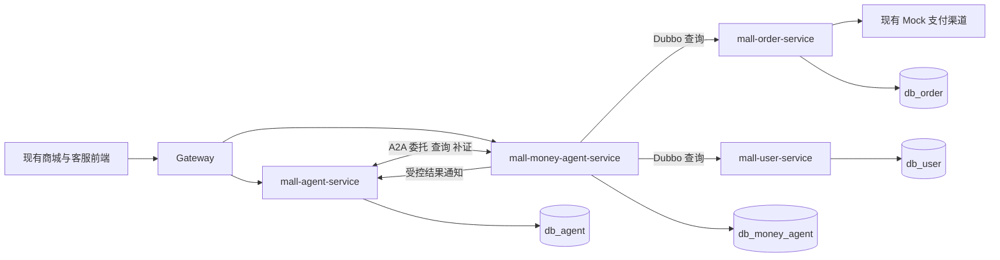
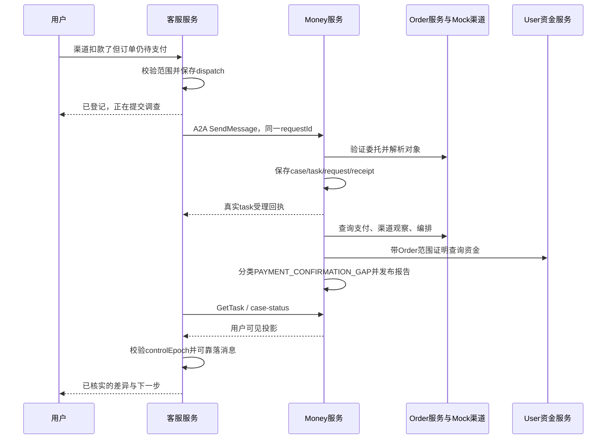

# 资金异常调查 Agent 独立微服务改造设计

日期：2026-10-31。目标服务：`mall-money-agent-service`。本文件为待实施的具体改造方案，不代表代码已经完成或数据库已经迁移。

## 1. 本次改造的明确目标

将资金异常调查建设为一个独立 Spring Boot 应用：拥有自己的启动类、配置、MySQL 数据库、调查任务、规则/模型执行、报告、后台 Worker、A2A 服务与管理 API。上述模块位于同一个 Maven 服务模块、打成同一个应用包、作为一个服务部署。初期允许单实例，任务表设计支持后续多实例竞争执行。

客服仍运行在 `mall-agent-service`，通过 A2A 委托任务。支付、退款、对账事实由 `mall-order-service` 提供，资金事务和流水由 `mall-user-service` 提供。Money 使用 Dubbo 调用受限查询接口，不直接连接这两个业务数据库。

**支付、银行、退款渠道允许一直使用项目现有 Mock 实现，不要求申请真实金融机构接口。** Mock 也必须明确区分成功、失败、处理中、无记录和未知，并支持业务关联、身份校验和可追溯观察。数据库事务测试可以使用隔离 MySQL；不需要真实银行或真实扣款。

本次文档解决三个具体问题：

1. 当前分布在 API、Order、User 中的代码分别保留在哪里、修复什么。
2. 独立 Money 服务逐包、逐类需要什么，当前原型如何补齐。
3. 客服如何接入独立服务，形成提交、补证、进展同步、人工接管和结果送达闭环。

本文件是当前审查之后的实施细化。业务范围与状态机沿用[主体设计](development_design.md)和[数据契约](data_contracts_and_schema.md)；客服完整背景见[客服接入分册](customer_agent_integration.md)。遇到同一实现细节表述不同时，使用本文件明确写出的改造约定，并同步更新原分册。不要把 [implementation_progress.md](implementation_progress.md) 中“M0/M1 已完成”的文字作为跳过验收的依据。

## 2. 当前工作区基线与处理方式

### 2.1 已有内容

工作区在文档编写期间继续变化。收尾复核已发现独立 Money 模块、客服 money 包及部分查询修复；以下记录该次静态复核，不表示新代码已经完成验收。实施时保留有效实现，按目标补齐，不重复建模块。

| 实际位置 | 当前内容 | 改造动作 |
| --- | --- | --- |
| 根 `pom.xml` | 已在原 7 个模块外加入 Money 模块 | 保留 mall-money-agent-service，不重复添加 |
| `mall-api/src/main/java/api/agent/money` | 29 个查询 DTO、接口、枚举及签名工具 | 保留查询契约，修复字段语义和授权设计，增加任务/A2A 业务 DTO |
| `mall-order-service/src/main/java/com/example/item/money` | Resolver、查询 Provider、渠道观察、对账回溯、观察 Mapper/Entity | 留在 Order；按第 6 节修复并提供可验证事实 |
| `mall-user-service/.../MoneyFundQueryDubboServiceImpl` | 资金查询 Provider | 留在 User；补历史精确查询和鉴权，移除查询中的引用写入 |
| `FundService`、`FundBusinessRef`、Mapper | 新业务引用写入 | 留在 User；修复真实退款号关联和幂等重放 |
| `mall-gateway-service/application.yml` | 已有 `/api/admin/money-agent/**` 路由及 ADMIN 限制 | 保留，补目标服务和服务端财务岗位校验；不重复添加路由 |
| `mall-money-agent-service` | 已有 POM、启动类、部分 Entity/Mapper、同步 CaseService/Graph、管理及自定义 JSON-RPC 入口 | 保留模块，按第 2.3 节改造为持久异步运行时和标准 A2A |
| `mall-agent-service` | 已出现 money client/bridge、binding/dispatch 映射及三类意图路由 | 完善可靠异步桥接与客服全链路 |
| `mall-frontend` | 已有客服对话与对账控制台 | 新增资金卡片和财务调查视图，沿用登录与消息机制 |
| `doc/sql/agent/moneyerrorAgent` | 6 份建表/种子脚本、1 份核对脚本，共 26 张表 | 核对并使用；扩展字段另写增量，不生成另一套重名表 |

源码中的 Order 根包实际是 `com.example.item`；User 根包是 `com.example.user`。不得按 Maven 模块名猜成 `com.example.order`。

### 2.2 保留的服务边界

独立模块已有原型，接下来主要是“完善事实源 + 补齐可靠运行时 + 完成客服接入”。不把 Order/User 的整个 money 包搬走，保留以下事实源和权威写入边界：

- Order 的 Mapper、PaymentApplicationService、PaymentConfirmationService、MockChannelEngine、ReconciliationExecutionService 继续在 Order。
- User 的 FundTransaction、FundFlow、FundService 继续在 User。
- CustomerRunner、CustomerStore、会话消息、人工接管和 WebSocket 继续在客服服务。
- 新服务不依赖 `mall-order-service`、`mall-user-service` 或 `mall-agent-service` 的 JAR，只依赖 `mall-api` 和第三方运行时依赖。

### 2.3 当前原型的具体改造位置

| 文件/方法 | 收尾静态复核所见 | 具体改造 |
| --- | --- | --- |
| Money 模块 POM/application.yml | 已有基础依赖和端口；缺可执行打包，数据源有业务地址/root 回退 | 原地补 repackage、运行时依赖和显式环境配置，使用独立账号/UTC |
| MoneyCaseService.createOrAttachCase | 事务内同步调用 Graph，只按 OPEN 查重，随机 grantRef、空 executionScope | 拆为持久受理与后台执行；落实真实 grant、范围、请求回执和活动案去重 |
| MoneyCaseService 的标识 | CASE_/TASK_ 与设计 MC/MT 不同，ownerStaffId 使用 actorUserId | 新写按统一契约；已有数据兼容读取，不批量改主键；买家不自动成为财务负责人 |
| MoneyInvestigationGraph.executeInvestigation | 普通同步方法，自签 SYSTEM/0L 委托，只观察首笔记录，默认 VERIFIED_NORMAL | 固定真实执行授权，按问题目标分页取证，改有限 Graph；缺证据返回 INCONCLUSIVE |
| Graph 的报告写入 | revision 固定 1，直接写报告与实体状态 | 分离 snapshot/report/projection；锁下分配版本，统一发布事务与 Outbox |
| api/MoneyA2aEndpoint | /a2a/money、money.start/money.getCase，自定义 Map，接受 userId、返回 internalJson | 迁到 transport/a2a，标准协议方法、验证身份、受众投影；旧入口不能绕过新鉴权 |
| MoneyA2aEndpoint.mapProblemFamily | PAYMENT 模糊匹配先于 EXCESS，可能吞掉 EXCESS_PAYMENT | 共享枚举精确匹配，未知值拒绝 |
| MoneyCaseAdminController | 请求传 staffId，缺省 1，返回 Entity | 从登录与岗位获得身份，使用 DTO、对象范围和版本条件 |
| 客服 MoneyAgentClient | RestTemplate 具体类调用自定义 method，缺持久业务 requestId | 提取应用接口和协议适配器；使用 dispatch 中的稳定 requestId |
| CustomerMoneyBridgeService | 先远程调用后写 binding，随机 context/grant、TASK_0 回退，失败也称已登记 | 本地登记与后台提交分开；只使用真实回执，未落库不称已登记 |
| Bridge 的进度与结论 | 缺 case 选最近一条，VERIFIED_RESOLVED 泛化为已到账 | 多案明确选择；依据受众事实回复，不用 outcome 推断到账 |

已存在的有效修复应复用。原型是否已部署需实施前核实：未部署可直接替换接口；已使用则先做兼容迁移。不要同时保留两套可绕过统一鉴权/幂等的建案入口。

## 3. 目标部署与依赖拓扑



管理网页通过 Gateway 调 Money 管理 API；买家通过客服的用户 API 发起/查询调查。浏览器不直接调用内部 A2A、Dubbo 或 Money 数据库。

| 项目 | 目标值/约束 |
| --- | --- |
| Maven artifactId / 注册服务名 | `mall-money-agent-service` |
| Java 根包 | `com.example.moneyagent` |
| 启动类 | `MoneyAgentApplication` |
| 本地 HTTP 端口 | `8086`，可由 MONEY_AGENT_PORT 覆盖，启动前检查占用 |
| 数据库 | `db_money_agent`，可以与现有库共用 MySQL 实例，单独账号和库权限 |
| 对外管理路径 | `/api/admin/money-agent/**` |
| A2A JSON-RPC 路径 | `/internal/a2a/money`，为本项目选择的部署路径 |
| Agent Card | `/.well-known/agent-card.json`，服务内网发现；不暴露数据库、密钥或具体案件 |
| Dubbo | 消费 Order/User 的查询 Provider；首版 Money 不发布资金命令 Provider |
| 首版推送 | 客服持久轮询；Money 的 case-notices 只作加速通知，不能代替恢复查询 |
| 跨服务事务 | 无 XA/Seata 调查事务；使用本地事务、稳定请求键、Inbox/Outbox 与重试 |

### 3.1 为什么内部仍采用包划分

一个微服务不等于一个大类。API、应用逻辑、调查、持久化、Worker、模型和传输模块保持单向依赖，避免重试逻辑、权限、模型输出和数据库锁交织在 Controller 中。

```text
api / transport -> application -> investigation + authorization + persistence
runtime          -> application
investigation    -> tools + model + domain
tools            -> mall-api 中的查询接口
```

`investigation` 不依赖 Controller、A2A SDK、客服 Run 或具体 HTTP 请求。`persistence` 不调用模型或远程服务。

## 4. 新服务工程结构与配置

### 4.1 必须创建的目录

以下是目标文件树，包含已有原型与待补齐文件；存在的文件原地重构，不重复生成平行实现：

```text
mall-money-agent-service/
  pom.xml
  src/main/java/com/example/moneyagent/
    MoneyAgentApplication.java
    config/
      MoneyAgentProperties.java
      MoneyRuntimeConfiguration.java
      MoneySecurityConfiguration.java
      MoneyModelConfiguration.java
    api/
      MoneyCaseAdminController.java
      MoneyProposalAdminController.java
      MoneyInternalGrantController.java
    application/
      MoneyCaseService.java
      MoneyTaskService.java
      MoneyInputService.java
      MoneyGrantService.java
      MoneyReportPublishService.java
      MoneyCaseQueryService.java
    domain/
      MoneyCaseState.java
      MoneyTaskState.java
      MoneyOutcome.java
      MoneyCheckpoint.java
      MoneyTaskClaim.java
      MoneyEvidenceSet.java
      MoneyFinding.java
    investigation/
      MoneyInvestigationGraph.java
      MoneyFactCollector.java
      MoneyStatusNormalizer.java
      MoneyRuleEvaluator.java
      MoneyPlanValidator.java
      MoneyReportAssembler.java
      MoneyReportGuard.java
      MoneyPublicProjectionBuilder.java
    tools/
      OrderMoneyQueryClient.java
      UserFundQueryClient.java
      MoneyToolCatalog.java
      MoneyToolExecutor.java
      MoneyToolPolicy.java
    model/
      MoneyModelClient.java
      MockMoneyModelClient.java
      DashScopeMoneyModelClient.java
      MoneyPromptRegistry.java
    authorization/
      MoneyAccessPolicy.java
      MoneyAdminPolicy.java
      MoneyCredentialFactory.java
    runtime/
      MoneyTaskWorker.java
      MoneyTaskRecoveryJob.java
      MoneySourceInboxWorker.java
      MoneyEventOutboxWorker.java
    transport/a2a/
      MoneyA2aEndpoint.java
      MoneyA2aAdapter.java
      MoneyTaskStateMapper.java
      MoneySkillCatalog.java
    persistence/
      entity/    与 15 张 Money 自有表对应的 Entity
      mapper/    常规 Mapper 与带锁的专用查询
      repository/
        MoneyCaseRepository.java
        MoneyTaskRepository.java
        MoneyLeaseRepository.java
        MoneyEvidenceRepository.java
        MoneyReportRepository.java
        MoneyRequestRepository.java
    operations/  M4/M5 的分配、复核、建议与执行跟踪
  src/main/resources/
    application.yml
    application-local.yml
    prompts/money/planner-v1.xml.st
    schemas/money/investigation-request-v1.json
    schemas/money/plan-v1.json
    schemas/money/report-v1.json
    schemas/money/public-projection-v1.json
    mapper/money/  带锁/批量 SQL（采用 XML 时）
  src/test/java/com/example/moneyagent/
  src/test/resources/
    application-money-it.yml
    fixtures/money/
```

启动类使用项目已有的 `@SpringBootApplication`、`@ConfigurationPropertiesScan`、`@EnableDubbo`，MapperScan 仅扫描 `com.example.moneyagent.persistence.mapper`。不要照搬现有 AgentApplication 中固定 `en0/utun` 的机器网络设置；确需网卡选择时通过部署配置传入。

### 4.2 POM 具体处理

根 POM 已有 `<module>mall-money-agent-service</module>`，保留这一项。完善模块 POM，继承当前父版本 `com.example:mall-parent:0.0.1-SNAPSHOT`，沿用 Java 21、Boot 3.5.6、Dubbo 3.3.0 的项目基线，不以本次改造为由升级全工程。

| 依赖 | 用途/约束 |
| --- | --- |
| mall-api | 只使用公共 DTO、服务接口及无状态工具；排除其传递的 spring-cloud-starter-alibaba-seata，现有客服 POM 已有同样排除 |
| spring-boot-starter-web / validation | 管理接口、协议接入与参数验证 |
| spring-boot-starter-jdbc、MyBatis-Plus、mysql-connector-j | 单一 MySQL 数据源、本地事务、Mapper |
| dubbo-spring-boot-starter、Nacos discovery | 沿用现有注册发现；服务调用仍有应用层身份校验 |
| spring-ai-alibaba-graph-core | 复用现有 Graph 技术；版本来自当前 AI BOM 1.1.0.0 |
| DashScope / Spring AI chat | 仅模型适配器使用，沿用客服已锁定依赖；Mock 模式不要求模型 API Key |
| actuator、Prometheus registry | 健康、任务与调用指标 |
| 选定 A2A SDK | 只在 transport 包使用；先验证 v1.0 协议与当前 Spring/Jackson 的兼容，再锁精确版本 |
| 成熟 JOSE 实现 | 服务/委托/范围票据；版本在依赖管理中锁定并做安全验收 |
| starter-test、Surefire 3.5.4 | 当前项目测试惯例；MySQL 集成通过隔离实例或后续锁定的 Testcontainers 依赖提供 |

不复制客服的 pgvector 数据源、知识库索引、记忆 Worker 或 WebSocket 依赖。Money 首版无需新向量库；已有财务业务规则由确定性规则与事实查询提供。

必须显式配置 `spring-boot-maven-plugin` 的 repackage 执行，使 `mvn package` 得到可独立 `java -jar` 启动的包；不能只生成普通 JAR 后宣称可部署。

### 4.3 配置模板

以下 `money-agent.*` 是本次新增的项目配置，必须由 MoneyAgentProperties 绑定、校验；它们不是声称框架已内建的属性。连接与密钥采用环境配置，不复制现有业务环境地址或密码。

```yaml
server:
  port: ${MONEY_AGENT_PORT:8086}
spring:
  application:
    name: mall-money-agent-service
  datasource:
    url: ${MONEY_MYSQL_URL}
    username: ${MONEY_MYSQL_USERNAME}
    password: ${MONEY_MYSQL_PASSWORD}
    hikari:
      maximum-pool-size: 10
      connection-timeout: 5000
  sql:
    init:
      mode: never
dubbo:
  application:
    name: mall-money-agent-service
  registry:
    address: ${DUBBO_REGISTRY_ADDRESS}
  consumer:
    check: false
    timeout: 3000
    retries: 0
money-agent:
  enabled: false
  accept-new-cases: false
  worker-enabled: false
  model-mode: MOCK
  max-plan-rounds: 3
  max-tool-calls: 10
  max-source-rpc-calls: 30
  max-pages-per-source: 5
  task-lease-seconds: 30
  task-heartbeat-seconds: 5
  worker-concurrency: 4
  model-timeout-ms: 15000
  a2a-path: /internal/a2a/money
  source-time-zone: Asia/Shanghai
  repair-enabled: false
```

数值是首版默认预算，需通过本地压测调整。`max-tool-calls` 计算调查动作次数，`max-source-rpc-calls` 同时限制动作内部的分页调用，避免通过一个“聚合工具”绕过预算。

新库 JDBC 会话时区与读写约定统一为 UTC，持久化统一使用注入的 Clock/Instant 转换。`source-time-zone` 只用于解释旧业务字段，实际渠道业务日使用原 profile 时区。凭据配置缺失时，启用的服务鉴权组件应拒绝启动，不能回退固定密钥。

### 4.4 本地事务与线程模型

Money 使用单数据源及本地事务管理器，不复制 `AgentDataSourceConfig` 的双数据源。事务方法只包含本库写入/加锁；远程查询、模型生成都在事务外。Worker 使用有界执行器，租约负责恢复正确性；虚拟线程只改变执行方式，不能替代持久化。

## 5. 公共契约与授权改造

### 5.1 公共包与新业务 DTO

继续使用 `mall-api/src/main/java/api/agent/money`，新增子包可按 `task / report / security` 组织。不得把 Money Entity、MyBatis Mapper、A2A SDK Task 或 Spring Bean 放进 mall-api。

| 类型 | 必需字段/行为 |
| --- | --- |
| MoneyInvestigationRequest | schema、requestId、origin、subject、problemFamily、claim、relatedCaseNo、delegationRef、callerContext、expectedScopeFingerprint |
| MoneyTaskReceipt | requestId、caseNo、taskNo、contextId、acceptedAt、reused、projectionRevision |
| MoneyAdditionalInput | requestId、caseNo、taskNo、inputRequestNo、expectedInputVersion、answers、sourceMessageRef |
| MoneyTaskView | 固定 task 的状态、版本、当次可见报告；终态后不被下一次调查覆盖 |
| MoneyCaseView | case 当前状态、currentTaskNo、最新受众投影、allowedActions、inputRequest |
| MoneyCancelRequest | requestId、caseNo、taskNo、expectedTaskVersion、reason；服务端判断取消权限 |
| MoneySnapshotCursor | 来源服务生成的不透明游标；绑定范围、分页位置、读取水位、过期时间 |
| MoneyMatchStatus | MATCHED / MISMATCH / UNVERIFIED，替代“缺证据也为 true” |
| MoneyExistence | EXISTS / NOT_FOUND / UNKNOWN，独立于请求成功与业务终态 |
| VerifiedMoneyPrincipal | 验签后得到的 caller、subject、role、actions、scope、grantNo/version，不可从普通请求 JSON 直接构造为已验证身份 |

金额通过 BigDecimal 表达，公开 JSON 契约输出十进制字符串；为金额字段明确序列化规则，并测试包含小数与大金额的往返。schema 主版本不支持时拒绝，不默默丢字段。

### 5.2 替换 MoneySecuritySupport 的信任模型

保留无状态 fingerprint 工具；删除固定默认密钥与共享万能签发能力。使用成熟 JOSE 库、固定算法白名单和基于 kid 的可信密钥配置。首版可采用 RS256：私钥仅存在于对应签发服务，验签服务只配置允许 issuer 的公钥；不读取票据中任意 jku/x5u URL。

| 票据 | 签发者 | 接收方与范围 |
| --- | --- | --- |
| 服务身份票据 | 当前调用服务的凭据组件 | 精确目标服务 audience，绑定 caller、签发时间、过期时间、jti |
| 客服用户/坐席委托 | 客服校验登录、会话与对象权限后的授权组件 | 允许的 Money/Order/User 接收链、原主体、限定订单/动作、grant/version |
| 财务委托 | Money 管理入口核实登录和财务岗位后签发 | 受配置岗位范围约束的调查对象，不等于所有 ADMIN 可查全部账本 |
| Order 范围证明 | Order 的 MoneySubjectResolver/签发组件 | audience=User、当前 grant、授权订单和精确 attempt/refund/operation 集合、读取动作、时效 |

允许多个接收服务的委托必须是服务端 allowlist 的明确集合，不能使用 `*` 或由请求传入新接收方。跨链只取权限交集，不扩大动作。

新增可测试的 `MoneyRequestAuthorizer`/`MoneyScopeVerifier`，由各 Provider 注入。所有入口先执行：服务验签 → 委托验签 → 主体与请求绑定 → action/scope/grant 校验 → 当前业务归属检查。`actorRole/actorUserId/callerService` 如保留在旧 DTO 中，仅作一致性比对，不能作为授权依据。

短期票据建议 120 秒，允许时钟误差由配置固定；业务 grant 是另一份可撤回记录，不能以票据不断续签来绕过撤回。Money 每次开始取证/续跑前检查 grant 状态，撤回时使任务版本和租约失效。已在途的只读请求无法保证远端立刻中断，返回结果必须在发布前重新校验授权，不能在撤回后继续披露。

开发/集成环境可以使用独立测试密钥，但仍执行完整验签，不通过 `access=null` 或 `security-disabled=true` 通过测试。禁止将测试私钥写入生产默认配置。

### 5.3 M0/M1 接口兼容策略

当前调用方已包括 Money tools 中的 Dubbo client 和专项测试。实施前再次检索调用方和部署状态：未发布时共同修订 DTO/Provider/client；已有部署则采用接口版本和滚动发布。无身份查询必须收紧，不能为兼容旧测试保留旁路。

现有 `MoneyOrderQueryDubboService` 的 resolveSubject/getSnapshot/observeChannel/getReconEvidence 和 `MoneyFundQueryDubboService.getSnapshot` 保留职责。新增 `issueFundScopeProof(access, request)`，由 Order 对每批已发现引用再核验并签发 User 可验证的有限证明；单批最多 50 个引用。

### 5.4 grant 注册、续签和撤回落点

首个 start 请求携带经验证的委托：Money 在受理本地事务内注册 t_money_grant，保存主体、scope、actions、receivers、版本与有效期，不保存原始签名票据。重复 grantNo 必须与原授权定义一致；后续短期票据续签不会覆盖原 grant 的 REVOKED 状态，也不会自动延长业务授权期限。

客服 dispatch 保存 grantRef 与构造请求所需的非凭据上下文。Worker 重启后通过服务端凭据组件读取当前有效授权并签发短期票据；授权失效时进入待授权状态，不长期保存用户登录 token 或通过重新生成 grantNo 自动绕过撤回。财务 grant 同样绑定当前岗位范围，不能以 ADMIN 字符串替代岗位验证。

新增 `POST /internal/money/grants/{grantNo}/revoke`，由 MoneyInternalGrantController 处理，只接受原签发方/受授权管理主体的服务凭据、稳定 requestId 和 expectedGrantVersion。先在短事务锁 grant 行，标记 REVOKED、递增 version 并提交；随后分批使依赖任务租约失效、转 AUTH_REQUIRED。即使进程在两步之间退出，发布路径的 grant 检查也能阻止失效结果发布，RecoveryJob 补完任务状态迁移。

为让撤回与发布可判定先后，所有需要授权的 Money 复合写事务统一采用 **request（如有）→ grant（按 grantNo 排序）→ case → task → 子记录**。发布持有相关 grant 行锁并再次验证有效期/版本直到提交；不能只在事务外验一次。多受众发布只使用本次锁定的授权集合，事务中新出现的受众由后续投影流程处理。只更新 grant 的撤回事务不持有 grant 锁再同步等待远程调用。

## 6. 对当前审查问题逐项修复

R01—R12 为此前审查编号。收尾复核已看到 verifyEntryAccess、profile 缺失拒绝、分页/fingerprint、查询回填移除和时间转换等修复代码。下表是最终行为与验收目标，不表示每项仍完全未修改；新代码未在本次文档任务中重新测试。

### 6.1 文件级改动清单

| 审查编号 | 必改文件/新增组件 | 具体改造与验收 |
| --- | --- | --- |
| R01 | MoneyOrderQueryDubboServiceImpl、MoneyFundQueryDubboServiceImpl、MoneySubjectResolver、MoneyRequestAuthorizer | 每个入口鉴权；空 access、伪造角色、交叉订单、他人 proof 全拒绝，且拒绝前不执行业务查询 |
| R02 | MoneySecuritySupport、各服务凭据配置 | 无默认签名密钥；验证 issuer/audience/type/action/grant/expiry；签发私钥不进入公共 JAR |
| R03 | MoneyChannelObservationService.resolveProfile | 删除 defaultFor 回退；原快照不可恢复返回 PROFILE_UNRESOLVED，断言渠道调用次数为 0 |
| R04 | MoneyChannelObservationService、渠道证据 DTO/适配器 | NOT_FOUND→NOT_FOUND；缺状态→UNKNOWN；缺身份字段→UNVERIFIED，不借用本地字段制造匹配 |
| R05 | MoneyFundQueryDubboServiceImpl、FundTransactionMapper 的受限查询 | 根据授权 refs 查询精确历史幂等键；旧 orderNo=null 的挂账也能查到；不可证明的关联显式 LEGACY_UNLINKED |
| R06 | MoneyOrderQueryDubboServiceImpl、MoneyFactFingerprint | 使用规范化事实与版本计算 hash；退款终态/金额/编排/事件改变必须改变指纹 |
| R07 | MoneySnapshotQuery/CoverageInfo、各源 Mapper | 真正实现游标；每个集合都判定完整性；事件和差异超页时不能标 COMPLETE |
| R08 | MoneyFundQueryDubboServiceImpl、独立 FundBusinessRefBackfillService | 从 getSnapshot 移除 backfill 写入；回填由显式任务执行，查询只返回验证后的派生关联 |
| R09 | TradeOrchestrationCommandService.fundRefund、FundService.execute | 传真实 refundNo，重放核对 attempt/refund/operation；已有事务只补引用，不再次动账 |
| R10 | MoneyReconEvidenceService、ReconTask/Run/File/Item Mapper | 以 run.fileId/profile/merchant/业务日定位；检查窗口与解析覆盖；按原 itemType 分类 |
| R11 | 三个查询/观察服务、MoneyTimeMapper | 旧 Asia/Shanghai 时间转 Instant；新审计表写 UTC；验证跨日不偏移 |
| R12 | MoneyChannelObservationService.recordAudit | 审计成功后才返回 evidenceRef；失败显式返回 PERSISTENCE_UNAVAILABLE，不发不存在的 AUDIT 引用 |

### 6.2 对象解析必须补齐的检查

`MoneySubjectResolver.resolve` 按顺序处理：

1. 验证 principal 与 action，规范化输入并验证长度。
2. 根据明确输入查 order/attempt/refund/diff；输入同时包含多个编号时必须逐一验证关联，不能因为已有 orderNo 就忽略其他字段。
3. 买家仅允许自己的支付/退款；卖家继续原有结算查询。客服坐席限定已分配会话对应主体，不能因角色是 CUSTOMER_STAFF 自动拥有全平台财务视图。
4. 未能关联订单的 diff 仅允许受限财务调查，并保留精确 RECON scope/profile/diff；不得用 null order 的空证明代替范围。
5. 输出真实 canonicalOrderNo、允许视图、有限引用及 coverage。完整引用超过上限时由快照分页继续发现，再按批签发资金范围证明。
6. 无记录和无权限对用户统一不可访问；内部审计保留准确原因但不进入公开消息。

### 6.3 快照分页与指纹的可实施算法

继续使用 MoneySnapshotQuery.cursor，明确其为来源签发的不透明对象。游标内部绑定 scopeHash、schemaVersion、每个集合的 afterId/highWaterId/completed 和 expiresAt；不允许客户端改写范围。

一次查询返回当前页的 attempts/refunds/events/diffs/orchestration 集合及每源 coverage。每个集合按不可变 id 升序查询 `id > afterId AND id <= highWaterId`，取 limit+1 判定下一页；已 completed 的集合不重读第一页。首轮记录 highWaterId，后续保持；这只限制新增记录，不保证旧行状态不变。

MoneyFactCollector 合并分页时按来源实体编号去重，保存读取时间与版本。结束后重新核对关键业务状态/版本；变化时允许重采一次，再变化则标 INCONSISTENT_WINDOW。超过页数、RPC 或 JSON 大小预算时返回 TRUNCATED，停止否定性结论。

指纹计算顺序：版本化规范对象 → 集合按稳定键排序 → BigDecimal 统一十进制表示 → 时间统一 Instant → 显式 null → canonical JSON → SHA-256。包括状态、金额、币种、采用关系、实体版本/相关字段 hash、事件与编排结果、coverage；排除 traceId、临时票据和每次变化的请求时间。分别保留 evidenceFingerprint 与 observedAt，避免心跳造成无意义重分析。

### 6.4 Mock 渠道证据的具体扩展

当前 ChannelRefundResult 不提供币种/商户等充分身份字段。不要直接影响所有退款命令调用：在 Order 的 channel 包增加只读取证 record `ChannelPaymentEvidence`、`ChannelRefundEvidence`，并为策略增加独立只读 evidence 查询能力。证据字段至少为 existence、rawStatus、merchantNo、outTradeNo/refundNo、channelTradeNo/channelRefundNo、amount、currency、occurredAt、observedAt、provider、environment。

Mock 实现从对应模拟交易/退款记录中返回事实，校验原 profile 的商户与查询对象；不能把查询参数原样复制成“响应已证明”的身份。现有 queryPayment/queryRefund 业务调用可以继续使用，新的取证接口逐步由 Mock 策略实现；不支持的适配器返回未支持/UNVERIFIED，不能默认成功。

| 场景 | existence | 业务状态 | 匹配质量 |
| --- | --- | --- | --- |
| 查到成功交易且身份金额一致 | EXISTS | SUCCEEDED | 按字段验证 MATCHED |
| 查到退款 PROCESSING | EXISTS | PROCESSING | 可匹配，但不是终态成功 |
| 渠道明确 NOT_FOUND | NOT_FOUND | UNKNOWN/NOT_FOUND 对应映射 | 未返回身份字段则 UNVERIFIED |
| 超时、异常、响应无法解析 | UNKNOWN | UNKNOWN | UNVERIFIED |
| 查到记录但缺状态/币种 | EXISTS | 未知部分保持 UNKNOWN | 缺失项 UNVERIFIED |
| 查询商户与记录商户不同 | EXISTS 或拒绝不披露 | 不作为成功依据 | MISMATCH，进入人工核查 |

`environment=MOCK` 来自当前适配器配置并随证据保存。实际到账层仍为 UNKNOWN；Mock 渠道返回 SUCCEEDED 不等于已取得真实收款账户到账证据。

### 6.5 User 历史关联与幂等修复

只根据 Order 已验证的 refs 构造精确键：FUND_FREEZE:order、FUND_REFUND:order、FUND_REFUND_CHANNEL:refund、FUND_SUSPENSE_CREDIT:attempt、FUND_SUSPENSE_REFUND:refund。存在历史调用使用自定义稳定 key 时，先通过来源业务记录证明映射；不得把任意前缀字符串都当作正确关联。

查询按 transactionNo 合并“orderNo 查询 + 新引用 + 验证后的精确键查询”，再以 transactionNo 联查流水。响应区分 STORED_REFERENCE 与 VERIFIED_DERIVED_REFERENCE，后者不会在查询中落库。相关来源不可用或历史映射无法证明时，不把空集合标成已证实无资金。

新资金写入必须使用强类型关联参数 `FundBusinessReferences`（orderNo、attemptNo、refundNo、operationId），由业务入口验证后传到 execute。在新事务分支和幂等命中分支都调用同一引用一致性检查；冲突时拒绝，不向旧 transaction 附加另一订单/退款。引用补齐与事务状态读取在同一本地事务，幂等命中绝不再次执行余额动作。

现有渠道退款编排仍需返回/保存真实退款受理记录；M1 修复准确关联不意味着提前开放 Agent 自动退款，后者继续归 M5。

## 7. Money 自有数据与 SQL 处理

### 7.1 数据访问规则

Money 的数据库账号只访问 db_money_agent。客服 bridge 访问 db_agent；Order/User 各自访问所属库。运行时不得通过同一个 root 数据源跨库 SELECT 或更新其他服务表。

已有脚本在 [SQL 目录说明](../../sql/agent/moneyerrorAgent/README.md)。本次改造继续使用这套表名和字段，不另造 agent_task/payment_case 等重复表。

| 表组 | Money 负责的具体写入 |
| --- | --- |
| case/task/request | 问题去重、调查生命周期、请求 hash、稳定受理回执 |
| grant/task_access | 执行授权、受众访问、撤回状态与范围版本 |
| task_input/input_request | 初始陈述、补证版本、未完成的输入要求 |
| snapshot/tool_call | 不可变事实快照、调用序号与结果引用 |
| report/projection | 不可变内部报告与按受众更新的公开投影 |
| event/source_inbox/outbox | caseSeq、源事件去重、可靠通知 |
| action_proposal | 建议和后续审核，不等于业务命令已执行 |

### 7.2 当前 SQL 可承载的状态与需要核对的点

15 张 Money 表已经包含 lease/fencing/version、execution_grant_ref、task_access、task_input 等字段。首版 checkpoint 可使用 task.checkpoint_json；保存 schemaVersion，禁止在 JSON 中存明文凭据或隐藏思维过程。grant 关联和 sourceId 由已有列/受控 JSON 保存，新增必需查询条件时再设计索引。

实施时核对这些约束：

- request 的 caller/action/requestId 唯一，hash 不同返回冲突；同 key 不同主体不能取得原回执。
- case.active_dedupe_key 唯一且结束后置 NULL；创建/复用任务一律经过 case 行锁。
- taskNo、reportNo、snapshotNo 全局唯一；同 case 的 report revision 在锁下分配。
- task_access 只能授权视图，不能扩大 task.execution_scope；访问授权与执行授权分开撤回。
- public projection 的 revision 按 case+audienceScope 递增，不能使用全局任务版本代替。
- User/Order Outbox 与本地业务变更同事务；Money 不帮它们跨库补写事件。

脚本 IF NOT EXISTS 不能证明结构一致。任何实际新增字段必须另写 `money_error_v1_1_*.sql` 等增量并补核对脚本；未发布脚本可在确认无人执行后修订，已执行迁移不能只改原文件使环境失配。

## 8. 案件、请求与任务应用服务

### 8.1 接口及事务职责

| 类/方法建议 | 输入/输出 | 必须保证 |
| --- | --- | --- |
| MoneyCaseService.start | VerifiedMoneyPrincipal + MoneyInvestigationRequest → MoneyTaskReceipt | 稳定去重、可见范围、case/task 原子受理 |
| MoneyTaskService.get | principal + taskNo → MoneyTaskView | 指定任务视图，终态历史不改写 |
| MoneyCaseQueryService.get | principal + caseNo → MoneyCaseView | 返回当前案件投影和合法 currentTaskNo |
| MoneyInputService.submit | principal + MoneyAdditionalInput → receipt/view | 输入版本、目标受众、幂等、恢复任务 |
| MoneyTaskService.cancel | principal + expectedTaskVersion → cancelReceipt | 单案共享需求/未决命令检查，取消与完成 CAS |
| MoneyGrantService.revoke | 验证后的授权操作 → 当前 grant 状态 | 失效任务租约，停止新取证，发布前再次检查 |
| MoneyReportPublishService.publish | task claim + validated report → revision | 锁顺序、事实版本、受众过滤、报告和 Outbox 同事务 |

### 8.2 start 的精确流程

1. 解析并验证请求 schema、身份和委托，生成规范化 requestHash。先尝试查询已持久的同键回执，验证原主体/范围/当前 grant 后可直接重放，避免响应丢失后因 Order 短暂不可用再次建案；不返回原始调查事实。
2. 事务外调用 Order resolveSubject，取得当前真实 scope 和允许范围；以规范数组序列化 scopeKey/problemFamily/targetRef 后散列活动去重键。
3. 开启 Money 本地事务，写 request 去重记录，按第 5.4 节注册/锁定 grant 并重验授权。重复主键时读取原记录：hash/主体一致且权限有效才返回原回执；不一致返回 IDEMPOTENCY_CONFLICT。
4. 插入或定位 case，并锁 case 行；并发冲突只处理预期唯一键异常，不把数据库不可用当作重复成功。
5. 同一 case 已有相容非终态任务时附着访问绑定；没有则创建 task，并固定 execution_grant_ref/scope。新陈述另存 task_input。
6. 若已有任务与新执行范围不相容，首版返回 CASE_TASK_BUSY/范围不相容，不扩大旧任务权限，也不伪造一个已排队的新 task。财务可在原任务结束后显式 reinvestigate；需要中止原任务时走受控取消。
7. 新建/复用 task_access，写最小进度 projection 和 case event，将完整受理回执存 request.receipt_json。
8. 提交事务后返回；Worker 稍后领取。HTTP/JSON-RPC 成功不早于持久化成功。

这是对原方案“登记后续调查”的首版落实约定：暂不引入第二套等待任务队列。请求忙时必须明确返回未创建新任务，客服保留原请求处理状态或提示稍后重试。

### 8.3 补充资料与取消

补证按 request → grant → case → task → input_request 顺序加锁。先在鉴权后识别重复提交，再检查 input version/state；成功后追加 task_input、更新输入状态、递增任务版本/fencing、设置 SUBMITTED/next_run_at，保存事件与回执。已经成功的同 requestId 重试仍返回原受理结果。

等待补证的任务不占线程。输入过期后由恢复任务产生明确进度：可转 NEED_REVIEW/INCONCLUSIVE，不能悄悄把缺证据判断为正常。终态任务不恢复，新材料创建同案的新任务。

用户取消仅影响其可取消的调查或订阅。有其他财务需求时只将客服订阅 MUTED；撤回取证授权是独立行为。关闭聊天窗口不触发远程任务取消。

## 9. Graph、规则、模型与持久化执行

### 9.1 有限 Graph 节点

| 节点 | 动作 | 成功后保存 | 失败处理 |
| --- | --- | --- | --- |
| VALIDATE_SCOPE | 检查 grant、范围、输入版本 | principal 引用、范围 hash | AUTH_REQUIRED/REJECTED |
| COLLECT_FACTS | 按授权调用 Order/User，有限分页 | snapshot refs、coverage、source versions | 可重试来源失败或部分报告 |
| NORMALIZE | 按源/业务类型归一状态、金额和时间 | evidenceFingerprint、冲突项 | 未知值保留，不默认成功 |
| EVALUATE_RULES | 执行确定性异常分类 | findings、缺证据项 | 数据矛盾转复核 |
| PLAN_NEXT | 仅必要时调用模型提出下一动作 | 结构化 hypothesis/action | 一次输出修复后降级 |
| VALIDATE_PLAN | 校验工具、目标、事实 ID 和预算 | approved action 或拒绝原因 | 拒绝越权/不存在事实 |
| EXECUTE_TOOL | 执行只读动作并保存证据 | tool_call、snapshot、checkpoint | 有限重试，结果带来源 |
| REQUEST_INPUT | 持久化有版本输入请求 | input_request、INPUT_REQUIRED | 等待，不保留线程 |
| ASSEMBLE_REPORT | 汇总事实、陈述、假设、建议 | 候选报告 | 无模型也可确定性报告 |
| GUARD_AND_PUBLISH | 验证事实、受众、版本并发布 | report、projection、event、outbox | 旧租约/过期事实不能覆盖最新结果 |

沿用项目的 StateGraph/CompiledGraph 技术；每次 Worker 执行有限节点后落 checkpoint，不能把 Java 对象或长时间阻塞线程当作任务持久化。建议封装 `advance(MoneyCheckpoint, MoneyExecutionContext)`，输出下一 checkpoint/等待原因/终态产物；Graph 编译对象可以复用，业务状态必须每任务独立。

### 9.2 checkpoint 最少字段

```json
{
  "schemaVersion": 1,
  "nextNode": "EVALUATE_RULES",
  "lastConsumedInputSeq": 2,
  "snapshotRefs": ["MS_DEMO_001"],
  "evidenceFingerprint": "sha256:example",
  "sourceVersions": {"ORDER:T202610310001": "sha256:source-example"},
  "completedActionHashes": ["sha256:action-example"],
  "planRounds": 1,
  "toolCalls": 3,
  "sourceRpcCalls": 5,
  "nextToolCallSeq": 4,
  "stopReason": null
}
```

原始快照、模型结构化输出和 report 分别存表/受控 JSON 引用，checkpoint 不复制全份历史。恢复只根据已提交状态继续；工具在调用后、保存前崩溃可以再次只读查询，但必须记录新的 observedAt，不能把两次响应冒充同一次原子事实。

### 9.3 规则优先与模型边界

直接实现主体设计中的 NORMAL_PROGRESS、PAYMENT_CONFIRMATION_GAP、CHANNEL_AMOUNT_CONFLICT、EXCESS_OR_LATE_PAYMENT、SUSPENSE_LEDGER_GAP、退款冲突/超额、RECON_WINDOW_OPEN、IDENTITY_OR_LINK_AMBIGUOUS、SOURCE_UNAVAILABLE、LEGACY_PAYMENT_PATH 等规则。

每个 finding 包含 code、supportingFactIds、contradictingFactIds、certainty 和 missingEvidence。状态冲突或覆盖缺失时不得输出 VERIFIED_NORMAL；渠道退款成功仍不能升级为 BENEFICIARY_RECEIPT 已到账。

模型只负责选择未完成的有用取证动作、提出待验证假设和辅助解释。MoneyPlanValidator 接收结构化 schema，校验所有 factId/targetRef 属于已授权事实和实体集合；工具名来自固定目录。相同 actionHash 且证据没变时拒绝重复规划。

MockMoneyModelClient 应按命名场景返回可重复的结构化动作，覆盖成功规划、缺字段、越权目标、未知 factId、模型异常和预算耗尽；不能固定返回“调查成功”。真实模型模式和 Mock 模式通过同一计划、事实及报告校验器。

## 10. Worker 与故障恢复

### 10.1 领取与续租

`MoneyTaskWorker` 只从可运行任务中领取。可使用 MySQL 8 的短事务行锁：

```sql
SELECT id, task_no, version, fencing_token
FROM t_money_task
WHERE state IN ('SUBMITTED', 'WORKING')
  AND (next_run_at IS NULL OR next_run_at <= UTC_TIMESTAMP(3))
  AND (lease_until IS NULL OR lease_until < UTC_TIMESTAMP(3))
ORDER BY id
LIMIT 1
FOR UPDATE SKIP LOCKED;
```

同一短事务把 state=WORKING、lease_owner=实例执行 ID、lease_until=当前时间+30 秒，fencing_token/version 各加一，返回 MoneyTaskClaim 后立即提交。没有候选时结束本轮，不长轮询持有锁。

续租每 5 秒检查一次 owner/fencing/state 和 `lease_until > 当前数据库时间`，更新 lease_until；已经过期的租约不能由旧 Worker 复活。**续租不增加业务 version**，否则会使同一 Worker 的发布 CAS 失效。checkpoint/输入/取消/任务转换才增加业务 version。执行超过限制或失去租约时，停止后续步骤，丢弃尚未发布的结果。

### 10.2 保存与发布

Worker 的只锁 task 的领取事务先完成；需要同时修改 case/task 的保存事务统一按 grant → case → task → 其他子记录加锁。校验当前 owner、fencing、version、未过期 lease_until、grant、输入序号和已观察事实版本，再写 checkpoint 或报告。即使尚无其他实例接手，已过期 Worker 也不得发布。

完成一步后更新 checkpoint、version，释放 lease。需要立即继续则 SUBMITTED/next_run_at=now；等待外部输入则 INPUT_REQUIRED/AUTH_REQUIRED 且不进入运行扫描。来源短暂不可用可设置 SUBMITTED+RETRY_BACKOFF+next_run_at，不新增与 A2A 冲突的公开状态。

报告发布同事务执行：分配 report revision/caseSeq → 插入不可变 report → 更新各允许受众 projection → 写 event/outbox → 更新 task/case → 提交。Task COMPLETED 只表示本次调查产物完成；case 可为 NEED_REVIEW 或 WAITING_BIZ。

跨服务没有原子事实快照。发布校验针对 Money 已知输入/事件与已读取版本；投影必须带 observedAt/freshness。后续源事件可以让报告过期，任何 M5 业务写入都必须在源服务重新校验实时条件。

### 10.3 必须明确处理的崩溃点

| 崩溃位置 | 恢复结果 |
| --- | --- |
| request 已提交，响应未到客服 | 客服重放原 requestId，返回同 taskNo |
| 领取任务后、调用前 | 租约到期后新 Worker 接手 |
| 只读工具完成、checkpoint 未提交 | 可重新查询，新的观察单独留证 |
| 模型完成、Worker 租约已失效 | 旧结果不能发布，禁止覆盖新任务状态 |
| report 已提交、通知未发出 | Outbox 重试，报告不重建 |
| 客服收到通知、公开消息事务失败 | Inbox/delivery 恢复，不标已送达 |
| 用户补证与旧 Worker 并发 | 输入版本/fencing 改变，旧 Worker 发布失败 |

重试使用指数退避并限制次数；超限产生部分报告/人工队列，不能无限调用模型。发起业务命令结果未知时只能查询原 operationId，该路径属于 M5。

## 11. A2A 与管理接口

### 11.1 协议与应用接口分离

协议基线继续采用 A2A v1.0.0。JSON-RPC 使用 SendMessage、GetTask、CancelTask 等协议方法；SendMessage 可返回 Task 或即时 Message。HTTP 路径由项目部署选择，业务 operation/schema 放在数据载荷中，不自创协议方法。具体 envelope、枚举与序列化由锁定 SDK/协议模型生成并验收。[A2A v1.0.0 规范](https://a2a-protocol.org/v1.0.0/specification/)

| 应用操作 | A2A 映射 | 项目行为 |
| --- | --- | --- |
| start investigation | SendMessage，money.investigate.v1 | 持久受理后返回 Task 与业务回执载荷 |
| provide input | SendMessage，关联未终态 task/context | 校验 inputRequest/version，保存后续输入 |
| get task | GetTask | 返回指定任务的授权视图，历史报告不改写 |
| get case | SendMessage，money.case-status.v1，operation=GET_CASE | 即时 Message 返回当前案件视图，不新建调查 Task |
| cancel task | CancelTask | 调用受控取消；共享财务需求下由应用先判定只静音订阅 |

JSON-RPC 的 id 用于本次协议响应关联，业务 requestId/messageId 用于持久幂等；网络重试不能只更换业务 requestId。Task、case、context 均不是授权凭证。终态任务不可重启；新事实创建同案新任务，案件查询负责发现 currentTaskNo 变化。

受理回执、MoneyTaskView、MoneyCaseView、报告分别有 JSON schema。协议中的业务状态载荷只返回调用方投影，原始内部报告和其他人的 message history 不因 GetTask 默认序列化泄漏。Agent Card 仅声明已实现技能与能力，首版未实现的 streaming/push capability 不宣称支持。

### 11.2 HTTP 管理接口落实

| Method/path | Controller → Service | 主要约束 |
| --- | --- | --- |
| GET /api/admin/money-agent/cases | MoneyCaseAdminController → CaseQueryService.list | 状态/责任人/时间游标，强制岗位范围 |
| POST /api/admin/money-agent/cases | → CaseService.start | clientOperationId，Order 解析 diff/order，不能自报任意买家身份 |
| GET /api/admin/money-agent/cases/{caseNo} | → CaseQueryService.get | 内部视图按财务岗位限制 |
| POST .../{caseNo}/assign | → AssignmentService | expectedCaseVersion、负责人必须可分配 |
| POST .../{caseNo}/reinvestigate | → CaseService.reinvestigate | 新事实/明确理由；已有非终态任务时返回 BUSY |
| POST .../{caseNo}/close | → CaseService.close | 原因与结果分开；CLOSED 不等于资金问题 RESOLVED |
| POST /api/admin/money-agent/proposals/{proposalNo}/review | MoneyProposalAdminController | M5 才启用；审批版本、参数 hash、证据时效 |
| GET /api/admin/money-agent/commands/{operationId} | → CommandTracker | M5 回执查询，不重发命令 |

管理 API 沿用项目 ApiResponse；A2A 返回协议响应，不套 ApiResponse。业务错误至少包含 code、retryable、traceId；权限错误不透露其他用户案件是否存在。服务端重新验证管理员登录和财务岗位，不能只信 Gateway 传来的 role 字符串。

### 11.3 来源故障与健康检查

Money 数据库不可用时不受理新任务；readiness 不通过。某一个业务源暂时不可用时限制相关工具，案件查询和已有报告仍可用。模型服务不可用时尽量发布确定性事实/部分报告，不使客服整轮失败。

health/metrics 只在运维授权面暴露；不把 DataSource URL、密钥、完整错误堆栈返回用户。启动成功至少验证配置绑定、schema 版本/必要表和接口可用性状态，禁止启动时自动执行建表 SQL。

### 11.4 客服与 Money 的传输约定

客服 start/provideInput 必须显式设置 SendMessage 的 `configuration.returnImmediately=true`、`historyLength=0`，受理后由后台同步；省略前者会进入协议默认等待语义。服务端也应正确处理标准客户端的等待模式，HTTP 等待结束或超时不影响已持久任务。CancelTask 支持 metadata，项目借此传递版本条件。[A2A 参数与取消规范](https://a2a-protocol.org/v1.0.0/specification/#32-operation-parameter-objects)

| 传输位置 | 本项目内容 | 处理方式 |
| --- | --- | --- |
| Authorization: Bearer | 服务身份短期票据 | HTTP 过滤器验证；不进入 Message/history/日志 |
| X-Money-Delegation | 委托短期票据，项目自定义 Header | 与服务身份、grant 与业务 scope 联合验证；不透传浏览器同名 Header |
| SendMessage.message 的 data Part | data_contracts_and_schema.md 中版本化业务请求 | 由应用 schema 校验；不把自然语言直接当作已授权命令 |
| 返回 Task.metadata 的 mall.money.receipt.v1 | MoneyTaskReceipt | 客服验证 taskId/contextId 与回执完全一致后建立 binding |
| 返回 Task.metadata 的 mall.money.view.v1 | 当前调用方 MoneyTaskView | 只包含受众投影；Artifact 也必须受众过滤 |
| case-status 即时 Message 的 data Part | MoneyCaseView | 查当前案件，不用它改写历史 Task Artifact |
| CancelTask.params.metadata 的 mall.money.control.v1 | requestId、caseNo、expectedTaskVersion、reason | 转 MoneyCancelRequest，校验 case/task 关系与条件版本 |

以上 metadata key 和自定义 Header 是本项目约定，不是 A2A 内建资金协议字段；Agent Card 与客户端契约文档需声明它们。认证信息只在传输安全上下文中使用。

取消的项目 metadata 示例：

```json
{
  "mall.money.control.v1": {
    "requestId": "REQ-CANCEL-DEMO-001",
    "caseNo": "MC00000000000000000000000000000001",
    "expectedTaskVersion": 7,
    "reason": "用户取消此次调查"
  }
}
```

同 requestId 的成功取消重试先校验身份和载荷，再返回持久结果；不同请求遇到已终态任务按协议拒绝。未携带项目 metadata 的合法标准客户端按锁下当前状态执行协议取消，不能绕过对象权限；UI 提交的条件取消必须通过项目客户端保留版本，不能静默降级。

客户端收到未知结果形状、回执 taskId 不一致或缺少持久业务回执时，不建立成功 binding；保留 dispatch 并用原 requestId 对账重试。不得仅通过读取模型文本中的 caseNo 绑定案件。

## 12. 客服服务的具体接入改造

### 12.1 新增包与类

在 `mall-agent-service/src/main/java/com/example/agent/customer/money` 新增：

```text
CustomerMoneyApplicationService       本地授权、分流、dispatch 登记
CustomerMoneyTriageService            普通查询/复用案件/新建调查判断
CustomerMoneyContextLoader           当前用户可见案件与引用加载
CustomerMoneyDispatchWorker          A2A 提交、补证、取消的可靠发送
CustomerMoneyTaskSyncWorker          任务与案件分别同步
CustomerMoneyNoticeService           内部通知 Inbox 与绑定建立
CustomerMoneyAnswerAssembler         固定资金事实段
CustomerMoneyCardActionHandler       卡片归属、动作与版本校验
CustomerMoneyStore                   db_agent 本地事务与 Mapper 封装
MoneyAgentClient                     应用层客户端接口
transport/MoneyA2aClient              唯一依赖 A2A SDK 的客户端实现
```

`CustomerSystemMessageService`、`CustomerSessionAccessService` 放在客服通用服务包，供资金通知和现有会话入口使用。Money 内部业务不能 import 这些客服类。

### 12.2 现有类逐项修改

| 现有文件 | 必须修改的具体位置 |
| --- | --- |
| IntentCatalog | 三类新意图 → MONEY_BRIDGE；支付/退款异常 required orderNo，进度 required moneyCaseNo |
| CustomerMaster | 抽取、模型校验、resolve/resume、registryCandidates 等全部槽位白名单；先识别完整 PA_/RF_/REF_SUSPENSE_ 再提取订单 |
| CustomerContextWindowBuilder | 增加有界 moneyCases 与 verifiedReferences，不能加载完整财务报告 |
| CustomerPromptRegistry / CustomerModels | 注册 Master 新模板；切换调用点；资金段不交给汇总模型自由改写 |
| CustomerRunner.LOAD_CONTEXT | 在 Master 前加载当前用户授权绑定与可信实体解析 |
| CustomerRunner.executeTask | 新增 MONEY_BRIDGE 分支，防止落入 policy fallback；只等待本地登记或缓存查询 |
| CustomerRunner.respond | 保留 money/cards/projectionRef，拼接不可改写资金段；包含资金的轮次先缓冲再校验、提交和推送 |
| CustomerToolPolicy | resolve/query/register 桥接工具，不提供退款/账务命令 |
| CustomerOutputGuard | 校验 case-order、来源、版本、金额/币种和模板，缺证据不能声明成功 |
| CustomerStore.start/finish | 带 expectedControlEpoch；finish 要求生成时 epoch 与当前完全相同 |
| CustomerRealtimeController / ConversationMessageStore | 用户会话访问校验，快照统一消息 DTO，支持 cards/payload 兼容 |
| CardActionService | 委派资金动作；未知 action 不默认成功，校验 server-side card/actionId/revision |
| IntentReleaseService 使用流程 | 新意图元数据启用后构建、验证、激活完整快照；独立评测覆盖原意图和 OTHER |

原 AFTER_SALE_AGENT 继续负责售后流程、规则和售后单查询。资金桥接不是另一个模型推理子 Agent，只负责与独立调查服务交接任务。

### 12.3 客服第一次发起调查

1. 用户明确订单/支付异常，客服加载身份和范围，Triage 判断是否需要调查。
2. 本地短事务创建 dispatch，保存稳定 requestId、requestHash、原始消息引用和授权引用。资金段回复“已登记核查请求，正在提交”。
3. DispatchWorker 在后台发送 A2A；收到 Money 的真实受理回执后才建立/更新 binding 并显示“调查已受理”。
4. 响应丢失时用同 requestId 重放，不能为了重试生成新案件。
5. SyncWorker 查询未终态 task；只要 case 仍活动，即使 task 已完成，也低频 getCase 查询后续报告和 currentTaskNo。

客服当前 Run 有 90 秒总预算、单工具约 3 秒、总工具数 6 的限制。不要将长调查塞入同步工具调用；本轮登记与后台调查预算分别控制。

### 12.4 补证、通知和人工接管

Money 持久化 inputRequest 后，客服展示 MoneyInputCard。用户提交经 card/session/user/version 校验后写 PROVIDE_INPUT dispatch，远端接受前显示 SUBMITTING，接受后显示 SUBMITTED。自由文字只作候选，多个案件必须选择目标。

Money `/internal/agent/money/case-notices` 通知由客服服务处理，这是项目可靠事件桥，不伪称 A2A 标准回调。通知仅带引用、版本、事件 ID 与授权关联；客服重新确认合法收件人并取用户投影。无法确认时留运营处理，禁止默认 userId=1。

公开消息投递在 db_agent 本地事务中锁 binding → session → delivery/card，验证会话 ACTIVE、BOT/HUMAN、controlEpoch 和投影版本。BOT 时落消息/事件/Outbox/回执；HUMAN/QUEUED 时写坐席便笺；会话关闭时保留投影等待合法会话恢复。BOT→HUMAN→BOT 期间生成的旧答复不能重新公开。

### 12.5 客服 HTTP 和前端文件

已有 `/realtime/sessions` 与服务端 `/sessions` 的差异按客服接入分册修正；WS/ticket 本身的 realtime 前缀保持。新增用户 API 仍归客服：

```text
POST /api/agent/money/investigations
GET  /api/agent/money/dispatches/{dispatchNo}
GET  /api/agent/money/cases
GET  /api/agent/money/cases/{caseNo}
POST /api/agent/money/cases/{caseNo}/inputs/{inputNo}
POST /api/agent/money/cases/{caseNo}/cancel
```

| 前端文件 | 实施项 |
| --- | --- |
| src/api/customerServiceApi.js | 修正实时 API 路径；增加上述用户 API，短请求，不长时间等待调查 |
| src/api/customerRealtimeClient.js | 保留 eventId/sessionNo/eventSeq envelope 信息 |
| src/context/CustomerRealtimeContext.jsx | 稳定 messageNo/runNo/clientMessageId 关联、事件补拉、messages/recentMessages 兼容 |
| src/components/customer/rich/RichMessageRenderer.jsx | 注册 money_investigation、money_input，旧客户端 fallbackText |
| 新 MoneyInvestigationCard.jsx | 阶段、订单、四层可见事实、最后核实时间、允许动作 |
| 新 MoneyInputCard.jsx | 字段 schema、输入版本、重复点击、过期提示 |
| CustomerStaffWorkspace.jsx | 显示受众允许的调查摘要与便笺，人工选择公开 |
| 新 src/api/moneyAgentApi.js 与 MoneyInvestigationConsole.jsx | 财务列表、证据、负责人、报告、后续审核与命令进展 |

卡片数据来自服务端投影，内部财务报告不能先发给浏览器再隐藏字段。UI 明确区分登记、受理、调查完成、等待复核和问题已解决。

## 13. 两条必须跑通的独立进程链路

### 13.1 客服发起：Mock 支付成功、通知丢失



验收不要求真实银行；利用当前 Mock 的 DROP_PAYMENT_NOTIFY。预期报告能解释平台确认链缺口，但首版不直接补单或退款。

### 13.2 财务独立发起：渠道单边差异

财务从对账差异指定 diffNo → Money 校验岗位与 RECON 范围 → Order 返回原 run/file/item 证据 → Money 建案并调查 → 财务查看内部报告。无法关联订单时仍可完成内部调查，不向任意买家发消息；因此客服服务暂不可用也不影响该调查运行。

需要用户补充时先定位并授权业务主体，再通知客服建立合法用户绑定。此时用户只能看自己的投影，不能借共用 case 查看其他受众材料。

## 14. 发布、启停与回滚

### 14.1 实施顺序

1. **R 阶段：修复 M0/M1。** 完成第 6 节及失败用例；可同时创建新模块骨架，但不将未通过验证的事实用于用户结论。
2. **S 阶段：独立运行。** 完成新模块、schema 验证、任务、确定性规则、MockModel、报告、Worker，先由财务测试入口跑通。
3. **A 阶段：A2A。** 两个独立进程提交/查询/补证/取消，验证响应丢失重试和受众隔离。
4. **C 阶段：客服闭环。** 本地 dispatch → A2A →投影 →卡片/补证 →人工接管；通过后启用意图库快照。
5. **O 阶段：主动运营。** 源 Outbox、Inbox、扫描、财务工作台与效果基线。
6. **W 阶段：后续受控修复。** 对应原 M5，单独满足支付/退款一致性门槛，保持默认关闭直到明确实施。

这些 R/S/A/C/O/W 是本次工程交付批次，对应原 M0—M5，不另改业务状态枚举。逐项开发拆解见[任务与验收清单](microservice_refactoring_tasks.md)。

### 14.2 SQL 与启动顺序

先核对已有数据库结构，按 SQL README 执行当前批次所需增量。常规顺序：User 引用/源事件 → Order 观察/源事件 → Money 核心 →客服桥接 →禁用意图种子。M5 命令表可后续执行。SQL 在 `/Users/yu/IdeaProjects/mall-parent/doc/sql/agent/moneyerrorAgent`，注意 moneyerrorAgent 的实际大小写。

启动基础设施 → Order/User Provider → Money（关闭新建与 Worker）→健康/schema 验证→启用 Worker 与财务灰度→客服桥接→用户灰度。发布客服意图库之前，必须先部署包含新路由的客服代码。

### 14.3 关闭功能与滚动升级

accept-new-cases=false 停新建但保留已有查询；worker-enabled=false 停领取新任务，已领取任务按关机宽限完成或释放/到期恢复。repair-enabled 独立控制，不能与查询开关绑定。

服务停止时先从接入侧停止新受理，Worker 停领取，允许有限时间完成本地提交；超过宽限不发布失效结果，交由租约恢复。滚动升级至少兼容当前与上一版本 checkpoint/report/业务 schema；迁移采用 expand 先行。

回滚客户端前先切回兼容的意图库快照；保留 case/report/request/outbox 等记录，不删表“恢复旧版”。若有已经受理的业务命令，必须保留跟踪能力，不因禁用模型而停止查询回执。

## 15. 验收必须提供的证据

| 维度 | 通过标准 |
| --- | --- |
| 服务独立 | 可独立打包启动；客服停机时可由财务入口调查；重启 Money 后任务继续 |
| 数据边界 | Money 仅连接 db_money_agent；业务查询均经已鉴权 Provider |
| Mock 业务完整性 | 成功/处理中/失败/NOT_FOUND/未知不混淆，Mock 标识保留，身份缺证据不标匹配 |
| 幂等与恢复 | 响应丢失、重复提交、旧租约回包、输入并发均不重复建相容任务或覆盖新结果 |
| 客服协作 | 注册/受理分开；补证有版本；人工接管不抢话；断线后消息和卡片可恢复 |
| 权限 | 空身份、伪造角色、错误 audience、他人 scope/card/task、撤权全部有拒绝用例 |
| 数据库 | 隔离 MySQL 迁移/重放、Mapper SQL、唯一键、锁与事务回滚实际执行；渠道可继续 Mock |
| 报告准确性 | 每个金额/状态有证据；覆盖不足不作否定结论；无实际到账证据不称已到账 |
| 可观测性 | trace/dispatch/case/task/业务单据可关联，日志不含凭据，失败可定位和恢复 |

当前已有 12 个专项测试可作回归基础，但全部通过不能代替上述验收。新失败用例先证明旧实现会失败，再证明修复有效；测试名称与实际覆盖一致，不把 Mock Mapper 测试称为数据库集成验收。

本文件不承诺尚未验证的 SDK 兼容性、运行性能或部署结果。实施结束要提供实际构建命令、测试报告、SQL 执行环境与结果、独立进程联调记录，并更新 implementation_progress.md 的阶段状态。
