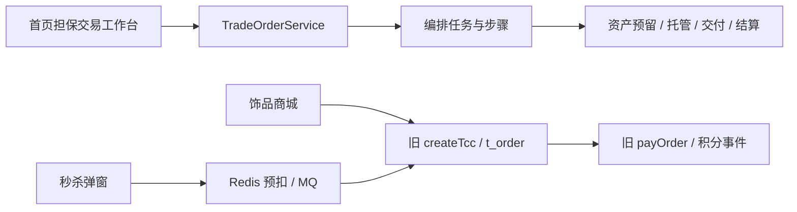
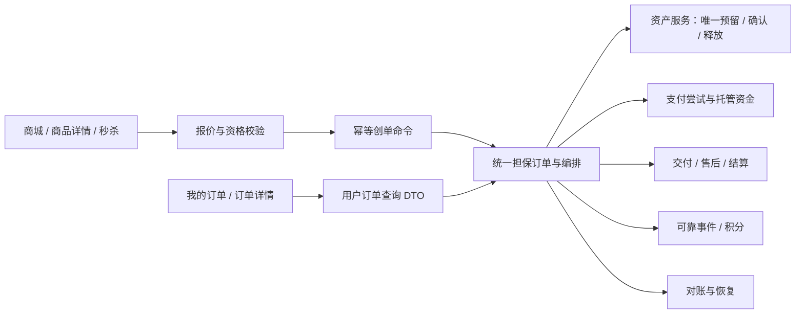

# 购物、下单与交易一致性改造设计

> 版本：1.0 · 日期：2026-10-15 · 状态：待实施设计
>
> 依据：当前工作区源代码静态审查。问题描述区分已确认的代码行为、需要并发条件触发的风险和新增产品能力；不代表已在线上复现。本文不包含实际业务代码或数据库变更。

## 1. 结论与范围

系统有必要继续优化。应优先让所有购物入口共享订单、库存、支付、积分的一致性规则，并让用户能够在独立订单页面持续查询真实进度。

建议按以下顺序推进：

1. **P0：交易正确性**。移除前端伪成功；限制旧商城/TCC入口；修复资产预留、卡密释放、积分幂等、秒杀本地事务与售后竞争。
2. **P1：可恢复的完整交易体验**。客户端创单幂等、报价快照、支付尝试和迟到支付处理、编排租约隔离、对账闭环，以及用户端“我的订单”独立页面。
3. **P2：购物便利与规模化**。购物车、批量结算、促销叠加、查询读模型等。在单订单闭环可靠后逐步引入。

用户补充要求的订单页面是本次设计的明确交付项，详细方案见[用户端订单页面设计](/Users/yu/IdeaProjects/mall-parent/doc/improve/user_order_page_design.md)。该页面可以先开发查询与展示能力，支付等写操作应随对应交易修复一起开放。

### 1.1 已有能力应继续复用

- 担保交易已实现订单、资产预留、托管、交付、确认、结算、售后和仲裁的基本链路。
- 支付回调已有签名、时间戳、nonce、金额等校验，不能再次将“增加回调签名”当作从零开发项。
- 已有持久化编排任务、步骤、失败重试、恢复扫描和人工处理状态；本次补齐并发执行与结果持久化边界。
- 资金服务已有数据库事务和业务幂等校验，应复用资金交易号、流水及原有接口。
- 担保订单列表已有分页、状态/时间筛选、买卖双方可见性检查，已有详情、日志、交付和售后接口。
- 外部支付、提现当前采用 Mock，这是现阶段产品边界；本设计仍保留 Mock，不把真实支付接入作为默认要求。

### 1.2 业务边界与默认决策

| 事项 | 本期设计默认值 |
| --- | --- |
| 商品模型 | C2C 虚拟资产，兼容自动卡密和人工交付 |
| 订单粒度 | 一笔订单一个商品/卖家，数量沿用 1～10；特殊商品可进一步限购 |
| 退款 | 先落实全额退款；部分退款需另行实现可退数量、累计金额和费用分摊 |
| 退款去向 | 现有托管退款为平台账户余额入账；页面必须说明去向，不能写成“原路退回” |
| 秒杀 | 作为统一订单链路的购买来源，另管场次配额，不再生成另一套可支付订单 |
| 旧订单 | 查询兼容、逐笔核对；不凭旧订单状态自动补造托管余额 |
| 订单页面 | 首期以“我买到的”为主，支持“我卖出的”；订单详情有独立可刷新地址 |

## 2. 当前链路与目标链路

### 2.1 当前存在两套交易入口



普通商城和秒杀购买仍使用旧接口，而担保工作台使用另一套状态机。用户看到的商品价格、成交金额、支付结果和订单入口可能无法对应。

### 2.2 目标架构



保留服务间最终一致性架构。每个服务的状态变更和本地事实写入必须原子提交；跨服务通过现有编排、业务幂等和可靠事件推进，不在一个本地事务中长时间等待多个 RPC。

## 3. 问题清单与代码证据

P0 表示涉及错误成交、库存/积分错误、对象级越权或交易互斥失效，相关入口发布前必须处理。P1 表示恢复、可用性和重要体验改进。优先级并不等同于已发生事故。

| 编号 | 级别 | 现状、触发条件与影响 | 证据 |
| --- | --- | --- | --- |
| SHOP-01 | P0 | 订单和秒杀 API 在异常时返回虚构订单号/成功；弹窗用固定延迟替代真实排队状态。接口失败仍可能显示购买成功并增加本地积分 | [orderApi][ev-order-api]、[seckillApi][ev-seckill-api]、[SeckillModal][ev-modal] |
| SHOP-02 | P0 | 旧 `createTccOrder` 固定支付金额 99 元；旧支付与详情未按调用者校验订单归属；数量未做正整数校验，负数可进入库存 SQL | [旧订单服务][ev-old-order]、[旧控制器][ev-old-controller]、[TCC入口][ev-tcc-controller]、[库存SQL][ev-item-mapper] |
| SHOP-03 | P0 | `reserve` 先扣库存/锁卡，后插唯一预留单；并发重复请求的败方捕获唯一键异常后返回成功，之前的副作用可能一并提交 | [AssetService.reserve][ev-asset] |
| SHOP-04 | P0 | `release/confirm` 先普通查询再更新库存，缺少同一预留记录的串行化；重复/交叉操作可能消耗其他订单的聚合冻结量。部分卡密更新未校验影响行数 | [AssetService.release/confirm][ev-asset-state] |
| SHOP-05 | P0 | 取消预留将卡密改为 `RELEASED`，库存数增加，但后续只选 `AVAILABLE`；当前未找到转回可售状态的链路 | [CardSecretMapper][ev-card] |
| SHOP-06 | P0 | 积分先加余额再插唯一流水，重复异常被捕获并正常返回；Redis 键失效后重投可能多加积分。SETNX 后进程退出又可能造成漏发 | [PointService][ev-point] |
| SHOP-07 | P0 | 秒杀库存预扣与持久化之间有崩溃窗口；事务监听器扣 MySQL 库存与插日志没有本地事务包裹；数据库查询异常被当成明确回滚 | [秒杀服务][ev-seckill-service]、[事务监听器][ev-seckill-tx] |
| SHOP-08 | P0 | 发起售后先读状态，再远程风控，最后无条件更新售后字段；可与确认/结算交错，形成已确认但售后处理中，结算 SQL 未加售后互斥条件 | [openDispute/settle][ev-dispute]、[订单状态SQL][ev-order-mapper] |
| SHOP-09 | P1 | 创建担保订单每次生成新单号，没有面向用户重试的请求幂等键；编排任务幂等不能合并两次创单 | [TradeOrderService.create][ev-create] |
| SHOP-10 | P1 | 支付 `FAIL` 后收到 `SUCCESS`，订单可进入确认，而支付 SQL 不允许从 FAIL 迁移且结果未检查；迟到支付仅记录待人工对账 | [回调状态处理][ev-payment-state]、[支付SQL][ev-payment-mapper] |
| SHOP-11 | P1 | 秒杀键只按商品隔离，不带场次；当前购买方法未校验场次时间；空 token 被兼容入口接受；旧消费者固定按 99 元创单 | [秒杀服务][ev-seckill-service]、[场次预热][ev-catalog]、[旧秒杀消费者][ev-seckill-consumer] |
| SHOP-12 | P1 | 编排完成更新未校验执行者租约代次；旧执行者可能覆盖新执行者结果。步骤成功与资金交易号写入分两次，存在恢复上下文缺失窗口 | [编排执行][ev-orchestration]、[任务Mapper][ev-task-mapper] |
| SHOP-13 | P1 | 结算手续费按结算时配置计算；公开商品详情直接查实体且不统一校验上架状态，缓存更新缺少明确失效链路；零库存被前端显示成 99 | [费用计算][ev-fee]、[商品详情][ev-catalog]、[商品卡片][ev-catalog-ui] |
| SHOP-14 | P1 | 对账把金额相等统一视为无差异，会漏掉“金额相同但缺资金流水”等结构异常；跨库实时汇总缺共同水位，可能产生暂态误报 | [对账Service][ev-reconciliation]、[对账SQL][ev-reconciliation-mapper] |
| SHOP-15 | P1 | 缺少独立用户订单页；工作台状态文案不完整，受理即提示完成，买入卖出混合，失败刷新可能被显示为空列表 | [工作台][ev-workbench]、[页面入口][ev-app]、[现有列表][ev-order-list] |

**边界说明：** 网关默认要求登录，旧接口问题主要是登录后的订单归属校验缺失，不能直接断言任意匿名访问。`mockReward` 在网关配置中已要求管理员；问题是用户购买流程依赖该调试接口、失败被吞掉，以及服务内仍应隔离测试能力，不能描述成正常网关下所有用户都可任意增发积分。参见[网关配置][ev-gateway]。

## 4. 入口收敛与订单命令设计

### 4.1 旧入口处置

1. 普通商城购买改为统一报价、创单、支付流程；秒杀成功后得到统一订单号。
2. `/api/order/createTcc`、旧 `/pay` 退出用户购买路径。压测能力使用独立测试配置，默认关闭，并在网关和服务层同时限制。
3. 过渡期仍开放的旧详情/列表也必须从认证上下文取得用户，按订单归属过滤；删除随机用户和用户 1 的降级行为。
4. 所有库存写入口，包括 Dubbo 和压测入口，校验 `itemId > 0`、`quantity > 0`、上限、商品可售与审核状态。SQL 条件保留第二道校验。
5. 写接口使用 POST；取消 `mockException` 等调试参数进入正式业务协议。
6. 关闭旧消费组前先统计积压和在途事务，完成已受理请求的处理；不能直接停消费者留下已扣库存请求。

若过渡期继续处理旧 TCC 在途事务，[ItemDubboServiceImpl](/Users/yu/IdeaProjects/mall-parent/mall-item-service/src/main/java/com/example/item/provider/ItemDubboServiceImpl.java:68) 的 confirm/cancel 也要加固：动作日志、库存变化在同一本地事务提交，以明确的分支业务标识串行化状态迁移，检查库存与日志更新行数。已有防悬挂标记继续保留；不能只在最外层加一个事务注解就把普通读后的重复执行问题视为解决。新用户订单统一使用资产预留链路，旧 TCC 只负责完成明确归属的存量事务。

### 4.2 报价与快照

新增 `POST /api/trade/quotes`，输入商品、数量、可选场次。服务端读取权威商品价格、卖家资格、商品版本、限购和费用规则，返回：

```json
{
  "quoteNo": "Q_example",
  "itemId": 1001,
  "quantity": 1,
  "unitPrice": "99.00",
  "orderAmount": "99.00",
  "currency": "CNY",
  "itemVersion": 12,
  "feePolicyVersion": "v1",
  "expiresAt": "2026-10-15T14:05:00+08:00"
}
```

- 金额用数据库 DECIMAL、Java BigDecimal、接口十进制字符串；浏览器只做格式化，不决定成交金额。
- 默认报价有效期建议 5 分钟，作为可配置初始值。到期重新报价；价格或关键交易条件变化时返回 `QUOTE_CHANGED`，让用户重新确认。
- 商品版本校验与实际库存预留必须在商品服务同一本地事务中完成，避免“先核价、改价、再按旧价预留”的窗口。用于报价的版本应排除普通库存变化，避免每卖一件就使全部报价失效；新增 `sale_terms_version` 或按价格/交付条款生成版本。
- 订单保存商品名、封面、成交单价、数量、卖家、交付方式、售后规则、费用规则快照，后续展示不依赖实时商品仍在售。
- 手续费费率、最低费用、舍入方式在创单时固定；结算读取快照。不得把前端显示价或旧固定金额作为资金事实。

### 4.3 用户请求幂等与事务边界

创单请求携带 `Idempotency-Key`，作用域为 `(buyerId, commandType, key)`；请求体仅包含 `quoteNo`、商品数量等被报价绑定的字段。

```text
事务开始（订单库）
  插入命令记录：唯一 buyerId + commandType + key，绑定 requestHash
  已存在：当前读原记录；相同请求返回原 orderNo，不同请求返回 409
  新命令：插入 CREATE_PENDING 订单 + 创建编排任务 + 状态日志
  将命令记录绑定 orderNo
事务提交
返回 202 Accepted + orderNo + commandNo + 查询地址
```

重复冲突处理必须发生在副作用之前；若捕获发生在事务代理外，则开启新只读事务查询结果。不要在已标记 rollback-only 的事务里强行返回成功。

客户端在点击确认购买时生成一次 key，超时后继续用原 key 查询/重试，直到取得明确结果。主动改变商品/数量或再次购买才产生新 key。服务端限制键长度、规范化 JSON 后计算请求摘要，不接受用户修改的 buyerId。

`CREATE_PENDING` 是已受理，不代表预留完成。创建失败保留订单号、失败码和可理解原因，页面可查询；初始金额/卖家尚未确定时不得用买家充当卖家或用 0 元表示成交价，应返回 `priceConfirmed=false` 等明确字段。

## 5. 库存与卡密的一致性

### 5.1 必须成立的不变量

- 每个订单最多有一笔有效预留；同一预留不得同时确认和释放。
- `stock >= 0`、`frozen_stock >= 0`；重复同一业务命令不改变累计数量。
- 自动卡密商品：可售库存等于可售卡密数；冻结库存等于处于 `LOCKED` 的有效绑定卡密数。统计时排除隔离/停用资产，并统一相关字段定义。
- 卡密同一时刻最多绑定一个有效预留；所有卡密批量更新影响行数必须等于预期数量，否则整个本地事务回滚。
- 冻结总数足够不等于“本订单仍拥有冻结量”；所有扣减必须由本订单有效预留状态授权。

### 5.2 预留先占唯一执行权

建议增加轻量 `t_asset_operation_guard`：以 `order_no` 为主键，保存请求摘要、是否关闭、版本及关联预留号。它既串行化同一订单的资产命令，也为先到达的取消命令保存拒绝迟到预留的标记。已有预留表继续保存业务事实，不另造库存系统。

当前重复预留风险与隔离级别有关：在 READ COMMITTED 等能够读到胜出记录的条件下，失败方可能在已产生副作用后捕获重复异常、返回胜出结果并提交；在 REPEATABLE READ 下，先前快照还可能看不到胜出记录，转为抛错回滚。因此验收需要覆盖两种隔离级别，不能依赖“重复插入会自动回滚整个事务”这一错误假设。

1. 进入商品服务本地事务，插入或取得该订单 guard，并 `SELECT ... FOR UPDATE` 当前读；这一步在库存/卡密变化前完成。
2. 相同业务请求、已有 `RESERVED/CONFIRMED` 返回原结果；同键不同商品/数量返回冲突。已关闭/释放/退款的订单拒绝重新预留。
3. 检查报价条款版本、商品和卖家资格；获取商品行及卡密锁，所有相关方法遵循统一锁顺序：订单 guard → 商品 → 按 ID 升序的卡密。
4. 条件扣可售库存、增加冻结库存；自动卡密只选择并锁定准确数量的 AVAILABLE 记录。
5. 写预留单、资产变更记录和 guard 结果；事务一起提交。
6. 不足、状态冲突、行数异常均完整回滚，不在已经改变资产后捕获冲突并正常提交。

商品行串行化是本期正确性优先的选型。后续高热点可拆库存桶或优化锁顺序，但必须重新证明不变量，不能只删除锁提高吞吐。

### 5.3 确认、释放和取消先到

`confirm/release` 获取同一 guard 和预留记录锁，再执行合法迁移。更新状态用 expectedStatus + version 条件，检查影响行数。

| 当前预留状态 | confirm | release |
| --- | --- | --- |
| 不存在 | 返回未预留，不凭空确认 | 写 guard 关闭标记；重复释放成功 |
| RESERVED | 冻结扣减、卡密 LOCKED→SOLD、预留→CONFIRMED，同事务 | 冻结返还、卡密 LOCKED→AVAILABLE、预留→RELEASED，同事务 |
| CONFIRMED | 幂等返回原确认结果 | 返回已确认冲突，转正式退款流程 |
| RELEASED / REFUNDED | 拒绝重新确认 | 返回原最终结果，不重复修改库存 |

订单取消是“禁止后续新增预留”的事实。即使取消到达时尚无预留，也必须保存 guard；否则延迟到达的 reserve 仍能锁住无人管理的库存。

### 5.4 卡密释放与退款区分

未支付、未披露的锁定卡密取消后可回到 AVAILABLE；预留单的历史状态保留 RELEASED。已售出或曾披露的卡密退款后进入 INVALID/隔离状态，不能自动回到货架。

历史 RELEASED 卡密修复前必须核对原预留、订单支付、交付和查看记录。仅明确未售出、未泄露且无有效绑定的卡密可恢复可售；证据不足的隔离处理。补充独立绑定历史，不因清空 `order_no` 丢失资产流转证据。

## 6. 支付、售后与结算

### 6.1 支付尝试与状态事实

保留现有回调签名和防重放能力，补充以下规则：

- 订单与支付尝试分开：一单可有多个有序尝试，最多一个有效成功入账结果；失败后重新支付产生新 attempt。
- 每个 attempt 绑定订单、金额、币种、渠道、渠道交易号；渠道交易号唯一。用户支付入口严格限定买家身份。
- 回调事件先可靠落库，验证后推进状态；每次条件更新必须检查影响行数。不能在订单已推进、支付单未更新时继续记“处理完成”。
- 同一 attempt 的先 FAIL 后 SUCCESS 不直接忽略：保存两个事件，查询渠道或 Mock 的权威事实；确认已扣款后进入 `RECONCILING`，再按订单是否仍可成交选择确认或补偿。不能仅依靠创建新 attempt 掩盖旧 attempt 的迟到成功。
- 用户超时/断网显示“结果确认中”，按命令或支付尝试查询。接口受理、渠道成功、平台托管成功分别展示。
- Mock 能力明确显示在界面并由配置控制；真实渠道接入是后续独立项目。

### 6.2 迟到支付闭环

订单关闭后收到可信成功回调，应在同一本地事务中登记 `LATE_SUCCESS` 事件和持久化补偿任务，并关联真实渠道交易事实。

```text
回调验签、金额/渠道核对
  -> 发现订单已关闭，保存迟到支付事实
  -> 创建 LATE_PAYMENT_RESOLUTION 任务
  -> 核实是否已入托管：已入则按托管规则退款；未入则按渠道撤销/退款规则处理
  -> 记录退款单、目标去向、处理结果与对账关联
  -> 用户订单页显示退款进度；不能恢复已释放并可能转卖的资产
```

不能在尚未冻结托管余额时调用普通托管退款来“补钱”；所有补偿必须有资金来源凭据。当前 Mock 应提供同一抽象下的可查询、可重试结果。

### 6.3 售后与确认/结算互斥

远程风控可在事务外调用，但提交售后时必须锁订单并重新检查状态、版本、风险和既有售后。订单状态、售后记录、状态日志、商家统计/风控确认的持久化任务在同一订单库事务内写入。

| 命令 | 允许前置条件 | 原子效果 |
| --- | --- | --- |
| 买家/自动确认 | DELIVERED，支付成功，无处理中售后，风险允许 | CONFIRMED、冷却截止时间、事件 |
| 发起售后 | PAID/DELIVERED，无处理中售后，身份合法，风险允许 | 售后 ARBITRATING、售后单及事件 |
| 普通结算 | CONFIRMED、冷却结束、无处理中售后、风险允许 | SETTLING + 唯一结算任务 |
| 仲裁放款 | 匹配当前有效仲裁决议 | 仲裁完成 + 放款任务，独立于普通结算条件 |
| 仲裁退款 | 匹配当前有效仲裁决议，累计可退金额充足 | REFUNDING + 唯一退款任务 |

上述条件须体现在行锁内检查及条件 SQL 中，不能仅依赖页面按钮或事务外读取。结算/退款任务执行资金步骤前重新核验最终授权；并发争用失败返回可识别的 409 和最新状态。

本期全额退款请求金额必须等于可退全额；不允许接受任意申请金额又实际退另一个金额。未来部分退款应以 refundNo 幂等、累计上限、数量和手续费分摊设计实现。

### 6.4 交付与敏感内容

- AUTO_CARD 在支付确认、托管成功、风险允许后自动完成交付记录；人工交付保留卖家输入和证据。
- 查看卡密是产生披露事实的命令，建议由 GET 改为显式 POST 授权，读取普通详情不得触发披露。
- 披露授权和退款/风险冻结共享订单状态互斥。短事务产生可审计的一次性披露许可；远程取密后返回前再次确认许可，避免在长事务中等待 RPC。许可发放视为已披露，退款不得复售对应卡密。
- 普通列表、状态日志、SSE、客服上下文均不携带明文卡密；敏感接口 `Cache-Control: no-store`，退出账号/离开详情立即清理内存中的明文。

## 7. 秒杀改造

### 7.1 场次身份与资格

请求必须包含 sessionId、itemId、数量、用户请求幂等键与场次 token。后端校验活动发布状态、服务器时间范围、商品关联、场次价、用户限购、风险资格；前端倒计时只用于展示。

Redis 使用同一集群槽的键，例如 `seckill:{sessionId:itemId}:quota`、`:request:{requestId}`、`:user:{userId}`。Lua 原子完成 token 校验/消费、同请求返回原受理结果、限购检查、配额预占；禁止先 SETNX 后独立扣减形成无主标记。

### 7.2 配额和资产只有明确的扣减责任

秒杀配额属于活动，真实卡密/商品库存属于资产服务。推荐活动预占配额后，通过统一编排调用一次 AssetService.reserve；不再在旧监听器调用 `tryDeductStock` 后又在新链路预留相同资产。

场次配额、请求状态、订单关联必须有数据库持久化事实，Redis 是入口限流和快速预占层。数据库唯一键约束同请求及用户限购；条件 SQL 保证活动总配额不为负。

### 7.3 异步受理与恢复

首选将秒杀受理记录、数据库场次配额变更和 outbox 在同一本地事务提交，再由消费者幂等创建统一订单。若继续使用 RocketMQ 事务消息，则这三项必须通过显式本地事务提交，回查仅根据已持久化事务事实回答。

- 查询异常或网络未知返回 UNKNOWN，进入后续回查；只有已明确失败才能返回 ROLLBACK。
- 发送超时不能假定消息未送达并立即返还配额。先查 requestId/事务记录，再按唯一补偿号返还一次。
- 对“Redis 已预占但 DB 尚无受理记录”的崩溃窗口，保留带 deadline 的预占凭据和扫描索引；恢复任务经过持久化事实核查后处理，不能任意过期自动加库存。
- Redis 丢失或切换后，暂停该场次受理，按数据库配额、有效预占和已成交数量重建，核对后恢复。不得把配置初始库存直接覆盖正在销售的余量。
- 返回 `202 + requestId`；查询返回 QUEUED / CREATING / WAIT_PAY / FAILED，成功时给统一 orderNo。刷新页面仍可按本人请求查询。

## 8. 积分与可靠事件

### 8.1 消除积分事务漏洞

数据库作为唯一正确性依据。消费积分事件时，在一个用户库事务中：

1. 验证受信来源事件的 eventId、orderNo、buyerId、金额和规则版本。
2. **先插入唯一 inbox/积分操作凭据**，重复则核对请求摘要并返回原结果，尚未修改余额。
3. 锁定积分账户，计算合法范围内的积分变化；检查整数溢出、负数及业务上限。
4. 更新余额并写积分流水，流水 `balanceAfter` 是实际新余额。
5. 提交事务后 ACK 消息。失败让整个事务回滚并等待重投；Redis 只能作提交后的加速提示。

永久业务唯一键建议使用 `(eventType, businessNo)`，而不仅使用可变消息 ID；补发事件即使换 eventId，也不能给同一订单重复记账。

### 8.2 事件可靠性与退款

旧支付方法在本地事务内发 MQ、失败后只写日志，需要替换成业务状态与 outbox 同事务提交、独立发送、消费者 inbox 去重。沿用现有编排发布方式能够保证同样语义的地方直接复用，不为每种业务重复建设任务框架。

建议积分政策为“支付后展示待到账积分，订单完成后转可用；退款取消待到账积分”。如果保留支付即到账政策，则必须实现退款冲正和已使用积分不足时的明确欠额规则。页面不能通过 `mockRewardPoints` 或本地累加余额代替服务端记账。

所有事件带 schemaVersion、eventId、业务号、occurredAt、aggregateVersion 和规则快照；乱序退款/支付按订单积分状态机处理，不靠消息到达顺序。

## 9. 编排、资金与对账加固

### 9.1 租约隔离与恢复上下文

- 领取任务时增加递增 `lease_epoch`，保存 workerId；续租、步骤更新、上下文更新、结束任务都带 taskNo + workerId + leaseEpoch 条件。
- RPC 期间可续租；失去租约后旧执行者停止写回。数据库影响行数为 0 视为已失去执行权，不能继续推进。
- RPC 接收端仍按业务幂等键和请求摘要处理，因为租约无法撤销已经发出的远程请求。
- 步骤成功、response_json、任务上下文（包括 fundTransactionNo）在同一本地事务提交；或由后续步骤从持久化步骤结果重建，禁止出现“步骤成功但必需结果丢失”。
- 重试使用原业务幂等键；人工恢复提供原因、操作人、状态版本和前置校验，不能新造支付/退款号重复扣款。

### 9.2 订单维度资金约束

沿用 FundService 已有资金事务幂等和账户校验，补充订单级托管子账或等效约束，使同一订单的冻结、已退款、已结算、剩余托管金额可直接核对：

`该订单累计有效托管入账 = 已退款 + 已结算转出 + 当前托管余额`

手续费是结算转出内部拆分的一部分，不能在等式中再次重复相加。资金操作既检查平台总余额，也检查该订单余额及合法资金阶段；流水金额与交易后余额分别记录。

### 9.3 对账改造

1. 差异分为金额、状态、关联缺失、重复、超时五类。仅金额差异可以因 expectedAmount=actualAmount 而消除；缺流水/状态不合法即使金额相等也必须落单。
2. 采用截止水位和宽限期，排除仍在正常编排中的暂态；例如 PAY_CONFIRMING 的资产已 CONFIRMED 可能是资金确认前的合法步骤。
3. 跨服务按业务号、版本和时间窗口核对，不依赖无限跨库全表 JOIN；短期保留 SQL 时加入游标、批量上限和明确跨库权限。
4. 差异记录维护 firstSeen、lastSeen、occurrenceCount、状态、责任人、证据、处理任务；同差异再次出现可重新打开，不能永久 INSERT IGNORE。
5. 修复操作分为“幂等重放任务”“补齐关联”“人工资金调整”。前两类验证事实后执行；资金调整需独立审核及审计，不直接 UPDATE 余额抹平差额。

## 10. 商品查询与购物体验

- 公开商品详情返回展示 DTO，只允许可公开商品；审核备注、内部风险原因等不随实体直接返回。
- 商品上架、下架、调价、审核变更产生可重试失效事件，清理 Redis 和各实例本地缓存；缓存携带条款版本。缓存展示过期不能绕过创单时的权威校验。
- 全量首页商品查询改为分页/分类加载；场次商品批量加载，减少逐商品查库/查 Redis。
- 零库存用 `stock ?? 0` 或明确未知态，禁止 `stock || 99`。售罄禁用购买并提供刷新；服务器仍最终裁决库存。
- 商品详情补充数量、成交价、卖家、交付方式、预计交付时限、售后规则；购买确认只提交服务端报价引用。
- 购物车列为后续可选能力：加购不占库存，结算重新报价；跨卖家拆单，失败逐单显示。首期不承诺跨店一次支付的原子成功，避免引入未设计的退款分摊。

## 11. 接口与数据结构变更

### 11.1 接口清单

| 接口 | 改动 | 核心约束 |
| --- | --- | --- |
| POST `/api/trade/quotes` | 新增 | 认证买家、服务端价格及条款版本 |
| POST `/api/trade/orders` | 扩展 | Idempotency-Key、quoteNo、202/明确业务受理状态 |
| GET `/api/trade/commands/{commandNo}` | 新增 | 仅命令所有者可查；返回状态、orderNo、可重试信息 |
| GET `/api/trade/orders` | 扩展 | 买/卖视角、状态组、订单号；沿用分页，见订单页文档 |
| GET `/api/trade/orders/{orderNo}` | DTO化 | 展示状态、allowedActions、最新版本、金额快照 |
| POST `/api/trade/orders/{orderNo}/payment-attempts` | 新增 | 仅买家、有效订单、尝试幂等 |
| POST `/api/trade/orders/{orderNo}/cancel` | 加固 | 所有权、状态版本、持久化释放任务，返回处理中 |
| POST `/api/trade/orders/{orderNo}/reveal` | 新增 | 显式披露授权、风控、售后互斥、审计 |
| POST `/api/seckill/sessions/{sessionId}/requests` | 替换旧受理 | session token、原子限购、统一订单 |
| GET `/api/seckill/requests/{requestId}` | 新增 | 查询本人真实排队结果 |

统一业务错误码：`QUOTE_CHANGED`、`OUT_OF_STOCK`、`IDEMPOTENCY_CONFLICT`、`ORDER_STATE_CHANGED`、`PAYMENT_CONFIRMING`、`RISK_REVIEW_REQUIRED`、`SECKILL_NOT_OPEN` 等。保留已有 envelope 的兼容期，同时让 HTTP 状态和业务码语义一致；前端 `unwrap` 必须显式兼容新的 202，不能把所有非 200 受理都报错。

### 11.2 数据变更与归属

以下是实施清单，不是可直接执行的迁移脚本。具体列类型、索引名和数据量需以实际库为准。

| 库/对象 | 新增或扩展 | 唯一性/索引 |
| --- | --- | --- |
| 订单库 `t_trade_command` | 买家、命令类型、幂等键、请求摘要、orderNo、结果/状态 | UNIQUE(actor_id, command_type, idempotency_key) |
| 订单库 `t_trade_quote` | 金额、数量、条款/费用快照、有效期、引用状态 | quote_no唯一，买家+创建时间 |
| `t_trade_order` | source、quoteNo、条款/费用版本、创建失败原因 | 买家/卖家+created_time+id；按状态筛选索引用执行计划决定 |
| 商品库 `t_asset_operation_guard` | orderNo、请求摘要、closed、version、reservationNo | order_no主键，先加锁再操作资产 |
| `t_asset_reservation` | 请求摘要、version、操作时间；保留原唯一键 | 已有 orderNo/幂等键唯一约束继续使用 |
| 商品库资产绑定历史 | 卡密、预留、动作、操作号、时间 | operationNo唯一，reservationNo索引 |
| 商品库场次请求/配额 | requestNo、场次商品、买家、quota状态、orderNo、恢复时间 | 请求幂等唯一；限购按规则建独立额度记录 |
| 本地 outbox/inbox | 事件号、业务版本、payload、投递/消费状态 | eventId唯一；业务幂等约束不能只靠eventId |
| 支付尝试/退款单 | attemptNo/refundNo、渠道事实、金额、状态、原交易关联 | 渠道+transactionNo唯一；orderNo+attemptNo唯一 |
| 编排任务/步骤 | leaseEpoch、结果版本、必要上下文 | 更新条件校验 owner/epoch |
| 积分操作/账户 | 规则版本、pending/available、冲正关联；扩大整数范围 | 业务动作+业务号唯一 |
| 订单托管子账 | 冻结、已退、已结算、剩余、version | orderNo唯一 |
| 对账差异 | 类型、证据、重复出现计数、处理状态/关联任务 | 差异业务键唯一但允许重新打开 |

示例：客户端命令的关键约束如下，索引长度应结合实际字符集确定。

```sql
CREATE TABLE t_trade_command (
    id BIGINT NOT NULL AUTO_INCREMENT,
    command_no VARCHAR(64) NOT NULL,
    actor_id BIGINT NOT NULL,
    command_type VARCHAR(32) NOT NULL,
    idempotency_key VARCHAR(64) CHARACTER SET ascii COLLATE ascii_bin NOT NULL,
    request_hash CHAR(64) CHARACTER SET ascii COLLATE ascii_bin NOT NULL,
    order_no VARCHAR(64) NULL,
    status VARCHAR(32) NOT NULL,
    result_json JSON NULL,
    created_time DATETIME(3) NOT NULL,
    updated_time DATETIME(3) NOT NULL,
    PRIMARY KEY (id),
    UNIQUE KEY uk_command_no (command_no),
    UNIQUE KEY uk_actor_command_key (actor_id, command_type, idempotency_key)
) ENGINE=InnoDB;
```

支付表现有“一单一支付单”唯一约束不能直接删除后放任并发多付；先迁移旧记录为 attempt 1，新增订单支付协调状态，再开放多尝试。长期幂等记录的保留期覆盖在途请求、消息重放和历史补偿；不得在交易未结束时按短 TTL 删除。

## 12. 分阶段实施与历史数据修复

| 阶段 | 工作包 | 完成门槛 |
| --- | --- | --- |
| A：止错 | 去伪成功；旧入口隔离/归属与数量校验；预留/释放/积分事务修复；卡密释放修正；售后互斥；秒杀事务边界 | SHOP-01～08 对应正确性验收通过，旧购买路径不再绕过修复 |
| B：统一购买 | 报价、客户端幂等、统一订单来源、可靠事件、场次配额与恢复 | 商城/秒杀最终均可查询同一订单模型，无双重扣库存 |
| C：订单体验 | 独立订单列表/详情、买卖视角、状态组、操作约束、刷新恢复 | 订单页专项验收通过；与 B 联调的操作不伪报完成 |
| D：完整恢复 | 支付尝试/迟到支付、租约隔离、订单资金约束、对账闭环 | 超时、重投、进程退出等故障可追踪并收敛 |
| E：扩展 | 购物车、批量下单、促销、读模型 | 单订单指标稳定后单独评估 |

阶段 C 的页面壳层、查询 DTO 和只读展示可与 A/B 并行开发。写操作按依赖逐项启用，不以“页面先上线”为理由继续调用旧支付接口。

### 12.1 历史数据盘点

上线前导出可追溯清单：

1. `t_order` 与 `t_trade_order` 数量、来源、状态、金额和未完成订单，区分演示数据与真实业务数据。
2. 卡密 AVAILABLE/LOCKED/RELEASED/SOLD/INVALID 数量、有效预留与聚合库存差异。
3. 积分余额与流水净额、订单重复积分、缺失积分事件；不能仅凭前端本地积分修复。
4. 秒杀 Redis 预占、数据库冻结量、本地 MQ 事务记录、已生成订单的差异。
5. 支付成功但订单未确认、支付 FAIL 但订单已支付、关闭订单迟到成功、结算缺流水等。

对每项数据修复生成 dry-run 报告、原因、修复业务号、前后值和回滚/补偿方案。财务与资产修复通过受控命令和审计实施，禁止批量修改状态绕过状态机。

### 12.2 发布与回滚

- 先加兼容列/表和读逻辑，再上线幂等写路径，最后切换前端入口与关闭旧入口。
- 新旧实现不能对同一订单同时拥有库存或资金写权限；用 source、开关和存量订单路由明确唯一处理者。
- 旧订单只读展示使用来源+旧单号映射；未完成旧订单逐单确认迁移策略，禁止重放全部历史支付事件来“补齐”资金。
- 灰度观察错误率、处理中滞留、库存差异、重复事件和越权拒绝。发现正确性异常时停止新受理，继续允许查询及必要恢复。
- 回滚代码不回滚已产生的金融事实；保留新字段与日志，已受理订单由兼容恢复程序处理，不能删除任务或将已退款改回未退款。

## 13. 验收与测试设计

当前已有资产、交易编排、支付回调和资金相关测试；已检查的 AssetServiceTest、TradeOrderServiceTest 主要使用 Mock。以下是后续实现时需要补充的验收，不表示本次已经执行。

| 场景 | 操作 | 必须满足 |
| --- | --- | --- |
| 错误真实性 | 购买接口返回 401/403/429/500、断网、超时 | 无虚构订单号、支付成功或积分增长；未知结果可查询 |
| 数量/归属 | 0、负数、超上限数量；用户 A 查/支付用户 B 订单 | 拒绝且无任何资产/资金变动 |
| 创单幂等 | 100 个并发请求使用同 key；同 key 不同数量 | 仅一单；不同内容明确冲突；返回相同业务号 |
| 重复预留 | 同订单并发 reserve，数据库唯一冲突 | 仅一次库存变化、仅一份绑定卡密 |
| 资产竞争 | 并发 confirm/release；先 release 后迟到 reserve | 唯一合法终态，无其他订单冻结量被消耗，无迟到锁库 |
| 卡密复购 | 未支付取消后另一用户购买；已披露后退款 | 前者可再次购买，后者不可复售 |
| 积分幂等 | Redis 清空/过期后重投；插流水处失败；SETNX后退出 | 余额与流水一致，业务只记账一次，最终可补发 |
| 消息恢复 | DB提交前/后退出；发送超时；重复和乱序事件 | 无丢事件、无重复业务副作用；未知结果进入回查 |
| 秒杀 | 未开始/已结束/跨场次token/超限购；Redis丢失 | 不越时成交、不超场次配额、不重复预留资产 |
| 支付乱序 | FAIL→SUCCESS；关闭后SUCCESS；多次同回调 | 支付/订单/资金最终一致；迟到成功有补偿任务 |
| 售后竞争 | 在风控返回前并发确认；售后与结算抢同订单 | 仅一个合法分支获准；无售后中普通结算 |
| 编排竞争 | 让旧 worker 超过租约后返回 | 旧执行者不能覆盖新结果；资金交易号可恢复 |
| 报价/费用 | 商品调价、费用配置变化后重试/结算 | 按明确报价有效策略执行，历史费用快照不漂移 |
| 对账 | 金额相等但缺流水；正常编排中间态 | 前者落差异，后者按宽限/步骤判断，不误报终态错误 |
| 用户订单页 | 刷新、前进后退、换账号、操作后状态变化 | 查询条件恢复、权限隔离、终态由后端确认 |

关键事务与并发用例使用真实 MySQL/Redis 和事务代理环境，采用屏障控制交错顺序，不只依赖 Mockito 或随机 sleep。MQ 场景增加故障注入和恢复扫描验收。

### 13.1 指标与告警建议

- 正确性目标：重复记账、越权成功、负库存、已取消订单迟到新增预留均为 0。
- 观测命令受理到 WAIT_PAY、支付回调到 PAID、退款发起到完成的分位延迟及滞留数量。
- 观测 outbox 积压年龄、编排重试/人工处理量、租约冲突、迟到支付待处理量、资产/资金/积分差异。
- 订单查询建议初始目标 P95 < 500ms（服务端），异步处理中按 SLA 超时告警；这些是待压测校准的目标值，不是当前实测结论。
- traceId 串联 requestId、orderNo、paymentNo、reservationNo、taskNo、fundTransactionNo；日志不得记录卡密、支付签名密钥或完整动态 token。

## 14. 开发拆分与交付物

1. 前端：统一购买 API、移除伪成功、订单页面与状态文案；详见配套页面文档。
2. 订单服务：命令幂等、报价引用、支付状态、售后互斥、可靠事件和用户查询 DTO。
3. 商品服务：资产 guard、卡密状态、场次配额/请求、商品可见性和缓存失效。
4. 用户服务：积分数据库幂等、退款冲正、资金订单维度约束。
5. 基础设施：编排租约、重放/恢复操作、对账分类与指标。
6. 每个工作包交付：代码、增量迁移、兼容说明、故障恢复方式、验收结果；演示数据与生产式迁移脚本分开管理。

## 15. 证据索引

以下行号基于 2026-10-15 当前工作区，后续修改可能移动；定位时以类名和方法名为准。

[ev-order-api]: /Users/yu/IdeaProjects/mall-parent/mall-frontend/src/api/orderApi.js:1
[ev-seckill-api]: /Users/yu/IdeaProjects/mall-parent/mall-frontend/src/api/seckillApi.js:1
[ev-modal]: /Users/yu/IdeaProjects/mall-parent/mall-frontend/src/components/modal/SeckillModal.jsx:45
[ev-old-order]: /Users/yu/IdeaProjects/mall-parent/mall-order-service/src/main/java/com/example/item/service/OrderServiceImpl.java:32
[ev-old-controller]: /Users/yu/IdeaProjects/mall-parent/mall-order-service/src/main/java/com/example/item/controller/OrderController.java:24
[ev-tcc-controller]: /Users/yu/IdeaProjects/mall-parent/mall-order-service/src/main/java/com/example/item/controller/TccOrderController.java:29
[ev-item-mapper]: /Users/yu/IdeaProjects/mall-parent/mall-item-service/src/main/java/com/example/item/mapper/ItemMapper.java:26
[ev-asset]: /Users/yu/IdeaProjects/mall-parent/mall-item-service/src/main/java/com/example/item/service/AssetService.java:54
[ev-asset-state]: /Users/yu/IdeaProjects/mall-parent/mall-item-service/src/main/java/com/example/item/service/AssetService.java:124
[ev-card]: /Users/yu/IdeaProjects/mall-parent/mall-item-service/src/main/java/com/example/item/mapper/CardSecretMapper.java:42
[ev-point]: /Users/yu/IdeaProjects/mall-parent/mall-user-service/src/main/java/com/example/user/service/PointService.java:38
[ev-seckill-service]: /Users/yu/IdeaProjects/mall-parent/mall-item-service/src/main/java/com/example/item/provider/SeckillServiceImpl.java:65
[ev-seckill-tx]: /Users/yu/IdeaProjects/mall-parent/mall-item-service/src/main/java/com/example/item/listener/SeckillTransactionListener.java:21
[ev-dispute]: /Users/yu/IdeaProjects/mall-parent/mall-order-service/src/main/java/com/example/item/service/TradeOrderService.java:393
[ev-order-mapper]: /Users/yu/IdeaProjects/mall-parent/mall-order-service/src/main/java/com/example/item/mapper/TradeOrderMapper.java:148
[ev-create]: /Users/yu/IdeaProjects/mall-parent/mall-order-service/src/main/java/com/example/item/service/TradeOrderService.java:149
[ev-payment-state]: /Users/yu/IdeaProjects/mall-parent/mall-order-service/src/main/java/com/example/item/service/TradeOrderService.java:190
[ev-payment-mapper]: /Users/yu/IdeaProjects/mall-parent/mall-order-service/src/main/java/com/example/item/mapper/PaymentOrderMapper.java:13
[ev-catalog]: /Users/yu/IdeaProjects/mall-parent/mall-item-service/src/main/java/com/example/item/service/ProductCatalogService.java:83
[ev-seckill-consumer]: /Users/yu/IdeaProjects/mall-parent/mall-order-service/src/main/java/com/example/item/listener/SeckillOrderConsumer.java:1
[ev-orchestration]: /Users/yu/IdeaProjects/mall-parent/mall-order-service/src/main/java/com/example/item/service/TradeOrchestrationService.java:337
[ev-task-mapper]: /Users/yu/IdeaProjects/mall-parent/mall-order-service/src/main/java/com/example/item/mapper/TradeOrchestrationTaskMapper.java:33
[ev-fee]: /Users/yu/IdeaProjects/mall-parent/mall-order-service/src/main/java/com/example/item/service/TradeOrderService.java:860
[ev-catalog-ui]: /Users/yu/IdeaProjects/mall-parent/mall-frontend/src/components/catalog/CatalogGrid.jsx:89
[ev-reconciliation]: /Users/yu/IdeaProjects/mall-parent/mall-order-service/src/main/java/com/example/item/service/TradeReconciliationService.java:68
[ev-reconciliation-mapper]: /Users/yu/IdeaProjects/mall-parent/mall-order-service/src/main/java/com/example/item/mapper/TradeReconciliationDiffMapper.java:20
[ev-workbench]: /Users/yu/IdeaProjects/mall-parent/mall-frontend/src/components/trade/TradeWorkbench.jsx:16
[ev-app]: /Users/yu/IdeaProjects/mall-parent/mall-frontend/src/App.jsx:21
[ev-order-list]: /Users/yu/IdeaProjects/mall-parent/mall-order-service/src/main/java/com/example/item/service/TradeOrderService.java:559
[ev-gateway]: /Users/yu/IdeaProjects/mall-parent/mall-gateway-service/src/main/resources/application.yml:83
