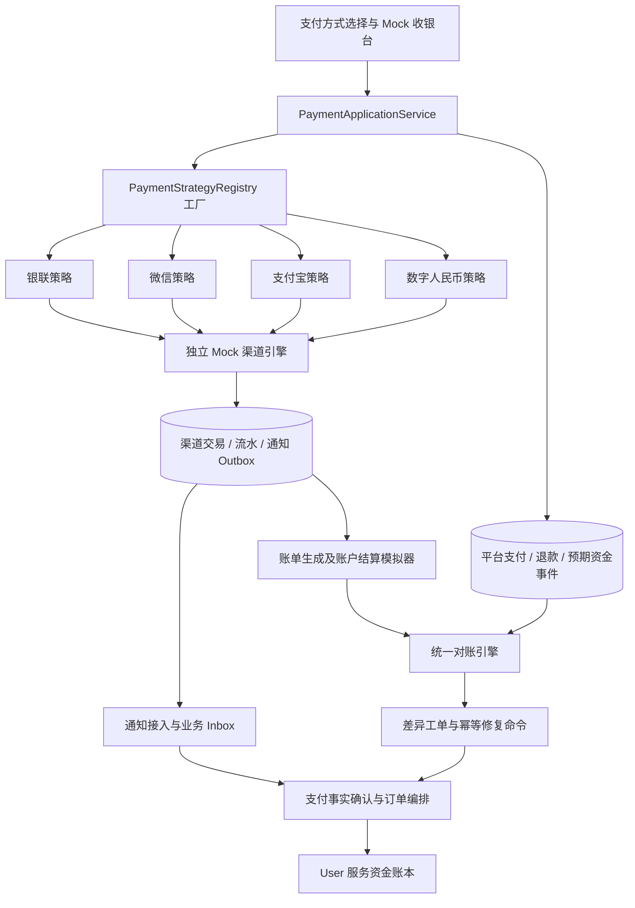

# 多支付渠道 Mock 支付与对账设计开发方案

版本：1.0  
编写日期：2026-10-16  
适用仓库：mall-parent  
文档性质：待开发方案；本文列出的新增接口、表、状态、配置和任务均不表示已经实现。  
实施范围：Java / Spring Boot 现有服务内扩展，前端使用现有 React 工程；全部支付、渠道账单和银行流水均为 Mock，不申请真实商户、不调用真实资金接口。

## 1. 设计结论与交付目标

用户在支付订单时可以选择：**银行卡／银联、微信支付、支付宝、数字人民币**。推荐使用**策略模式 + Spring 策略注册工厂 + 统一支付编排**：策略封装渠道差异，工厂负责定位策略，编排服务负责状态、幂等、事务和业务规则。对账周期配置在渠道商户协议中，不写死在支付方式枚举里。

采用企业支付系统常见的分层处理：

1. 单笔支付通过通知、查单和补偿及时确认，四种方式都具备此能力。
2. 当日滚动核对用于尽早发现异常，不能把未结束的一天标成“全日已平账”。
3. 日切后取得完整账单，再做交易、退款及渠道资金的日终对账。
4. 渠道结算到账与平台给卖家放款分别建模，保留订单交付、确认、售后和风控条件。

本项目默认场景如下。**表中的资金到账规则是明确选定的 Mock 商户协议，不是对相应品牌所有产品的承诺。**

| 方式 | 产品代码 | 日内核对 | 正式日账单及核对 | 默认模拟资金到账 |
| --- | --- | --- | --- | --- |
| 银行卡／银联 | `UNIONPAY_BANK` | 每 5 分钟核对已确认交易 | 清算业务日期的 D+1，09:00 出账、09:15 核对，时间为项目设定 | 清算日期后的第 1 个有效结算工作日，即本文 T+1，09:30 到模拟银行账户 |
| 微信支付 | `WECHAT_PAY` | 每 5 分钟核对已确认交易 | D+1，10:00 后出账，10:15 核对 | Mock 协议设为 D+1 11:00 到模拟银行账户 |
| 支付宝 | `ALIPAY` | 每 5 分钟核对已确认交易 | D+1，08:00 出账，08:15 核对 | Mock 协议设为 D+1 09:00 到模拟银行账户 |
| 数字人民币 | `ECNY` | 成功事件触发，1 分钟扫描兜底，即 D+0 增量核对 | 日切后 D+1 00:10 生成全日汇总，00:15 复核；时间为项目设定 | D+0 实时进入模拟商户数字人民币钱包；兑回银行另计 |

因此，面向用户的正确描述是“支持多渠道支付；实时核对 + 次日完整账单对账；按协议模拟 T+1、D+1 或实时结算”。不要写成“银联只能 T+1 对账、微信只能 D+1 对账、数字人民币不需要日终对账”。

### 1.1 必须完成的功能

- 四种支付方式选择、模拟收银台、支付处理中与最终结果展示。
- 支付聚合单与支付尝试分离，支持失败重试、受控换渠道，防止多次扣款导致重复履约。
- 独立持久化的 Mock 渠道交易、通知、资金流水和账单，不从本地成功订单即时复制渠道账。
- 通知验签、重放防护、业务幂等、通知丢失补偿、关单竞态和迟到成功处理。
- 交易对账、退款对账、手续费核对、渠道结算和模拟银行／钱包到账核对。
- 账单未就绪、空账单、修订账单、单边账、金额差异、重复流水的处理闭环。
- 管理端查看批次、差异、处理记录，能够按业务日期重跑。
- 自动化场景能通过固定时钟和历史样本验证，无须真实等待一天。

### 1.2 实施边界

本期使用人民币 CNY、普通单次消费、既有全额售后退款。支付基础层预留多次部分退款字段与约束，但在订单金额、库存、平台佣金的部分退款规则完成前，不开放业务侧部分退款入口。

银行卡支付采用“银联网络下的模拟收银台”概念，不额外实现线下 POS、信用卡分期、银行账户实名绑卡、真实短信验证码。数字人民币采用在线商户钱包场景，不实现双离线支付。支付工具中用银行卡作为微信或支付宝资金来源时，在平台仍归类为微信或支付宝渠道。

商家保证金支付、旧秒杀订单支付和提现不是本期四渠道收银台的直接入口，保留原流程；相关资金若出现在模拟渠道账户，应通过事件类型和业务域隔离，不能混入担保订单交易对账。提现与数字人民币兑回的后续联动见第 9 节。

## 2. 已核实的源码现状及改造影响

以下是本次设计时的源码事实。

| 位置 | 当前行为 | 本方案要求 |
| --- | --- | --- |
| [TradeOrchestrationCommandService](../../mall-order-service/src/main/java/com/example/item/service/TradeOrchestrationCommandService.java) | `orderReady` 创建 `PAY + orderNo`；`buildPayment` 将渠道写死为 `MOCK_WECHAT` | 保留订单级支付聚合；用户发起支付时创建渠道尝试 |
| [PaymentOrder / Mapper](../../mall-order-service/src/main/java/com/example/item/mapper/PaymentOrderMapper.java) | 支付表按订单唯一；状态更新只识别 paymentNo/orderNo | 保留聚合唯一约束，新增 attempt 表和条件更新，避免一个渠道的失败覆盖另一个渠道的成功 |
| [MockPaymentController](../../mall-order-service/src/main/java/com/example/item/controller/MockPaymentController.java) | `start` 无渠道参数；`mock-pay` 现场签名并同步调用本地回调服务 | 改为持久化渠道支付事实后异步投递通知；不能以接口返回成功直接宣告订单已支付 |
| [PaymentCallbackService](../../mall-order-service/src/main/java/com/example/item/service/PaymentCallbackService.java) | HMAC、时间窗、nonce、callbackNo 去重；保存回调并触发支付确认编排 | 保留防护，增加 attempt、商户、币种、渠道流水身份绑定和 durable inbox |
| [PaymentCallbackRequest](../../mall-order-service/src/main/java/com/example/item/dto/PaymentCallbackRequest.java) | 没有 attemptNo、渠道商户、币种、渠道流水号 | 使用版本化通知 DTO，不能只给旧 DTO 增加显示字段 |
| [TradeOrderService](../../mall-order-service/src/main/java/com/example/item/service/TradeOrderService.java) | 支付成功进入 PAY_CONFIRMING；确认任务完成后进入 PAID；存在超时关单、冷却与售后逻辑 | 统一接收通知／查单确认事实；兼容旧任务；迟到成功与重复支付进入独立异常资金流程 |
| [TradeOrchestrationService](../../mall-order-service/src/main/java/com/example/item/service/TradeOrchestrationService.java) | 步骤返回 String 就被标记 SUCCESS，运行异常消耗重试预算；当前恢复条件没有 WAITING | 增加显式等待结果，退款 PROCESSING 不能当步骤成功，也不能连续消耗失败次数 |
| [FundService](../../mall-user-service/src/main/java/com/example/user/service/FundService.java) | `freezeEscrow` 记平台 ESCROW 与 EXTERNAL_CHANNEL 镜像流水，没有扣买家站内余额；`refundEscrow` 却把退款增加到买家站内 AVAILABLE | 新渠道原路退款必须有专用账务方法；不能既退回模拟外部渠道，又给站内余额加钱 |
| [ReconciliationJobHandler](../../mall-order-service/src/main/java/com/example/item/component/ReconciliationJobHandler.java) | 查询旧 `t_order` 全部 status=1 数据，无日期过滤；用本地数据和 Math.random 构造渠道账 | 退出新交易链路；新引擎基于 `t_trade_order/t_payment_*` 和独立渠道账；老演示任务明确停用或加 legacy 开关 |
| [TradeReconciliationService](../../mall-order-service/src/main/java/com/example/item/service/TradeReconciliationService.java) | 核对订单、结算、托管、资产和编排任务 | 继续作为内部一致性对账，与渠道账对账互补 |
| [FundReconciliationService](../../mall-user-service/src/main/java/com/example/user/service/FundReconciliationService.java) | 账户余额与资金流水、提现核对 | 扩展新异常资金账户和原路退款业务类型；不替代渠道对账 |
| [TradeOrderJobHandler](../../mall-order-service/src/main/java/com/example/item/job/TradeOrderJobHandler.java) | 已有支付超时、自动确认、结算、内部对账 XXL-Job | 复用调度体系，新增渠道账任务；后台配置任务的步骤列入发布清单 |
| [tradeApi.js](../../mall-frontend/src/api/tradeApi.js) | 支付先 start 再 mock-pay，固定成功 | 增加渠道查询、attempt 创建、状态轮询和 Mock 收银台 |
| [用户订单详情](../../mall-frontend/src/pages/orders/UserOrderDetailPage.jsx)、[订单列表](../../mall-frontend/src/pages/orders/UserOrdersPage.jsx)、[TradeWorkbench](../../mall-frontend/src/components/trade/TradeWorkbench.jsx) | 三处均有支付入口 | 共用 PaymentDialog，全部切换，避免只改其中一处 |

还有三项落地约束：

1. [现有 schema](../sql/init/stage1_schema.sql) 中 `t_payment_order.uk_order_no` 是唯一索引。直接新增第二张同订单支付单会冲突；本方案保留聚合单唯一，新增尝试表。
2. 现有支付接口使用 `getVisibleOrder` 判断可见性，当前该方法允许买卖双方查看，不能直接当作付款授权。新“创建尝试／模拟支付／切换渠道”必须校验当前用户是 buyerId；管理端另行验证管理员身份，管理员查看权限也不自动获得付款权限。
3. 网关当前只对精确路径 `POST /api/payment/callback` 做回调放行、来源控制及特殊限流；订单路由已覆盖 `/api/payment/**` 和 `/api/trade/**`。新方案保留统一回调路径，管理端使用 `/api/trade/admin/**`，同步复核服务端管理员校验。见 [网关配置](../../mall-gateway-service/src/main/resources/application.yml) 和 [来源控制 Filter](../../mall-gateway-service/src/main/java/com/example/gateway/security/PaymentCallbackSourceControlFilter.java)。

## 3. 真实企业惯例与 Mock 约定

### 3.1 不同“时间”的含义

| 名称 | 回答的问题 | 本项目保存字段 |
| --- | --- | --- |
| 支付确认 | 用户的钱是否已经在渠道支付成功 | channelSuccessAt、channelTradeNo |
| 渠道交易日期 | 这笔交易进入哪天的账单 | channelBusinessDate、windowStart/windowEnd |
| 账单就绪 | 完整账单什么时候可以取 | statementAvailableAt |
| 对账执行 | 系统什么时候拿双方数据比较 | runStartedAt、completedAt |
| 渠道结算 | 款项何时到指定银行账户或钱包 | expectedSettlementAt、actualSettledAt、settlementTarget |
| 平台卖家结算 | 订单何时满足给卖家释放权益的条件 | confirmedAt、settleAvailableTime、riskHold |

本文采用：D+N 表示自然日偏移；T+N 专指按某个配置日历计算的结算工作日偏移。但是外部文档里的 T 也可能仅指“交易日”，不能看到 T+1 就认定跳过周末。微信官方账单文档即同时使用“次日”和“T+1日”的表达。[微信支付账单产品介绍](https://pay.wechatpay.cn/doc/v3/merchant/4013071215)

实现中禁止仅保存字符串 `T+1`。至少保存 `dayBasis=CALENDAR/BUSINESS`、偏移、时间、日切、日期锚点、日历和到账目标。D+0 表示当日，不自动等于秒到；秒级能力另用 `REALTIME` 表达。

### 3.2 资料支持的事实

- 微信交易／资金日账单在次日 10 点后提供；交易日期与支付成功／退款受理时间有关，资金账单按动账时间归属。退款受理记录不等于退款已经到账。[微信支付下载账单](https://pay.wechatpay.cn/doc/v3/merchant/4013071215)
- 支付宝交易和资金日账单通常次日 8 点前生成。费用账单另有出账周期，不能套用交易账单时间。[支付宝账单说明](https://help.alipay.com/enterprise/knowledgeDetail.htm?knowledgeId=201603401890)
- 银联提供按清算日期获取文件的接口；具体产品、收单机构和商户协议会影响日切及到账。历史全渠道指引的机构结算章节存在 23 点日切、下一工作日划拨的示例，不能把它当成所有银联商户的固定规则。[银联文件接口](https://open.unionpay.com/tjweb/acproduct/APIList?acpAPIId=763&apiservId=448)、[银联历史运营指引](https://open.unionpay.com/upload/download/%E5%85%A8%E6%B8%A0%E9%81%93%E4%B8%9A%E5%8A%A1%E8%BF%90%E8%90%A5%E6%9C%8D%E5%8A%A1%E6%8C%87%E5%BC%95%EF%BC%88%E5%95%86%E6%88%B7%EF%BC%891.2.pdf)
- 收单产品可能提供标准 T+1 以及经审核开通的实时结算，因此到账能力不应只取决于“银行卡”这个名称。[农业银行商户收单业务](https://www.abchina.com/CN/businesses/payment/sdyw/)
- 数字人民币具备支付即结算的特性；本方案据此选择“在线商户钱包实时收款”的模拟产品。商户服务依然有钱包、入网和清算到账等约定，不能由这项特性推出全日账单实时完整、银行兑回立即完成。[人民银行陕西省分行答复](https://xian.pbc.gov.cn/xian/129428/129478/5607109/2025122911065186547/2025122911063319148.pdf)、[建设银行数字人民币商户条款](https://www2.ccb.com/sd/cn/fhgg/upload/20240614_1718327700/20240614091516802905.pdf)

上述链接核对日期为 2026-10-16；历史协议用作建模依据，不能视为当前统一报价或所有产品的 SLA。下面的费率、Mock 银行到账时刻、数字人民币汇总出账时刻均属于本项目明确设置的演示参数。

### 3.3 为什么不按渠道选一个唯一的 T+1/D+1/D+0

同一笔银联模拟支付可以“当天已成功、次日账单已核对、下个工作日才到账”；同一笔数字人民币支付可以“当天钱包已入账、交易已核对、次日才结束全日账核验”。没有矛盾，它们描述不同环节。

微信、支付宝同样可以做日内交易查询和预核对，本期也实现；数字人民币的差异在于默认钱包实时结算，以及支持事件驱动的资金流水核对。日内任务与日终任务同时存在。

## 4. 日期、日历和配置模型

### 4.1 渠道协议维度

支付方式表示用户选择；渠道商户协议表示服务端实际模拟的支付产品和商户账户。前端不能选择商户号、结算周期、手续费或凭据版本。

`ChannelProfile` 建议至少包含：

| 字段 | 含义 |
| --- | --- |
| profileId、version、enabled、mode | 版本化协议；mode 本期固定 MOCK |
| paymentMethod、providerCode、productCode | 用户支付方式、模拟提供方、产品 |
| channelMerchantNo、accountId | 模拟商户与结算账户；隔离账单及幂等范围 |
| zoneId | 默认 Asia/Shanghai |
| cutoffTime、dateLabelRule | 日切时间与业务日期命名方法 |
| statementPolicies | 每类账单独立设置日期锚点、偏移、可用时刻、重试宽限 |
| settlementPolicy | REALTIME/CALENDAR/BUSINESS，offset、time、calendarId、target |
| feePolicy、feeRefundPolicy | 渠道手续费及退款时费用规则 |
| capabilities | 支持查单、关闭、原路退、日账单、增量流水、钱包兑回等 |

启动时校验：缺少时区、工作日日历、重复策略注册、渠道与 profile 不匹配等应报错。支付尝试保存 profileVersion 和关键配置快照；更改当前配置只影响新尝试，历史交易不重算原结算计划。

### 4.2 日切及日期算法

- 所有金额事件同时记录 `occurredAt`（渠道业务发生时间）、`recordedAt`（写库时间）和 `channelBusinessDate`。
- 用 Instant 或带时区时间在接口传输；数据库既有 DATETIME(3) 统一按 Asia/Shanghai 解释，新列文档明确时区。跨系统转换不能使用宿主机默认时区。
- 微信、支付宝、数字人民币默认区间为 `[D 00:00, D+1 00:00)`。
- 银联 Mock 采用历史日切示例：标签 D 对应 `[D-1 23:00, D 23:00)`。同一自然日 23:00 后的支付属于下一清算日期。
- 日账单可用时间以 `channelBusinessDate` 加自然日偏移计算；T+1 到账以该清算日期之后的第一个结算有效日计算，不能用 `plusHours(24)` 或仅判断周一到周五。
- 日历表显式记录工作日、非结算日、特殊开闭市。行政调休不自动等于收单结算工作日。测试使用自带的虚拟结算日历，注明其不是官方节假日表。
- 当年／次年日历缺失时，T+1 计划进入 `CALENDAR_MISSING` 并告警，不静默假定是工作日。

示例：假定演示日历把 2026-10-17、18 标为非结算日、19 标为有效日。

| 支付时间（北京时间） | 方式 | 账单归属 | 日账单可核对时间 | 默认模拟到账 |
| --- | --- | --- | --- | --- |
| 10-16 周五 14:00 | 银联 | 10-16 | 10-17 09:15 | 10-19 09:30 |
| 10-16 周五 23:10 | 银联 | 10-17 | 10-18 09:15 | 10-19 09:30 |
| 10-16 周五 14:00 | 微信 | 10-16 | 10-17 10:15 | 10-17 11:00 |
| 10-16 周五 14:00 | 支付宝 | 10-16 | 10-17 08:15 | 10-17 09:00 |
| 10-16 周五 14:00 | 数字人民币 | 10-16 | 当日增量；10-17 00:15 全日复核 | 当日钱包实时入账 |

### 4.3 配置示意

下例展示协议结构；版本和费率均为模拟值。建议初期 YAML 管理并生成不可变快照，后续再扩展管理界面，避免一开始实现复杂配置中心。

```yaml
payment:
  mode: MOCK
  profiles:
    unionpay-demo-v1:
      payment-method: UNIONPAY_BANK
      version: 1
      zone-id: Asia/Shanghai
      cutoff-time: "23:00"
      date-label-rule: CUTOFF_END_DATE
      statement:
        day-basis: CALENDAR
        offset-days: 1
        available-time: "09:00"
      settlement:
        day-basis: BUSINESS
        offset-days: 1
        calendar-id: MOCK_CN_ACQUIRER
        available-time: "09:30"
        target: BANK
      fee-rate: 0.005
    wechat-demo-v1:
      payment-method: WECHAT_PAY
      version: 1
      statement: {day-basis: CALENDAR, offset-days: 1, available-time: "10:00"}
      settlement: {day-basis: CALENDAR, offset-days: 1, available-time: "11:00", target: BANK}
      fee-rate: 0.006
    alipay-demo-v1:
      payment-method: ALIPAY
      version: 1
      statement: {day-basis: CALENDAR, offset-days: 1, available-time: "08:00"}
      settlement: {day-basis: CALENDAR, offset-days: 1, available-time: "09:00", target: BANK}
      fee-rate: 0.006
    ecny-demo-v1:
      payment-method: ECNY
      version: 1
      statement: {day-basis: CALENDAR, offset-days: 1, available-time: "00:10"}
      settlement: {day-basis: REALTIME, delay-seconds: 1, target: ECNY_WALLET}
      fee-rate: 0
```

后三种 profile 的 timezone 和日切使用显式公共默认 `Asia/Shanghai + 00:00 + CALENDAR_DATE`，加载后必须展开到快照。手续费按每笔金额四舍五入到分；默认退款按累计比例退回手续费并在最后一笔补齐尾差。以上费率及费用退回政策只用于演示，不能显示为官方报价。

### 4.4 不同账单的日期不能混用

上面的简化 YAML 主要展示交易日账单。完整配置需按账单类型展开：

| 类型 | 归属日期依据 | 例子 |
| --- | --- | --- |
| TRADE | 支付成功／对应退款业务阶段的渠道日期 | 16 日支付，17 日提供 16 日交易账单 |
| FUND | 账户实际动账时间对应的业务日期 | 17 日结算转出，计入 17 日资金账单，通常 18 日才能完整取到 |
| SETTLEMENT | 结算协议定义的批次日期及实际入账日期均保存 | 16 日交易的批次，实际银行到账可能是 19 日 |
| BANK_RECEIPT | 银行账务日期／valueDate，另存实时观察时间 | 实时查得 19 日入账，不伪装成 16 日银行流水 |

L3 到账核验可以使用即时模拟回执，不必等该入账日的资金日账单；随后还应让日账单复核覆盖该转账。退款当日无新支付时仍应生成有退款的账单。

同一商户一天内可存在多个 profileVersion。账单按商户／账户和业务日期归集，条目保留自身协议版本；本地规则快照按各笔交易版本计算。run 固定解析器和核对规则版本，不能强制把当天全部交易重算成最新费率。不同日切的历史 profile 必须保留各自窗口，不能只套用新 profile 的日期边界。

## 5. 总体架构与设计模式

### 5.1 部署方案

复用 mall-order-service、mall-user-service、mall-api、mall-gateway-service 和 mall-frontend，不新增语言或必须单独部署的支付微服务。Mock 渠道逻辑放在 order 服务内独立 package，表以 `t_mock_` 为前缀。

逻辑上必须隔离平台侧与渠道侧：Mock 组件只消费不可变的支付／退款命令，不读取平台最终支付状态来拼账单；平台对账组件通过渠道 Port 获取 Mock 数据，不直接替 Mock 修改交易结果。



### 5.2 策略与工厂的具体职责

推荐 Spring 注入的注册式工厂，而非每次 `new` 策略，或在 Controller 中维护四套 switch。工厂不是业务编排器，策略也不能直接改买家、卖家余额。

```java
// 以下均为拟新增接口示意，不是现有可直接编译的实现。
enum PaymentMethod { UNIONPAY_BANK, WECHAT_PAY, ALIPAY, ECNY }
record ChannelKey(String providerCode, String productCode, String mode) {}

interface PaymentChannelStrategy {
    ChannelKey key();
    ChannelCapabilities capabilities();
    CreatePaymentResult createPayment(CreateChannelPayment command);
    ChannelPaymentResult queryPayment(QueryChannelPayment query);
    ClosePaymentResult closePayment(CloseChannelPayment command);
    ChannelRefundResult refund(RefundChannelPayment command);
    ChannelRefundResult queryRefund(QueryChannelRefund query);
    VerifiedChannelEvent verifyAndParse(RawChannelNotification notification);
}

interface ChannelStatementPort {
    StatementFetchResult fetchDaily(StatementQuery query);
    IncrementalPage fetchIncremental(IncrementalQuery query);
}

interface SettlementSchedulePolicy {
    SettlementPlan plan(ChannelProfileSnapshot profile,
                        FinancialEvent event, SettlementCalendar calendar);
}
```

`PaymentStrategyRegistry` 注入 `List<PaymentChannelStrategy>` 构建不可变 Map；重复 key 启动失败，未注册 key 返回明确业务错误。服务端按用户选定方式解析允许的 profile，再依据其 ChannelKey 查找策略。请求参数不能指定 Spring Bean 名或任意类名。

推荐实现类：`MockUnionPayStrategy`、`MockWechatPayStrategy`、`MockAlipayStrategy`、`MockEcnyStrategy`。共用 `MockChannelEngine` 处理交易持久化、幂等和事件，分别定义收银台呈现、字段转换、账单模板和能力集。

注册工厂可以采用如下结构，重复 key 在启动时失败：

```java
final class PaymentStrategyRegistry {
    private final Map<ChannelKey, PaymentChannelStrategy> strategies;

    PaymentStrategyRegistry(List<PaymentChannelStrategy> candidates) {
        this.strategies = candidates.stream().collect(
            Collectors.toUnmodifiableMap(
                PaymentChannelStrategy::key, Function.identity()));
    }

    PaymentChannelStrategy require(ChannelKey key) {
        PaymentChannelStrategy strategy = strategies.get(key);
        if (strategy == null) {
            throw new IllegalArgumentException("CHANNEL_NOT_SUPPORTED");
        }
        return strategy;
    }
}
```

实际实现加 Spring 组件注解、项目业务异常和 profile 校验；该示例不建议通过工厂绕过支付应用服务直接供 Controller 调用渠道。

三项变化用组合表达：

- 支付策略：怎么创建、查询、关闭和退款。
- 账单适配器：怎么获取文件／流水、解析并标准化。
- 周期策略：自然日、结算工作日或实时；从配置选择，不新增 `WechatD1Strategy` 等组合类。

`PaymentApplicationService` 统一执行权限、金额、幂等和状态流转；`ReconciliationService` 统一比对算法。四个策略不用各写一套对账核心。

### 5.3 建议包结构

```text
mall-order-service/.../com/example/item/
  payment/
    application/     # 支付尝试、关单、确认、退款
    domain/          # 聚合、状态、渠道协议和金额对象
    channel/         # Strategy、Registry、StatementPort
    mock/            # 四渠道策略、独立账、Outbox、场景注入
    settlement/      # 周期计算、渠道结算计划、到账核验
  reconciliation/
    application/     # 计划、执行、重跑、差异处理
    statement/       # 文件快照、解析、标准化
    matching/        # 交易/退款/手续费/资金核对规则
    job/             # XXL-Job 适配
    controller/      # 管理 API
```

与现有包可以逐步迁移；不要求顺便重命名整个项目的 `com.example.item` 包。

## 6. 核心数据模型与约束

### 6.1 通用规范

- 金额使用 DECIMAL(18,2) / BigDecimal；接口金额字符串，禁止浮点运算。超过两位小数直接校验失败，不在验签前静默截断。
- 统一 CNY；币种仍是核对字段。测试必须覆盖币种错误。
- 业务号不可变：orderNo、paymentNo、attemptNo、refundNo、channelTradeNo、settlementNo 均分别表达不同对象。
- 业务表存当前状态；金融事件、原始账单、通知证据和差异处理历史追加保存。
- 新表的渠道键包含 profileId、channelMerchantNo、accountId；同一个渠道多个商户的数据不得混核。
- 普通联调使用 scopeId=`DEFAULT`；合成演示数据用独立 scopeId，不能据此授权访问其他用户订单。端到端测试另用独立数据库。
- 各表使用 id、created_at、updated_at；需 CAS 的表增加 version，工作队列表增加 next_execute_at、locked_until、lease_token。

### 6.2 支付聚合与尝试

保留 `t_payment_order`：

| 字段改造 | 用途 |
| --- | --- |
| 保留 payment_no 唯一、order_no 唯一、amount、expire_time | 与现有订单和 PAY_CONFIRM 编排兼容 |
| 新增 active_attempt_no、successful_attempt_no | 当前尝试及唯一已采用成功尝试 |
| 新增 currency、payment_mode、data_origin、version | MOCK 标识、LEGACY_V1/NATIVE_V2 来源、并发控制 |
| channel 调整为可空 | 无尝试时未选择；有尝试时只是展示投影，真实渠道以尝试为准 |
| status 明确为聚合业务状态 | INIT、PAYING、SUCCESS_PENDING、SUCCESS、CLOSED；原 FAIL/TIMEOUT/CANCELLED 通过迁移映射，保留原始值证据 |

新增 `t_payment_attempt`：

| 字段 | 说明 |
| --- | --- |
| attempt_no、payment_no、order_no、attempt_seq | 一次不可变的支付发起 |
| payment_method、profile_id、profile_version、profile_snapshot | 渠道及协议固定 |
| channel_merchant_no、channel_trade_no、out_trade_no | outTradeNo 使用 attemptNo；渠道流水后续绑定且不可覆盖 |
| amount、currency、status | 独立状态 |
| channel_success_at、channel_business_date、local_confirmed_at | 支付发生与平台观察时间分开 |
| request_key、request_hash、expires_at、next_query_at | 客户端重试与补查 |
| failure_code、allocation_status、version | 故障原因；是否用于订单，或转入异常资金 |

索引：UNIQUE(attempt_no)、UNIQUE(payment_no, attempt_seq)、UNIQUE(payment_no, request_key)、UNIQUE(profile_id, channel_merchant_no, channel_trade_no)，以及 INDEX(status,next_query_at)、INDEX(profile_id,channel_business_date,id)。channelTradeNo 未知时为 NULL，不用空串占位。

**约束实现**：同订单至多一个活动尝试通过聚合行锁和 activeAttemptNo 控制；只有一次 SUCCESS 可被 successfulAttemptNo 接受。数据库唯一键作为幂等底线，不能只依赖 Redis 锁。

### 6.3 平台侧新增表

| 表 | 核心字段与用途 | 唯一性／关键索引 |
| --- | --- | --- |
| `t_payment_command` | commandNo、attemptNo/refundNo、type、payloadHash、status、retry、lease；可靠地下发 CREATE/CLOSE/REFUND 等命令 | commandNo；bizKey+type |
| `t_payment_event_inbox` | eventId、attemptNo/refundNo、channelTradeNo、verifiedPayload、source=CALLBACK/QUERY、processingStatus | profile+merchant+eventId；status+nextExecuteAt |
| `t_payment_financial_event` | eventNo、bizType、bizNo、amount、currency、occurredAt、recordedAt、businessDate、profileVersion；平台侧不可变资金事实／预期 | profile+merchant+eventType+bizNo+eventStage |
| `t_payment_refund_order` | refundNo、originalAttemptNo、orderNo、reason、amount、currency、status、acceptedAt、successAt、channelRefundNo、fundTaskNo | refundNo；originalAttemptNo+requestKey；status+nextQueryAt |
| `t_channel_settlement_order` | settlementNo、profile、businessDate、target、expectedAt、actualAt、gross、refund、fee、feeReturn、net、status | profile+merchant+account+businessDate+target+planVersion |
| `t_channel_settlement_line` | settlementNo、financialEventNo、settlementPurpose、direction、amount、fee、feeReturn、expectedNet | settlementNo+financialEventNo；金融事件+结算用途不得被两个有效批次重复分配 |
| `t_channel_cash_receipt` | 平台观察到的模拟银行／钱包到账回执，receiptNo、settlementNo、amount、currency、observedAt | source+account+receiptNo |
| `t_channel_transfer` | 资金搬运单：ECNY_REDEEM 等；from/toAccount、amount、state、requestKey、渠道回执 | transferNo；sourceAccount+requestKey |
| `t_settlement_calendar_day` | calendarId、date、isSettlementDay、version、reason | calendarId+date+version |

`t_payment_financial_event` 是支付与渠道结算的对账子账，不替代 user 服务的余额权威。事件产生规则：已验证支付成功生成 PAYMENT；退款受理生成 REFUND_ACCEPTED，成功才生成 REFUND_SUCCEEDED；结算预期由独立计划器按快照计算。账单导入不能反过来静默生成平台预期以凑平账。

### 6.4 Mock 渠道侧新增表

| 表 | 核心字段与用途 | 约束 |
| --- | --- | --- |
| `t_mock_channel_transaction` | 模拟渠道独立交易结果；attemptNo、渠道流水、币种金额、成功时间、业务日期、费用、faultPlanId | profile+merchant+outTradeNo 幂等；不同参数拒绝 |
| `t_mock_channel_refund` | 模拟原路退款；原渠道流水、refundNo、受理及成功时间、金额状态 | merchant+refundNo；总退款预留与成功额不超过实收 |
| `t_mock_channel_posting` | 追加流水：PAYMENT、REFUND、FEE、FEE_RETURN、SETTLEMENT_OUT、REDEEM；account、sequence、余额变化 | account+sequence；sourceEventNo+entryType |
| `t_mock_notification_outbox` | eventId、payload、retry、nextSendAt、status；渠道交易事务内创建 | eventId；status+nextSendAt |
| `t_mock_settlement_transfer` | Mock 渠道独立计算的实际结算动作，net、计划／实际发生时间、目标账户 | mockSettlementNo；profile+merchant+date+target+version |
| `t_mock_bank_entry` | 独立模拟银行／钱包回执，允许延迟、拆分、失败注入 | bankEntryNo；externalReference+entrySeq |
| `t_mock_statement` | scope、profile、merchant、account、type、date、version、hash、rowCount、totals、availableAt、fileLocation | scope+profile+merchant+account+type+date+version |
| `t_mock_fault_plan` | 具名故障计划、目标 attempt/date、参数、seed、planVersion | scope+scenarioKey+planVersion |

Mock 资金流水与通知 Outbox 在渠道本地事务中共同落库；平台状态确认是另一个事务。即使部署在同进程，也不得用一个大事务包住双方，才能真实模拟“渠道已扣款、平台没收到通知”。

### 6.5 对账表

| 表 | 核心内容与职责 |
| --- | --- |
| `t_recon_task` | 一个逻辑核对范围：scope/profile/merchant/account/type/businessDate/mode/windowEnd；任务状态、调度游标、锁租约 |
| `t_recon_run` | 每次执行：taskNo、runSeq、输入文件版本/hash、本地snapshotCutoff、规则版本、计数与金额汇总、executionStatus、outcome |
| `t_recon_file` | 原始渠道文件副本、checksum、manifest、parserVersion、导入结果；原始文件只读 |
| `t_recon_channel_item` | 标准化渠道条目及原始行引用；保留重复行证据 |
| `t_recon_local_item` | 本次运行的平台快照，不直接依赖执行中不断变化的在线表 |
| `t_recon_match` | 双边条目、核对类型、金额／状态结果、规则和版本 |
| `t_recon_diff` | 稳定的差异工单：diffKey、类型、双方金额与状态、严重度、first/lastSeen、状态、关联attempt/refund |
| `t_recon_diff_history` | 差异发现、认领、修复、重核、关闭、重开的追加记录 |
| `t_recon_repair_command` | 补查、重投递、原路退、重跑等幂等动作与执行结果 |

逻辑任务唯一键包含 scope、profile、merchant、account、statementType、businessDate、mode 和 windowEnd；日终 windowEnd 使用业务日结束点。run 以 (taskNo,runSeq) 唯一。文件以逻辑范围+源版本+hash 去重；同版本不同 hash 不能覆盖旧文件。

渠道条目使用 (fileId,lineNo) 唯一保存原始输入，再做业务键重复检测；不能在导入阶段按业务键去重而掩盖渠道重复记录。本地快照以 (runNo,eventNo) 唯一。

差异稳定键由 profile/merchant/account + 对账层 + bizKey + diffType 构成，保存本次观察日期和输入版本；同一未解决问题跨多轮扫描更新 lastSeen，而非不断插入新工单。已关闭问题再次出现应显式 REOPEN，并保留前次证据。

### 6.6 user 服务资金接口的扩展

新原路退款接口按 refundNo 幂等，订单级键只保留给旧流程：

- `refundEscrowToChannel(orderNo, attemptNo, refundNo, amount, idempotencyKey)`：退款渠道确认成功后，托管扣减，记录 EXTERNAL_CHANNEL 方向的退款流水，不增加买家站内余额。
- `creditPaymentSuspense(attemptNo, amount, idempotencyKey)`：迟到／多付等未用于订单的外部收款记入异常资金待处理账户。
- `refundPaymentSuspense(attemptNo, refundNo, amount, idempotencyKey)`：成功原路退后释放对应异常资金。
- 订单已退款但平台资金任务尚未完成时，状态保持 REFUNDING，依靠任务重试，不抢先改成 REFUNDED。

在 `t_platform_account` 新增 payment_suspense_amount，并将其纳入资金流水与余额核对。每笔异常资金绑定 attemptNo；资金汇总账户之外必须有明细可查。

## 7. 支付与换渠道流程

### 7.1 状态分离

支付尝试：

```text
CREATED -> SUBMITTING -> PENDING -> SUCCEEDED
                     -> UNKNOWN -> 查询后 PENDING / SUCCEEDED / FAILED / CLOSED
PENDING -> CLOSING -> CLOSED
                  -> UNKNOWN / SUCCEEDED
CREATED / PENDING -> FAILED（仅在渠道已明确终态时）
```

网络超时表示 UNKNOWN，不表示失败。订单支付聚合可以 PAYING，但某个尝试 UNKNOWN；订单只有一次已采用成功。通知受理、渠道成功和订单 PAID 是三个不同状态。

异常资金归属使用独立 allocationStatus：`ORDER_APPLIED / LATE_PAYMENT / EXCESS_PAYMENT / UNIDENTIFIED`。即便旧尝试已 CLOSED，可信渠道后来确认成功，也必须保留实际成功事实并走异常资金处理，不能丢弃。

### 7.2 首次支付顺序

1. 前端查询服务端允许的四种方式和可用性；用户选择并提交 paymentMethod 和 requestKey。
2. 服务端检查 buyerId、订单 WAIT_PAY、金额、有效期、风险状态和活动尝试，金额完全从订单读取。
3. 短事务锁住聚合，保存 attempt、profile 快照、命令 Outbox，并把 activeAttemptNo 指向该尝试。
4. 提交后 Worker 调策略创建渠道支付。渠道按 outTradeNo 幂等，创建模拟收银台动作。请求超时先查单，不重新产生新尝试扣款。
5. 用户在 Mock 收银台确认。Mock 引擎在独立事务保存支付结果、费用和通知 Outbox。
6. 通知验签后写 inbox；立即回应“已持久化受理”，不等远端 Dubbo 履约完成。
7. inbox Worker 调 `PaymentConfirmationService.acceptVerifiedFact`，锁定订单／支付聚合，选择唯一可采用成功尝试；同时记录平台金融事实、创建既有支付确认编排。
8. 既有 FUND_FREEZE、ASSET_CONFIRM、LOCAL_PAYMENT_CONFIRM、ESCROW_CONFIRM 完成后，订单进入 PAID，前端轮询才展示“支付成功”。

不把该链路放到分布式大事务里。数据库 Outbox／Inbox 加幂等构成可靠性基础，RocketMQ 可以加速唤醒，丢消息后定时扫描依然可以推进。

### 7.3 换渠道与同时支付

- 未下发的 CREATED 尝试可以本地取消。
- 已下发尝试必须完成 CLOSE + QUERY，确认渠道未收款且 CLOSED，才允许创建下一次尝试。
- 旧渠道 UNKNOWN 或关单结果未知时，页面提示“正在确认上一笔支付”，阻止另开付款。
- 同一 requestKey + 相同请求体返回同一 attempt；同 key 不同 paymentMethod 返回 409。
- 两个浏览器同时请求不同方式时，聚合行锁／version 让其中一个成功，另一个返回现有活动尝试。
- 极端竞态下出现两次实际成功，只允许其中一次执行订单资金冻结与履约；其余先进入 PAYMENT_SUSPENSE，再通过原渠道原路退。
- 已成功支付不接受用户修改渠道；退款始终走 successfulAttemptNo 所绑定渠道，不能读取当前 UI 选择。

### 7.4 迟到成功与主动查单

统一确认服务同时服务通知和主动查单；修复任务不得伪造过期通知绕过验签。查单策略返回已验证的内部事实，带 source=QUERY 和独立证据引用。

区分两类迟到：

1. **渠道在付款期限内成功，只是通知迟到**：先查订单是否仍能安全履约；如果订单已关单、库存已释放，则转异常资金退款，不能强行恢复订单。
2. **渠道在付款期限后才成功**：进入迟付处理，不使已关闭订单复活。

先可靠记录渠道成功事实，再检查订单能否采用；风控阻断或订单状态错误不能导致外部收款事实丢失。需要调整现有 `handleVerifiedCallback` 中部分业务检查先于事实落库的顺序。

### 7.5 通知幂等与验签

Mock v2 通知包含 version、eventId、paymentNo、attemptNo、channelMerchantNo、channelTradeNo、eventType、amount、currency、occurredAt、timestamp、nonce、rawPayloadHash。

签名覆盖上述关键字段并使用服务端保存的 profile／凭据版本解析密钥；请求宣称的渠道不得直接决定密钥。金额、币种、订单、尝试、商户四层绑定均需校验。

网络投递重试保留同一 eventId，发送时间／nonce 可重新生成；已验签且已持久化的相同 eventId 和相同 businessPayloadHash 返回 ACK，不重复处理；同 eventId 的业务内容不同进入安全差异。businessPayloadHash 不包含每次投递变化的 timestamp、nonce，另存完整 envelopeHash。原样重放可以在已验证原始签名与内容完全相同的前提下返回同样 ACK，业务只执行一次。

需要调整当前“先因 nonce 重复直接拒绝”的顺序：先验证身份和签名，再识别已有的完全相同、已验签事件并幂等 ACK；对新事件执行时间窗及 nonce 校验后持久化。不能仅凭调用者猜中 eventId 就返回已处理或绕过验签。

timestamp 的防重放窗口使用真实安全时钟。occurredAt 是渠道业务时间，不能拿它判断一条延迟通知的 HTTP 签名是否过期。

### 7.6 事务边界及互斥

平台订单相关命令统一按 order → payment aggregate → attempt → refund 的顺序加短行锁。退款申请和卖家结算均先条件更新订单状态；退款抢占成功则结算不再执行，结算已执行则不能进入仅面向 ESCROW 的退款路径。网络请求、文件 IO、Dubbo 调用均在短事务提交后执行。

Mock 侧独立锁住渠道交易／退款额度及受影响资金账户，多账户按稳定 accountId 排序。渠道侧不能尝试同时持有平台订单锁，否则失去逻辑隔离并增加死锁风险。

迟付、多付的补偿任务必须先确认 PAYMENT_SUSPENSE 记账成功，再推进异常款原路退款及对应待处理余额释放；即使资金退款已在渠道发生，内部补记也按原幂等键恢复。资金服务的幂等结果必须校验金额、业务号和账户等参数一致，不能只凭键相同返回成功。

## 8. 退款、费用及资金核对

### 8.1 原路退款状态机

```text
REQUESTED -> SUBMITTING -> ACCEPTED / PROCESSING -> SUCCEEDED
                       -> UNKNOWN -> 查询恢复
                       -> FAILED（明确终态）
```

既有仲裁全额退款、交付超时退款流程增加 CHANNEL_REFUND_REQUEST、CHANNEL_REFUND_QUERY、FUND_REFUND_TO_CHANNEL 等步骤。外部退款确认之前保持待退状态并阻止卖家结算；外部退款成功但内部账务失败时重试内部步骤，不能再下发一笔新退款。

refundNo 在所有重试中不变；退款申请先锁住原支付尝试并预留额度：

```text
已成功退款金额 + 正在处理／未知的退款预留金额 + 本次金额 <= 原支付实收金额
```

UNKNOWN 不释放额度。明确失败才释放，退款成功转为已退金额。迟到／多付退款扣 PAYMENT_SUSPENSE；正常订单退款扣 ESCROW。旧版退款仍执行旧账务路径，必须通过 paymentMode/dataOrigin 路由，避免双记。

微信 Mock 交易账单中可模拟“退款已受理”记录；资金账单中以“退款已成功动账”记录支出。标准化行必须带 REFUND_ACCEPTED 或 REFUND_SUCCEEDED，不能以同一个 SUCCESS 状态替代全部含义。

**现有编排器必须同步改造异步等待语义。** 当前命令返回字符串就会直接调用 markSuccess，因此 CHANNEL_REFUND_QUERY 不能返回字符串 PROCESSING 后继续扣减内部托管。建议引入：

```java
// SUCCESS 推进下一步；WAIT 释放租约并等待，不推进。
record StepExecutionResult(
    StepOutcome outcome,
    String response,
    Instant nextExecuteAt
) {}
enum StepOutcome { SUCCESS, WAIT }
```

正常步骤用 SUCCESS 包装原返回值；渠道退款处理中返回 WAIT。任务和步骤新增 WAITING，恢复查询／tryClaim／markRunning 的 SQL 一并支持已到期 WAITING。接收到退款成功事件时可以提前唤醒，定时扫描兜底。

保留 attempt_count 统计执行次数，新增 failure_count 管理错误重试预算；WAIT 不能增加 failure_count 或任务 retry_count。网络故障计入技术失败预算，明确退款失败／等待超出业务期限则转人工并保持订单 REFUNDING，不误用 COMPENSATED 表示退款已经完成。资金和资产后续步骤只有在渠道退款 SUCCEEDED 后才执行。

### 8.2 渠道手续费与平台佣金

两种费用分开记录：

- 平台佣金：现有订单结算中 feeAmount，影响卖家收入。
- 渠道手续费：模拟收单费用，影响平台实际渠道净收，不自动再次扣卖家。

例如订单 100 元，平台佣金 2 元，演示渠道费用 0.60 元：卖家应得 98 元；渠道净收 99.40 元；平台扣除该渠道成本后的差额为 1.40 元。不能拿平台佣金 2 元与渠道手续费 0.60 元比对后报错。

所有退款、费用和调整以独立事件表示；跨日退款进入退款发生日的流水，不删除原支付，也不重写原支付日账单。

新对账子账记录 `grossAmount, refundAmount, channelFee, feeReturn, adjustmentAmount, netAmount`。不同账单的优惠字段预留，MVP 固定为 0；遇到非零未知优惠字段不能自动凑平，应标记 UNSUPPORTED_SCHEMA／规则不支持。

### 8.3 结算预期与到账核对

正向简化公式（本期无优惠、无分账）：

```text
本期净变动 = 支付实收 - 成功退款 - 渠道费用 + 费用退回 + 有符号调整
期末渠道余额 = 期初渠道余额 + 本期净变动 - 结算转出 - 钱包兑回
期末模拟银行余额 = 期初银行余额 + 渠道结算入账 + 钱包兑回入账 - 已模拟银行支出
```

结算批次必须逐行关联金融事件；金额汇总相同但对应交易不同仍为差异。一个批次可对应多张拆分到账回执，分别校验币种、目标账户、结算引用，再累计比对；同一回执不能被两批采用。

负净额不创建负数银行打款，转为待抵扣／待补资金余额，保留明细跨期结转。若已在次日结算前退款，按协议抵扣；若结算后才退款，产生新的退款出款，不能倒改已经到账的结算单。

Mock 账户设置明确期初余额和模拟运营资金注入事件，以支持手续费支出、全额退款等场景；余额不足返回 WAIT_FUNDS，不能为了演示“成功”无限创造资金。支付、结算及银行到账三侧分别计算，允许独立故障注入，避免共用同一个总金额结果导致永远相等。

费用在支付行中可以作为校验用附属字段，但现金余额计算只采用独立 FEE/FEE_RETURN 资金事件一次，不能既在 PAYMENT 扣费又再次汇总 FEE 行。结算金额计算使用各金融事件的符号，退款与退费的计入阶段固定为实际成功动账。

数字人民币的 PAYMENT 入账本身就是钱包资金增加；“D+0 结算完成”引用同一笔钱包资金记录，不再次插入一笔收入。其他渠道的渠道余额转银行，以及数字人民币钱包兑回银行，都是源账户减少、目标账户增加，合并余额不得凭空增长。

渠道结算单状态建议：PLANNED → DUE → PROCESSING → SUCCEEDED；未知结果为 UNKNOWN，余额不足为 WAIT_FUNDS，明确失败为 FAILED。重试保留 settlementNo；到达 expectedAt 只说明应当处理，不能按时间自动把资金标记成已到账，须有可核验的 Mock 资金事件／回执。

### 8.4 四层核对边界

| 层级 | 左侧 | 右侧 | 典型问题 |
| --- | --- | --- | --- |
| L1 交易／退款 | 平台支付尝试和退款金融事件 | 渠道交易账单／增量事件 | 单边、金额、币种、退款阶段不符 |
| L2 渠道资金 | 平台渠道资金预期 | Mock 渠道资金流水及账户余额 | 手续费、重复支出、漏记或期初期末差异 |
| L3 到账 | 渠道结算／兑回预期及渠道结果 | 独立模拟银行／钱包回执 | 延迟、短款、到账失败、重复或错账户 |
| L4 内部业务 | 订单／托管／编排状态 | user 服务资金与资产状态 | 资金冻结缺失、退款双记、余额与流水不一致 |

L1 对平不代表 L3 已到账，也不代表 L4 已完成。后台分别展示状态。原有两套内部对账继续工作，并加入新退款业务类型、异常资金余额、数据版本以及处理中任务宽限，避免异步中间态被立即认定为永久错账。

## 9. 与卖家结算、提现的关系

支付成功后，能够确认外部资金事实并完成内部托管记账，就可按现有规则履约，不等待 D+1 账单。这是支付处理与财务日终核验的分工。

卖家结算继续满足：确认收货、冷却期、无阻断售后／风控；新方案还检查被采用支付尝试的资金状态及严重差异。建议采用保守模拟配置：

- `channelFundsConfirmed=true` 才释放可用权益。
- 存在金额不符、疑似多付、退款处理中等严重差异时暂停释放。
- 未到日账单生成时间本身不作为阻断项；到期仍缺账、无法核实收款才升级处理。
- 数字人民币钱包已收款可满足渠道资金确认，但不能自动满足银行账户提现所需流动性。

现有提现是独立的 Mock 打款。第一阶段保留其原业务含义，不宣称已经模拟完整跨渠道现金池；第三阶段若纳入现金账户余额控制，要求实际模拟银行余额充足。数字人民币兑回使用独立 `t_channel_transfer`，先钱包扣减，再形成模拟银行入账回执，未知状态查询恢复，防止既保留钱包余额又增加银行余额。

因此不能通过把 `settleCooldownHours` 改成 0 来实现“数字人民币 D+0”。该参数是平台订单规则，与渠道支付周期无关。

## 10. Mock 渠道与账单生成

### 10.1 独立数据源

Mock 支付发生时生成渠道交易记录，再生成对应资金流水及通知。平台处理失败不回滚渠道事实。

禁止如下实现：

```text
查询平台所有 SUCCESS 支付单 -> 复制为“渠道账单” -> 与同一批订单比较
```

这样的实现无法验证真正的渠道单边账。正确的数据依赖是“支付命令导致渠道事实；已验证事实导致平台记录”，双方可能因故障暂时不同。

Mock 与平台可以共享金额基础类型，但故障场景必须能独立改变渠道记录、通知投递、平台消费或银行入账，不能把同一错误同步到双方。

### 10.2 四种取账结果

`fetchDaily` 返回带类型结果：

| 结果 | 行为 |
| --- | --- |
| NOT_READY | 等待 availableAt，重试；没有明细不能当作零交易 |
| READY | 有 manifest 和原始文件，进入完整性校验 |
| NO_ACTIVITY | 渠道明确本范围无业务；有平台预期时仍需复核来源和范围，不能直接标记平账 |
| ERROR | 暂时故障或格式错误，区别 RETRYABLE 与 FATAL |

项目统一用零行 manifest 表示 Mock 的明确无交易事实，但允许渠道适配器把实际风格的“账单不存在”转换为 NOT_READY/NO_ACTIVITY。只有确认无业务才能采用 NO_ACTIVITY，未知原因进入未完成状态。

### 10.3 文件规范

每份原始账单带有：

- profile、商户、账户、币种、账单类型、业务日期、区间起止。
- availableAt、generatedAt、revision、statementId、rowCount。
- 支付总额、退款总额、费用、费用退回、资金净变动等分类总计。
- SHA-256 文件摘要、格式版本、编码、是否日终完整快照。

可用四种不同模板训练适配器：银联定长／分隔文本、微信 CSV、支付宝 CSV、数字人民币增量 JSON 与日汇总 CSV。**模板是本项目自定义的 Mock 格式，不声称兼容官方全部字段。**

首版统一 UTF-8，明确表头、转义和两位小数；后续支持 GBK/压缩包时增加独立解析器和编码测试。原始文件保存于可配置的持久化目录，元数据入库；多实例须共享文件存储或先用数据库 BLOB，不能把文件只留在临时容器目录。

账单生成后不可原地修改。故障修正出 revision+1 文件，保存原版并让新 run 标记旧结果被替代；不得删除历史差异处理证据。

### 10.4 增量数据与最终性

增量流水按账户分配持久化 sequence，提供 highWatermark 和 cursor。扫描先固定本轮 highWatermark，再读取 `(lastCursor, highWatermark]`；原始事件持久化成功后才推进 cursor，重复读取由唯一键去重。

outbox 或事件消费者发生缺口时，轮询负责补齐。业务时间晚到事件通过后续 sequence 仍可获取，不只根据 occurredAt 的时间区间扫描。

日内核对结果标记 `PROVISIONAL`，已到达且验证完整的单笔事件可以标记单笔匹配；整天 finality 只在日切、账单 manifest 完整、导入校验完成后为 `DAILY_CLOSED`。DAILY_CLOSED 仍可能有差异，不等于所有工单已关闭。

## 11. 对账引擎与差异闭环

### 11.1 执行步骤

1. 固定任务范围、profileVersion、规则版本、业务区间和本地 snapshotCutoff。
2. 取得租约；读取／生成渠道账单，不在数据库长事务里等待文件 IO。
3. 校验商户、账户、币种、日期、摘要、总笔数及分类总额；不通过则停止本轮比较。
4. 导入原始行和标准化条目；保留失败行，不允许静默跳过后标记成功。
5. 分页生成平台事件快照。匹配范围同时参考渠道业务日期和事件号；不能只取“本地回调接收日”或订单当前 SUCCESS 状态。
6. 执行双向匹配，覆盖平台独有、渠道独有、金额、币种、状态、费用与重复记录。
7. 对账单中的未知渠道交易按渠道流水／商户订单号查单，登记异常资金，不伪造订单完成。
8. 写匹配结果、差异和汇总，提交 run 完成状态，再异步安排允许的修复动作。
9. 修复后新建 run 核验，通过后关闭工单；“命令已发送”不能直接关闭。

平台快照由 financial_event 的 eventNo 和 recordedAt 截止条件稳定界定。渠道成功、本地尚未入账的回调会成为渠道单边的候选；应用 5 分钟演示宽限后补查，不能立即重复冻结托管。晚到记录仍归原业务日期，生成新 run 复核，而非移到新支付日。

### 11.2 业务匹配键

| 记录 | 首选键 | 校验／关联 |
| --- | --- | --- |
| 支付 | profile + merchant + outTradeNo（attemptNo） | channelTradeNo、orderNo、币种、金额 |
| 退款 | profile + merchant + refundNo + eventStage | 原 channelTradeNo／attemptNo、退款金额与阶段 |
| 渠道资金行 | account + sourceEventNo + postingType | 正负方向、金额、余额／序列 |
| 结算 | merchant + account + settlementNo | 目标账户、币种、明细覆盖和净额 |
| 银行／钱包回执 | receiptNo + targetAccount | settlementNo/transferNo，支持分笔汇总 |

找不到 outTradeNo 时，只有唯一且证据充分的 channelTradeNo 映射才可关联；仅凭相同金额、时间接近不能自动配对。orderNo 只作业务关联，一张订单的多个 attempt 和多笔退款必须分开核对。

### 11.3 金额和状态规则

- 支付实收与平台支付金额精确到分相等，不能设置“差 1 分自动视为一致”的全局容差。
- 渠道费用单独按 feePolicy 核验，记录舍入算法和政策版本。
- 退款受理与退款成功分别核验；“已支付”与“已结算”不可直接比较为状态相等。
- 缺失行的金额是未知，不统一转换为 0 后参加金额相等判断。
- 单边账分类前检查账单完整性、业务日期、已处理窗口和异步宽限。
- 渠道汇总笔数、明细总额、平台分类总额均保存；总额相同但交易对应不同仍报差异。

### 11.4 差异类型与动作

| 类型 | 示例 | 自动处理范围 |
| --- | --- | --- |
| CHANNEL_ONLY_PAYMENT | Mock 渠道成功，平台回调丢失 | 查单验证，若仍可履约，调用统一确认服务补入账 |
| PLATFORM_ONLY_PAYMENT | 平台成功但完整渠道账无记录 | 查询渠道；保持告警，不能自动把订单改失败 |
| AMOUNT / CURRENCY_MISMATCH | 金额或币种不一致 | 阻断相关释放，人工确认，不自动改金额 |
| DUPLICATE_CHANNEL_ENTRY | 文件同一交易出现两次 | 保留双行证据，检查实际交易是否重复 |
| EXCESS / LATE_PAYMENT | 重复付款或订单已关闭后收款 | 先记异常资金；允许按规则原路退并核验 |
| REFUND_STAGE_MISMATCH | 受理和成功混淆、丢退款通知 | 主动查退款，推进既有 refundNo |
| FEE_MISMATCH | 费用规则、退费金额不符 | 重算快照及查单，人工处理政策差异 |
| SETTLEMENT_DELAYED | 计划到账已过宽限 | 查模拟银行／钱包回执，重试原结算查询 |
| SETTLEMENT_AMOUNT_MISMATCH | 短款、重复或错账户 | 关联批次及回执，禁止自动补造银行流水 |
| BILL_MISSING / INCOMPLETE | 过期仍无账、文件缺行 | 账单任务重取并告警，不能批量制造支付单边账 |
| INTERNAL_LEDGER_MISMATCH | 托管资金或编排遗漏 | 原内部对账任务查证，以原幂等键补偿 |

差异状态：OPEN → INVESTIGATING → REPAIRING → WAIT_RECHECK → RESOLVED；无需修复且有充分证据才 WAIVED，并要求原因。重新出现为 REOPENED。所有动作记录操作人、证据、前后状态、命令号。

自动修复只执行预定义幂等命令，不直接 UPDATE 财务余额、支付成功状态或原始账单。一个工单同类型修复操作使用唯一 requestKey；人工重试不产生第二次退款。

### 11.5 并发、性能和中断恢复

- 新引擎使用业务日期和渠道索引分页，不全量装入十万／百万订单到一个 Map。
- 首版推荐 2,000 行分页导入，按标准化业务键分区后做 SQL join／双向 anti-join；同时记录 matched、leftOnly、rightOnly、duplicate。
- 处理过程分阶段提交，保留 checkpoint；导入重试、重复执行不重复累加汇总或插入差异。
- 任务租约 token 每次领取递增；过期旧 Worker 不得提交新结果。只用 Redis 锁而无数据库唯一约束不足以保证正确。
- 普通 XXL-Job 单机串行策略只减少重叠，最终仍以 DB 租约和幂等为准。
- 跨 user 服务财务核对只读 API 或既有明确授权查询；新引擎不写 db_user 表，资金调整走 Dubbo 命令。

## 12. 接口与前端设计

### 12.1 用户 API

以下沿用现有网关路径，响应约定使用项目 ApiResponse 风格并统一 HTTP 状态。

| 方法与路径 | 请求／结果 | 关键校验 |
| --- | --- | --- |
| GET `/api/payment/methods?paymentNo=...` | 四种方式、名称、可用性、Mock 展示类型 | 订单可见；无权限不给商户账户信息 |
| POST `/api/payment/{paymentNo}/attempts` | paymentMethod、requestKey；返回 attemptNo、状态、cashierAction | 买家、订单可支付、请求幂等 |
| GET `/api/payment/{paymentNo}` | 聚合状态、活动尝试、已采用成功、可操作动作 | 参与者可见，敏感字段脱敏 |
| GET `/api/payment/attempts/{attemptNo}` | 状态、到期时间、结果 | 所属买家或授权查看者 |
| POST `/api/payment/attempts/{attemptNo}/close` | requestKey；可能返回 CLOSING | 买家；关单结果未知不允许换渠道 |
| POST `/api/payment/attempts/{attemptNo}/mock-confirm` | requestKey、result=SUCCESS/FAIL/CANCEL | 买家、Mock 已启用；金额及故障参数不接收客户端覆盖 |
| POST `/api/payment/callback` | 版本化签名通知 | 精确白名单路径；渠道身份、验签和 inbox |

创建示例：

```json
{
  "paymentMethod": "ECNY",
  "requestKey": "checkout-6d426214e2cb"
}
```

返回数据示例：

```json
{
  "paymentNo": "PAYTR_DEMO_001",
  "attemptNo": "PA_DEMO_001_02",
  "paymentMethod": "ECNY",
  "mode": "MOCK",
  "status": "PENDING",
  "amount": "100.00",
  "currency": "CNY",
  "cashierAction": {
    "type": "MOCK_WALLET",
    "displayToken": "demo-wallet-001"
  }
}
```

支付命令已受理时用 202，已完成／幂等读取可用 200；前端现有 unwrap 只接受 code=200，要一并更新。最终成功看服务端聚合／订单状态，不看模拟确认接口是否返回 2xx。

旧 `/{paymentNo}/start` 与 `/{paymentNo}/mock-pay` 仅兼容 LEGACY_V1 数据；对新单返回明确升级提示，防止绕过尝试模型。迁移过渡期 start 可映射为默认微信尝试，但不得与新尝试并行创建。

退款对用户先沿用售后入口；退款申请经过原业务审核后调用内部 PaymentRefundService，不能新开一个买家可无条件退款的公共接口。

### 12.2 管理 API

| 方法与路径 | 用途 |
| --- | --- |
| GET `/api/trade/admin/reconciliation/runs` | 按渠道、业务日、层级、结果分页查询 |
| POST `/api/trade/admin/reconciliation/runs` | 提交指定范围任务，带 requestKey，返回 taskNo |
| GET `/api/trade/admin/reconciliation/runs/{runNo}` | 汇总、账单版本、日期口径、匹配与差异 |
| GET `/api/trade/admin/reconciliation/diffs` | 差异列表、筛选及金额汇总 |
| POST `/api/trade/admin/reconciliation/diffs/{diffNo}/actions` | CLAIM / QUERY / REPAIR / RECHECK / WAIVE，带原因与幂等键 |
| GET `/api/trade/admin/reconciliation/files/{fileId}` | 授权下载原始模拟账单及摘要 |
| GET `/api/trade/admin/channel-settlements` | 预期到账、实际回执、资金状态 |
| POST `/api/trade/admin/mock/fault-plans` | 创建具名故障，仅 local/dev/test，管理员 |

执行请求包含 profileId、billType、businessDate、mode。日期范围建议最多 31 日并分解单日任务；普通请求不接受任意未来 asOf、任意文件路径、SQL 或渠道实现类。管理与模拟管理必须服务端鉴权，不能只隐藏前端菜单。

### 12.3 页面行为

共用 `PaymentDialog` 展示四个选项，默认不自动提交。银行卡使用演示卡别名／尾号，微信和支付宝用不可真实付款的二维码示意或 Mock 按钮，数字人民币使用演示钱包。不要要求用户填写真实卡号、密码或验证码。

操作状态：选择方式 → 创建尝试 → 模拟收银台 → 处理中 → 成功／失败。关闭弹窗不等于关闭渠道交易；重新打开恢复活动尝试。切换方式先执行关闭旧尝试流程。

建议轮询 2 秒一次、持续 30 秒，之后降低频率并提示“稍后在订单查看”，不把轮询超时显示为付款失败。每次操作按钮防重复，但服务端幂等仍必需。

后台用两个独立维度展示“账单核对”和“渠道到账”，另显示“卖家结算”。当日增量用“截至 xx:xx 已核对”，不可显示为“全天已平账”。

## 13. 任务调度与重试

所有周期由协议计算；XXL-Job 时间表只负责唤醒。扫描应基于 `nextExecuteAt <= now`，停机恢复后能补跑，不依赖“刚好在指定分钟执行”。

| 新任务建议名 | 推荐频率 | 工作内容 |
| --- | --- | --- |
| `paymentCommandDispatchJob` | 10 秒兜底 | 下发创建、关闭、退款命令；MQ 可加速 |
| `mockNotificationDispatchJob` | 10 秒兜底 | 通知投递与带退避重试 |
| `paymentInboxProcessJob` | 10 秒兜底 | 消费已验签事件，推进支付／退款事实 |
| `paymentResultQueryJob` | 1 分钟 | 补查 PENDING/UNKNOWN、丢通知及关单竞态 |
| `mockChannelSettlementJob` | 1 分钟 | 按协议处理已到期的渠道结算与兑回 |
| `mockDailyStatementBuildJob` | 1 分钟 | 到 availableAt 生成完整账单／零行 manifest |
| `channelIntradayReconciliationJob` | 1 分钟 | ECNY 全部增量；其余按 5 分钟 profile 间隔 |
| `channelDailyReconciliationJob` | 1 分钟 | 扫描 08:15/09:15/10:15/00:15 等到期计划 |
| `channelSettlementReconciliationJob` | 5 分钟 | 预期到账与模拟渠道、银行／钱包回执核对 |
| `reconciliationRepairJob` | 1 分钟 | 幂等修复、重查与复核 |

重试建议：10 秒、30 秒、2 分钟、5 分钟，封顶 15 分钟；设置最大重试次数和总时长。账单尚未就绪不是支付失败，默认账单宽限 2 小时、到账宽限 30 分钟，均为模拟配置。超限转待人工，同时保留次日补取和手工重跑能力。

原 `tradeFundReconciliationJob`、`tradeConsistencyReconciliationJob` 保留。旧 `wechatReconciliationJob` 不与新任务共用结果表或继续制造随机异常。

## 14. 可复现的模拟与故障注入

### 14.1 时间策略

运行支付链路使用注入 Clock。现有 Order 服务虽已有 Clock Bean，但编排、回调等部分路径仍使用系统时间，实施时必须明确梳理。

采用两个概念：

- `BusinessClock`：付款期限、渠道业务日期、出账与结算计划；生产式本地联调用真实北京时间，集成测试可 fixed/offset。
- `SecurityClock`：JWT、签名 timestamp、nonce TTL、任务租约等安全与真实执行时长，保持真实时间。

同一次端到端模拟中的相关服务必须使用一致的业务时钟。自动测试使用独立数据库和进程配置，不让普通用户通过 HTTP 把共享实例时间推进一天。

手工快速演示优先提供历史样本初始化脚本：构造明确标记的历史订单、渠道账和差异，以日期参数执行任务；不改变正常用户新订单的时钟。纯对账合成数据使用专用 scopeId，禁止进入真实订单履约／资金修复服务；端到端演示则在隔离数据库跑完整链路。

### 14.2 故障场景

不用无种子的 `Math.random()`。通过 scenarioKey + seed + planVersion + 目标 attemptNo／账单日期生成固定结果，执行时落库记录，重试不得重新抽样。

| 场景 | 注入点 | 预期结果 |
| --- | --- | --- |
| NORMAL | 无 | 四渠道均完成对应周期及日终核对 |
| DROP_PAYMENT_NOTIFY | 渠道 Outbox 投递 | 渠道成功保持，平台查单恢复且只冻结一次 |
| DUPLICATE_NOTIFY | 重复投递同 eventId | 一次业务影响，多次 ACK |
| SUCCESS_AFTER_CLOSE | 渠道关单竞态 | PAYMENT_SUSPENSE，原路退款，不重复履约 |
| DOUBLE_SUCCESS | 两个尝试实际成功 | 一次订单支付，另一笔异常资金退款 |
| CHANNEL_AMOUNT_ERROR | 渠道事实或文件行 | AMOUNT_MISMATCH，不能自动改平台金额 |
| PLATFORM_EXPECTED_ONLY | 独立合成平台样本 | 检出平台单边，禁止成功回填 |
| CHANNEL_ONLY | 独立渠道交易／漏平台消费 | 检出渠道单边，按证据补查或转异常 |
| DELAY_BILL | availableAt 延迟 | NOT_READY／BILL_MISSING，不误报全部订单缺失 |
| EMPTY_DAY | 无交易 | 经确认零行 manifest 可完成 |
| BROKEN_FILE / BAD_TOTAL | 文件或 manifest | 导入失败，不给出平账结果 |
| REVISED_BILL | 新 revision | 新 run，历史结果可追踪 |
| REFUND_ACCEPTED_DELAYED | 退款成功延迟 | 受理与资金支出分别核验，不提前退款记账 |
| BANK_RECEIPT_DELAY / SHORT | 独立回执 | L1 可匹配、L3 仍异常 |
| WORKER_CRASH | 导入／修复提交边界 | 断点续跑，无重复流水和重复退款 |

允许管理员在受控环境选择场景；普通买家请求只能选择模拟成功／失败／取消，不能指定金额错配、伪造管理员事件或直接注入平台账。

## 15. 迁移与逐步开发计划

### 阶段 A：表结构与兼容基础

1. 定义 PaymentMethod、profile、金额／时间口径、策略及工厂接口。
2. 为支付聚合加扩展字段，创建 attempt、命令、inbox 与 Mock 独立交易表。
3. 给既有 `MOCK_WECHAT` 数据标记 LEGACY_V1；旧单生成序号 1 的兼容尝试或在兼容查询中映射，操作过程幂等。
4. 历史渠道账不能事后凭平台订单冒充独立证据：旧数据标记 `LEGACY_UNRECONCILED`；只读展示，或由显式迁移样本任务生成 SYNTHETIC 数据用于练习。
5. 保留现有 `uk_order_no`；新 attempt 负责 1:N。

旧状态迁移应有明确映射，并保留 legacyStatus：

| 旧状态 | 新聚合／兼容尝试 | 处理要求 |
| --- | --- | --- |
| INIT | INIT；未下发的兼容尝试可撤销 | 未真实产生渠道交易，不伪造成功流水 |
| PAYING | PAYING + legacy PENDING | 先经旧兼容查询确认，再允许切换 |
| SUCCESS_PENDING | SUCCESS_PENDING | 关联原 PAY_CONFIRM 任务，不重新创建第二份订单确认 |
| SUCCESS | SUCCESS + successfulAttemptNo | 保留历史内部账务，标明缺独立渠道证据 |
| FAIL | 未过期可回 INIT；旧尝试 FAILED | 失败事实保留，新尝试使用新业务号 |
| TIMEOUT / CANCELLED | CLOSED + 对应关闭尝试 | 不能恢复已释放库存 |
| LATE_SUCCESS | CLOSED + 迟付待核实标记 | 旧数据不凭状态自动补造外部资金或重复退款；进入人工／显式迁移处理 |

迁移前先统计在途任务、已冻结资金与旧支付状态，输出核对清单。初始化脚本不得把历史所有成功订单直接复制成“官方账单”并批量关闭差异。

拟新增迁移脚本放 `doc/sql/reconciliation/`，由开发阶段编写，本设计文档不执行 DDL：

- `v1_payment_attempt_and_mock_channel.sql`
- `v2_payment_refund_and_fund_suspense.sql`
- `v3_channel_settlement_and_reconciliation.sql`
- `v4_mock_demo_fixtures.sql`

### 阶段 B：四渠道支付闭环

实现四策略、Registry、attempt API、独立 Mock 渠道 Outbox、通知 Inbox 和统一确认服务。接回既有 PAY_CONFIRM 编排，新增上下文版本和 attemptNo；旧任务 JSON 缺字段时按 LEGACY_V1 读取，不因 record 构造器变化而使在途任务反序列化失败。

修正所有前端支付入口共用收银台。验收：每种方式可支付，失败可重试，UNKNOWN 不重复扣款，权限与幂等测试通过。

### 阶段 C：原路退款与渠道资金

实现退款单、退款限额预留、查询恢复、异常资金账户和 FundDubbo 新方法；改造仲裁／交付超时编排，以及 StepExecutionResult、WAITING 恢复与失败计数语义。新增渠道结算预期、Mock 实际转账和独立回执；费用及负净额结转可核验。

原路退款是完整闭环的必做项，不能只完成四个成功按钮就宣告支付改造完成。既有退款路径按 dataOrigin 分流，不回写历史已完成账务。

### 阶段 D：日内与日终对账

实现四模板、manifest、日期日历、增量 cursor、文件版本、快照、双向匹配、差异生命周期和修复命令。配置 XXL-Job；停用新链路上的旧随机对账任务。

验收：周五银行卡账单周六可核对但周一才到账；微信／支付宝按 D+1；数字人民币 D+0 钱包与次日复核；跨日退款和修订账单可复现。

### 阶段 E：后台、观测和端到端演示

上线管理页、原始证据查看、任务重跑、差异修复、具名 Mock 故障和历史样本脚本。对接数字人民币钱包兑回及提现现金校验时，单独验收资金不重复搬运。

开发顺序按依赖推进，不要求五个阶段分别部署微服务。可按约 12～18 个开发工作日规划一个熟悉仓库的开发者完成核心链路与验证，前端管理页和完整异常场景的工作量需单独评估；该数字是计划估算。

### 15.1 原文件改造清单

| 模块 | 必须改动位置／职责 |
| --- | --- |
| mall-api | 新资金命令 DTO／Dubbo 接口；保留旧方法供旧流程 |
| mall-order-service | 支付实体/Mapper/DTO/Controller；TradeOrderService 事实确认入口；编排任务上下文和退款步骤；新增 payment/reconciliation 包 |
| mall-user-service | 原路退款、异常资金账户、幂等约束；资金余额与流水对账规则 |
| mall-gateway-service | 核验统一回调精确路径、防护与新管理路径鉴权；不放开整个 payment 路由 |
| mall-frontend | tradeApi 响应处理与新 API、三处付款入口、PaymentDialog、后台对账与差异页 |
| SQL / 初始化资料 | 增量迁移、索引、旧数据标识、具名样本与回滚说明 |

### 15.2 开关与回退

新增开关：`payment.multichannel.enabled`、`payment.reconciliation.enabled`、`payment.mock.fault-injection-enabled`、`payment.legacy-api.enabled`，结合现有 `PAYMENT_MOCK_ENABLED`。

关闭多渠道只阻止创建新 attempt，不停止处理既有支付通知、退款、补偿和对账任务。停用某个渠道也必须允许查询／退款历史尝试。回滚应用时新增金融记录不能删除，旧版服务若无法处理新状态，不得直接上线接管；应先暂停新单、由兼容版本清理在途任务。

## 16. 验收测试与质量标准

测试按真实业务不变量组织，不以“调用了某个策略方法”替代资金正确性。

| 范围 | 必验场景与断言 |
| --- | --- |
| 日期 | 周五、周末、虚拟节假日、调休、跨年、23:00 日切及毫秒边界；无日历不计算假到账日 |
| 配置 | 修改协议后旧 attempt 的费用／到账计划不变化；禁用渠道仍可处理存量退款 |
| 权限 | 卖家／其他买家不能创建或确认付款；管理员修复受限；回调不能借 request 字段换商户 |
| 并发 | 双浏览器选不同渠道，只产生一个活动 attempt；同 key 异参被拒绝 |
| 支付 | 丢通知、重复通知、超时 UNKNOWN、关单成功竞态、两次实际成功；订单和资金只确认一次 |
| 退款 | 跨日全额退、超额退款、重复请求、未知退款额度保留；不同时增加站内余额与外部余额；连续 WAIT 不消耗失败预算，也不执行下一步资金退款 |
| 数字人民币 | 钱包实时资金只记一次；次日日终账核验仍执行；兑回前后总资金守恒 |
| 账单 | 未就绪、无业务、hash 错误、行数错误、重复行、未知版本、同版异内容及修订版 |
| 匹配 | 相同金额不同单仍检出；不同商户同 outTradeNo 不串账；退款阶段不误判 |
| 结算 | T+1 工作日与 D+1 自然日分开；短款、拆分到账、负净额结转、缺回执可解释 |
| 恢复 | 导入一半宕机、租约过期双 Worker、修复退款成功但响应丢失；重跑不重复动账 |
| 兼容 | 旧订单、旧编排 JSON、旧退款记录、旧单边差异均可查，不伪造历史渠道证据 |

端到端样例至少包含：

1. 周五 14:00 四笔 100 元订单分别使用四渠道；按演示日历推进验证第 4 节矩阵。
2. 周五 23:10 银联支付，核对清算日期归属下一天。
3. 微信成功丢通知，次日核对触发查单并最终只产生一笔 PAY_FREEZE。
4. 已关闭订单收到成功，异常资金入账后原路退，订单维持关闭。
5. 同订单两尝试实际成功，卖家只收到一次结算权益，另一笔独立退款。
6. 支付日次日退款，原支付账单不变，退款归新业务日；平台余额与外部退款不双加。
7. 数字人民币已实时核对，但银行兑回未完成，后台不能显示银行已到账。

建议使用现有 JUnit / Spring Test，Mock 数据持久化测试可使用项目现有测试数据库或容器化 MySQL；测试环境不要求任何真实支付凭据。开发验收包括相关后端测试、前端 lint/build、迁移空库／旧库演练和完整场景回放。

## 17. 可观测性与运行交付

建议指标：attempt_unknown_count、payment_confirmation_lag、notification_retry_count、bill_ready_lag、recon_run_duration、recon_diff_count、recon_diff_amount、unresolved_diff_age、settlement_overdue_amount、refund_unknown_amount、payment_suspense_amount。

计数按渠道、业务日期、账单类型和结果聚合；paymentNo/orderNo 不作高基数监控标签，放结构化日志与 trace。日志不输出签名密钥、完整模拟凭据或原始通知敏感字段。

后台每次 run 展示：业务区间、预期出账／到账、实际执行、文件版本、双方笔数／分类金额、匹配金额、未解决金额、阶段最终性和修复进度。不能仅用一条“发现 N 个差异”日志作为交付。

本方案完成的验收标准是：四种方式可选择并走完整支付退款链路；周期来自明确的协议和日历；Mock 渠道账独立、异常可复现；重试不重复动账；日内、日终、到账和内部账本各自可查，所有差异都有来源与处理记录。

## 18. 开发前应坚持的决策

1. 采用策略 + 注册工厂；共用支付编排和对账引擎。
2. 保留一订单一支付聚合，增加多次尝试，不直接破坏原唯一约束。
3. 真实支付工具差异通过可配置协议模拟，不能把 T+1/D+1/D+0 固化为渠道枚举属性。
4. 数字人民币采用实时钱包模拟，同时保留完整日账；银行兑回另建资金搬运流程。
5. Mock 独立账和可控故障是核心实现，必须早于对账算法完成。
6. 先修复原路退款与内部余额的语义冲突，再验收多渠道资金闭环。
7. 本文只交付设计；真实代码、DDL、调度和部署需在开发阶段按上述步骤实施。
